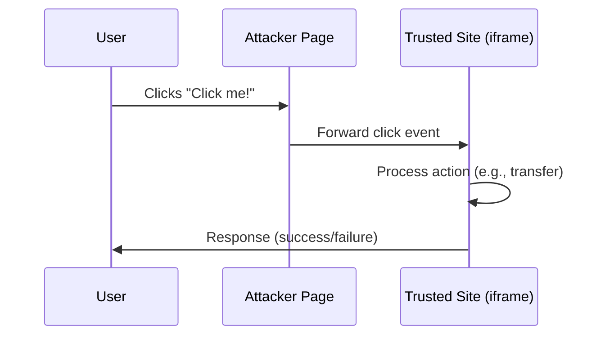

<!-- Generated by Groq via GitHub Actions -->
<!-- Topic ID: T134 -->
<!-- Category: Backend Security -->
<!-- Generated at UTC: 2026-10-25T17:09:41.568328+00:00 -->

# Clickjacking

## 1. What problem does this solve?

Clickjacking is a malicious technique where an attacker tricks a user into clicking on a hidden or disguised UI element that performs an unintended action on a trusted site.  

**Why it matters**

| Problem | Impact |
|---------|--------|
| A user thinks they are clicking “Play” on a video but actually submits a form that transfers money. | Unauthorized actions, data leaks, financial loss. |
| An attacker overlays a login form on a bank’s login page, capturing credentials. | Credential theft, account takeover. |
| A malicious iframe forces a user to like a page or share content without consent. | Reputation damage, spam. |

**What happens if it’s not mitigated?**

- Users can be coerced into performing actions they did not intend.
- Sensitive operations (e.g., fund transfers, admin changes) can be triggered without authentication.
- The site’s trustworthiness erodes, leading to churn and regulatory penalties.

**Where it appears in real backend systems**

- E‑commerce checkout flows (payment confirmation).
- Social media “share” or “like” buttons.
- Admin dashboards with critical actions (delete user, reset password).
- OAuth consent screens.

---

## 2. Mental model

**Analogy:**  
Imagine a magician’s stage. The audience sees a simple curtain (the legitimate UI). Behind the curtain, the magician (attacker) hides a lever that, when pulled, triggers a dangerous trap. The audience thinks they’re just watching a show; they never realize the lever is being pulled.

**Engineering model:**  
The attacker embeds a hidden iframe or overlay that loads the target site. The user interacts with the overlay, but the click is forwarded to the underlying iframe. The browser treats the click as if it originated from the user on the target site, bypassing normal UI controls.

---

## 3. Deep explanation

### Internals

1. **Iframe embedding** – The attacker hosts a page that includes `<iframe src="https://trusted.com/critical-action">`.
2. **CSS tricks** – The iframe is positioned off‑screen or made transparent (`opacity: 0; width: 0; height: 0;`).
3. **User interaction** – The attacker places a visible button or link that the user clicks. The click event bubbles to the iframe because the iframe is the underlying element.
4. **Same‑origin policy** – The browser allows the click to be forwarded, but JavaScript in the attacker’s page cannot read the iframe’s content. However, the click itself is sufficient to trigger actions.

### Important terminology

| Term | Meaning |
|------|---------|
| **X‑Frame‑Options** | HTTP header that tells browsers whether a page can be framed. |
| **Content‑Security‑Policy (CSP) – frame‑ancestors** | CSP directive that restricts which origins may embed a page. |
| **Same‑origin policy** | Browser security model that restricts cross‑origin scripting. |
| **Overlay** | A UI element that covers another element. |
| **Transparent iframe** | An iframe with `opacity: 0` or `visibility: hidden` but still receives events. |

### Trade‑offs

| Approach | Pros | Cons |
|----------|------|------|
| `X-Frame-Options: DENY` | Simple, widely supported. | Cannot allow framing for legitimate partners. |
| `X-Frame-Options: SAMEORIGIN` | Allows internal framing. | Still vulnerable to clickjacking if the attacker can host a page on the same origin (rare). |
| `Content-Security-Policy: frame-ancestors 'none'` | Fine‑grained control, can whitelist specific origins. | Requires CSP support; misconfiguration can break legitimate embeds. |
| **JavaScript frame busting** | Detects if page is framed and redirects. | Can be bypassed by modern browsers and CSP. |

### Failure modes

- **Header misconfiguration** – Typos (`DENY` vs `DENY`) or missing headers.
- **Browser quirks** – Some older browsers ignore CSP or X‑Frame‑Options.
- **Dynamic content** – If the page is served from multiple origins, CSP must account for all.
- **Content delivery networks (CDNs)** – Headers may be stripped or overridden.

### Limitations

- **Not a silver bullet** – Clickjacking protection only stops framing; it does not prevent other UI manipulation attacks (e.g., overlaying a transparent button).
- **User experience** – Overly restrictive framing can break legitimate integrations (e.g., embedded dashboards).
- **Legacy browsers** – Some older browsers lack CSP support.

### Where it fits in a backend architecture

- **HTTP layer** – Headers are set by the web server or application framework.
- **Middleware** – Express/Next.js middlewares can inject headers.
- **CDN** – Edge rules can enforce framing policies.
- **API layer** – Not directly relevant; clickjacking is a front‑end concern, but APIs must still validate CSRF tokens.

### Interaction with related concepts

| Concept | Interaction |
|---------|-------------|
| **CSRF** | Both rely on the browser’s same‑origin policy; CSRF tokens are needed even if clickjacking is mitigated. |
| **CSP** | CSP can replace X‑Frame‑Options for more flexibility. |
| **SameSite cookies** | Helps mitigate CSRF but not clickjacking. |
| **OAuth consent screens** | Must be protected from framing to prevent credential theft. |

---

## 4. How it works

1. **Attacker hosts malicious page**  
   ```html
   <button id="clickMe">Click me!</button>
   <iframe id="victim" src="https://trusted.com/transfer" style="position:absolute; top:0; left:0; width:100%; height:100%; opacity:0;"></iframe>
   ```
2. **User clicks button** – The click event propagates to the iframe.
3. **Browser forwards click to iframe** – The iframe receives the click as if the user clicked inside the trusted site.
4. **Trusted site processes action** – The action (e.g., money transfer) is executed with the user’s session.

**Mermaid diagram**



---

## 5. Practical implementation

### Setting protection headers in a Next.js API route

```ts
// pages/api/transfer.ts
import type { NextApiRequest, NextApiResponse } from 'next';

export default function handler(req: NextApiRequest, res: NextApiResponse) {
  // 1. Set X-Frame-Options to prevent framing
  res.setHeader('X-Frame-Options', 'DENY');

  // 2. Also set CSP frame-ancestors for modern browsers
  res.setHeader(
    'Content-Security-Policy',
    "frame-ancestors 'none';"
  );

  // 3. Handle the transfer logic (simplified)
  const { amount, toAccount } = req.body;
  // ... validate, authorize, perform transfer ...

  res.status(200).json({ status: 'success', amount, toAccount });
}
```

**Why this works**

- `X-Frame-Options: DENY` tells browsers that the page cannot be embedded in any frame.
- `frame-ancestors 'none'` is the CSP equivalent and is supported by all modern browsers.
- The headers are added at the API level; they apply to all responses from this route.

### Express middleware example

```ts
// middleware/csp.ts
import { Request, Response, NextFunction } from 'express';

export function cspMiddleware(req: Request, res: Response, next: NextFunction) {
  res.setHeader('Content-Security-Policy', "frame-ancestors 'none';");
  next();
}
```

```ts
// app.ts
import express from 'express';
import { cspMiddleware } from './middleware/csp';

const app = express();
app.use(cspMiddleware);
app.post('/transfer', transferHandler);
```

### Dockerfile snippet (ensuring headers at edge)

```dockerfile
# Use Nginx as reverse proxy
FROM nginx:alpine
COPY nginx.conf /etc/nginx/nginx.conf
```

```nginx
# nginx.conf
server {
  listen 80;
  location / {
    proxy_pass http://app:3000;
    add_header X-Frame-Options "DENY";
    add_header Content-Security-Policy "frame-ancestors 'none';";
  }
}
```

---

## 6. Production considerations

| Concern | Recommendation |
|---------|----------------|
| **Scalability** | Headers are lightweight; no performance hit. |
| **Reliability** | Ensure all entry points (API, static pages, CDN) set headers. Use automated tests to verify. |
| **Security** | Combine with CSRF tokens, SameSite cookies, and HTTPS. |
| **Observability** | Log header presence in access logs; alert if missing. |
| **Performance** | Minimal overhead; header size < 200 bytes. |
| **Error handling** | If a header is missing, return 500 with a clear message. |
| **Resource usage** | None significant. |
| **Operational concerns** | Update CDN edge rules when deploying new services. |
| **Failure recovery** | Rollback to previous config if framing errors occur. |
| **Deployment considerations** | Use CI/CD pipeline to inject headers automatically. |

---

## 7. Common mistakes

| Mistake | Why it’s problematic |
|---------|----------------------|
| **Only setting X-Frame-Options** | Modern browsers ignore it if CSP is present; also doesn’t cover all framing scenarios. |
| **Using `ALLOWALL` or omitting headers** | Leaves the site vulnerable to clickjacking. |
| **Setting headers on static assets only** | Dynamic pages (API responses) can still be framed. |
| **Relying on JavaScript frame busting** | Can be bypassed by CSP or modern browsers. |
| **Not testing across browsers** | Some older browsers may not enforce CSP, leading to false security. |
| **Over‑restricting framing** | Legitimate partners (e.g., embedded dashboards) cannot embed the site. |

---

## 8. Senior engineer perspective

### When used at scale

- **Architecture decisions**  
  - Centralize header injection in a reverse proxy (NGINX, Envoy) to avoid duplication.  
  - Use a shared library or middleware across services to enforce consistency.

- **Trade‑offs**  
  - `DENY` vs `SAMEORIGIN`: Choose based on whether internal framing is needed.  
  - CSP vs X‑Frame‑Options: CSP offers finer control but requires careful testing.

- **Bottlenecks**  
  - None; header injection is trivial.  
  - However, misconfiguring CSP can break legitimate integrations, causing traffic loss.

- **Failure scenarios**  
  - A misconfigured CDN rule can strip headers, exposing the site.  
  - A new microservice that forgets to set headers can become an attack vector.

- **Monitoring**  
  - Log header presence in access logs.  
  - Use a security scanner (OWASP ZAP, Burp) to verify framing protection.

- **Cost/performance**  
  - Negligible cost; no extra compute.  
  - Edge rules may incur a small CDN cost but are justified by security.

- **When NOT to use**  
  - If the service must be framed by trusted partners, use `frame-ancestors` with a whitelist instead of `DENY`.  
  - For internal dashboards, consider `SAMEORIGIN` and enforce strict same‑origin policies.

---

## 9. Interview questions

1. **Beginner** – *What is clickjacking and how does it differ from CSRF?*  
   *Answer:* Clickjacking tricks a user into clicking a hidden element; CSRF exploits a user’s authenticated session to perform actions. Both rely on the browser’s same‑origin policy but target different attack vectors.

2. **Beginner** – *Which HTTP header can prevent a page from being framed?*  
   *Answer:* `X-Frame-Options` (values: `DENY`, `SAMEORIGIN`, `ALLOW-FROM`).

3. **Senior** – *Explain how CSP’s `frame-ancestors` directive can replace `X-Frame-Options` and what considerations you must make when deploying it in a microservices architecture.*  
   *Answer:* `frame-ancestors` allows whitelisting specific origins; it’s more flexible and works with modern browsers. In microservices, you must ensure all services set consistent CSP headers, possibly via a shared middleware or edge proxy, and test that inter‑service framing (e.g., dashboards) still works.

4. **Senior** – *Describe a scenario where a misconfigured clickjacking protection could inadvertently block legitimate functionality. How would you mitigate this?*  
   *Answer:* A SaaS platform that embeds its admin panel in partner sites could be blocked by `DENY`. Mitigation: use `frame-ancestors` with a whitelist of partner domains, and test with partner integrations.

5. **Scenario/Debugging** – *A user reports that a “Transfer” button on your banking site no longer works after a recent deployment. You suspect a clickjacking header issue. How would you investigate and resolve it?*  
   *Answer:*  
   - Inspect network response headers for `X-Frame-Options` and `Content-Security-Policy`.  
   - Verify that the button is not inside an iframe.  
   - Check if a new CDN rule stripped headers.  
   - Restore previous header configuration or adjust the rule.  
   - Deploy a regression test that simulates the click to ensure functionality.

---

## 10. Hands‑on task

**Task:** Add clickjacking protection to an existing Next.js API route that processes user payments.

1. Create a middleware that sets `X-Frame-Options: DENY` and `Content-Security-Policy: frame-ancestors 'none';`.
2. Apply the middleware to all API routes in the project.
3. Write a unit test that sends a request to the `/api/pay` endpoint and asserts the headers are present.
4. Deploy the changes to a staging environment and use a browser console to verify that the page cannot be framed.

---

## 11. Quick revision

- Clickjacking tricks users into clicking hidden elements inside an iframe.
- Protect with `X-Frame-Options: DENY` or CSP `frame-ancestors 'none'`.
- CSP offers finer control; whitelist origins if needed.
- Combine with CSRF tokens and SameSite cookies for full protection.
- Verify headers on all entry points (API, static, CDN).
- Monitor header presence; alert if missing.
- Avoid JavaScript frame busting; it can be bypassed.
- In microservices, centralize header injection via middleware or edge proxy.
- Test across browsers; older browsers may ignore CSP.
- Misconfiguration can break legitimate framing; use whitelists carefully.

---

## 12. References

- [OWASP Clickjacking Prevention Cheat Sheet](https://cheatsheetseries.owasp.org/cheatsheets/Clickjacking_Prevention_Cheat_Sheet.html)
- [MDN Web Docs – X-Frame-Options](https://developer.mozilla.org/en-US/docs/Web/HTTP/Headers/X-Frame-Options)
- [MDN Web Docs – Content Security Policy (CSP)](https://developer.mozilla.org/en-US/docs/Web/HTTP/CSP)
- [Next.js Documentation – API Routes](https://nextjs.org/docs/api-routes/introduction)
- [Express.js Documentation – Response.setHeader](https://expressjs.com/en/4x/api.html#res.setHeader)
- [NGINX Documentation – add_header](https://nginx.org/en/docs/http/ngx_http_headers_module.html#add_header)
