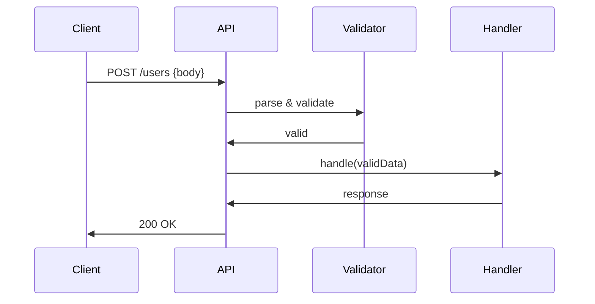

<!-- Generated by Groq via GitHub Actions -->
<!-- Topic ID: T135 -->
<!-- Category: Backend Security -->
<!-- Generated at UTC: 2026-10-26T06:34:42.348294+00:00 -->

# Request validation

## 1. What problem does this solve?

When a client sends data to a backend, the server must decide whether that data is **well‑formed, complete, and safe** before it can be processed.  
Without validation:

- **Security holes**: malformed payloads can trigger injection attacks, buffer overflows, or cause the server to crash.
- **Data integrity**: bad data can corrupt the database or lead to inconsistent state.
- **User experience**: clients receive vague errors or no feedback, making debugging hard.
- **Performance waste**: resources are spent on processing invalid requests.

In real systems, request validation appears in:

- REST/GraphQL APIs (JSON bodies, query params, headers)
- Webhooks (signature verification + schema checks)
- Microservice gRPC calls (proto validation)
- Serverless functions that receive HTTP events

## 2. Mental model

**Analogy**: Think of a **security guard at a club**.  
- The guard checks IDs (headers), confirms the guest list (schema), and ensures no one is bringing a prohibited item (type constraints).  
- If the guard lets someone in without a proper ID, the club could face legal trouble or a security breach.

**Engineering model**:  
- **Input** → **Validator** → **Cleaned/Typed Data** → **Business Logic**.  
- The validator is a gatekeeper that either accepts the input (passes it downstream) or rejects it with a clear error.

## 3. Deep explanation

### Internals

- **Schema definitions** (JSON Schema, Zod, Joi, pydantic, etc.) describe the shape, types, and constraints of expected data.
- **Parsing**: raw request body → parsed object (e.g., `JSON.parse`).
- **Validation**: the parsed object is checked against the schema.
- **Transformation**: optional coercion (e.g., string → number) and default values.
- **Error aggregation**: collect all violations to return a single error response.

### Important terminology

| Term | Meaning |
|------|---------|
| **Schema** | Declarative description of valid data. |
| **Validator** | Function or library that enforces a schema. |
| **Coercion** | Automatic type conversion during validation. |
| **Sanitization** | Removing or escaping unsafe characters. |
| **Error payload** | Structured information about why validation failed. |

### Trade‑offs

| Aspect | Pros | Cons |
|--------|------|------|
| **Strict schemas** | Prevents malformed data, easier debugging. | Adds overhead, may reject legitimate edge cases. |
| **Coercion** | Improves developer ergonomics. | Can mask bugs; unexpected type changes. |
| **Runtime validation** | Works with dynamic languages. | Slower than compile‑time checks. |
| **Schema‑first design** | Enables auto‑generated docs, client SDKs. | Requires maintenance of schema files. |

### Failure modes

- **Missing fields** → `400 Bad Request` with detailed message.
- **Wrong type** → same as above.
- **Extra fields** → either ignored or rejected, depending on policy.
- **Nested errors** → deep error trees can be hard to parse; flattening helps.

### Limitations

- Validation only checks **structure**; it does not guarantee business rules (e.g., “user must be at least 18”).
- Schemas can become large and hard to maintain if not modularized.
- Runtime validation can become a bottleneck under high load.

### Where it fits

```
Client
   │
   ▼
HTTP Request
   │
   ▼
API Gateway / Load Balancer
   │
   ▼
Request Validator (middleware)
   │
   ▼
Business Logic / Service
   │
   ▼
Database / External Service
```

It sits **before** business logic and **after** the transport layer. It also interacts with:

- **Authentication/Authorization** (e.g., ensuring a token is present before validating payload).
- **Rate limiting** (rejecting malformed requests early).
- **Logging/Tracing** (capturing validation failures).

## 4. How it works

1. **Receive request** – HTTP body, query, headers, path params.
2. **Parse** – Convert raw bytes to a JavaScript object (`JSON.parse`).
3. **Validate** – Run the object through a schema validator.
4. **Transform** – Coerce types, set defaults, sanitize.
5. **Handle errors** – If validation fails, return `400` with error details.
6. **Pass to handler** – If valid, forward the cleaned data to the route handler.



## 5. Practical implementation

### TypeScript / Node.js (Express + Zod)

```ts
// src/validators/user.ts
import { z } from 'zod';

export const createUserSchema = z.object({
  username: z.string().min(3).max(30),
  email: z.string().email(),
  age: z.number().int().min(0).optional(),
  // Nested object example
  address: z.object({
    street: z.string(),
    city: z.string(),
    zip: z.string().regex(/^\d{5}$/),
  }),
});
```

```ts
// src/middleware/validate.ts
import { Request, Response, NextFunction } from 'express';
import { ZodSchema } from 'zod';

export function validateBody<T>(schema: ZodSchema<T>) {
  return (req: Request, res: Response, next: NextFunction) => {
    const result = schema.safeParse(req.body);
    if (!result.success) {
      // Aggregate Zod errors into a flat array
      const errors = result.error.errors.map(err => ({
        path: err.path.join('.'),
        message: err.message,
      }));
      return res.status(400).json({ errors });
    }
    // Attach validated data to request for downstream handlers
    (req as any).validatedBody = result.data;
    next();
  };
}
```

```ts
// src/routes/user.ts
import express from 'express';
import { createUserSchema } from '../validators/user';
import { validateBody } from '../middleware/validate';

const router = express.Router();

router.post(
  '/users',
  validateBody(createUserSchema),
  async (req, res) => {
    const user = (req as any).validatedBody; // type: inferred from schema
    // Business logic: persist to DB, etc.
    const created = await db.users.create(user);
    res.status(201).json(created);
  }
);

export default router;
```

**Key points**

- `safeParse` returns a `Result` that contains either `data` or `error`.
- The middleware attaches the validated data to `req` so the handler can rely on type safety.
- Errors are returned as a structured JSON array, making it easy for clients to display.

### Optional: Redis cache for schema

If you have many schemas, you can cache them in Redis to avoid re‑parsing on every request. This is rarely necessary but can help in micro‑service environments.

## 6. Production considerations

| Concern | How validation helps / what to watch |
|---------|--------------------------------------|
| **Scalability** | Offload heavy validation to a separate middleware; use async validation only if needed. |
| **Reliability** | Reject malformed requests early to avoid downstream failures. |
| **Security** | Prevent injection by validating input types and lengths. |
| **Observability** | Log validation failures with request IDs; expose metrics (`validation_errors_total`). |
| **Performance** | Use lightweight schemas; avoid expensive regexes in hot paths. |
| **Error handling** | Return consistent error format; avoid leaking internal stack traces. |
| **Resource usage** | Validation is CPU‑bound; ensure enough CPU cores or use worker threads if needed. |
| **Operational concerns** | Keep schema definitions in versioned source control; use CI to test schema changes. |
| **Failure recovery** | If validation middleware crashes, fallback to a generic error handler. |
| **Deployment** | Validate schema changes against a staging environment before production. |

## 7. Common mistakes

| Mistake | Why it’s problematic |
|---------|----------------------|
| **Skipping validation for query params** | Query strings are untyped; missing values can cause runtime errors. |
| **Over‑strict schemas that reject legitimate data** | Users get blocked; reduces adoption. |
| **Using `any` or disabling type checks** | Loses compile‑time safety; bugs slip to production. |
| **Not sanitizing input** | Allows XSS or injection attacks. |
| **Returning raw error stacks** | Exposes internal implementation details to clients. |
| **Validating after business logic** | Wasteful; errors could have been caught earlier. |
| **Not handling async validation errors** | Unhandled promise rejections crash the process. |

## 8. Senior engineer perspective

### Architecture decisions

- **Centralized vs. per‑route validation**: A global middleware can catch all payloads but may be too generic; per‑route gives fine control.
- **Schema language**: JSON Schema for interoperability, Zod for TypeScript ergonomics, pydantic for Python.
- **Versioning**: Keep schemas versioned; expose API versioning to allow backward compatibility.

### Trade‑offs

- **Performance vs. safety**: In ultra‑high‑throughput services, you might skip validation for trusted internal calls.
- **Complexity vs. maintainability**: Large schemas can be split into reusable components.

### Bottlenecks

- **CPU‑bound validation**: Heavy regexes or deep nested objects can slow request handling. Profile and optimize.
- **Memory usage**: Storing large parsed objects before validation can spike memory; stream parsing for large uploads.

### Failure scenarios

- **Schema drift**: Backend updates schema but clients still send old format → 400 errors. Mitigate with backward‑compatible defaults.
- **Race conditions**: Concurrent schema updates in a distributed system; use feature flags.

### Monitoring

- Metrics: `validation_errors_total{status=400}` per endpoint.
- Alerts: Spike in validation errors may indicate a client bug or malicious traffic.

### Cost/performance

- Offload validation to a separate service if it becomes a cost driver (e.g., using a dedicated validation microservice).

### When NOT to use

- **Trusted internal services**: If both ends are controlled, you might skip validation to save CPU.
- **One‑off scripts**: For small CLI tools, inline checks may suffice.

## 9. Interview questions

1. **Beginner**: *What is request validation and why is it important?*  
   *Answer*: It ensures incoming data matches expected structure, preventing errors, security issues, and data corruption.

2. **Beginner**: *How would you validate a JSON payload in Express?*  
   *Answer*: Parse the body (`express.json()`), then use a library like Joi/Zod to check the shape; return 400 on failure.

3. **Senior**: *Explain how you would design a validation system that supports multiple API versions without duplicating code.*  
   *Answer*: Use a schema registry with version tags, compose schemas from reusable fragments, and route requests to the appropriate schema based on the `Accept` header or URL prefix.

4. **Senior**: *What are the performance implications of runtime validation in a high‑traffic service, and how would you mitigate them?*  
   *Answer*: CPU cost can be high; mitigate by caching compiled schemas, using async validation only when necessary, profiling, and possibly delegating validation to a separate service.

5. **Scenario/Debugging**: *A client reports that their request is failing with a 400 error, but the payload looks correct. How would you investigate?*  
   *Answer*:  
   - Enable detailed logging of validation errors with request IDs.  
   - Reproduce locally with the same payload.  
   - Check schema definitions for hidden constraints (e.g., regex, min/max).  
   - Verify that the request body is parsed correctly (e.g., content‑type).  
   - Look for differences between environments (e.g., missing defaults).  

## 10. Hands‑on task

**Goal**: Add request validation to an existing Express route that creates a blog post.

1. Create a Zod schema for the post payload: `title` (string, 5–100 chars), `content` (string, min 20), `tags` (array of strings, max 5), `publishedAt` (ISO date string, optional).
2. Implement a `validateBody` middleware that uses this schema.
3. Attach the middleware to the `/posts` POST route.
4. Write a unit test that sends an invalid payload and asserts a 400 response with error details.
5. (Optional) Add a Dockerfile that runs the app and runs the test.

## 11. Quick revision

- Validation ensures data integrity, security, and developer ergonomics.
- Schemas describe expected shape; validators enforce them.
- Use libraries like Zod (TS), Joi (JS), pydantic (Python).
- Validate **before** business logic; reject with 400 and structured errors.
- Coercion and defaults help but can mask bugs.
- Log validation failures; expose metrics.
- Avoid over‑strict schemas; support backward compatibility.
- In high‑traffic services, profile and cache compiled schemas.
- Keep schemas versioned and modular.
- Always sanitize inputs to prevent XSS/SQL injection.
- For microservices, consider a shared schema registry.

## 12. References

- [Zod – TypeScript-first schema validation](https://github.com/colinhacks/zod)
- [Express.js – Middleware](https://expressjs.com/en/guide/writing-middleware.html)
- [FastAPI – Pydantic models](https://fastapi.tiangolo.com/tutorial/validation/)
- [JSON Schema – Official spec](https://json-schema.org/)
- [OWASP – Input Validation Cheat Sheet](https://cheatsheetseries.owasp.org/cheatsheets/Input_Validation_Cheat_Sheet.html)
- [Mermaid – Sequence diagrams](https://mermaid-js.github.io/mermaid/#/sequenceDiagram)
