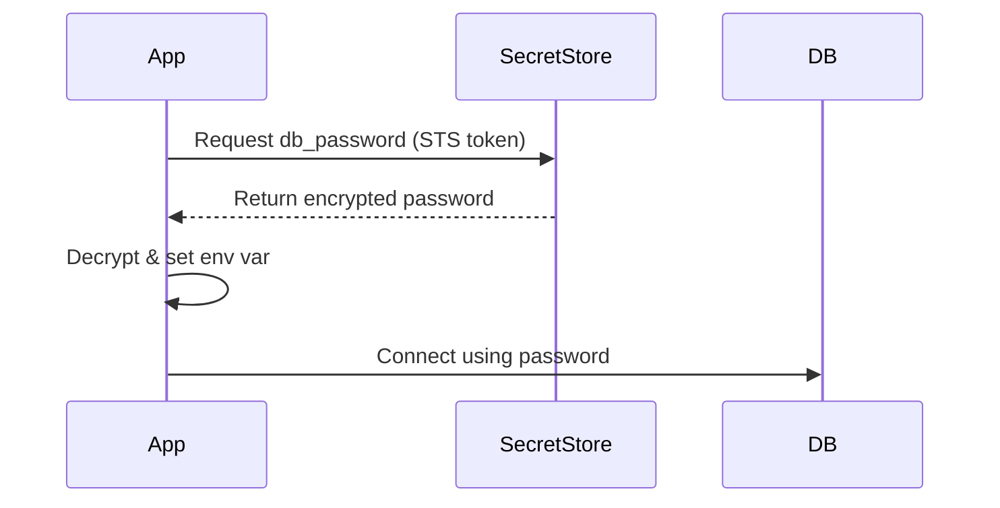

<!-- Generated by Groq via GitHub Actions -->
<!-- Topic ID: T137 -->
<!-- Category: Backend Security -->
<!-- Generated at UTC: 2026-10-26T19:29:01.143903+00:00 -->

# Secrets management

## 1. What problem does this solve?

**Motivation**  
When a backend service needs to talk to a database, an external API, or a message broker, it must authenticate itself. The credentials (passwords, API keys, certificates) are called *secrets*. If these secrets are mishandled, the entire system can be compromised.

**What problem exists**  
- Secrets are often stored in plain text (e.g., in source‑control, in environment variables, or in config files).
- Developers may copy secrets into code or commit them accidentally.
- Secrets may be duplicated across environments (dev, staging, prod) leading to drift.

**Why the problem matters**  
- A leaked secret can give attackers full access to a database or third‑party service.
- Compromised credentials can be used to exfiltrate data, inject malicious code, or launch denial‑of‑service attacks.
- Regulatory compliance (GDPR, PCI‑DSS) requires strict handling of credentials.

**What happens if this concept is not used**  
- Secrets may be exposed in logs, error messages, or version control.
- Manual rotation becomes error‑prone and slow.
- Auditing and compliance become impossible.

**Where this concept appears in real backend systems**  
- A microservice that reads a PostgreSQL password from an environment variable.
- A serverless function that pulls an API key from AWS Secrets Manager.
- A CI/CD pipeline that injects a JWT signing key into a Docker image at build time.

---

## 2. Mental model

**Analogy**  
Think of secrets as *keys to a vault*.  
- The vault is your production environment.  
- The keys must be kept safe, only given to authorized people, and replaced regularly.

**Engineering model**  
- **Secret store**: a secure, auditable repository (e.g., HashiCorp Vault, AWS Secrets Manager, Azure Key Vault).  
- **Access control**: IAM policies or role‑based access that limits who can read a secret.  
- **Injection**: secrets are injected into the runtime environment (environment variables, mounted files, or API calls) just before the application starts.  
- **Rotation**: secrets are periodically regenerated and the new value is propagated automatically.

---

## 3. Deep explanation

| Topic | Explanation |
|-------|-------------|
| **Internals** | A secret store typically stores values encrypted at rest, uses TLS for transport, and logs access. The store exposes an API (REST, gRPC, CLI) that the application calls to retrieve a secret. |
| **Important terminology** | *Secret*, *credential*, *token*, *rotation*, *vault*, *policy*, *role*, *access token*, *KMS*, *encryption‑at‑rest*. |
| **Trade‑offs** | <ul><li>**Centralized store**: easier to rotate, but introduces a single point of failure.</li><li>**Environment variables**: simple, but secrets can leak via process listings or logs.</li><li>**Mounted files**: safer than env vars, but still risk if the filesystem is compromised.</li></ul> |
| **Failure modes** | <ul><li>Secret store outage → application cannot start.</li><li>Mis‑configured IAM → unauthorized access.</li><li>Secret rotation failure → application uses stale credentials.</li></ul> |
| **Limitations** | <ul><li>Secrets are still stored in memory while the app runs.</li><li>Network latency to the secret store can affect startup time.</li><li>Some cloud providers limit the number of secrets per account.</li></ul> |
| **Where this concept fits** | In a typical backend architecture, the secret store sits behind the network perimeter. Services authenticate to it via short‑lived tokens (e.g., AWS STS). The application reads secrets at startup or on demand. |
| **Interaction with related concepts** | • **Configuration management** (dotenv, config files) – secrets are a subset of configuration.<br>• **CI/CD** – secrets are injected into pipelines.<br>• **Observability** – access logs from the secret store are part of audit trails.<br>• **Security** – secrets are the first line of defense; they must be protected by encryption, access control, and rotation. |

---

## 4. How it works

1. **Define the secret** in the secret store (e.g., `db_password`).
2. **Attach a policy** that allows the service’s IAM role to read the secret.
3. **Deploy the service** with a short‑lived token or role assumption (e.g., AWS IAM role).
4. **At startup**, the service calls the secret store API to fetch the secret.
5. **Inject the secret** into the process environment or a configuration object.
6. **Use the secret** to establish connections (DB, API, etc.).
7. **Rotate the secret** automatically; the service re‑fetches the new value without downtime.



---

## 5. Practical implementation

Below is a minimal Node.js/TypeScript example that fetches a PostgreSQL password from AWS Secrets Manager and uses it to connect via `pg`.

```ts
// src/secrets.ts
import { SecretsManagerClient, GetSecretValueCommand } from "@aws-sdk/client-secrets-manager";
import { config } from "dotenv";

config(); // Load .env for AWS credentials

const secretsClient = new SecretsManagerClient({ region: process.env.AWS_REGION });

export async function getSecret(secretName: string): Promise<string> {
  const command = new GetSecretValueCommand({ SecretId: secretName });
  const response = await secretsClient.send(command);

  if (!response.SecretString) {
    throw new Error(`Secret ${secretName} has no string value`);
  }
  return response.SecretString;
}
```

```ts
// src/db.ts
import { Pool } from "pg";
import { getSecret } from "./secrets";

export async function createPool(): Promise<Pool> {
  const password = await getSecret("prod/db_password");
  const pool = new Pool({
    host: process.env.DB_HOST,
    port: Number(process.env.DB_PORT),
    user: process.env.DB_USER,
    password,
    database: process.env.DB_NAME,
  });
  return pool;
}
```

```ts
// src/server.ts
import express from "express";
import { createPool } from "./db";

async function main() {
  const pool = await createPool();
  const app = express();

  app.get("/", async (_req, res) => {
    const { rows } = await pool.query("SELECT NOW() AS time");
    res.json(rows[0]);
  });

  app.listen(3000, () => console.log("Server listening on :3000"));
}

main().catch(console.error);
```

**Key points**

- Secrets are never hard‑coded or stored in the repo.  
- The service uses an IAM role (`AWS_REGION`, `AWS_ACCESS_KEY_ID`, `AWS_SECRET_ACCESS_KEY`) to authenticate to Secrets Manager.  
- The secret is fetched once at startup; you can cache it or refresh it on a schedule if needed.

---

## 6. Production considerations

| Concern | What to watch for | Mitigation |
|---------|-------------------|------------|
| **Scalability** | Many services may hit the secret store simultaneously. | Use caching (e.g., in‑memory or Redis) and enable secret store throttling limits. |
| **Reliability** | Secret store outage can bring down services. | Implement retry with exponential backoff; fallback to cached secret; use multiple regions. |
| **Security** | Secrets in memory, transport, or logs. | Encrypt at rest, use TLS, avoid printing secrets, use secure logging. |
| **Observability** | Need audit trails of secret access. | Enable access logs in the secret store; monitor for unusual access patterns. |
| **Performance** | Startup latency due to secret fetch. | Cache secrets; pre‑fetch during deployment; use short‑lived tokens. |
| **Error handling** | Missing or malformed secret. | Validate secret format; provide clear error messages; fail fast. |
| **Resource usage** | Memory consumption for secrets. | Keep secrets minimal; purge from memory after use if possible. |
| **Operational concerns** | Rotation schedules, IAM changes. | Automate rotation via CloudWatch Events or Vault policies; test IAM changes in staging. |
| **Failure recovery** | Secret rotation failure. | Use versioned secrets; keep old secret until new one is verified. |
| **Deployment considerations** | CI/CD pipelines must not expose secrets. | Store secrets in the CI provider’s secret store; inject via environment variables at runtime. |

---

## 7. Common mistakes

| Mistake | Why it’s problematic |
|---------|----------------------|
| Hard‑coding secrets in source code | Exposes credentials if repo is leaked; hard to rotate. |
| Storing secrets in plain text config files | Anyone with repo access can read them; risk of accidental commit. |
| Using environment variables without validation | Secrets can be overridden by malicious users or mis‑typed. |
| Not rotating secrets | Long‑lived credentials increase attack surface. |
| Ignoring access logs | No audit trail for who accessed a secret. |
| Using a single secret store for all services | Creates a single point of failure and a bottleneck. |
| Failing to handle secret fetch errors | Application may crash or use stale credentials. |

---

## 8. Senior engineer perspective

### What changes at scale?

- **Architecture decisions**  
  - *Centralized vs. decentralized*: A single vault per cluster vs. per‑service vaults.  
  - *Network placement*: Vault in a private subnet, accessible via VPC endpoints.  
  - *Token strategy*: Use short‑lived IAM roles or Kubernetes ServiceAccounts with OIDC.  

- **Trade‑offs**  
  - Central vault simplifies rotation but can become a bottleneck.  
  - Decentralized vaults reduce risk of a single outage but increase operational overhead.  

- **Bottlenecks**  
  - Secret store API limits (e.g., 5 000 requests/min).  
  - Network latency to the vault.  

- **Failure scenarios**  
  - Vault outage → all services fail to start.  
  - Mis‑configured ACL → unauthorized access or denial of service.  

- **Monitoring**  
  - Track secret read latency, error rates, and access counts.  
  - Alert on failed authentication attempts.  

- **Cost/performance**  
  - Cloud secret stores charge per request; caching mitigates cost.  
  - In‑memory caching reduces latency but increases memory footprint.  

- **When NOT to use**  
  - For very small, single‑instance services where the risk is low and the overhead of a vault outweighs benefits.  
  - When secrets are truly static and never need rotation (rare in production).  

---

## 9. Interview questions

1. **Beginner** – *What is a secret in the context of backend development?*  
   - *Answer:* A piece of sensitive data (password, API key, certificate) that must be protected and not exposed in code or logs.

2. **Beginner** – *Why should secrets not be stored in environment variables?*  
   - *Answer:* Env vars can be exposed via process listings, logs, or accidental commits; they also persist in memory longer than necessary.

3. **Senior** – *Explain how you would design a secret rotation strategy for a microservice that uses a database password.*  
   - *Answer points:* Use a secret store with versioning, schedule rotation via cron or cloud events, update the service via a sidecar or in‑process refresh, ensure backward compatibility, test rotation in staging, monitor for failures.

4. **Senior** – *What are the main risks of using a single centralized vault for all services, and how would you mitigate them?*  
   - *Answer points:* Single point of failure, performance bottleneck, access control complexity. Mitigation: use VPC endpoints, rate limiting, caching, multi‑region replication, fine‑grained IAM policies.

5. **Scenario/Debugging** – *Your service fails to start because it cannot fetch a secret from Vault. The logs show a 403 error. What steps would you take to debug and resolve this?*  
   - *Answer points:* Verify the service’s IAM role or Vault token has the correct policy; check ACLs and path permissions; confirm the secret exists and is not revoked; review Vault audit logs; ensure network connectivity (VPC, security groups); retry with correct credentials.

---

## 10. Hands‑on task

**Task:**  
Add secret management to the existing `nextjs-demo` repository.

1. Create a new secret in AWS Secrets Manager named `demo/db_password` with a random password.  
2. Update the `nextjs-demo` API route `/api/db` to fetch the password at runtime using the AWS SDK (similar to the example above).  
3. Store the database connection string in an environment variable that references the secret value.  
4. Deploy the updated API to a staging environment and verify that the database connection works.  
5. Document the steps you took and any challenges encountered.

---

## 11. Quick revision

- Secrets are sensitive credentials that must be protected from exposure.  
- Use a dedicated secret store (Vault, Secrets Manager, Key Vault).  
- Enforce fine‑grained access control (IAM, policies).  
- Fetch secrets at startup or on demand; cache if needed.  
- Rotate secrets regularly; automate rotation.  
- Never hard‑code secrets; avoid storing them in plain text.  
- Log all secret access for auditability.  
- Handle secret fetch failures gracefully.  
- Consider performance, reliability, and cost when scaling.  
- Use short‑lived tokens to limit exposure.  
- Monitor latency, error rates, and access patterns.  
- When in doubt, prefer a central vault over ad‑hoc env vars.

---

## 12. References

- [AWS Secrets Manager Documentation](https://docs.aws.amazon.com/secretsmanager/latest/userguide/intro.html)  
- [HashiCorp Vault Documentation](https://www.vaultproject.io/docs)  
- [Node.js AWS SDK v3](https://docs.aws.amazon.com/AWSJavaScriptSDK/v3/latest/index.html)  
- [PostgreSQL Node.js Driver (`pg`)](https://node-postgres.com/)  
- [Next.js API Routes](https://nextjs.org/docs/api-routes/introduction)  
- [OpenAPI Spec for Secrets](https://github.com/OAI/OpenAPI-Specification)  

---
