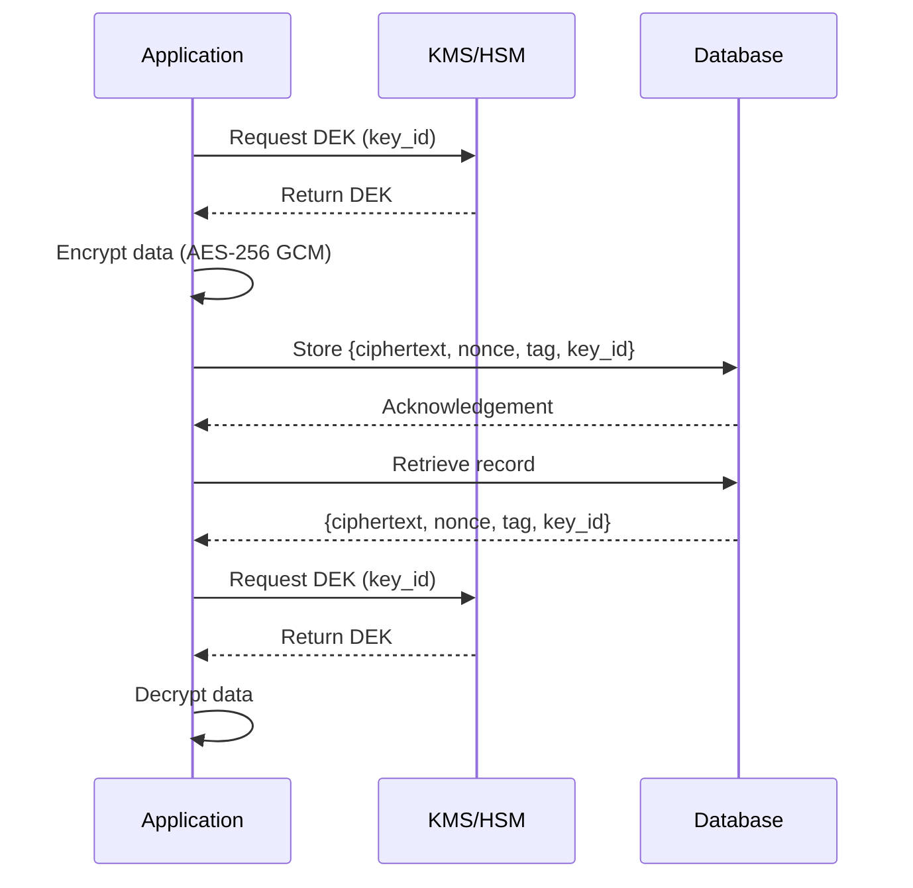

<!-- Generated by Groq via GitHub Actions -->
<!-- Topic ID: T138 -->
<!-- Category: Backend Security -->
<!-- Generated at UTC: 2026-10-26T19:29:01.143903+00:00 -->

# Encryption at rest

## 1. What problem does this solve?

- **Data exposure when storage media is compromised**  
  If a server, a backup disk, or a cloud object store is stolen, lost, or accessed by an attacker, the raw data on disk can be read immediately. Encryption at rest protects the data even if the underlying storage is compromised.

- **Compliance and privacy requirements**  
  Regulations such as GDPR, HIPAA, PCI‑DSS, and FedRAMP mandate that sensitive data be encrypted on disk. Failure to do so can lead to legal penalties and loss of customer trust.

- **Defense in depth**  
  Even if an attacker bypasses application‑level security (e.g., SQL injection), encrypted data remains unintelligible without the key.

- **Real‑world impact**  
  • A ransomware attack that encrypts a database file can be mitigated if the file is already encrypted and the key is stored separately.  
  • A disgruntled employee with physical access to a server can’t read the database files if they’re encrypted.

## 2. Mental model

**Analogy**  
Think of a safe deposit box. The box (storage) is locked with a key (encryption key). Even if someone steals the box, they can’t open it without the key. In the same way, encrypted files are like locked boxes; the key is required to unlock (decrypt) them.

**Engineering model**  
- **Data** → **Encryption layer** → **Encrypted bytes** → **Storage medium**  
  The encryption layer sits between the application and the storage system. When data is written, it is encrypted; when read, it is decrypted on the fly.

## 3. Deep explanation

### Internals
- **Symmetric encryption** (AES‑256 GCM is common) is used because it’s fast and suitable for bulk data.  
- **Key derivation**: Keys are derived from a master key using KDFs (e.g., HKDF) and stored in a Key Management Service (KMS).  
- **IV / nonce**: Each encryption operation uses a unique IV/nonce to ensure semantic security.  
- **Metadata**: Store the IV, authentication tag, and key identifier alongside the ciphertext.

### Important terminology
- **Encryption at rest**: Protecting data stored on disk or in persistent storage.  
- **Key Management Service (KMS)**: Centralized service for key generation, storage, rotation, and access control.  
- **Key rotation**: Periodically changing encryption keys to limit exposure.  
- **Transparent Data Encryption (TDE)**: Database‑level encryption that encrypts data pages automatically.  
- **Hardware Security Module (HSM)**: Physical device that stores keys and performs cryptographic operations.

### Trade‑offs
| Aspect | Pros | Cons |
|--------|------|------|
| **Performance** | Minimal overhead with modern CPUs (AES‑NI). | Slight CPU usage; I/O may be impacted by encryption/decryption. |
| **Complexity** | Strong security guarantees. | Requires key management, key rotation logic, and secure storage of keys. |
| **Scalability** | Works across distributed systems. | Key distribution to many nodes can be challenging. |
| **Compliance** | Meets regulatory requirements. | Misconfiguration can lead to non‑compliance. |

### Failure modes
- **Key loss** → Data becomes permanently inaccessible.  
- **Weak key management** → Keys exposed to attackers.  
- **Improper IV reuse** → Enables chosen‑plaintext attacks.  
- **Side‑channel leaks** (e.g., timing attacks) if not mitigated.

### Limitations
- Does **not** protect against **in‑memory** exposure or **application‑level** vulnerabilities.  
- Requires secure key storage; if the KMS is compromised, all data is at risk.  
- Does not protect against **data at rest** in backups unless backups are also encrypted.

### Where it fits in a backend architecture
```
┌───────────────────────┐
│  Application Layer    │
│  (Node.js / FastAPI)  │
└───────▲───────┬───────┘
        │       │
        │       │
┌───────▼───────┴───────┐
│  Encryption Layer   │
│  (AES‑256 GCM)       │
└───────▲───────┬───────┘
        │       │
        │       │
┌───────▼───────┴───────┐
│  Storage Layer      │
│  (PostgreSQL, S3)    │
└───────────────────────┘
```
The encryption layer can be implemented as a library in the application or as a database feature (e.g., PostgreSQL’s pgcrypto or TDE in cloud services).

### Interaction with related concepts
- **Encryption in transit**: Protects data while moving between services; encryption at rest protects it once stored.  
- **Access control**: Even encrypted data must be protected by fine‑grained IAM policies.  
- **Audit logging**: Must log key usage events for compliance.  
- **Backup strategy**: Backups must be encrypted or stored in a secure vault.

## 4. How it works

1. **Key generation** – A master key is generated in a KMS/HSM.  
2. **Key derivation** – For each data item, derive a unique data‑encryption key (DEK) using the master key and a KDF.  
3. **Encrypt** – Use AES‑256 GCM with a fresh nonce to encrypt the plaintext.  
4. **Store** – Persist the ciphertext, nonce, authentication tag, and key identifier.  
5. **Decrypt** – Retrieve the ciphertext, fetch the DEK from KMS, and decrypt with the same nonce.  



## 5. Practical implementation

Below is a minimal Node.js example using the `crypto` module and a mock KMS.

```ts
// encryption.ts
import { randomBytes, createCipheriv, createDecipheriv } from 'crypto';
import { getKmsKey } from './kms'; // Mock KMS

const ALGORITHM = 'aes-256-gcm';
const KEY_LENGTH = 32; // 256 bits

// Encrypt a string
export async function encrypt(plain: string, keyId: string) {
  const key = await getKmsKey(keyId); // 32‑byte Buffer
  const iv = randomBytes(12); // 96‑bit nonce for GCM

  const cipher = createCipheriv(ALGORITHM, key, iv);
  const encrypted = Buffer.concat([cipher.update(plain, 'utf8'), cipher.final()]);
  const tag = cipher.getAuthTag();

  return {
    ciphertext: encrypted.toString('base64'),
    iv: iv.toString('base64'),
    tag: tag.toString('base64'),
    keyId,
  };
}

// Decrypt the object returned by encrypt()
export async function decrypt(payload: {
  ciphertext: string;
  iv: string;
  tag: string;
  keyId: string;
}) {
  const key = await getKmsKey(payload.keyId);
  const decipher = createDecipheriv(
    ALGORITHM,
    key,
    Buffer.from(payload.iv, 'base64')
  );
  decipher.setAuthTag(Buffer.from(payload.tag, 'base64'));

  const decrypted = Buffer.concat([
    decipher.update(Buffer.from(payload.ciphertext, 'base64')),
    decipher.final(),
  ]);

  return decrypted.toString('utf8');
}
```

```ts
// kms.ts (mock)
import { randomBytes } from 'crypto';

const masterKey = randomBytes(32); // In production, store in KMS/HSM

export async function getKmsKey(keyId: string): Promise<Buffer> {
  // In a real system, keyId would map to a specific key in KMS.
  // Here we just return the master key for simplicity.
  return masterKey;
}
```

**Usage**

```ts
import { encrypt, decrypt } from './encryption';

(async () => {
  const secret = 'my super secret data';
  const keyId = 'key-123';

  const encrypted = await encrypt(secret, keyId);
  console.log('Encrypted payload:', encrypted);

  const decrypted = await decrypt(encrypted);
  console.log('Decrypted:', decrypted);
})();
```

> **Important**: In production, never store the master key in the application code. Use a managed KMS (AWS KMS, GCP KMS, Azure Key Vault) and rotate keys regularly.

## 6. Production considerations

| Concern | Practical advice |
|---------|------------------|
| **Scalability** | Offload encryption to a dedicated service or use database‑level TDE to avoid per‑request CPU overhead. |
| **Reliability** | Cache DEKs in memory with short TTLs to reduce KMS latency. |
| **Security** | Use hardware‑backed KMS, enforce least‑privilege IAM policies, enable key rotation, audit key usage. |
| **Observability** | Log key access events, monitor latency of encryption/decryption, alert on failed decryptions. |
| **Performance** | Benchmark CPU usage; consider using `crypto`’s native bindings or hardware acceleration (AES‑NI). |
| **Error handling** | Gracefully handle decryption failures (e.g., corrupted data) and provide clear error messages. |
| **Resource usage** | Keep key cache small; avoid storing large blobs in memory. |
| **Operational concerns** | Automate key rotation, maintain backup of encrypted data, ensure backups are also encrypted. |
| **Failure recovery** | If a key is lost, data is unrecoverable; maintain key recovery procedures. |
| **Deployment** | Use environment variables or secrets managers to pass KMS credentials; avoid hardcoding. |

## 7. Common mistakes

| Mistake | Why it’s problematic |
|---------|----------------------|
| **Using the same IV for multiple encryptions** | Enables nonce reuse attacks; data becomes vulnerable. |
| **Storing keys in source control** | Anyone with repo access can decrypt data. |
| **Encrypting only the database file but not the backup** | Backups remain exposed. |
| **Ignoring key rotation** | Long‑lived keys increase risk if compromised. |
| **Using weak algorithms (e.g., DES, 3DES)** | Easily breakable; not compliant. |
| **Assuming encryption at rest protects in‑memory data** | Data in RAM can still be read by attackers. |
| **Not separating key management from application logic** | Tight coupling makes scaling and security hard. |

## 8. Senior engineer perspective

### Architecture decisions
- **Database‑level TDE vs. application‑level encryption**  
  *TDE* is simpler to deploy but offers less granular control. Application‑level encryption allows per‑column or per‑record encryption and custom key rotation policies.

- **Centralized KMS vs. per‑service keys**  
  Centralized KMS simplifies key rotation and auditing but introduces a single point of failure. Per‑service keys reduce blast radius but increase operational overhead.

### Trade‑offs
- **Performance vs. security**: Offloading encryption to the database reduces application load but may limit key rotation frequency.  
- **Complexity vs. compliance**: Implementing fine‑grained encryption can satisfy stricter regulations but requires more code and testing.

### Bottlenecks
- **KMS latency**: Each encryption/decryption may incur network round‑trips. Mitigate with caching or local HSMs.  
- **CPU usage**: High‑throughput services may saturate CPU if encryption is done per request.

### Failure scenarios
- **KMS outage**: Decryption fails; service must fallback or reject requests gracefully.  
- **Key compromise**: Immediate revocation and re‑encryption of all affected data.

### Monitoring
- **Key access metrics**: Count requests per key, latency, failures.  
- **Encryption/decryption error rates**: Detect data corruption or key mismatches.  
- **Backup encryption status**: Ensure all backups are encrypted.

### Cost/performance
- **Cloud KMS pricing**: Each key operation incurs cost; batch operations reduce cost.  
- **Hardware acceleration**: Using CPUs with AES‑NI can reduce CPU cost.

### When NOT to use
- **Public data**: No need for encryption at rest.  
- **Low‑risk environments**: If regulatory requirements are minimal, simpler approaches may suffice.  
- **Very small datasets**: Overhead may outweigh benefits.

## 9. Interview questions

1. **Beginner**: *What is encryption at rest and why is it important?*  
   - Protects data stored on disk; mitigates data exposure if storage media is compromised.

2. **Beginner**: *What is the difference between encryption at rest and encryption in transit?*  
   - Rest encrypts data when stored; transit encrypts data while moving between services.

3. **Senior**: *How would you design a key rotation strategy for a large microservices architecture?*  
   - Use a central KMS, schedule periodic rotations, propagate new keys via cache invalidation, re‑encrypt data asynchronously, ensure backward compatibility.

4. **Senior**: *Explain how you would mitigate the risk of key compromise in a multi‑tenant SaaS platform.*  
   - Isolate keys per tenant, use hardware‑backed KMS, enforce strict IAM, monitor key access, rotate keys frequently, audit logs, use separate HSMs per tenant if necessary.

5. **Scenario/Debugging**: *You notice that decrypting a record fails with an authentication tag mismatch. What could be the cause and how would you troubleshoot?*  
   - Possible causes: IV reuse, corrupted ciphertext, wrong key, missing tag.  
   - Troubleshoot: Verify IV uniqueness, check key consistency, inspect storage for corruption, enable detailed logging, compare with backup.

## 10. Hands‑on task

Implement a simple Express middleware that automatically encrypts and decrypts JSON request bodies and responses using the encryption functions from section 5.  
- Store encrypted payloads in a PostgreSQL table with columns: `id`, `ciphertext`, `iv`, `tag`, `key_id`.  
- Add endpoints to create, read, and delete records.  
- Verify that data is stored encrypted in the database by inspecting the raw table rows.

## 11. Quick revision

- Encryption at rest protects data on disk from physical theft or unauthorized access.  
- Use symmetric algorithms (AES‑256 GCM) with unique IVs per encryption.  
- Store keys in a KMS/HSM; never hardcode them.  
- Cache DEKs to reduce KMS latency.  
- Rotate keys regularly; keep audit logs of key usage.  
- TDE is database‑level; application‑level gives fine‑grained control.  
- Failure modes: key loss, IV reuse, weak algorithms.  
- Monitor key access, decryption errors, and backup encryption status.  
- Avoid encrypting public or low‑risk data to reduce overhead.  
- In production, balance performance, security, and operational complexity.

## 12. References

- https://docs.aws.amazon.com/kms/latest/developerguide/overview.html  
- https://cloud.google.com/kms/docs/overview  
- https://learn.microsoft.com/en-us/azure/key-vault/general/overview  
- https://www.postgresql.org/docs/current/pgcrypto.html  
- https://www.owasp.org/index.php/Encryption_at_rest  
- https://www.nist.gov/publications/cryptographic-standards-and-guidelines-application-security-cryptography  
- https://nodejs.org/api/crypto.html  
- https://www.ietf.org/rfc/rfc8452.txt (AES‑GCM)
