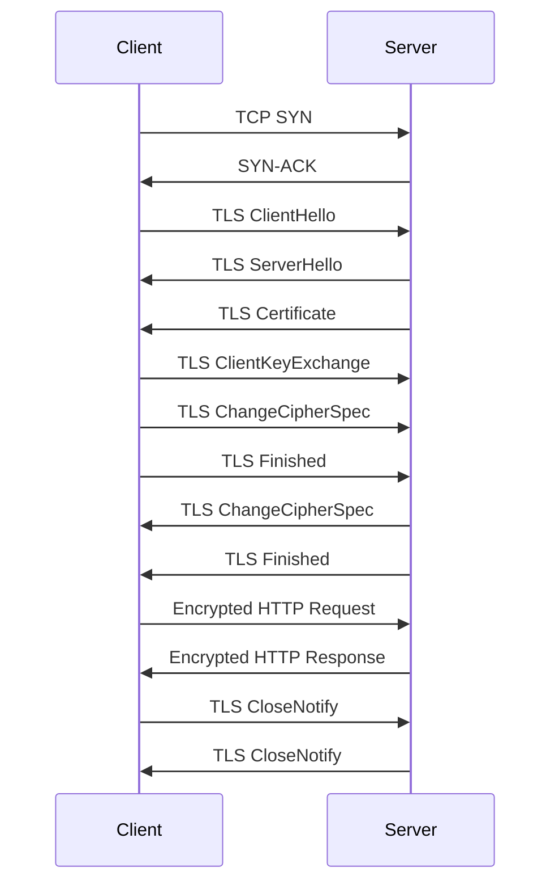

<!-- Generated by Groq via GitHub Actions -->
<!-- Topic ID: T139 -->
<!-- Category: Backend Security -->
<!-- Generated at UTC: 2026-10-27T06:30:31.398940+00:00 -->

# Encryption in transit

## 1. What problem does this solve?

- **Problem**: Data traveling between services (client ↔ server, microservice ↔ database, service ↔ message broker) can be intercepted, tampered with, or replayed by an attacker who can eavesdrop on the network.
- **Why it matters**:  
  - Confidentiality: Sensitive user data (PII, auth tokens, payment info) must not be exposed.  
  - Integrity: An attacker could modify requests or responses, leading to incorrect application state or injection attacks.  
  - Authentication: Without a secure channel, an attacker could impersonate a client or service.  
- **Consequences of not using encryption in transit**:  
  - Man‑in‑the‑middle (MITM) attacks.  
  - Credential theft, session hijacking.  
  - Data corruption or loss of trust.  
- **Real‑world appearance**:  
  - HTTPS for web APIs.  
  - TLS for PostgreSQL, MySQL, MongoDB, Redis, Kafka.  
  - Mutual TLS (mTLS) between microservices in a service mesh.  
  - VPN or dedicated links (e.g., AWS PrivateLink) for inter‑region traffic.

## 2. Mental model

### Analogy  
Think of sending a letter through a **sealed envelope** that only the recipient can open.  
- The envelope protects the letter from anyone who intercepts it.  
- If the envelope is tampered with, the recipient can see it (e.g., a broken seal).  
- If you want to prove you sent the letter, you can sign it inside the envelope.

### Engineering model  
- **TLS (Transport Layer Security)** is the digital equivalent of that sealed envelope.  
- **Certificates** are the keys that lock/unlock the envelope.  
- **Cipher suites** decide how the lock is made (which algorithms).  
- **Handshake** is the process of exchanging keys and agreeing on the cipher.  
- **Encrypted payload** is the letter inside the envelope.

## 3. Deep explanation

| Topic | Explanation |
|-------|-------------|
| **Internals** | TLS uses a combination of asymmetric (public/private key) and symmetric encryption. The client and server perform a handshake (e.g., TLS 1.3) to agree on a shared secret, then use that secret to encrypt traffic with a fast symmetric cipher (AES‑GCM). |
| **Important terminology** | • **Certificate Authority (CA)** – trusted entity that signs certificates.<br>• **Certificate chain** – sequence of certificates up to a trusted root.<br>• **Cipher suite** – combination of key exchange, authentication, encryption, and MAC algorithms.<br>• **Key exchange** – Diffie‑Hellman (ECDHE) or RSA.<br>• **Mutual TLS (mTLS)** – both sides present certificates. |
| **Trade‑offs** | • **Performance**: TLS adds CPU overhead; modern hardware acceleration mitigates this.<br>• **Complexity**: Managing certificates, revocation, and rotation can be hard.<br>• **Latency**: Handshake adds a round‑trip; session resumption reduces this. |
| **Failure modes** | • **Certificate expiration** – traffic fails until renewed.<br>• **Wrong cipher suite** – handshake fails if client/server don’t share a common suite.<br>• **Mis‑configured trust store** – clients reject valid certificates.<br>• **Downgrade attacks** – forcing older, weaker TLS versions. |
| **Limitations** | • TLS protects only the transport layer; application‑level encryption (e.g., field‑level) is still needed for some use cases.<br>• Does not protect against insider threats or compromised endpoints. |
| **Where it fits** | • **API gateways**: terminate TLS and forward to internal services over plain HTTP or mTLS.<br>• **Databases**: enable `sslmode=require` in PostgreSQL, `tls=true` in MongoDB.<br>• **Message brokers**: Kafka `security.protocol=SSL` or `SASL_SSL`. |
| **Interaction with other concepts** | • **Service mesh**: mTLS is often handled by Envoy/Linkerd.<br>• **Zero‑trust**: every service verifies the identity of its peers.<br>• **Observability**: TLS termination can expose plaintext for logging; consider end‑to‑end encryption if needed. |

## 4. How it works

1. **Client initiates connection** to server’s TLS port (443, 8443, etc.).  
2. **Server sends its certificate** (and optional chain).  
3. **Client validates** the certificate chain against its trust store.  
4. **Client and server perform key exchange** (ECDHE‑RSA, etc.) to derive a shared secret.  
5. **Both sides negotiate a cipher suite** and generate symmetric keys.  
6. **Handshake completes**; all subsequent data is encrypted with the symmetric key.  
7. **Application data flows** over the encrypted channel.  
8. **Connection termination**: both sides close the TLS session gracefully.



## 5. Practical implementation

### 5.1 HTTPS server with Node.js (Express)

```ts
// server.ts
import express from 'express';
import https from 'https';
import fs from 'fs';
import path from 'path';

const app = express();
app.get('/', (_, res) => res.send('Hello, secure world!'));

const options = {
  key: fs.readFileSync(path.join(__dirname, 'certs', 'server.key')),
  cert: fs.readFileSync(path.join(__dirname, 'certs', 'server.crt')),
  // Optional: enforce strong cipher suites
  ciphers: [
    'ECDHE-ECDSA-AES256-GCM-SHA384',
    'ECDHE-RSA-AES256-GCM-SHA384',
  ].join(':'),
  honorCipherOrder: true,
};

https.createServer(options, app).listen(8443, () => {
  console.log('HTTPS server listening on https://localhost:8443');
});
```

> **Key points**  
> - `key`/`cert` are the server’s private key and certificate.  
> - `ciphers` restricts the server to strong suites.  
> - `honorCipherOrder` forces the server’s preference.

### 5.2 HTTP client with TLS (Axios)

```ts
// client.ts
import axios from 'axios';
import https from 'https';
import fs from 'fs';
import path from 'path';

const agent = new https.Agent({
  // Client cert for mTLS (optional)
  cert: fs.readFileSync(path.join(__dirname, 'certs', 'client.crt')),
  key: fs.readFileSync(path.join(__dirname, 'certs', 'client.key')),
  // Trust only our CA
  ca: fs.readFileSync(path.join(__dirname, 'certs', 'ca.crt')),
  rejectUnauthorized: true, // fail if cert is invalid
});

axios
  .get('https://localhost:8443/', { httpsAgent: agent })
  .then((res) => console.log(res.data))
  .catch((err) => console.error(err));
```

### 5.3 PostgreSQL over TLS

```ts
// db.ts
import { Client } from 'pg';
import fs from 'fs';
import path from 'path';

const client = new Client({
  host: 'db.internal',
  port: 5432,
  user: 'app_user',
  password: 's3cr3t',
  database: 'appdb',
  ssl: {
    ca: fs.readFileSync(path.join(__dirname, 'certs', 'ca.crt')).toString(),
    cert: fs.readFileSync(path.join(__dirname, 'certs', 'client.crt')).toString(),
    key: fs.readFileSync(path.join(__dirname, 'certs', 'client.key')).toString(),
    rejectUnauthorized: true,
  },
});

await client.connect();
```

### 5.4 Redis over TLS

```ts
// redis.ts
import { createClient } from 'redis';
import fs from 'fs';
import path from 'path';

const client = createClient({
  socket: {
    host: 'redis.internal',
    port: 6379,
    tls: {
      ca: fs.readFileSync(path.join(__dirname, 'certs', 'ca.crt')).toString(),
      cert: fs.readFileSync(path.join(__dirname, 'certs', 'client.crt')).toString(),
      key: fs.readFileSync(path.join(__dirname, 'certs', 'client.key')).toString(),
      rejectUnauthorized: true,
    },
  },
});

await client.connect();
```

> **Tip**: Use environment variables for paths and secrets; never commit certs to source control.

## 6. Production considerations

| Concern | What to watch for | Mitigations |
|---------|-------------------|-------------|
| **Scalability** | TLS handshake is CPU‑heavy; many concurrent connections can saturate CPU. | Use TLS session resumption, enable hardware crypto acceleration, load‑balance across nodes. |
| **Reliability** | Certificate expiration or revocation causes outages. | Automate renewal (Let’s Encrypt + certbot), use ACME clients, monitor expiry dates. |
| **Security** | Weak cipher suites, outdated TLS versions. | Enforce TLS 1.3, disable TLS 1.0/1.1, use strong ciphers, keep OpenSSL/LibreSSL up‑to‑date. |
| **Observability** | Encrypted traffic hides payloads; logs may contain only metadata. | Log connection metadata (IP, TLS version, cipher), use TLS termination proxies for debugging. |
| **Performance** | Handshake latency, encryption overhead. | Use session tickets, enable `ssl_prefer_server_ciphers`, consider HTTP/2 multiplexing. |
| **Error handling** | Clients misconfigured to trust wrong CA. | Provide clear error messages, use certificate pinning in critical clients. |
| **Resource usage** | TLS context per connection consumes memory. | Reuse contexts, limit max concurrent connections, use connection pooling. |
| **Operational concerns** | Managing many certificates across services. | Centralized CA (e.g., Vault, cert-manager), automated issuance, revocation lists. |
| **Failure recovery** | Sudden CA compromise. | Rotate certificates, use short-lived certs, monitor for revocation. |
| **Deployment** | Docker images need CA bundles. | Include CA certificates in images or mount as secrets; use `--mount type=secret`. |

## 7. Common mistakes

| Mistake | Why it’s bad |
|---------|--------------|
| Using self‑signed certs in production | Clients reject them; opens door for MITM. |
| Leaving `rejectUnauthorized: false` | Allows any certificate, including malicious ones. |
| Hard‑coding cert paths in code | Hard to rotate, insecure if repo is compromised. |
| Not enabling TLS 1.3 | Exposes to older, weaker protocols. |
| Forgetting to set `honorCipherOrder` | Client may choose a weak cipher. |
| Using the same key for multiple services | Compromise of one key compromises all services. |
| Not renewing certificates | Traffic fails after expiry. |
| Ignoring certificate revocation lists (CRLs) or OCSP | Compromised certs may still be accepted. |
| Not using session resumption | Extra handshake overhead for every request. |

## 8. Senior engineer perspective

### Scale‑level changes

- **Architecture**: Deploy a dedicated TLS termination layer (API gateway, Envoy) to offload handshake work from application servers.  
- **Certificate management**: Use a centralized CA (HashiCorp Vault, AWS ACM, cert‑manager) with automated issuance and rotation.  
- **Observability**: Instrument TLS metrics (handshake latency, cipher usage) with Prometheus; correlate with application logs.  
- **Security**: Adopt zero‑trust: every service authenticates peers via mTLS; use short‑lived certificates (e.g., 24 h).  
- **Performance**: Enable HTTP/2 or HTTP/3 to reduce per‑connection overhead; consider TLS session tickets or session caching.  
- **Cost**: TLS termination can increase CPU usage; evaluate whether to use hardware load balancers or cloud‑managed TLS (ALB, CloudFront).  

### Design decisions

| Decision | Trade‑off |
|----------|-----------|
| **mTLS vs. TLS only** | mTLS adds overhead but provides stronger authentication. |
| **Self‑signed CA vs. public CA** | Self‑signed gives full control but requires internal trust store; public CA simplifies client trust. |
| **TLS termination at edge vs. end‑to‑end** | Edge termination simplifies backend but exposes plaintext to gateway; end‑to‑end preserves confidentiality end‑to‑end. |
| **Session resumption** | Improves performance but requires stateful session cache. |
| **Certificate rotation frequency** | Shorter rotation reduces window of compromise but increases operational load. |

### Bottlenecks & failure scenarios

- **CPU saturation**: Mitigate with load balancers, hardware acceleration, or off‑loading to dedicated TLS proxies.  
- **Certificate revocation delays**: Use OCSP stapling or short‑lived certs to avoid reliance on revocation checks.  
- **Mis‑configured trust stores**: Leads to widespread connection failures; enforce automated validation.  

### Monitoring & cost

- **Metrics**: `tls.handshake.duration`, `tls.handshake.failures`, `tls.cipher`, `tls.version`.  
- **Logs**: Record handshake success/failure, certificate details.  
- **Cost**: TLS termination on managed services (e.g., AWS ALB) may add per‑GB charges; evaluate against in‑house load balancers.

### When NOT to use TLS

- **Local, isolated networks** where all traffic is already protected by a VPN or private link.  
- **Very low‑latency, high‑frequency micro‑transactions** where TLS overhead outweighs benefits (rare in modern cloud).  
- **Legacy systems** that cannot support TLS without significant rewrites; consider phased migration.

## 9. Interview questions

1. **Beginner**: *What is the purpose of the TLS handshake?*  
   *Answer*: To authenticate the server (and optionally client), agree on a cipher suite, and establish a shared secret for symmetric encryption.

2. **Beginner**: *Why do we use certificates instead of just passwords for TLS?*  
   *Answer*: Certificates provide asymmetric cryptography, allowing secure key exchange without pre‑shared secrets and enabling automated trust via CAs.

3. **Senior**: *Explain how TLS 1.3 improves performance over TLS 1.2.*  
   *Answer*: TLS 1.3 removes the “fallback” round‑trip, uses a single round‑trip for handshake, eliminates static RSA key exchange, and uses AEAD ciphers by default, reducing latency and CPU usage.

4. **Senior**: *Design a strategy for rotating TLS certificates in a microservice architecture with 50 services.*  
   *Answer*: Use a centralized CA (e.g., Vault), automate issuance via ACME, store certs as Kubernetes secrets, implement a sidecar that watches for changes and reloads TLS contexts, schedule rotation during low‑traffic windows, and monitor for failures.

5. **Scenario/Debugging**: *A client receives “certificate verify failed” when connecting to your API. What steps would you take to diagnose and fix the issue?*  
   *Answer*:  
   - Verify the client’s trust store contains the CA that signed the server cert.  
   - Check the server’s certificate chain (openssl s_client -showcerts).  
   - Ensure the server’s cert is not expired and matches the hostname.  
   - Confirm the server is presenting the full chain.  
   - If using mTLS, ensure the client presents a valid cert.  
   - Review logs for TLS handshake errors.  
   - If using a load balancer, ensure it forwards the correct cert.  

## 10. Hands‑on task

**Goal**: Set up a minimal Node.js microservice that exposes an HTTPS endpoint, requires mTLS from clients, and connects to a PostgreSQL database over TLS.

**Steps**:

1. Generate a root CA, server cert, and client cert using OpenSSL.  
2. Create an Express server (`server.ts`) that listens on 8443 with TLS options and requires client cert (`requestCert: true`).  
3. Add a `/health` endpoint that queries PostgreSQL (`SELECT 1`) over TLS.  
4. Write a simple client script (`client.ts`) that uses Axios with the client cert to call `/health`.  
5. Run the server and client, verify that requests succeed only with the correct client cert.  
6. Introduce a failing scenario (e.g., expired client cert) and observe the error.

**Deliverables**:  
- `certs/` directory with CA, server, and client certs.  
- `server.ts` and `client.ts` files.  
- `README.md` explaining how to run and test.

## 11. Quick revision

- TLS encrypts data in transit, protecting confidentiality, integrity, and authentication.  
- Handshake: client → server cert → key exchange → cipher agreement → encrypted channel.  
- TLS 1.3 removes a round‑trip, uses AEAD, and requires TLS 1.3 or higher.  
- mTLS authenticates both sides; useful in service meshes.  
- Certificates must be signed by a trusted CA, kept fresh, and stored securely.  
- Use `rejectUnauthorized: true` in clients; never disable verification.  
- Session resumption (tickets or caching) reduces handshake overhead.  
- Monitor handshake latency, failure rates, and cipher usage.  
- Automate certificate issuance/rotation (Let’s Encrypt, Vault).  
- For databases and brokers, enable `sslmode=require` or equivalent.  
- Avoid hard‑coding cert paths; use secrets management.

## 12. References

- https://www.openssl.org/docs/man1.1.1/man7/TLSv1_3-Ciphers.html  
- https://www.rfc-editor.org/rfc/rfc8446  
- https://nodejs.org/api/https.html  
- https://nodejs.org/api/tls.html  
- https://www.postgresql.org/docs/current/ssl-tcp.html  
- https://redis.io/docs/management/security/ssl/  
- https://kafka.apache.org/documentation/#security_ssl  
- https://docs.aws.amazon.com/elasticloadbalancing/latest/application/create-https-listener.html  
- https://cert-manager.io/docs/  
- https://www.hashicorp.com/products/vault  

---
