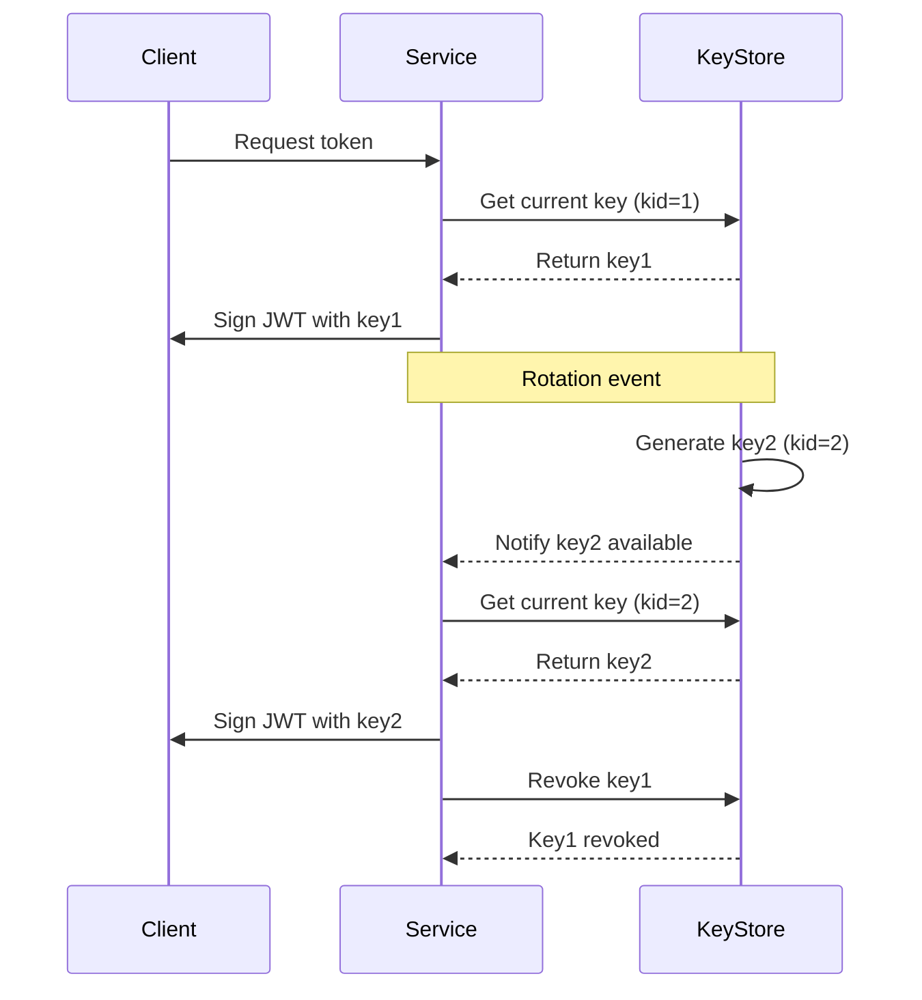

<!-- Generated by Groq via GitHub Actions -->
<!-- Topic ID: T140 -->
<!-- Category: Backend Security -->
<!-- Generated at UTC: 2026-10-27T06:30:31.398940+00:00 -->

# Key rotation

## 1. What problem does this solve?

**Motivation**  
Every backend service uses cryptographic keys or secrets to protect data, authenticate users, or secure communication. If a key is compromised, all data encrypted or signed with that key becomes vulnerable. Even if a key is not compromised, over time keys can become weak (e.g., due to advances in cryptanalysis) or simply become stale.

**What problem exists**  
- **Key compromise**: An attacker who obtains a key can decrypt data, forge tokens, or impersonate services.  
- **Key leakage**: Keys accidentally exposed in logs, source control, or environment variables.  
- **Key aging**: Keys that have been in use for a long time may be more likely to be cracked or misused.  
- **Compliance**: Many regulations (PCI‑DSS, HIPAA, GDPR) require periodic key rotation.

**Why the problem matters**  
- **Data confidentiality**: If a key is reused indefinitely, a single breach can expose all past data.  
- **Integrity**: Old signing keys can be used to forge tokens if not revoked.  
- **Availability**: Stale keys can cause service outages if not updated across all nodes.  
- **Auditability**: Without rotation, it’s hard to prove that a system follows best‑practice security policies.

**What happens if this concept is not used**  
- A single compromised key can lead to a cascading failure of all services that rely on it.  
- Regulatory fines for non‑compliance.  
- Loss of customer trust and potential legal liability.

**Where this concept appears in real backend systems**  
- JWT signing keys for authentication.  
- TLS certificates and private keys for HTTPS.  
- Database credentials (PostgreSQL, MongoDB).  
- API keys for third‑party services.  
- Encryption keys for data at rest (e.g., S3 object encryption, encrypted PostgreSQL columns).  
- Secrets stored in Vault, AWS KMS, or HashiCorp Vault.

---

## 2. Mental model

**Analogy**  
Think of a house with a front door lock. If you keep the same key forever, a burglar who finds the key can open the door anytime. By changing the lock (or the key) regularly, you reduce the window of opportunity for the burglar. The lock itself is the *key*; the lock’s mechanism is the *key management system* that knows which lock is current.

**Engineering model**  
- **Key**: The secret value (e.g., a 256‑bit AES key or RSA private key).  
- **Key store**: A secure repository (KMS, Vault, HSM) that holds keys and their metadata.  
- **Key version**: Each time a key is rotated, a new version is created and the old one is retired.  
- **Key usage**: A service fetches the current key version to encrypt/decrypt or sign/verify.  
- **Key rotation policy**: Rules that define when and how often keys are rotated (e.g., every 90 days, after a breach, or on demand).  
- **Key revocation**: The process of marking a key as unusable before it naturally expires.

---

## 3. Deep explanation

### Internals
- **Key generation**: Use a cryptographically secure RNG (e.g., `crypto.randomBytes` or KMS).  
- **Key storage**: Store keys in an HSM or KMS; never hard‑code them in code or config files.  
- **Key metadata**: Keep creation time, expiration, usage policy, and a unique identifier (e.g., `kid`).  
- **Key distribution**: Services retrieve keys via API calls to the key store; caching is common for performance.  

### Important terminology
- **Key lifecycle**: Creation → Activation → Use → Retirement → Deletion.  
- **Key rotation**: The act of replacing an active key with a new one.  
- **Key revocation**: Explicitly marking a key as invalid before its natural expiry.  
- **Key versioning**: Assigning a monotonically increasing number or UUID to each key.  
- **Key derivation**: Generating a key from a master secret (e.g., using HKDF).  

### Trade‑offs
| Aspect | Benefit | Drawback |
|--------|---------|----------|
| **Automatic rotation** | Reduces human error, improves security | Requires orchestration, can cause downtime if not coordinated |
| **Centralized KMS** | Single source of truth, audit logs | Single point of failure, network latency |
| **Local key cache** | Low latency | Risk of stale keys, need cache invalidation |
| **Short key lifetimes** | Limits exposure | More frequent key management operations |
| **Long key lifetimes** | Less operational overhead | Higher risk if compromised |

### Failure modes
- **Key loss**: If a key is deleted before all services have switched, data becomes unreadable.  
- **Key mismatch**: Services using different key versions for encryption/decryption.  
- **Cache staleness**: Cached keys not refreshed after rotation.  
- **Revocation lag**: Old keys still accepted by some services.  
- **Downtime**: Services cannot start if they cannot fetch the current key.

### Limitations
- Keys embedded in static binaries or client apps cannot be rotated without a new release.  
- Distributed systems with many replicas need a coordination mechanism to propagate new keys.  
- Some legacy protocols (e.g., TLS 1.0) may not support dynamic key updates.

### Where this concept fits in a backend architecture
- **Auth layer**: JWT signing keys, OAuth client secrets.  
- **Data layer**: Encryption keys for database columns, file storage.  
- **Transport layer**: TLS certificates.  
- **Infrastructure layer**: API gateway secrets, service mesh mTLS keys.  

### Interaction with related concepts
- **Secrets management**: Key rotation is a subset of secrets lifecycle.  
- **CI/CD pipelines**: Deployments must handle key changes (e.g., env var updates).  
- **Observability**: Rotation events should be logged and monitored.  
- **Compliance**: Rotation policies often map to regulatory requirements.

---

## 4. How it works

1. **Generate a new key** (e.g., 256‑bit AES or RSA 2048).  
2. **Store the key** in a secure key store with a unique `kid`.  
3. **Publish the new key** to all services (via API, webhook, or configuration push).  
4. **Update service configuration** to use the new `kid` for encryption/signing.  
5. **Mark the old key** as retired; optionally keep it for a grace period.  
6. **Revoke the old key** from the key store (prevent future use).  
7. **Cleanup**: Delete the old key after all data encrypted with it has been re‑encrypted or after a safe period.



---

## 5. Practical implementation

Below is a minimal Node.js example that demonstrates JWT key rotation using Redis as a key store.  
The app keeps a `current_kid` key in Redis and stores each key under `key:{kid}`.

```ts
// key-rotation.ts
import { createSign, createVerify } from 'crypto';
import { createClient } from 'redis';
import { randomBytes } from 'crypto';
import { promisify } from 'util';

const redis = createClient();
const getAsync = promisify(redis.get).bind(redis);
const setAsync = promisify(redis.set).bind(redis);
const delAsync = promisify(redis.del).bind(redis);

const KEY_PREFIX = 'key:';
const CURRENT_KID = 'current_kid';

// Generate a new 256‑bit key and store it
async function rotateKey() {
  const kid = Date.now().toString(); // simple unique id
  const key = randomBytes(32).toString('hex');

  await setAsync(`${KEY_PREFIX}${kid}`, key);
  await setAsync(CURRENT_KID, kid);

  console.log(`Rotated key. New kid=${kid}`);
  return kid;
}

// Sign a payload with the current key
async function sign(payload: object) {
  const kid = await getAsync(CURRENT_KID);
  const key = await getAsync(`${KEY_PREFIX}${kid}`);
  if (!key) throw new Error('No key found');

  const signer = createSign('SHA256');
  signer.update(JSON.stringify(payload));
  signer.end();
  const signature = signer.sign(key, 'hex');

  return { kid, payload, signature };
}

// Verify a token
async function verify(token: { kid: string; payload: any; signature: string }) {
  const key = await getAsync(`${KEY_PREFIX}${token.kid}`);
  if (!key) throw new Error('Key not found');

  const verifier = createVerify('SHA256');
  verifier.update(JSON.stringify(token.payload));
  verifier.end();
  return verifier.verify(key, token.signature, 'hex');
}

// Example usage
(async () => {
  await redis.connect();

  // Initial rotation
  await rotateKey();

  const token = await sign({ userId: 42 });
  console.log('Token:', token);

  const ok = await verify(token);
  console.log('Verification result:', ok);

  // Rotate again
  await rotateKey();

  // Old token still verifies (if we keep old key)
  const ok2 = await verify(token);
  console.log('Old token after rotation:', ok2);

  await redis.quit();
})();
```

**Key points**  
- `kid` is stored in Redis so all services can read the current key.  
- Rotating a key does **not** invalidate existing tokens; they remain verifiable until the key is revoked.  
- To enforce revocation, delete the old key from Redis (`delAsync`) and optionally add a revocation list.

---

## 6. Production considerations

| Concern | How to address |
|---------|----------------|
| **Scalability** | Use a distributed key store (KMS, Vault) with low‑latency APIs; cache keys locally with TTL. |
| **Reliability** | Replicate key store; failover to secondary KMS; use circuit breakers when fetching keys. |
| **Security** | Encrypt keys at rest; restrict IAM roles; enable audit logs; use HSM for high‑value keys. |
| **Observability** | Emit rotation events to a monitoring system (e.g., Prometheus metrics, logs). |
| **Performance** | Cache keys in memory; avoid synchronous key fetch on every request. |
| **Error handling** | Gracefully fallback to previous key if new key fetch fails; retry logic. |
| **Resource usage** | Keep key store small; rotate only when necessary. |
| **Operational concerns** | Automate rotation via cron or KMS policy; test rotation in staging. |
| **Failure recovery** | Keep a grace period where both old and new keys are accepted; have a rollback plan. |
| **Deployment** | Use blue‑green or canary deployments to ensure services can handle new key. |

---

## 7. Common mistakes

| Mistake | Why it’s problematic |
|---------|----------------------|
| **Hard‑coding keys** | Exposes secrets in source control; impossible to rotate. |
| **Rotating only one service** | Other services still use old key → data inconsistency. |
| **Not versioning keys** | Hard to track which key was used for a given token or data. |
| **Immediate revocation** | Causes downtime if services haven’t updated yet. |
| **Ignoring cache invalidation** | Services keep using stale keys, defeating rotation. |
| **Using same key for multiple purposes** | Compromise of one use case compromises all. |
| **Failing to test rotation** | Uncovered bugs cause outages in production. |
| **Skipping audit logs** | No evidence of compliance or ability to investigate breaches. |

---

## 8. Senior engineer perspective

### What changes at scale
- **Centralized key management**: Use a dedicated KMS or Vault cluster with high availability.  
- **Policy automation**: Define rotation policies in code (e.g., Terraform modules) and enforce via CI/CD.  
- **Service mesh integration**: mTLS keys rotated by the mesh control plane.  
- **Observability**: Emit metrics (`keys_rotated_total`, `key_rotation_latency_ms`) and alerts for failed rotations.  
- **Cost**: KMS charges per request; balance between request frequency and cost.  

### Design decisions
- **Key store choice**: HSM for high‑value keys vs. cloud KMS for convenience.  
- **Rotation cadence**: 90 days for compliance vs. 24 h for high‑risk keys.  
- **Grace period**: 7 days of dual‑key support to avoid service disruption.  
- **Revocation strategy**: Immediate revocation vs. scheduled revocation.  
- **Deployment strategy**: Canary rotation to validate new keys before full rollout.  

### Bottlenecks
- **Network latency** to KMS can become a bottleneck if every request fetches a key.  
- **Cache invalidation**: Too frequent invalidation can cause thrashing.  

### Failure scenarios
- **Key store outage**: Services must fallback to cached keys or pause operations.  
- **Key loss**: Data encrypted with lost key becomes irrecoverable.  

### Monitoring
- **Metrics**: `keys_rotated_total`, `key_rotation_success_rate`, `key_rotation_latency`.  
- **Logs**: Rotation events, revocation actions, failures.  
- **Alerts**: Rotation failures, key expiry warnings.  

### When NOT to use
- **Low‑risk data**: If data is not sensitive, rotation may add unnecessary complexity.  
- **Static binaries**: If keys are embedded in client apps, rotation requires a new release.  
- **Legacy systems**: Systems that cannot handle key versioning may need a phased approach.

---

## 9. Interview questions

1. **Beginner**: *What is key rotation and why is it important?*  
   *Answer:* Key rotation is the periodic replacement of cryptographic keys to limit exposure if a key is compromised. It reduces the window of vulnerability, satisfies compliance, and improves overall security posture.

2. **Beginner**: *How would you store a rotating JWT signing key in a Node.js app?*  
   *Answer:* Store the key in a secure key store (e.g., Redis, KMS). Keep a `current_kid` reference. On each request, fetch the current key (or cache it). When rotating, generate a new key, store it with a new `kid`, update `current_kid`, and optionally revoke the old key.

3. **Senior**: *Describe how you would design a key rotation system that supports 1000 microservices with zero downtime.*  
   *Answer:* Use a centralized KMS with high availability. Implement key versioning and a revocation list. Deploy a key‑distribution service that pushes new `kid` to all services via a pub/sub channel (e.g., Kafka). Each service caches keys locally and refreshes on notification. Use a grace period where both old and new keys are accepted. Automate rotation via policy and monitor with metrics.

4. **Senior**: *What are the trade‑offs between rotating keys automatically versus manually?*  
   *Answer:* Automatic rotation reduces human error and ensures compliance but adds operational complexity, potential downtime if not coordinated, and costs (e.g., KMS request fees). Manual rotation gives more control and can be tailored to specific use cases but is error‑prone and may miss rotation windows.

5. **Scenario/Debugging**: *A service started returning “invalid signature” errors after a key rotation. What steps would you take to debug and fix the issue?*  
   *Answer:*  
   - Verify that the service fetched the new `kid` from the key store.  
   - Check the key cache TTL and invalidation logic.  
   - Ensure the old key is still available if the service is still verifying old tokens.  
   - Look at logs for key fetch failures or network issues.  
   - Confirm that the key store returned the correct key bytes.  
   - If the service uses a hard‑coded key, update the deployment.  
   - After fixing, re‑run tests and monitor for recurrence.

---

## 10. Hands‑on task

**Task**: Implement a simple key‑rotation service for JWT signing in a local Node.js project.

1. Create a Redis instance (Docker or local).  
2. Write a script that:
   - Generates a new 256‑bit key every minute.  
   - Stores it in Redis under `key:{kid}` and updates `current_kid`.  
   - Logs rotation events.  
3. Modify an existing Express route that signs a JWT using the current key.  
4. Add a health‑check endpoint that verifies the current key can decrypt a sample token.  
5. Run the rotation script and the Express app concurrently.  
6. Observe that the app continues to issue valid tokens after each rotation.

---

## 11. Quick revision

- **Key rotation** replaces old cryptographic keys with new ones to limit exposure.  
- **Key store** (KMS, Vault, Redis) holds keys and metadata.  
- **Key version (`kid`)** identifies which key to use.  
- **Rotation flow**: generate → store → publish → update services → retire old key.  
- **Cache** local keys; invalidate on rotation.  
- **Grace period**: accept old and new keys temporarily.  
- **Revocation**: mark key unusable before natural expiry.  
- **Common pitfalls**: hard‑coding, missing service updates, stale caches.  
- **Production**: use centralized KMS, audit logs, metrics, automated policies.  
- **Scaling**: pub/sub for key updates, versioned keys, canary deployments.  
- **Compliance**: rotation policies satisfy PCI‑DSS, HIPAA, GDPR.  

---

## 12. References

- [NIST SP 800‑57 Part 1: Recommendation for Key Management](https://nvlpubs.nist.gov/nistpubs/SpecialPublications/NIST.SP.800-57pt1-v2.pdf)  
- [RFC 7518 – JSON Web Algorithms](https://datatracker.ietf.org/doc/html/rfc7518)  
- [AWS Key Management Service (KMS) Documentation](https://docs.aws.amazon.com/kms/latest/developerguide/overview.html)  
- [HashiCorp Vault – Secrets Management](https://www.vaultproject.io/docs)  
- [Node.js Crypto Module](https://nodejs.org/api/crypto.html)  
- [Redis Key‑Value Store](https://redis.io/docs/)  
- [OpenTelemetry – Observability for Key Rotation](https://opentelemetry.io/docs/)
