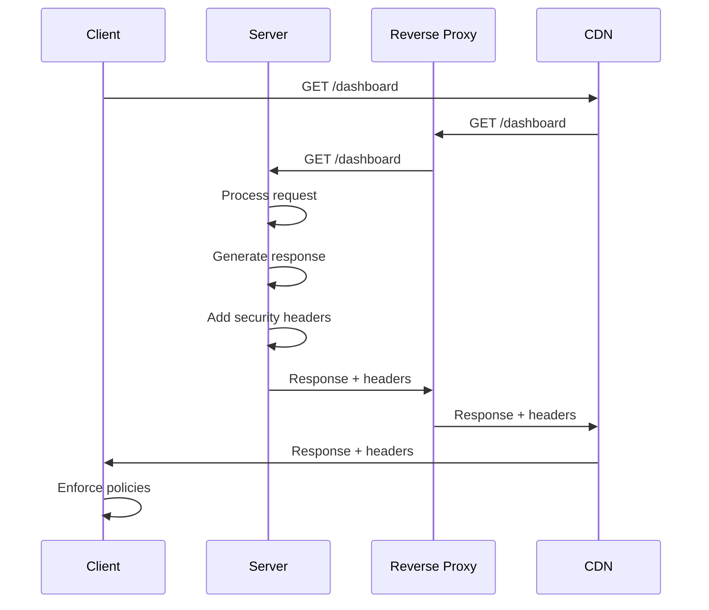

<!-- Generated by Groq via GitHub Actions -->
<!-- Topic ID: T141 -->
<!-- Category: Backend Security -->
<!-- Generated at UTC: 2026-10-27T18:50:44.082119+00:00 -->

# Security headers

## 1. What problem does this solve?

**Motivation**  
When a browser receives a response from a server, it must decide how to treat that content. If the server does not explicitly tell the browser what is safe, the browser may make assumptions that can be exploited by attackers. Security headers are tiny key‑value pairs that give the server a chance to *instruct* the browser about safe handling of the response.

**What problem exists?**  
- **Content‑type confusion** – browsers may guess the MIME type and execute malicious scripts.  
- **Click‑jacking** – embedding a page inside an attacker’s frame to trick users.  
- **Cross‑site scripting (XSS)** – executing scripts that were not intended to run.  
- **Data leakage** – referrer or cache headers exposing sensitive URLs.  
- **Transport downgrade** – forcing HTTP connections to be upgraded to HTTPS.

**Why the problem matters**  
A single mis‑configured header can open a whole class of attacks that bypass traditional server‑side defenses. For example, a missing `X-Content-Type-Options: nosniff` header lets a browser treat a plain‑text file as JavaScript, turning a harmless file into an XSS vector.

**What happens if this concept is not used?**  
- Browsers may render content in ways that reveal sensitive data.  
- Attackers can embed your site in malicious frames or inject scripts.  
- Sensitive URLs may leak via the `Referer` header.  
- Your site can be downgraded to HTTP, exposing credentials.

**Where this concept appears in real backend systems**  
- **CDNs** (Cloudflare, Akamai) inject security headers automatically.  
- **Reverse proxies** (NGINX, Envoy) add headers before traffic reaches the app.  
- **Frameworks** (Express, FastAPI, Next.js) expose middleware to set headers.  
- **CI/CD pipelines** validate header presence before deployment.

---

## 2. Mental model

**Analogy**  
Think of a **house**.  
- The **front door** (HTTPS) keeps intruders out.  
- The **security system** (Content‑Security‑Policy) monitors what can enter the house.  
- The **window locks** (X‑Frame‑Options) prevent outsiders from looking in.  
- The **alarm** (Strict‑Transport‑Security) ensures the door stays locked.  

Just as a house needs multiple layers of protection, a web app needs multiple headers to guard against different attack vectors.

**Engineering model**  
- **Transport layer**: `Strict-Transport-Security` forces HTTPS.  
- **Content layer**: `Content-Security-Policy` defines allowed scripts, styles, images.  
- **Frame layer**: `X-Frame-Options` or `Permissions-Policy` blocks click‑jacking.  
- **MIME layer**: `X-Content-Type-Options: nosniff` stops MIME sniffing.  
- **Referrer layer**: `Referrer-Policy` controls URL leakage.  
- **Feature policy**: `Permissions-Policy` limits use of browser APIs.

Each header is a guardrail that tells the browser *what* is allowed and *what* is forbidden.

---

## 3. Deep explanation

### Internals

| Header | Purpose | Typical value |
|--------|---------|---------------|
| `Strict-Transport-Security` | Forces HTTPS for a period | `max-age=31536000; includeSubDomains; preload` |
| `Content-Security-Policy` | Whitelists sources for scripts, styles, images, etc. | `default-src 'self'; script-src 'self' https://cdn.example.com;` |
| `X-Frame-Options` | Prevents framing of the page | `DENY` or `SAMEORIGIN` |
| `Permissions-Policy` | Enables/disables browser features | `geolocation=(), microphone=()` |
| `X-Content-Type-Options` | Stops MIME sniffing | `nosniff` |
| `Referrer-Policy` | Controls Referer header | `no-referrer-when-downgrade` |
| `X-XSS-Protection` | Legacy XSS filter (mostly ignored) | `1; mode=block` |

These headers are sent **once per HTTP response**. The browser reads them and enforces the policy for that response and any subsequent requests triggered by it.

### Important terminology

- **CSP (Content Security Policy)** – a declarative language for specifying allowed content sources.  
- **Directive** – a CSP rule (e.g., `script-src`).  
- **Nonce** – a random token that allows inline scripts while still enforcing CSP.  
- **Hash** – a SHA‑256 hash of an inline script that CSP can allow.  
- **Subresource Integrity (SRI)** – a hash that verifies external resources.  
- **Preload** – a directive that tells browsers to fetch a resource early.

### Trade‑offs

| Trade‑off | Description |
|-----------|-------------|
| **Security vs. Functionality** | Tight CSP can break legitimate third‑party widgets. |
| **Performance vs. Complexity** | Adding many headers increases response size slightly; negligible. |
| **Maintenance vs. Flexibility** | Hard‑coding CSP in code vs. using a CDN that auto‑generates it. |
| **Compatibility vs. Future‑proofing** | Some headers (e.g., `X-XSS-Protection`) are deprecated in modern browsers. |

### Failure modes

- **Over‑restrictive CSP**: Inline scripts or eval break, causing UI failures.  
- **Under‑restrictive CSP**: Allowing `unsafe-inline` defeats the purpose.  
- **Missing `nosniff`**: MIME sniffing can lead to XSS.  
- **Incorrect `HSTS`**: Wrong `max-age` or missing `includeSubDomains` can expose sub‑domains.  
- **Header injection**: Malicious actors add headers to responses if the app is vulnerable to header injection attacks.

### Limitations

- **Browser support**: Some older browsers ignore newer headers.  
- **Dynamic content**: CSP cannot enforce policies on content generated after the response.  
- **Server‑side rendering**: If you rely on client‑side rendering, CSP must allow the necessary scripts.  
- **CDN caching**: Headers may be cached; ensure they are not overridden by CDN rules.

### Where this concept fits in a backend architecture

```
┌─────────────────────┐
│  Client (Browser)   │
└───────┬──────────────┘
        │ HTTP Request
        ▼
┌─────────────────────┐
│  CDN / Edge Cache   │
└───────┬──────────────┘
        │ (adds/overrides headers)
        ▼
┌─────────────────────┐
│  Reverse Proxy      │
└───────┬──────────────┘
        │ (sets headers)
        ▼
┌─────────────────────┐
│  Application Server │
└─────────────────────┘
```

Headers can be added at the CDN, reverse proxy, or application level. The closer to the client, the faster the enforcement.

### Interaction with related backend concepts

- **HTTPS**: `HSTS` works only if HTTPS is already in place.  
- **CORS**: `Access-Control-Allow-Origin` is separate; CSP does not replace CORS.  
- **Authentication**: Tokens in cookies should be `SameSite` and `Secure`.  
- **Logging**: Capture header values for audit.  
- **Cache**: Some headers (e.g., `Cache-Control`) interact with security headers; ensure they don’t expose sensitive data.

---

## 4. How it works

1. **Client sends request** (e.g., `GET /dashboard`).  
2. **Server processes request** and prepares a response.  
3. **Middleware or framework** injects security headers into the response.  
4. **Response is sent back** to the client.  
5. **Browser reads headers** and enforces policies before rendering.  
6. **Subsequent requests** triggered by the page inherit the same policies (unless overridden).



---

## 5. Practical implementation

Below is a minimal **Express** + **Helmet** example that sets common security headers.  
Helmet is a popular middleware that bundles many headers, but you can also set them manually.

```ts
// src/server.ts
import express from 'express';
import helmet from 'helmet';

const app = express();
const PORT = process.env.PORT ?? 3000;

// 1️⃣ Apply Helmet to set a baseline of security headers
app.use(helmet());

// 2️⃣ Override or add custom CSP
app.use(
  helmet.contentSecurityPolicy({
    directives: {
      defaultSrc: ["'self'"],
      scriptSrc: ["'self'", "https://cdn.example.com"],
      styleSrc: ["'self'", "https://fonts.googleapis.com"],
      imgSrc: ["'self'", "data:"],
      connectSrc: ["'self'"],
      fontSrc: ["'self'", "https://fonts.gstatic.com"],
      objectSrc: ["'none'"],
      frameAncestors: ["'none'"],
      baseUri: ["'self'"],
    },
  })
);

// 3️⃣ Add a custom HSTS header (Helmet already does this, but shown for clarity)
app.use(
  helmet.hsts({
    maxAge: 31536000, // 1 year in seconds
    includeSubDomains: true,
    preload: true,
  })
);

// 4️⃣ Example route
app.get('/', (req, res) => {
  res.send(`
    <html>
      <head>
        <title>Secure App</title>
      </head>
      <body>
        <h1>Hello, secure world!</h1>
      </body>
    </html>
  `);
});

app.listen(PORT, () => {
  console.log(`🚀 Server listening on http://localhost:${PORT}`);
});
```

**Running the example**

```bash
# Install dependencies
npm i express helmet

# Compile TypeScript (or use ts-node)
npx ts-node src/server.ts
```

**Verify headers**

```bash
curl -I http://localhost:3000
```

You should see headers such as:

```
Strict-Transport-Security: max-age=31536000; includeSubDomains; preload
Content-Security-Policy: default-src 'self'; script-src 'self' https://cdn.example.com; ...
X-Content-Type-Options: nosniff
X-Frame-Options: DENY
```

---

## 6. Production considerations

| Concern | How to address |
|---------|----------------|
| **Scalability** | Headers are tiny; no impact on throughput. Ensure CDN or reverse proxy handles header injection to offload work from app servers. |
| **Reliability** | Use a central config (e.g., environment variables) so all instances share the same header values. |
| **Security** | Validate CSP directives against known third‑party scripts. Use nonces or hashes for inline scripts. |
| **Observability** | Log header presence in access logs. Use security scanners (OWASP ZAP, Burp) to verify. |
| **Performance** | Header size is < 1 KB; negligible. Avoid dynamic header generation per request; use static middleware. |
| **Error handling** | If a header is missing, the browser falls back to defaults. Log missing headers and alert. |
| **Resource usage** | Minimal CPU/memory. |
| **Operational concerns** | Ensure CDN or reverse proxy does not strip or override headers. Use `X-Forwarded-For` and `X-Forwarded-Proto` to detect HTTPS termination. |
| **Failure recovery** | If a mis‑configured CSP breaks the UI, roll back to a safe default or use a feature flag to disable CSP temporarily. |
| **Deployment** | Add header tests to CI pipeline. Use feature flags for gradual rollout. |

---

## 7. Common mistakes

| Mistake | Why it’s problematic |
|---------|----------------------|
| **Using `unsafe-inline` in CSP** | Allows any inline script, defeating CSP. |
| **Forgetting `nosniff`** | Browsers may execute a plain‑text file as JavaScript. |
| **Setting `X-Frame-Options: SAMEORIGIN` but using a CDN that rewrites the origin** | The header may be ignored or overridden. |
| **Hard‑coding CSP in code without environment variables** | Makes it hard to change for different environments (dev, staging, prod). |
| **Over‑restrictive CSP that blocks third‑party analytics** | Breaks functionality and user experience. |
| **Relying solely on CSP for XSS protection** | CSP is not a silver bullet; still need input validation and sanitization. |
| **Not using `includeSubDomains` in HSTS** | Sub‑domains can still be downgraded to HTTP. |
| **Missing `preload` flag** | Missed opportunity to get browsers to preload HSTS. |

---

## 8. Senior engineer perspective

### What changes at scale?

- **Edge placement**: Security headers are often added at the CDN or reverse proxy to avoid per‑request overhead.  
- **Header injection**: Use a dedicated service (e.g., Envoy filter) to inject headers consistently across microservices.  
- **Dynamic CSP**: For large sites with many domains, generate CSP per tenant or per route.  
- **Feature flags**: Roll out CSP changes gradually to avoid breaking users.  
- **Monitoring**: Instrument header presence and CSP violation reports (`report-uri`).  
- **Compliance**: Align headers with regulatory requirements (PCI‑DSS, GDPR).  

### Design decisions

| Decision | Trade‑offs |
|----------|------------|
| **CDN vs. reverse proxy** | CDN offers global edge caching but may override headers; reverse proxy gives more control. |
| **Static vs. dynamic CSP** | Static CSP is simpler but less flexible; dynamic CSP can adapt to per‑user content but adds complexity. |
| **Centralized header service** | Easier to audit but introduces a single point of failure. |
| **Preload HSTS** | Improves security but requires coordination with browser vendors and may lock out sub‑domains if mis‑configured. |
| **Using `helmet` vs. manual** | `helmet` is battle‑tested but may expose unnecessary headers; manual gives fine‑grained control. |

### Bottlenecks

- **Header size**: Extremely large CSP can exceed HTTP header limits (~8 KB).  
- **Cache invalidation**: Changing CSP requires cache busting; otherwise, browsers may use stale policies.  
- **Feature policy**: Some browsers ignore `Permissions-Policy`; rely on feature detection.

### Failure scenarios

- **Mis‑configured CSP**: UI breaks; users see blank pages.  
- **Header injection vulnerability**: Attackers add malicious headers.  
- **CDN misconfiguration**: Headers stripped, exposing the app to XSS.  

### Monitoring

- **CSP violation reports** (`report-uri` or `report-to`).  
- **Header presence checks** in automated tests.  
- **Security scanning** (OWASP ZAP, Burp) in CI.  

### When NOT to use

- **Legacy systems** that cannot set headers (e.g., old PHP scripts).  
- **Highly dynamic content** where CSP would need to change per request (use `unsafe-inline` sparingly).  
- **Internal APIs** that are not exposed to browsers (headers are irrelevant).  

---

## 9. Interview questions

1. **Beginner** – *What is the purpose of the `X-Content-Type-Options: nosniff` header?*  
   *Answer:* Prevents browsers from MIME‑sniffing and executing a file as a different type (e.g., treating a plain‑text file as JavaScript).

2. **Beginner** – *Explain the difference between `X-Frame-Options` and `Content-Security-Policy: frame-ancestors`.*  
   *Answer:* `X-Frame-Options` is a legacy header that only supports `DENY` or `SAMEORIGIN`. `frame-ancestors` in CSP is more flexible, allowing multiple origins or a wildcard.

3. **Senior** – *How would you design a system that needs to serve different CSPs for different tenants in a multi‑tenant SaaS?*  
   *Answer:* Generate CSP per tenant at request time, cache the policy, use a CDN or reverse proxy to inject the header, and expose a `report-uri` for each tenant. Use feature flags to roll out changes gradually.

4. **Senior** – *What are the performance implications of adding a large CSP header, and how can you mitigate them?*  
   *Answer:* Large headers increase response size, potentially affecting bandwidth and cache efficiency. Mitigate by compressing responses, using nonces/hashes instead of long lists, and leveraging CDN edge caching.

5. **Scenario/Debugging** – *A user reports that after deploying a new CSP, the analytics script stopped firing. How would you troubleshoot?*  
   *Answer:*  
   - Inspect the response headers in the browser dev tools.  
   - Check the CSP `script-src` directive; ensure the analytics domain is whitelisted.  
   - Look for CSP violation reports in the console or via `report-uri`.  
   - Verify that the analytics script is loaded from the correct domain and that any inline scripts use a nonce or hash.  
   - If using a CDN, confirm it isn’t stripping or overriding the CSP header.

---

## 10. Hands‑on task

**Task**: Add security headers to an existing Next.js API route and verify them.

1. **Create a new API route** `pages/api/hello.ts` that returns JSON.  
2. **Add a custom middleware** that sets the following headers:
   - `Strict-Transport-Security`
   - `Content-Security-Policy` (allow only `self` for scripts)
   - `X-Content-Type-Options: nosniff`
3. **Run the dev server** and make a request to `/api/hello`.  
4. **Use `curl -I`** to confirm the headers are present.  
5. **Add a CSP violation report endpoint** and trigger a violation by adding an inline script that is blocked.  
6. **Verify the report** appears in the console or a log file.

*Deliverable*: A Git commit with the middleware, updated API route, and a short README explaining how to test.

---

## 11. Quick revision

- **HSTS** forces HTTPS; use `max-age`, `includeSubDomains`, `preload`.  
- **CSP** whitelists content sources; use directives, nonces, hashes.  
- **X-Frame-Options** blocks framing; prefer `frame-ancestors` in CSP.  
- **X-Content-Type-Options: nosniff** stops MIME sniffing.  
- **Referrer-Policy** controls URL leakage.  
- **Permissions-Policy** limits browser APIs.  
- **Headers are tiny**; add them at CDN or reverse proxy for scalability.  
- **Helmet** bundles common headers; manual control gives fine‑grained policy.  
- **CSP violations** can be reported via `report-uri` or `report-to`.  
- **Testing**: `curl -I`, browser dev tools, automated tests.  
- **Common pitfalls**: `unsafe-inline`, missing `nosniff`, over‑restrictive CSP.  
- **At scale**: central header service, dynamic CSP per tenant, monitoring.

---

## 12. References

- MDN Web Docs – [Content Security Policy](https://developer.mozilla.org/en-US/docs/Web/HTTP/CSP)  
- MDN Web Docs – [HTTP Strict Transport Security](https://developer.mozilla.org/en-US/docs/Web/HTTP/Headers/Strict-Transport-Security)  
- MDN Web Docs – [X-Content-Type-Options](https://developer.mozilla.org/en-US/docs/Web/HTTP/Headers/X-Content-Type-Options)  
- OWASP – [Secure Headers Cheat Sheet](https://cheatsheetseries.owasp.org/cheatsheets/HTTP_Headers_Cheat_Sheet.html)  
- Helmet – [Helmet.js](https://helmetjs.github.io/)  
- Next.js – [API Routes](https://nextjs.org/docs/api-routes/introduction)  
- Cloudflare – [Security Headers](https://developers.cloudflare.com/fundamentals/security/security-headers/)  

---
