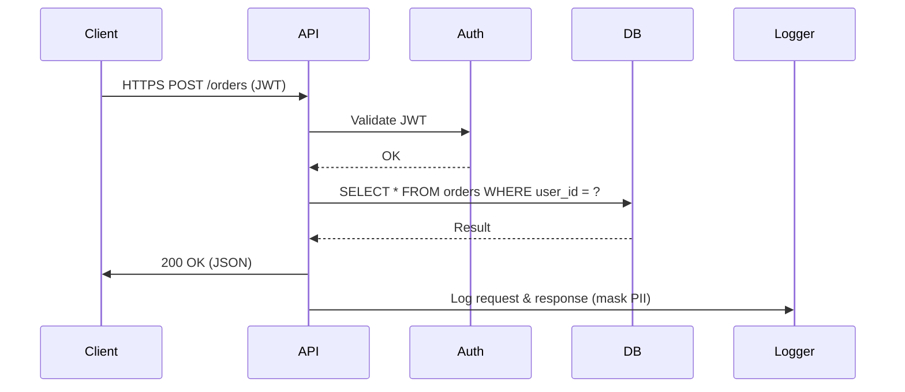

<!-- Generated by Groq via GitHub Actions -->
<!-- Topic ID: T142 -->
<!-- Category: Backend Security -->
<!-- Generated at UTC: 2026-10-27T18:50:44.082119+00:00 -->

# OWASP Top 10

## 1. What problem does this solve?

The **OWASP Top 10** is a living list of the most critical web‑application security risks.  
It exists because:

- **Security is hard** – developers often overlook subtle attack vectors that can be exploited by automated bots or malicious insiders.
- **Commonality** – many breaches arise from the same set of weaknesses (e.g., injection, broken auth).  
- **Prioritisation** – it gives teams a clear, industry‑accepted roadmap for hardening applications.
- **Compliance & risk management** – auditors and regulators reference the Top 10 when assessing controls.

If you ignore it, you risk:

- Data loss or exposure (financial, personal, IP).
- Regulatory fines (GDPR, PCI‑DSS, HIPAA).
- Reputation damage and loss of user trust.
- Legal liability.

In real backends, the Top 10 surfaces in:

- API endpoints that accept user input (SQL, GraphQL, REST).
- Authentication flows (JWT, OAuth, session cookies).
- Data storage (PostgreSQL, MongoDB, Redis).
- Third‑party libraries (npm packages, Docker images).
- Deployment pipelines (Docker, Kubernetes, CI/CD).

---

## 2. Mental model

**Analogy**: Think of a web application as a **castle**.  
- The **walls** are your input validation and sanitisation.  
- The **gatekeepers** are authentication and authorization.  
- The **keep** holds sensitive data; you lock it with encryption.  
- The **watchtower** is logging/monitoring.

If any wall is weak, a siege (attack) can breach the castle. The OWASP Top 10 tells you which walls are most likely to crumble.

**Engineering model**:  
- **Threat modelling** → identify attack surfaces.  
- **Risk assessment** → map threats to OWASP categories.  
- **Mitigation** → apply controls (e.g., prepared statements, CSP, rate limiting).  
- **Verification** → static analysis, dynamic scanning, penetration testing.  
- **Monitoring** → alerts for anomalous behaviour.

---

## 3. Deep explanation

| # | OWASP Category | Internals | Key Terms | Trade‑offs | Failure Modes | Limitations | Where it fits | Related Concepts |
|---|----------------|-----------|-----------|------------|---------------|-------------|---------------|------------------|
| A1 | **Injection** | Malformed input reaches a parser (SQL, NoSQL, OS shell). | *Prepared statements, parameterised queries, escaping* | Prepared statements reduce flexibility (e.g., dynamic queries). | Blind injection, error‑based injection. | Some ORMs still allow string interpolation. | Data access layer. | Input validation, ORM design. |
| A2 | **Broken Authentication** | Credentials are stored or transmitted insecurely; session fixation. | *JWT, session cookies, MFA, password hashing* | Strong hashing (bcrypt) slows login. | Credential stuffing, session hijacking. | MFA can be bypassed via phishing. | Auth service, API gateway. | Identity & Access Management (IAM). |
| A3 | **Sensitive Data Exposure** | Data in transit or at rest is unencrypted or weakly encrypted. | *TLS, AES‑256, key management* | Encryption overhead, key rotation complexity. | Man‑in‑the‑middle, key leakage. | Legacy protocols (SSLv3). | Data storage, API responses. | Data‑at‑rest, data‑in‑transit. |
| A4 | **XML External Entities (XXE)** | XML parser resolves external entities. | *Entity resolution, safe‑XML libraries* | Some XML features disabled; may break integration. | Remote code execution, data exfiltration. | Not relevant for JSON‑only APIs. | XML parsers, legacy services. | Secure coding, input sanitisation. |
| A5 | **Broken Access Control** | Authorization checks are missing or incorrect. | *Role‑based access control (RBAC), scopes* | Over‑restrictive scopes can hurt UX. | Privilege escalation, data leakage. | Mis‑configured ACLs. | Business logic layer. | IAM, policy engines. |
| A6 | **Security Misconfiguration** | Default configs, open ports, verbose errors. | *Hardening, least privilege, secrets management* | Hardening may break dev workflows. | Unintended public endpoints. | Mis‑configured CI/CD pipelines. | Deployment, infrastructure. | DevOps, IaC. |
| A7 | **Cross‑Site Scripting (XSS)** | Unescaped output rendered in browsers. | *DOM‑XSS, reflected, stored* | CSP can reduce functionality. | Session hijacking, phishing. | Content‑Security‑Policy misconfig. | Front‑end rendering. | CSP, sanitisation libraries. |
| A8 | **Insecure Deserialization** | Malicious payloads are deserialized into objects. | *Object injection, deserialization libraries* | Strict type checks reduce flexibility. | Remote code execution. | Language‑specific quirks. | API endpoints, message queues. | Serialization, type safety. |
| A9 | **Using Components with Known Vulnerabilities** | Third‑party libs contain CVEs. | *Dependency‑check, Snyk, npm audit* | Upgrading may break compatibility. | Exploits via package hijacking. | Shadowing, lockfile integrity. | Build pipeline, runtime. | Package management, CI. |
| A10 | **Insufficient Logging & Monitoring** | No audit trail or alerting. | *Log aggregation, SIEM, anomaly detection* | Logging can consume storage, affect performance. | Undetected breaches, delayed response. | Log tampering, privacy concerns. | All layers. | Observability, incident response. |

---

## 4. How it works

Below is a high‑level flow for a **secure API request** that touches several OWASP categories.



Key points:

1. **Transport** – TLS (A3).  
2. **Auth** – JWT verification, MFA (A2).  
3. **Input** – Parameterised query (A1).  
4. **Output** – JSON serialisation, CSP headers (A7).  
5. **Logging** – Mask PII, rotate logs (A10).  

---

## 5. Practical implementation

Below is a **Node.js/TypeScript** example that demonstrates mitigations for several OWASP categories in a single endpoint.

```ts
// src/routes/orders.ts
import express, { Request, Response } from 'express';
import { verifyJwt } from '../auth/jwt';
import { pool } from '../db';
import { logger } from '../utils/logger';
import { sanitize } from 'dompurify';
import { body, validationResult } from 'express-validator';

const router = express.Router();

/**
 * POST /orders
 *  - Auth: JWT + MFA
 *  - Input: validated & sanitized
 *  - DB: parameterised query
 *  - Output: JSON, CSP headers
 *  - Logging: masked PII
 */
router.post(
  '/',
  // 1️⃣ Validate JWT
  async (req: Request, res: Response, next) => {
    try {
      req.user = await verifyJwt(req.headers.authorization);
      next();
    } catch (e) {
      res.status(401).json({ error: 'Unauthorized' });
    }
  },
  // 2️⃣ Validate & sanitize body
  body('productId').isInt(),
  body('quantity').isInt({ min: 1 }),
  async (req: Request, res: Response) => {
    const errors = validationResult(req);
    if (!errors.isEmpty()) {
      return res.status(400).json({ errors: errors.array() });
    }

    const { productId, quantity } = req.body;
    const userId = req.user.id;

    try {
      // 3️⃣ Parameterised query (A1)
      const result = await pool.query(
        'INSERT INTO orders (user_id, product_id, quantity) VALUES ($1, $2, $3) RETURNING id',
        [userId, productId, quantity]
      );

      // 4️⃣ Mask PII before logging (A10)
      logger.info('Order created', {
        orderId: result.rows[0].id,
        userId: userId,
        productId,
        quantity,
      });

      // 5️⃣ CSP header (A7)
      res.setHeader(
        'Content-Security-Policy',
        "default-src 'self'; script-src 'none';"
      );

      res.status(201).json({ orderId: result.rows[0].id });
    } catch (err) {
      logger.error('DB error', { error: err.message });
      res.status(500).json({ error: 'Internal server error' });
    }
  }
);

export default router;
```

**Key lines**

- `verifyJwt` – ensures token integrity (A2).  
- `express-validator` – sanitises input (A1, A7).  
- `pool.query` with `$1, $2, $3` – prevents SQL injection (A1).  
- CSP header – mitigates XSS (A7).  
- `logger.info` – masks PII, logs minimal data (A10).  

---

## 6. Production considerations

| Concern | OWASP Relevance | Practical Tips |
|---------|-----------------|----------------|
| **Scalability** | A1, A9 | Use connection pools, lockfile integrity checks, automated dependency updates. |
| **Reliability** | A6, A10 | Harden defaults, enable health checks, use circuit breakers. |
| **Security** | All | Enforce TLS 1.2+, rotate keys, use HSTS, enable CSP, use OWASP ZAP or Snyk. |
| **Observability** | A10 | Centralised logs (ELK), distributed tracing, anomaly detection. |
| **Performance** | A1, A3 | Cache encrypted data in Redis, use prepared statements, avoid heavy sanitisation on every request. |
| **Error handling** | A10 | Return generic error messages, log stack traces separately. |
| **Resource usage** | A9 | Pin dependencies, audit for unused packages, use lightweight libs. |
| **Operational concerns** | A6 | Immutable infrastructure, secrets in Vault/K8s secrets, CI/CD pipelines with automated scans. |
| **Failure recovery** | A5, A10 | Role‑based backups, audit trails, incident response playbooks. |
| **Deployment** | A6, A9 | Use Docker images signed with Notary, run `npm audit` in CI, enforce policy checks. |

---

## 7. Common mistakes

| Mistake | Why it’s bad |
|---------|--------------|
| **String concatenation for SQL** | Enables injection (A1). |
| **Storing passwords in plain text** | Data breach, regulatory non‑compliance (A3). |
| **Ignoring CSP** | XSS attacks succeed (A7). |
| **Using default config files** | Open ports, verbose errors (A6). |
| **Hard‑coding secrets** | Secrets leak via source control (A6). |
| **Skipping dependency audit** | Vulnerable libs (A9). |
| **Logging raw request bodies** | PII exposure (A10). |
| **Assuming JWT is enough** | No MFA, session fixation (A2). |
| **Not rotating encryption keys** | Long‑term data exposure (A3). |
| **Over‑restrictive rate limits** | Denial‑of‑service for legitimate users. |


---

## 8. Senior engineer perspective

### What changes at scale?

- **Distributed auth** – use a centralised identity provider (OAuth2/OIDC) instead of per‑service JWTs.  
- **Policy engine** – externalise RBAC to a service like OPA or Keycloak.  
- **Zero‑trust networking** – enforce mutual TLS between services.  
- **Observability stack** – ingest logs into a SIEM, correlate with network telemetry.  
- **Automated compliance** – policy‑as‑code, continuous security scanning in CI/CD.  

### Design decisions

| Decision | Trade‑offs | Bottlenecks | Monitoring |
|----------|------------|-------------|------------|
| **Centralised auth** | Single point of failure, but simplifies revocation. | Auth service latency. | Auth request latency, token revocation rate. |
| **Encrypted DB columns** | Performance hit, key rotation complexity. | Query performance on encrypted columns. | Encryption key access latency. |
| **CSP with strict policy** | May break third‑party widgets. | Front‑end compatibility. | CSP violation reports. |
| **Immutable containers** | Faster rollbacks, but requires robust CI. | Build time, storage. | Image scan results. |
| **Rate limiting per IP** | DDoS protection, but may block legitimate users behind NAT. | Cache size for counters. | Rate‑limit hit metrics. |

### When NOT to use an approach

- **JWT without rotation** – if you need to revoke tokens quickly.  
- **Hard‑coded secrets** – in any environment that is not fully isolated.  
- **No logging** – if you need to meet compliance or forensic requirements.  
- **No dependency audit** – in production systems with external exposure.  

---

## 9. Interview questions

| # | Question | Answer Points |
|---|----------|---------------|
| 1 (beginner) | What is SQL injection and how can you prevent it? | • Malicious SQL in user input. <br>• Use parameterised queries / prepared statements. <br>• Avoid string concatenation. |
| 2 (beginner) | Why is TLS important for a web API? | • Encrypts data in transit. <br>• Protects against MITM. <br>• Enables HSTS, secure cookies. |
| 3 (senior) | How would you design a scalable authentication system for microservices? | • Centralised IdP (OAuth2/OIDC). <br>• Token introspection or short‑lived JWTs. <br>• MFA, device trust. <br>• Revocation strategy. |
| 4 (senior) | Explain how you would implement zero‑trust networking in a Kubernetes cluster. | • Mutual TLS between pods. <br>• Service mesh (Istio/Linkerd). <br>• Fine‑grained mTLS policies. <br>• Certificate rotation. |
| 5 (scenario/debugging) | A production API is returning 500 errors after a recent deployment. The logs show `Error: Invalid input` from the database driver. What could be happening? | • Possible injection due to missing parameterisation. <br>• Schema change (column renamed). <br>• Data type mismatch. <br>• Fix: review query, validate schema, add unit tests. |

---

## 10. Hands‑on task

**Add an OWASP‑compliant rate‑limiting middleware to the existing Express app.**

1. Install `express-rate-limit`.  
2. Configure a per‑IP limit of 100 requests per 15 min.  
3. Store counters in Redis for horizontal scaling.  
4. Log each rate‑limit hit with IP and endpoint.  
5. Write a test that simulates 101 requests and asserts a `429` response.

---

## 11. Quick revision

- OWASP Top 10 = 10 most critical web‑app risks.  
- A1 Injection – use prepared statements.  
- A2 Broken Auth – MFA, secure JWTs, session rotation.  
- A3 Sensitive Data – TLS, AES‑256, key rotation.  
- A4 XXE – disable external entity resolution.  
- A5 Broken Access – RBAC, scopes, policy engine.  
- A6 Misconfiguration – harden defaults, secrets in Vault.  
- A7 XSS – CSP, output escaping, DOM sanitisation.  
- A8 Insecure Deserialization – strict type checks, safe libs.  
- A9 Known Vulnerabilities – dependency audit, lockfiles.  
- A10 Logging – mask PII, rotate logs, SIEM integration.  
- Use **parameterised queries** to stop injection.  
- **CSP** + **XSS‑filter** = front‑end hardening.  
- **JWT** + **MFA** = strong auth.  
- **Redis** for distributed rate‑limiting.  
- **Snyk** / `npm audit` for component checks.  
- **Centralised logging** (ELK) for monitoring.  

---

## 12. References

- https://owasp.org/www-project-top-ten/  
- https://developer.mozilla.org/en-US/docs/Web/HTTP/Headers/Content-Security-Policy  
- https://nodejs.org/api/crypto.html  
- https://expressjs.com/en/guide/security.html  
- https://docs.npmjs.com/cli/v10/commands/npm-audit  
- https://kubernetes.io/docs/concepts/security/authorization/  
- https://docs.istio.io/latest/docs/concepts/security/  

---
