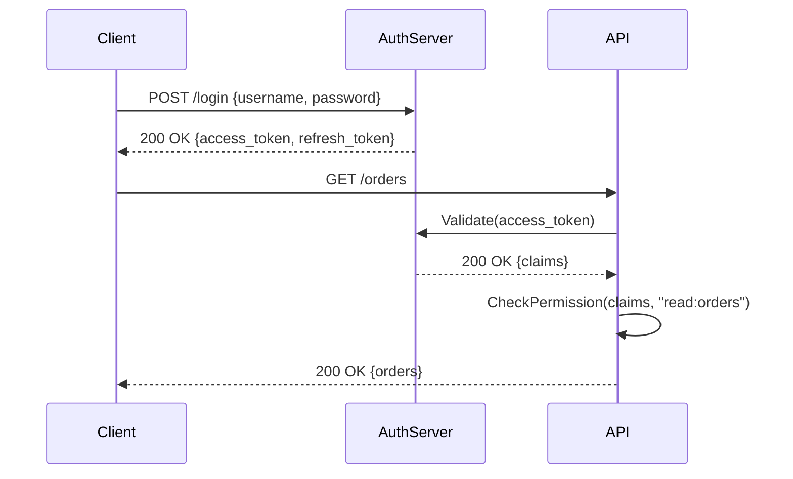

<!-- Generated by Groq via GitHub Actions -->
<!-- Topic ID: T143 -->
<!-- Category: Backend Security -->
<!-- Generated at UTC: 2026-10-28T06:58:53.570118+00:00 -->

# Authentication vs Authorization

## 1. What problem does this solve?

| Problem | Why it matters | Consequence of ignoring it | Real‑world appearance |
|---------|----------------|---------------------------|-----------------------|
| **Identity verification** – “Who am I?” | Every request must be tied to a known user or service. Without this, you cannot personalize, audit, or secure data. | Unauthenticated users could read or modify protected resources. | Login pages, OAuth flows, API keys. |
| **Access control** – “What can I do?” | Even a verified user may not be allowed to perform every action. Fine‑grained permissions prevent privilege escalation. | A user with a broken or missing check could delete all records or access admin dashboards. | Role‑based dashboards, admin panels, microservice gateways. |
| **Auditability & compliance** | Knowing who did what is essential for security audits, GDPR, PCI‑DSS, etc. | Inability to trace malicious activity or data leaks. | Logging middleware, audit trails, regulatory reporting. |
| **Scalability & performance** | Centralized auth/authorization reduces duplicated logic across services. | Each service must re‑implement checks, leading to bugs and performance hits. | API gateways, service meshes, shared auth libraries. |

If authentication or authorization is omitted, the system behaves like an open public API: anyone can read/write any data. In production, that translates to data breaches, regulatory fines, and loss of user trust.

---

## 2. Mental model

### Analogy  
- **Authentication** = *the key that proves you’re the right person to enter a building.*  
- **Authorization** = *the guard at the door who checks whether you’re allowed to go to a specific room.*

You can have the key (you’re authenticated), but the guard may still deny you access to the CEO’s office (you’re not authorized).

### Engineering model  
- **Authentication**: Issue a *token* (JWT, session ID, API key) that proves the user’s identity.  
- **Authorization**: Attach *claims* or *scopes* to that token, or perform a policy lookup, to decide if the user can access a particular resource or perform an action.

---

## 3. Deep explanation

### Internals
| Concept | What it is | Typical implementation |
|---------|------------|------------------------|
| **Principal** | The entity (user, service) making a request. | User ID, service name. |
| **Token** | A signed artifact that carries identity and optional permissions. | JWT (stateless), opaque session ID (stateful). |
| **Claims / Scopes** | Key/value pairs inside a token that describe privileges. | `role: "admin"`, `scope: ["read:users", "write:orders"]`. |
| **Policy Engine** | Evaluates whether a principal can perform an action on a resource. | RBAC tables, ABAC rules, external services like OPA. |
| **Revocation List** | Store of tokens that are no longer valid. | Redis set, database table. |

### Important terminology
- **Access token** – short‑lived token used to call APIs.  
- **Refresh token** – long‑lived token used to obtain new access tokens.  
- **Scope** – a string that represents a permission.  
- **Role** – a named collection of scopes.  
- **OPA (Open Policy Agent)** – a policy engine that can be queried by services.  

### Trade‑offs
| Choice | Pros | Cons |
|--------|------|------|
| **Stateless JWT** | No server‑side session store, scales horizontally. | Revocation is hard; token size adds bandwidth. |
| **Opaque session ID** | Easy revocation, small payload. | Requires a shared session store (Redis, DB). |
| **RBAC vs ABAC** | RBAC is simple to implement. | ABAC offers fine‑grained control but is more complex. |

### Failure modes
- **Token leakage** – stolen JWT can be used until expiration.  
- **Privilege escalation** – missing scope checks or hard‑coded admin routes.  
- **Broken revocation** – revoked tokens still accepted.  
- **Clock skew** – `iat`/`exp` mis‑validated due to time differences.  

### Limitations
- **JWT cannot be mutated** – you cannot change scopes after issuance without re‑issuing.  
- **Opaque tokens require a store** – adds latency and a single point of failure.  
- **Policy engines can become bottlenecks** if not cached or distributed.  

### Where it fits
- **API Gateway** – validates tokens and forwards requests.  
- **Microservice** – performs fine‑grained checks against a policy engine.  
- **Database** – row‑level security (PostgreSQL RLS) can enforce authorization at the data layer.  

### Interaction with related concepts
- **Rate limiting** – often tied to the authenticated principal.  
- **Caching** – store user permissions in Redis to avoid repeated DB lookups.  
- **Observability** – log `user_id`, `action`, `resource`, and `decision`.  

---

## 4. How it works

1. **User logs in** → credentials → auth server validates.  
2. **Auth server issues** an access token (JWT) and a refresh token.  
3. **Client stores** the access token (e.g., in memory or HTTP‑Only cookie).  
4. **Client calls API** → attaches token in `Authorization: Bearer`.  
5. **API validates** token signature, checks expiration, and extracts claims.  
6. **API (or policy engine)** checks if the principal has the required scope/role.  
7. **Decision**: allow or deny.  
8. **If denied**, return `403 Forbidden` or `401 Unauthorized`.  
9. **If access token expires**, client uses refresh token to obtain a new one.  
10. **Revocation**: if a user is disabled, add the token ID to a revocation list; middleware checks it on each request.



---

## 5. Practical implementation

Below is a minimal, runnable Express + TypeScript example that demonstrates:

- Password hashing with `bcrypt`.  
- JWT issuance (`jsonwebtoken`).  
- Role‑based authorization middleware.  
- Redis‑backed revocation list.

```ts
// src/server.ts
import express, { Request, Response, NextFunction } from 'express';
import jwt from 'jsonwebtoken';
import bcrypt from 'bcrypt';
import { createClient } from 'redis';

const app = express();
app.use(express.json());

// ------------------------------------------------------------------
// Configuration – in production use env vars or a secrets manager
// ------------------------------------------------------------------
const JWT_SECRET = process.env.JWT_SECRET ?? 'super-secret';
const REFRESH_SECRET = process.env.REFRESH_SECRET ?? 'refresh-secret';
const JWT_EXPIRES_IN = '15m';
const REFRESH_EXPIRES_IN = '7d';
const REDIS_URL = process.env.REDIS_URL ?? 'redis://localhost:6379';

// ------------------------------------------------------------------
// Redis client – used for token revocation
// ------------------------------------------------------------------
const redis = createClient({ url: REDIS_URL });
redis.on('error', console.error);
await redis.connect();

// ------------------------------------------------------------------
// In‑memory user store (replace with DB in prod)
// ------------------------------------------------------------------
interface User {
  id: number;
  username: string;
  passwordHash: string;
  role: 'admin' | 'user';
}
const users: User[] = [
  {
    id: 1,
    username: 'alice',
    passwordHash: bcrypt.hashSync('password', 10),
    role: 'admin',
  },
  {
    id: 2,
    username: 'bob',
    passwordHash: bcrypt.hashSync('password', 10),
    role: 'user',
  },
];

// ------------------------------------------------------------------
// Helpers
// ------------------------------------------------------------------
function findUser(username: string): User | undefined {
  return users.find((u) => u.username === username);
}

function generateAccessToken(user: User) {
  const payload = { sub: user.id, role: user.role };
  return jwt.sign(payload, JWT_SECRET, { expiresIn: JWT_EXPIRES_IN });
}

function generateRefreshToken(user: User) {
  const payload = { sub: user.id };
  return jwt.sign(payload, REFRESH_SECRET, { expiresIn: REFRESH_EXPIRES_IN });
}

// ------------------------------------------------------------------
// Middleware – authentication
// ------------------------------------------------------------------
async function authMiddleware(req: Request, res: Response, next: NextFunction) {
  const authHeader = req.headers.authorization;
  if (!authHeader?.startsWith('Bearer ')) {
    return res.status(401).json({ error: 'Missing token' });
  }
  const token = authHeader.split(' ')[1];

  // Check revocation list first
  const revoked = await redis.get(`revoked:${token}`);
  if (revoked) {
    return res.status(401).json({ error: 'Token revoked' });
  }

  try {
    const payload = jwt.verify(token, JWT_SECRET) as { sub: number; role: string };
    // Attach to request for downstream handlers
    (req as any).user = payload;
    next();
  } catch (err) {
    return res.status(401).json({ error: 'Invalid token' });
  }
}

// ------------------------------------------------------------------
// Middleware – authorization (role based)
// ------------------------------------------------------------------
function requireRole(role: string) {
  return (req: Request, res: Response, next: NextFunction) => {
    const user = (req as any).user;
    if (!user || user.role !== role) {
      return res.status(403).json({ error: 'Forbidden' });
    }
    next();
  };
}

// ------------------------------------------------------------------
// Routes
// ------------------------------------------------------------------
app.post('/login', async (req, res) => {
  const { username, password } = req.body;
  const user = findUser(username);
  if (!user || !(await bcrypt.compare(password, user.passwordHash))) {
    return res.status(401).json({ error: 'Invalid credentials' });
  }
  const accessToken = generateAccessToken(user);
  const refreshToken = generateRefreshToken(user);
  res.json({ accessToken, refreshToken });
});

app.post('/refresh', async (req, res) => {
  const { refreshToken } = req.body;
  try {
    const payload = jwt.verify(refreshToken, REFRESH_SECRET) as { sub: number };
    const user = users.find((u) => u.id === payload.sub);
    if (!user) throw new Error();
    const newAccess = generateAccessToken(user);
    res.json({ accessToken: newAccess });
  } catch {
    res.status(401).json({ error: 'Invalid refresh token' });
  }
});

app.post('/logout', authMiddleware, async (req, res) => {
  const authHeader = req.headers.authorization!;
  const token = authHeader.split(' ')[1];
  // Store token in revocation list for its remaining lifetime
  const decoded = jwt.decode(token) as { exp: number };
  const ttl = decoded.exp - Math.floor(Date.now() / 1000);
  await redis.set(`revoked:${token}`, '1', { EX: ttl });
  res.json({ message: 'Logged out' });
});

app.get('/orders', authMiddleware, (req, res) => {
  const user = (req as any).user;
  // Example: only admins can see all orders
  if (user.role === 'admin') {
    return res.json({ orders: ['order1', 'order2'] });
  }
  // Regular users see only their own orders
  res.json({ orders: ['order1'] });
});

app.get('/admin', authMiddleware, requireRole('admin'), (req, res) => {
  res.json({ secret: 'Top secret data' });
});

// ------------------------------------------------------------------
// Start server
// ------------------------------------------------------------------
const PORT = process.env.PORT ?? 3000;
app.listen(PORT, () => console.log(`🚀 Server listening on ${PORT}`));
```

**Key lines explained**

- `jwt.sign(payload, JWT_SECRET, { expiresIn })` – creates a signed JWT.  
- `redis.set('revoked:${token}', '1', { EX: ttl })` – revokes a token until it would naturally expire.  
- `requireRole('admin')` – simple role‑based guard.  

> **Tip**: In production, store `JWT_SECRET` and `REFRESH_SECRET` in a secrets manager, rotate them regularly, and use HTTPS to protect tokens in transit.

---

## 6. Production considerations

| Concern | How to address it |
|---------|-------------------|
| **Scalability** | Use stateless JWTs for read‑only APIs; keep refresh tokens in Redis for revocation. |
| **Reliability** | Fallback to a local cache of revoked tokens; retry auth server on transient failures. |
| **Security** | Enforce HTTPS, use `HttpOnly` & `Secure` flags for cookies, rotate secrets, set short access token lifetimes. |
| **Observability** | Log `user_id`, `action`, `resource`, `decision`; expose metrics (`auth_success`, `auth_fail`). |
| **Performance** | Cache JWT verification results (e.g., LRU cache of public keys), batch policy checks. |
| **Error handling** | Return `401` for authentication errors, `403` for authorization failures; avoid leaking stack traces. |
| **Resource usage** | Keep JWT payload small; avoid storing large lists of scopes. |
| **Operational concerns** | Automate secret rotation, monitor Redis health, set up alerting for auth failure spikes. |
| **Failure recovery** | Provide a `/refresh` endpoint; allow graceful logout by revoking tokens. |
| **Deployment** | Use environment variables or a secrets store; containerize with Docker; enable TLS termination at load balancer. |

---

## 7. Common mistakes

| Mistake | Why it’s problematic |
|---------|----------------------|
| **Storing passwords in plain text** | Enables immediate compromise if DB leaks. |
| **Using the same token for auth & authz** | Hard to revoke specific privileges; over‑privileged tokens. |
| **Not validating token signature** | Anyone can forge a token. |
| **Using insecure cookie flags** | Tokens can be stolen via XSS. |
| **Hard‑coding admin routes** | Privilege escalation if route is accidentally exposed. |
| **Ignoring token expiration** | Tokens remain valid forever, increasing risk. |
| **Not rotating secrets** | Compromised keys remain valid until expiration. |
| **Using JWT for session state** | Cannot revoke individual sessions easily. |
| **Storing tokens in localStorage** | Vulnerable to XSS. |
| **Not handling clock skew** | Valid tokens may be rejected or accepted incorrectly. |

---

## 8. Senior engineer perspective

### What changes at scale?

- **Distributed policy enforcement**: Instead of embedding RBAC checks in each service, use a central policy engine (OPA, Keycloak) and query it via gRPC or HTTP.  
- **Token revocation strategy**: Stateless JWTs are great for read‑heavy workloads, but for write‑heavy or highly regulated systems you may need opaque tokens or a short‑lived JWT with a revocation list.  
- **Key rotation**: Automate key rollover with JWKs and support key ID (`kid`) in JWT headers.  
- **Observability**: Instrument auth flows with distributed tracing (OpenTelemetry) to detect bottlenecks.  
- **Cost/performance**: JWT verification is CPU‑bound; cache public keys, batch verification, or use hardware acceleration if needed.  
- **Bottlenecks**: Policy engine can become a single point of failure; mitigate with caching and replication.  
- **Failure scenarios**: If the auth server is down, services should fallback to a cached token or deny access gracefully.  
- **When NOT to use**: For internal tooling with a single user, a simple API key may suffice; for microservices that only need mutual TLS, skip JWTs entirely.  

---

## 9. Interview questions

| Level | Question | Answer points |
|-------|----------|---------------|
| Beginner | What is the difference between authentication and authorization? | Authentication verifies identity; authorization decides what that identity can do. |
| Beginner | Why should we use HTTPS for token transport? | Prevents token theft via MITM; ensures integrity and confidentiality. |
| Senior | How would you design a revocation strategy for JWTs in a microservice architecture? | Use Redis or a database to store revoked jti; short token lifetimes; optional opaque tokens; key rotation. |
| Senior | Explain how you would integrate an external policy engine (e.g., OPA) into your services. | Service calls OPA via HTTP/gRPC; cache policy decisions; handle latency; fall back to default deny. |
| Scenario | A user reports that they can access an admin endpoint after being demoted. What steps would you take to debug? | Check token revocation list; verify token’s `role` claim; audit logs for token issuance; ensure secret rotation; test with a fresh login. |

---

## 10. Hands‑on task

**Goal**: Extend the example above to support **role‑based access control** for a new endpoint `/reports`.

1. Add a new role `analyst` to the user store.  
2. Create a middleware `requireAnyRole(['admin', 'analyst'])`.  
3. Protect `/reports` so that only admins and analysts can access it.  
4. Write a unit test that verifies a user with role `user` receives `403`.  
5. Deploy the updated service in Docker and verify the endpoint works.

---

## 11. Quick revision

- **Auth** = prove identity; **Authz** = decide permissions.  
- JWTs are stateless; opaque tokens require a store.  
- Use `sub` claim for user ID; `role` or `scope` for permissions.  
- Revocation: Redis set with TTL, or short token lifetime + refresh token.  
- Never store passwords in plain text; hash with bcrypt/scrypt/argon2.  
- Validate token signature and expiration; check revocation list.  
- Use `HttpOnly` & `Secure` flags for cookies; avoid localStorage.  
- Rotate secrets regularly; support JWK `kid`.  
- Central policy engine (OPA, Keycloak) scales better than per‑service checks.  
- Log auth decisions; expose metrics (`auth_success`, `auth_fail`).  
- For high‑traffic APIs, cache policy decisions and public keys.  

---

## 12. References

- [RFC 7519 – JSON Web Token (JWT)](https://datatracker.ietf.org/doc/html/rfc7519)  
- [OAuth 2.0 Authorization Framework](https://datatracker.ietf.org/doc/html/rfc6749)  
- [OpenID Connect Core 1.0](https://openid.net/specs/openid-connect-core-1_0.html)  
- [Node.js jsonwebtoken documentation](https://github.com/auth0/node-jsonwebtoken)  
- [OWASP Authentication Cheat Sheet](https://cheatsheetseries.owasp.org/cheatsheets/Authentication_Cheat_Sheet.html)  
- [Open Policy Agent (OPA) docs](https://www.openpolicyagent.org/docs/latest/)  
- [PostgreSQL Row‑Level Security](https://www.postgresql.org/docs/current/ddl-rowsecurity.html)  
- [Redis Revocation List Pattern](https://redis.io/docs/stack/quickstart/quickstart-redis-stack/)  

---
