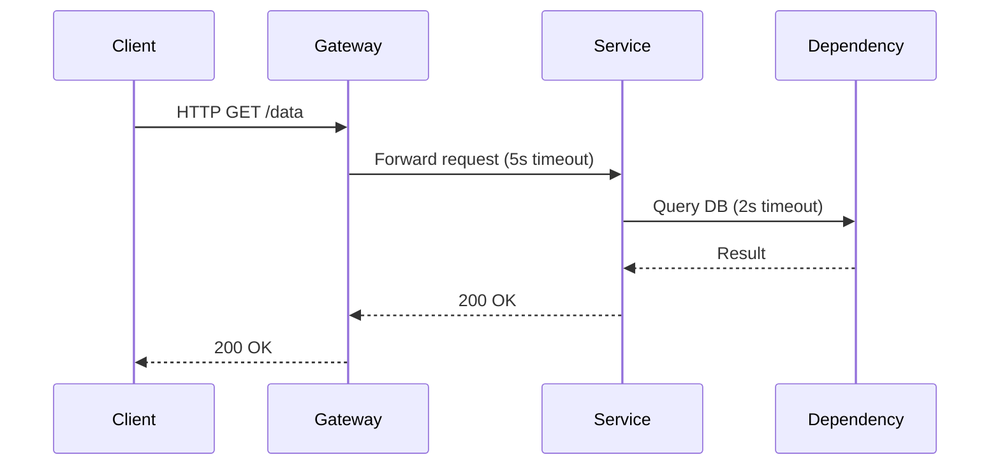

<!-- Generated by Groq via GitHub Actions -->
<!-- Topic ID: T144 -->
<!-- Category: Reliability Engineering -->
<!-- Generated at UTC: 2026-10-28T06:58:53.570118+00:00 -->

# Timeouts

## 1. What problem does this solve?

- **Problem**: A backend service can get stuck waiting for an external dependency (DB, cache, third‑party API, another microservice) that never responds or takes too long.  
- **Why it matters**:  
  - *Resource leakage*: The request thread or event loop stays occupied, exhausting CPU or connection pools.  
  - *User experience*: Clients see hanging requests, time‑outs, or degraded latency.  
  - *Cascade*: A single slow call can back‑pressure the entire system, causing a denial‑of‑service.  
- **If not used**:  
  - Unbounded waits lead to memory leaks, exhausted connection pools, and eventually crashes.  
  - In a distributed system, a single slow node can stall the whole chain.  
- **Real‑world appearance**:  
  - HTTP request handlers in Express/Next.js.  
  - Database queries in TypeORM/Prisma.  
  - Redis commands, Kafka producers/consumers.  
  - External AI inference calls (e.g., OpenAI, HuggingFace).  

## 2. Mental model

**Analogy**:  
Imagine a waiter in a busy restaurant who keeps a customer’s order in the kitchen. If the kitchen takes forever, the waiter will eventually give up and ask the customer to leave. The waiter’s “give‑up” time is the timeout.

**Engineering model**:  
A timeout is a *deadline* attached to an operation. If the operation hasn’t finished by that deadline, the system aborts it, cleans up resources, and returns an error. It’s a safety valve that protects the system from indefinite blocking.

## 3. Deep explanation

| Topic | Details |
|-------|---------|
| **Internals** | In Node.js, timeouts are often implemented with `setTimeout` or the `AbortController` API. For database drivers, the driver exposes a `timeout` option that sets a socket or query timeout. |
| **Important terminology** | *Timeout*, *deadline*, *cancellation*, *abort signal*, *retry*, *back‑off*. |
| **Trade‑offs** | Shorter timeouts reduce resource usage but may increase failure rates; longer timeouts improve success but risk cascading failures. |
| **Failure modes** | *Hard timeout*: operation is aborted; *soft timeout*: operation continues but result is ignored. |
| **Limitations** | Timeouts cannot fix slow code; they only protect against hangs. They also add complexity (error handling, retries). |
| **Where it fits** | In a request‑response pipeline: client → API gateway → microservice → DB/Cache/External API. Each hop can have its own timeout. |
| **Interactions** | Timeouts work with retries (exponential back‑off), circuit breakers, and rate limiting. They also influence observability (latency metrics, error rates). |

## 4. How it works

1. **Client sends request** → API gateway.  
2. **Gateway forwards** to backend service with a *request timeout* (e.g., 5 s).  
3. **Backend receives** and starts processing.  
4. **Backend makes external call** (DB, Redis, AI) with a *dependency timeout* (e.g., 2 s).  
5. **If dependency responds** before its timeout → backend continues.  
6. **If dependency times out** → abort signal is fired, backend cleans up, and returns a 504/502 error.  
7. **If backend’s own processing exceeds its timeout** → abort, return 503.  
8. **Client receives error** and can retry or fallback.



## 5. Practical implementation

### Node.js / TypeScript example

```ts
// src/handlers/getUser.ts
import { Request, Response } from 'express';
import { getUserFromDb } from '../db';
import { AbortController } from 'abort-controller';

export async function getUserHandler(req: Request, res: Response) {
  // 1. Set a 5s timeout for the entire request
  const controller = new AbortController();
  const timeoutId = setTimeout(() => controller.abort(), 5000);

  try {
    // 2. Call DB with a 2s timeout
    const user = await getUserFromDb(req.params.id, controller.signal, 2000);
    res.json(user);
  } catch (err: any) {
    if (err.name === 'AbortError') {
      // Timeout happened
      res.status(504).json({ error: 'Request timed out' });
    } else {
      // Other errors
      res.status(500).json({ error: 'Internal server error' });
    }
  } finally {
    clearTimeout(timeoutId);
  }
}
```

```ts
// src/db/index.ts
import { Pool } from 'pg';
const pool = new Pool();

export async function getUserFromDb(
  id: string,
  signal: AbortSignal,
  timeoutMs: number
) {
  // 3. Pass timeout to the driver
  const client = await pool.connect();
  try {
    const res = await client.query({
      text: 'SELECT * FROM users WHERE id = $1',
      values: [id],
      // pg driver supports a `statement_timeout` per query
      statement_timeout: timeoutMs,
    }, signal);
    return res.rows[0];
  } finally {
    client.release();
  }
}
```

**Key lines explained**

- `AbortController` + `setTimeout` → global request deadline.  
- `signal` passed to the DB query → driver can abort the query.  
- `statement_timeout` → PostgreSQL enforces the per‑query timeout.

### Redis example

```ts
import { createClient } from 'redis';

const client = createClient();
await client.connect();

async function getCache(key: string) {
  const controller = new AbortController();
  setTimeout(() => controller.abort(), 3000); // 3s timeout
  try {
    return await client.get(key, { abortSignal: controller.signal });
  } catch (e) {
    if (e.name === 'AbortError') throw new Error('Redis timeout');
    throw e;
  }
}
```

## 6. Production considerations

| Concern | How timeouts help | Practical tips |
|---------|------------------|----------------|
| **Scalability** | Prevents resource exhaustion. | Tune per‑service timeouts based on load tests. |
| **Reliability** | Avoids cascading failures. | Combine with circuit breakers; retry on transient errors. |
| **Security** | Limits exposure to DoS via slow connections. | Use TLS session timeouts; validate client IPs. |
| **Observability** | Exposes latency and failure rates. | Emit metrics: `request_timeout_total`, `dependency_timeout_seconds`. |
| **Performance** | Reduces average latency by cutting off slow paths. | Profile hot paths; adjust timeouts to match SLA. |
| **Error handling** | Provides clear error codes (504, 502). | Map internal errors to HTTP status codes. |
| **Resource usage** | Frees sockets, threads, memory. | Use connection pools with max idle time. |
| **Operational concerns** | Requires monitoring of timeout rates. | Alert on high timeout percentages. |
| **Failure recovery** | Allows graceful degradation. | Fallback to cached data or default responses. |
| **Deployment** | Timeouts may need to be updated with new versions. | Store in config files or feature flags. |

## 7. Common mistakes

| Mistake | Why it’s bad |
|---------|--------------|
| **No timeout on external calls** | Leads to hanging requests and resource leaks. |
| **Using a single global timeout for everything** | A slow DB query can kill a fast cache hit; over‑aggressive timeouts cause false positives. |
| **Ignoring abort signals** | Some drivers ignore `AbortSignal`; you must verify support. |
| **Retrying without back‑off** | Can overload the dependency again. |
| **Returning 200 on timeout** | Hides failures; clients cannot react. |
| **Setting timeouts too short** | Legitimate requests fail under load. |
| **Not clearing timers** | Memory leaks in long‑running processes. |

## 8. Senior engineer perspective

When scaling to thousands of requests per second:

- **Architecture decisions**  
  - *Per‑hop timeouts*: API gateway, service, DB, external API.  
  - *Circuit breakers*: Open after a threshold of timeouts.  
  - *Bulkhead isolation*: Separate thread pools per dependency.  

- **Trade‑offs**  
  - Shorter timeouts reduce resource usage but increase error rates.  
  - Longer timeouts improve success but risk cascading failures.  

- **Bottlenecks**  
  - Connection pool exhaustion.  
  - CPU bound operations that ignore abort signals.  

- **Failure scenarios**  
  - *Partial failure*: DB times out but cache succeeds.  
  - *Total failure*: All dependencies time out → service returns 503.  

- **Monitoring**  
  - Latency histograms per dependency.  
  - Timeout rate vs. success rate dashboards.  

- **Cost/performance**  
  - Timeouts reduce idle connections, lowering cloud costs.  
  - Too many retries can increase load on downstream services.  

- **When NOT to use**  
  - For idempotent, short‑lived operations where a retry is cheap.  
  - In internal micro‑services with guaranteed low latency (e.g., in‑memory cache).  

## 9. Interview questions

1. **Beginner**: *What is a timeout and why do we need it in a backend service?*  
   - Answer: A deadline after which an operation is aborted to prevent hanging, resource exhaustion, and cascading failures.

2. **Beginner**: *How do you implement a timeout for a database query in Node.js?*  
   - Answer: Use the driver’s timeout option (e.g., `statement_timeout` in PostgreSQL) or wrap the query in an `AbortController` with `setTimeout`.

3. **Senior**: *Explain how you would design a timeout strategy for a microservice that calls three external APIs, each with different reliability characteristics.*  
   - Answer: Assign per‑dependency timeouts based on SLA and reliability; use circuit breakers; implement retries with exponential back‑off; monitor each timeout rate separately.

4. **Senior**: *What are the trade‑offs between using a hard timeout vs. a soft timeout with retries?*  
   - Answer: Hard timeout guarantees resource release but may increase failure rate; soft timeout allows retries but can increase load and latency; choose based on SLA and downstream cost.

5. **Scenario/Debugging**: *Your service is returning a lot of 504 errors during peak traffic. What steps would you take to diagnose and fix the issue?*  
   - Answer: Check timeout metrics; identify which dependency is timing out; review load on that dependency; adjust timeout or add retries; consider scaling the dependency or adding caching; update circuit breaker thresholds.

## 10. Hands‑on task

**Task**: Add a 3‑second timeout to the `/search` endpoint in the `nextjs` app that queries a PostgreSQL database. If the query times out, return a 504 error. Then, add a retry mechanism that retries once with exponential back‑off (500 ms) before giving up.

**Steps**  
1. Wrap the DB query in an `AbortController`.  
2. Use `setTimeout` to trigger `abort()` after 3000 ms.  
3. Catch `AbortError` and return 504.  
4. Implement a retry loop with `setTimeout` for back‑off.  
5. Verify behavior with a slow query (e.g., `pg_sleep(5)`).

## 11. Quick revision

- Timeouts are *deadlines* that abort long‑running operations.  
- Use `AbortController` + `setTimeout` in Node.js.  
- Drivers often expose per‑query timeouts (`statement_timeout`).  
- Combine timeouts with retries, back‑off, and circuit breakers.  
- Separate timeouts per hop: client → gateway → service → dependency.  
- Monitor timeout rates and latency histograms.  
- Avoid global timeouts; tailor per‑dependency.  
- Clear timers to prevent memory leaks.  
- Return appropriate HTTP status (504, 502, 503).  
- In production, tune based on load tests and SLA.

## 12. References

- [Node.js AbortController](https://nodejs.org/api/abortcontroller.html)  
- [Express Timeout Middleware](https://expressjs.com/en/advanced/best-practice-security.html#timeout)  
- [PostgreSQL statement_timeout](https://www.postgresql.org/docs/current/runtime-config-client.html#GUC-STATEMENT-TIMEOUT)  
- [Redis Abort Signal](https://github.com/redis/node-redis#abortsignal)  
- [OpenTelemetry: Timeout and Cancellation](https://opentelemetry.io/docs/concepts/observability/#cancellation)  
- [AWS SDK v3: Timeout](https://docs.aws.amazon.com/AWSJavaScriptSDK/v3/latest/clients/client-s3/interfaces/ClientConfiguration.html#requesttimeout)  

---
