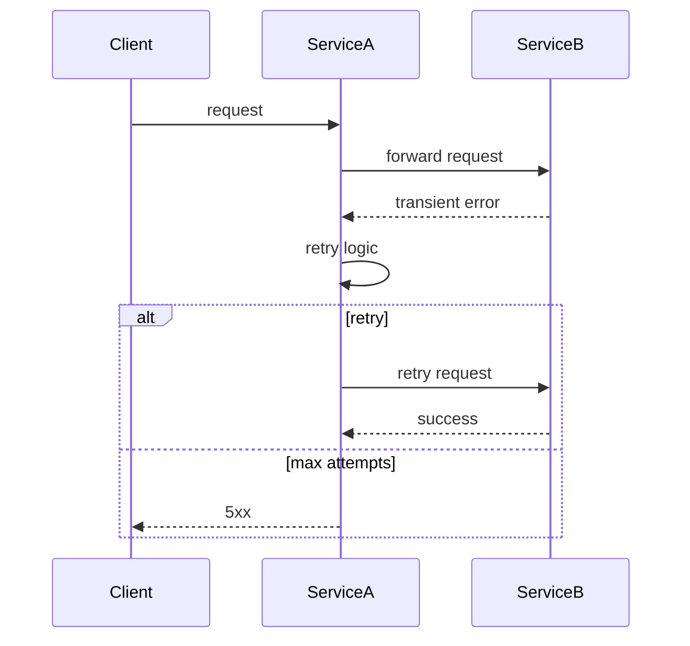

<!-- Generated by Groq via GitHub Actions -->
<!-- Topic ID: T145 -->
<!-- Category: Reliability Engineering -->
<!-- Generated at UTC: 2026-10-28T18:59:28.775139+00:00 -->

# Retries

## 1. What problem does this solve?

When a backend service calls another service, the network, the callee, or the underlying infrastructure can fail temporarily.  
Typical failure modes:

| Failure | Example | Impact if no retry |
|---------|---------|--------------------|
| **Transient network glitch** | 50 ms packet loss | Request fails, user sees error |
| **Service overload** | Rate‑limit hit, 429 | Client must back‑off manually |
| **Database connection hiccup** | Postgres connection pool exhausted | Transaction aborts |
| **Message broker outage** | Kafka broker down | Producer cannot publish |

**Why it matters**

* **User experience** – A single transient failure can turn a successful operation into a 5xx error.
* **Throughput** – Automatic retries can recover lost work without manual intervention.
* **Cost** – Unrecovered failures may trigger compensating actions (e.g., double‑charging a customer).

**What happens if we ignore retries**

* Increased error rates → higher SLA violations.
* More manual ops work → higher MTTR (Mean Time To Recovery).
* Potential data loss or duplicate work if callers don’t handle idempotency.

**Where retries appear in real systems**

* HTTP clients (e.g., Axios, Got, node-fetch) retry on 5xx or network errors.
* Message brokers (Kafka, RabbitMQ) retry message delivery.
* Database drivers (pg, mongoose) retry transient connection errors.
* Cloud SDKs (AWS SDK, GCP client libraries) automatically retry on throttling.

---

## 2. Mental model

**Analogy – “The Postman”**

Imagine you’re sending a letter to a friend. The post office sometimes drops the letter in the wrong bin or the postman gets stuck in traffic. You can:

1. **Ask the post office to try again** (retry).
2. **Give the post office a deadline** (timeout).
3. **Keep a copy of the letter** (idempotency).

If you never retry, the letter may never reach your friend. If you retry too aggressively, you overload the post office.

**Engineering model**

* **Request** → **Transport** → **Service**  
  If the transport or service fails transiently, we *retry* the request after a back‑off period.

* **Retry policy** = *when* to retry, *how many* times, *how long* to wait, *what back‑off strategy*.

* **Idempotency** = guarantee that repeated requests have the same effect, so retries don’t corrupt state.

---

## 3. Deep explanation

### Internals

1. **Retry loop** – A wrapper that executes the operation, catches failures, and decides whether to retry.
2. **Back‑off algorithm** – Determines the delay between attempts (exponential, jittered, constant).
3. **Circuit breaker** – Optional guard that stops retries if the failure rate is too high.
4. **Idempotency key** – Optional header or field that lets the callee recognize duplicate requests.

### Important terminology

| Term | Meaning |
|------|---------|
| **Transient error** | Error that is likely to succeed if retried (network hiccup, 5xx). |
| **Permanent error** | Error that will not succeed on retry (validation error, 4xx). |
| **Exponential back‑off** | Delay grows exponentially: `delay = base * 2^attempt`. |
| **Jitter** | Random variation added to delay to avoid thundering herd. |
| **Retry‑after** | Header indicating how long to wait before retrying. |
| **Idempotent** | Operation can be applied multiple times without changing the result. |
| **Circuit breaker** | Pattern that opens the circuit after a threshold of failures. |

### Trade‑offs

| Aspect | Pros | Cons |
|--------|------|------|
| **Retries** | Higher success rate, better user experience | Extra latency, higher load on downstream services |
| **Back‑off** | Avoids hammering services | Longer recovery time for real failures |
| **Jitter** | Prevents synchronized retries | Slightly more complex logic |
| **Circuit breaker** | Protects downstream services | Adds state management overhead |

### Failure modes

* **Thundering herd** – Many clients retry simultaneously, causing a spike.
* **Duplicate side effects** – Non‑idempotent operations cause data corruption.
* **Infinite loops** – Misconfigured retry limits lead to endless attempts.
* **Resource exhaustion** – Retrying too many times consumes CPU/memory.

### Limitations

* Retries only help with *transient* failures; they won’t fix bugs or permanent misconfigurations.
* They add latency; for latency‑sensitive paths you may need to cap retries aggressively.
* They require careful design of idempotency and state consistency.

### Where it fits

* **API Gateway** – Handles retry logic for downstream services.
* **Service Mesh** – Provides built‑in retry policies (e.g., Istio, Linkerd).
* **Message Queue** – Retries message delivery on consumer failure.
* **Database driver** – Retries connection or query errors.

### Interaction with related concepts

* **Timeouts** – Retries must respect overall request timeout to avoid hanging.
* **Rate limiting** – Retries should respect `Retry-After` headers or service limits.
* **Observability** – Each retry should be logged/metric‑ed to detect patterns.
* **Idempotency** – Essential to avoid duplicate side effects.

---

## 4. How it works

### Step‑by‑step flow

1. **Client sends request** to Service A.
2. Service A forwards request to Service B.
3. Service B fails transiently (e.g., network timeout).
4. Service A’s retry wrapper catches the error.
5. Service A waits `delay = base * 2^attempt + jitter`.
6. Service A retries the request.
7. If Service B succeeds, Service A returns success.
8. If maximum attempts reached, Service A returns failure.



---

## 5. Practical implementation

### TypeScript / Node.js example – HTTP client with retry

```ts
import fetch, { RequestInit, Response } from 'node-fetch';

type RetryOptions = {
  /** Maximum number of attempts (including the first try) */
  retries?: number;
  /** Base delay in ms for exponential back‑off */
  baseDelay?: number;
  /** Optional function to decide if an error is retryable */
  shouldRetry?: (err: any, attempt: number) => boolean;
};

const defaultOptions: RetryOptions = {
  retries: 5,
  baseDelay: 100, // 100 ms
  shouldRetry: (err) => {
    // Retry on network errors or 5xx status
    if (err instanceof fetch.FetchError) return true;
    if (err instanceof Response && err.status >= 500) return true;
    return false;
  },
};

async function fetchWithRetry(
  url: string,
  init: RequestInit = {},
  opts: RetryOptions = {}
): Promise<Response> {
  const { retries, baseDelay, shouldRetry } = { ...defaultOptions, ...opts };
  let attempt = 0;

  while (true) {
    try {
      const res = await fetch(url, init);
      if (!shouldRetry!(res, attempt)) return res; // success or non‑retryable
      throw res; // treat non‑retryable 5xx as error to trigger retry logic
    } catch (err) {
      attempt++;
      if (attempt > (retries ?? 0)) throw err; // give up

      // Exponential back‑off with jitter
      const delay = baseDelay! * Math.pow(2, attempt - 1);
      const jitter = Math.random() * delay * 0.1; // ±10%
      const wait = delay + jitter;

      console.warn(
        `Attempt ${attempt} failed. Retrying in ${wait.toFixed(0)} ms. Error:`,
        err
      );
      await new Promise((r) => setTimeout(r, wait));
    }
  }
}
```

**Key points**

* `shouldRetry` lets you filter which errors trigger a retry.
* `fetchWithRetry` is generic; you can wrap any async function.
* Jitter prevents many clients from retrying at the same time.

### Using the retry wrapper

```ts
async function getUserProfile(userId: string) {
  const url = `https://api.example.com/users/${userId}`;
  const res = await fetchWithRetry(url, { method: 'GET' }, { retries: 3 });
  if (!res.ok) throw new Error(`HTTP ${res.status}`);
  return res.json();
}
```

---

## 6. Production considerations

| Concern | Recommendation |
|---------|----------------|
| **Scalability** | Keep retry limits low; use distributed tracing to avoid cascading failures. |
| **Reliability** | Combine retries with circuit breakers; respect `Retry-After` headers. |
| **Security** | Avoid retrying on authentication errors; do not retry with stale credentials. |
| **Observability** | Emit metrics: `retry_attempts_total`, `retry_successes_total`, `retry_failures_total`. Log attempt number and delay. |
| **Performance** | Use async/await; avoid blocking timers. |
| **Error handling** | Distinguish transient vs permanent errors; do not retry on 4xx. |
| **Resource usage** | Limit concurrent retries; use a semaphore if many requests share a connection pool. |
| **Operational concerns** | Monitor retry rates; high rates may indicate upstream issues. |
| **Failure recovery** | If retries exhaust, surface a clear error to the caller; consider a fallback or circuit breaker. |
| **Deployment** | Expose retry policy via config (env vars, feature flags) to adjust without redeploying. |

---

## 7. Common mistakes

| Mistake | Why it’s problematic |
|---------|----------------------|
| **Retrying everything** | Causes duplicate side effects and overloads downstream services. |
| **No back‑off** | Creates a thundering herd; can crash the callee. |
| **No idempotency** | Re‑executing non‑idempotent operations leads to data corruption. |
| **Infinite retry loop** | Consumes resources and never returns to the caller. |
| **Ignoring `Retry-After`** | Violates service contract; may trigger throttling. |
| **Hard‑coding retry limits** | Makes it hard to adapt to changing traffic patterns. |
| **Retrying on 4xx** | Wastes time; the error is permanent. |
| **Not logging retries** | Hard to diagnose why retries are happening. |

---

## 8. Senior engineer perspective

### What changes at scale?

* **Policy as code** – Store retry policies in a central config service or feature flag system.
* **Distributed tracing** – Correlate retries across services to detect systemic issues.
* **Back‑off tuning** – Use metrics to adjust base delay and max attempts per endpoint.
* **Circuit breaker integration** – Open the circuit when failure rate > threshold; close after stability period.
* **Idempotency enforcement** – Design APIs to accept idempotency keys; store them in a fast store (Redis) to dedupe.
* **Rate‑limit awareness** – Respect `Retry-After` and service‑level rate limits; avoid retry storms.

### Design decisions

| Decision | Trade‑offs |
|----------|------------|
| **Central vs per‑service retry config** | Central simplifies governance but adds latency to fetch config. |
| **Jitter strategy** | Simple jitter reduces complexity; full random jitter may improve distribution but adds variance. |
| **Maximum retries** | More retries increase success but add latency; fewer reduce load but risk failures. |
| **Timeout vs retry** | Longer timeouts give more retry opportunities but increase user wait time. |
| **Retry on specific status codes** | Narrowing to 5xx reduces unnecessary retries but may miss transient 4xx (e.g., 429). |

### When NOT to use retries

* **Critical idempotent operations** that must not be duplicated (e.g., financial transfers) – use compensating actions or manual intervention.
* **High‑latency paths** where retries would exceed SLA.
* **Non‑transient failures** (e.g., validation errors) – always fail fast.

---

## 9. Interview questions

1. **Beginner** – *What is the purpose of exponential back‑off in retry logic?*  
   *Answer:* It gradually increases the wait time between retries to reduce load on the downstream service and avoid thundering herd problems.

2. **Beginner** – *When should you not retry a request?*  
   *Answer:* When the error is permanent (e.g., 4xx validation errors), or when the operation is non‑idempotent and retrying could cause side effects.

3. **Senior** – *Explain how you would design a retry policy for a microservice that calls an external payment gateway.*  
   *Answer:* Use a small number of retries (e.g., 3), exponential back‑off with jitter, respect `Retry-After`, enforce idempotency keys, integrate a circuit breaker, and expose policy via config.

4. **Senior** – *Describe a scenario where retries could actually make a system less reliable.*  
   *Answer:* If retries are too aggressive, they can overload the downstream service, causing cascading failures and higher overall error rates (thundering herd).

5. **Scenario/Debugging** – *Your service logs show a high number of retries but the downstream service is still failing. What steps would you take to investigate and resolve the issue?*  
   *Answer:*  
   - Check retry metrics and logs to confirm retry counts.  
   - Verify the retry policy (max attempts, back‑off).  
   - Inspect the downstream service logs for errors.  
   - Look for rate‑limit or capacity issues.  
   - Consider adding a circuit breaker or reducing retry attempts.  
   - Validate idempotency handling if duplicate requests are causing failures.

---

## 10. Hands‑on task

**Task:** Add a retry wrapper to the existing `apiClient` in the repository.

1. Create a `retry.ts` module that exports a `fetchWithRetry` function (similar to the example above).
2. Modify `apiClient.ts` to use `fetchWithRetry` for all outbound HTTP calls.
3. Add a configuration file (`retry-config.json`) that allows setting `retries`, `baseDelay`, and `maxDelay`.
4. Write a unit test that simulates a transient 500 error and verifies that the request is retried the configured number of times.

**Goal:** Demonstrate understanding of retry logic, configuration, and testing.

---

## 11. Quick revision

- Retries solve transient failures by re‑attempting operations.
- Distinguish *transient* vs *permanent* errors.
- Use exponential back‑off with jitter to avoid thundering herd.
- Respect `Retry-After` headers and service limits.
- Ensure operations are idempotent to avoid duplicate side effects.
- Combine retries with circuit breakers for safety.
- Log and metric each retry attempt for observability.
- Keep retry limits low to balance success rate and latency.
- Configure retry policies externally (env, config service).
- Test retry logic by simulating failures and verifying retry counts.

---

## 12. References

- [Node Fetch – Retry Logic](https://github.com/node-fetch/node-fetch#retry-logic)  
- [AWS SDK Retry Strategy](https://docs.aws.amazon.com/sdk-for-javascript/v3/developer-guide/retries.html)  
- [Istio Retry Policy](https://istio.io/latest/docs/tasks/traffic-management/retry/)  
- [Exponential Backoff and Jitter – Google Cloud](https://cloud.google.com/storage/docs/exponential-backoff)  
- [Circuit Breaker Pattern – Martin Fowler](https://martinfowler.com/bliki/CircuitBreaker.html)  
- [HTTP Retry‑After Header](https://developer.mozilla.org/en-US/docs/Web/HTTP/Headers/Retry-After)  

---
