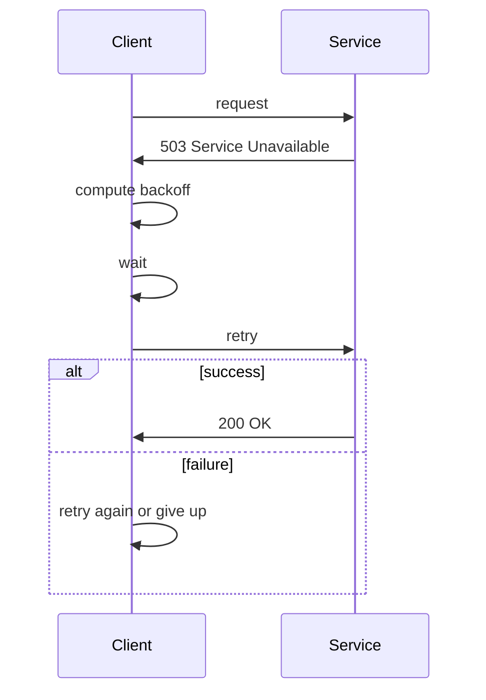

<!-- Generated by Groq via GitHub Actions -->
<!-- Topic ID: T146 -->
<!-- Category: Reliability Engineering -->
<!-- Generated at UTC: 2026-10-28T18:59:28.775139+00:00 -->

# Exponential backoff

## 1. What problem does this solve?

When a backend service calls another service (HTTP, database, message broker, etc.) it may encounter transient failures: network hiccups, temporary overload, rate limits, or brief outages.  
If the caller immediately retries, it can:

* **Amplify the problem** – many clients retry at the same time, creating a *thundering herd* that overwhelms the target service.
* **Waste resources** – repeated failed attempts consume CPU, memory, and network bandwidth.
* **Mask real issues** – continuous retries can hide underlying problems, making debugging harder.

Exponential backoff mitigates these issues by spacing retries increasingly farther apart, giving the target service time to recover while still giving the caller a chance to succeed.

### Why the problem matters
* **Availability** – A single point of failure can cascade if many services retry too aggressively.
* **Cost** – Unnecessary retries can increase API call quotas or cloud bandwidth costs.
* **Observability** – Without backoff, logs can be flooded with retry attempts, obscuring real errors.

### What happens if this concept is not used
* **Thundering herd**: All clients hammer the same endpoint simultaneously.
* **Resource exhaustion**: Servers run out of connections or threads.
* **Poor user experience**: Clients may experience long, uninformative delays.

### Where this concept appears in real backend systems
* **HTTP clients** (e.g., `axios-retry`, `fetch-retry`).
* **Message brokers** (e.g., Kafka consumer retry policies).
* **Database drivers** (e.g., PostgreSQL retry logic on connection failures).
* **Infrastructure tools** (e.g., Terraform, Pulumi, CI/CD pipelines).

---

## 2. Mental model

### Simple analogy
Imagine you’re calling a friend who is busy. You call, they’re on the phone, so you wait a short time and try again. If they’re still busy, you wait a bit longer, then longer, and so on. Eventually, either the friend picks up or you give up. The waiting times grow exponentially: 1 s, 2 s, 4 s, 8 s…

### Precise engineering model
* **Retry** – attempt the operation again after a failure.
* **Backoff** – the delay between retries.
* **Exponential** – the delay grows multiplicatively (e.g., *base* × 2ⁿ).
* **Jitter** – random variation added to avoid synchronized retries.

---

## 3. Deep explanation

### Internals
1. **Base delay** (`baseMs`) – the initial wait time (often 100 ms).
2. **Multiplier** (`factor`) – usually 2, but can be tuned.
3. **Maximum delay** (`maxMs`) – caps the wait to avoid excessive pauses.
4. **Maximum attempts** (`maxRetries`) – stops retrying after a set number.
5. **Jitter** – random offset (full or equal jitter) to spread retries.

The algorithm:
```
delay = min(maxMs, baseMs * (factor ** attempt)) + jitter
```

### Important terminology
* **Retry policy** – the set of rules governing when and how to retry.
* **Thundering herd** – many clients retry simultaneously, causing spikes.
* **Back‑off window** – the period during which retries are scheduled.
* **Circuit breaker** – a complementary pattern that stops retries after a threshold.

### Trade‑offs
| Aspect | Benefit | Drawback |
|--------|---------|----------|
| **Fast recovery** | Fewer retries → quicker success | May hit target too soon if it’s still down |
| **Graceful degradation** | Spreads load → target recovers | Longer wait → user sees delay |
| **Resource usage** | Fewer concurrent retries | More time spent idle waiting |
| **Complexity** | Adds logic | More code paths, harder to test |

### Failure modes
* **Infinite retry loop** – no max attempts → runaway resource consumption.
* **Back‑off too aggressive** – user waits too long, causing timeouts.
* **Missing jitter** – synchronized retries re‑create the thundering herd.
* **Incorrect error classification** – retrying on permanent errors wastes effort.

### Limitations
* Only addresses *transient* failures; permanent errors should not be retried.
* Requires careful tuning per service; a one‑size‑fits‑all policy can hurt performance.
* Does not solve underlying issues (e.g., misconfigured rate limits).

### Where it fits in a backend architecture
* **Client side** – HTTP clients, database drivers, message producers.
* **Server side** – retrying outbound calls, idempotent operations.
* **Infrastructure** – CI/CD pipelines, cloud function invocations.

### Interaction with related concepts
* **Circuit breaker** – often used together; backoff stops retries, circuit breaker stops attempts entirely after a threshold.
* **Rate limiting** – backoff can respect rate‑limit headers (`Retry-After`).
* **Idempotency** – retries should be safe; the operation must be idempotent or use idempotency keys.

---

## 4. How it works

### Step‑by‑step flow

1. **Attempt** the operation.
2. If it **succeeds**, return the result.
3. If it **fails** with a *transient* error:
   1. Increment `attempt`.
   2. Compute `delay = min(maxMs, baseMs * (factor ** attempt)) + jitter`.
   3. Wait `delay` milliseconds (non‑blocking).
   4. Go to step 1.
4. If `attempt` exceeds `maxRetries`, give up and propagate the error.



---

## 5. Practical implementation

Below is a reusable TypeScript helper that retries an async function with exponential backoff and jitter. It works for HTTP requests, DB queries, or any promise‑returning operation.

```ts
// backoff.ts
export type RetryableFn<T> = () => Promise<T>;

export interface BackoffOptions {
  /** Base delay in ms (e.g., 100) */
  baseMs?: number;
  /** Multiplier (default 2) */
  factor?: number;
  /** Maximum delay in ms (default 30_000) */
  maxMs?: number;
  /** Maximum number of retries (default 5) */
  maxRetries?: number;
  /** Jitter strategy: 'full' or 'equal' */
  jitter?: 'full' | 'equal';
  /** Function to decide if an error is transient */
  shouldRetry?: (err: any) => boolean;
}

const defaultOptions: BackoffOptions = {
  baseMs: 100,
  factor: 2,
  maxMs: 30_000,
  maxRetries: 5,
  jitter: 'full',
  shouldRetry: (err) => {
    // Retry on network errors or 5xx HTTP status
    if (err.code === 'ECONNRESET' || err.code === 'ETIMEDOUT') return true;
    if (err.response?.status >= 500) return true;
    return false;
  },
};

export async function retryWithBackoff<T>(
  fn: RetryableFn<T>,
  opts: BackoffOptions = {}
): Promise<T> {
  const {
    baseMs,
    factor,
    maxMs,
    maxRetries,
    jitter,
    shouldRetry,
  } = { ...defaultOptions, ...opts };

  let attempt = 0;
  while (true) {
    try {
      return await fn();
    } catch (err) {
      attempt++;
      if (attempt > maxRetries || !shouldRetry(err)) {
        throw err; // give up
      }

      // Calculate exponential delay
      let delay = Math.min(maxMs!, baseMs! * Math.pow(factor!, attempt));

      // Apply jitter
      if (jitter === 'full') {
        delay = Math.random() * delay;
      } else if (jitter === 'equal') {
        delay = delay / 2 + Math.random() * (delay / 2);
      }

      // Non‑blocking wait
      await new Promise((res) => setTimeout(res, delay));
    }
  }
}
```

### Usage example – HTTP request with `node-fetch`

```ts
import fetch from 'node-fetch';
import { retryWithBackoff } from './backoff';

async function fetchWithRetry(url: string) {
  return await retryWithBackoff(async () => {
    const res = await fetch(url);
    if (!res.ok) throw new Error(`HTTP ${res.status}`);
    return res.json();
  }, {
    baseMs: 200,
    maxRetries: 6,
    jitter: 'full',
  });
}

(async () => {
  try {
    const data = await fetchWithRetry('https://api.example.com/data');
    console.log('Fetched', data);
  } catch (err) {
    console.error('Failed after retries', err);
  }
})();
```

### Usage example – PostgreSQL query (node‑pg)

```ts
import { Client } from 'pg';
import { retryWithBackoff } from './backoff';

const pgClient = new Client({ connectionString: process.env.DATABASE_URL });
await pgClient.connect();

async function getUser(id: number) {
  return await retryWithBackoff(async () => {
    const res = await pgClient.query('SELECT * FROM users WHERE id = $1', [id]);
    if (res.rowCount === 0) throw new Error('Not found');
    return res.rows[0];
  }, {
    baseMs: 100,
    maxRetries: 4,
    jitter: 'equal',
  });
}
```

---

## 6. Production considerations

| Concern | How backoff helps | Practical tips |
|---------|------------------|----------------|
| **Scalability** | Reduces burst traffic to downstream services | Tune `maxMs` to match target’s recovery time |
| **Reliability** | Avoids cascading failures | Combine with circuit breakers and idempotency |
| **Security** | Prevents DoS from retry loops | Validate retryable errors; reject malicious patterns |
| **Observability** | Exposes retry patterns in metrics | Emit `retry_attempt`, `retry_delay` events |
| **Performance** | Balances latency vs. success rate | Expose `maxRetries` as a config flag |
| **Error handling** | Distinguishes transient vs. permanent | Use `shouldRetry` callback |
| **Resource usage** | Limits concurrent retries | Use a semaphore or pool for heavy workloads |
| **Operational concerns** | Easier to debug failures | Log retry attempts with context |
| **Failure recovery** | Gives services time to recover | Respect `Retry-After` headers when present |
| **Deployment** | Rolling updates may need backoff tweaks | Test with canary deployments |

---

## 7. Common mistakes

| Mistake | Why it’s problematic |
|---------|----------------------|
| **Fixed delay** (e.g., always wait 1 s) | Doesn’t adapt to load; can still cause spikes. |
| **No jitter** | All clients retry at the same time → thundering herd. |
| **Infinite retries** | Resource exhaustion, silent failures. |
| **Retrying on permanent errors** | Wastes time and may corrupt state. |
| **Blocking sleep** (`sleepSync`) | Blocks event loop, hurts throughput. |
| **Hard‑coding retry limits** | Inflexible across environments. |
| **Ignoring `Retry-After`** | Violates API contract, may be throttled further. |
| **Not logging retries** | Hard to diagnose why a request failed. |
| **Using exponential backoff for idempotent ops only** | Non‑idempotent ops may corrupt data if retried. |

---

## 8. Senior engineer perspective

### Architecture decisions
* **Where to place the retry logic** – client vs. server; sometimes a dedicated retry middleware is cleaner.
* **Choosing backoff parameters** – base delay, multiplier, max delay; often derived from SLA and target service health metrics.
* **Combining with circuit breakers** – decide thresholds for opening the circuit vs. retrying.
* **Idempotency enforcement** – ensure retried requests are safe; use idempotency keys for external APIs.

### Trade‑offs
* **Latency vs. success** – longer backoff reduces load but increases perceived latency.
* **Cost** – more retries can hit API quotas or increase compute usage.
* **Complexity** – adding backoff logic increases code paths; consider a library or framework support.

### Bottlenecks
* **Connection pools** – many retries may exhaust DB connections; use pooling or backpressure.
* **Message queues** – retries can pile up in the queue; use dead‑letter queues for failures.

### Failure scenarios
* **Target service down for minutes** – backoff may still retry too often; circuit breaker can help.
* **Rate limiting** – backoff may not respect `Retry-After`; need to parse headers.

### Monitoring
* **Metrics** – `retry_attempts_total`, `retry_delay_seconds`, `retry_success_rate`.
* **Tracing** – propagate retry context in distributed traces.
* **Alerts** – high retry rates or long delays can indicate upstream issues.

### Cost/performance considerations
* **Compute** – idle wait time still consumes CPU threads; use async timers.
* **Network** – repeated requests increase bandwidth; consider caching or batching.

### When NOT to use
* **Idempotent operations with low failure rate** – simple retry may be overkill.
* **Critical real‑time paths** – backoff introduces unacceptable latency.
* **Permanent failures** – e.g., 404 Not Found; retrying is wasteful.

---

## 9. Interview questions

1. **Beginner**: *What is exponential backoff and why is it used?*  
   *Answer*: A retry strategy where wait times grow exponentially to reduce load on a failing service and avoid synchronized retries.

2. **Beginner**: *What is jitter and why do we add it to backoff?*  
   *Answer*: Random variation in delay to prevent many clients from retrying at the same time, eliminating the thundering herd problem.

3. **Senior-level**: *How would you design a retry policy for a microservice that calls an external payment API with strict rate limits?*  
   *Answer*: Use exponential backoff with jitter, respect `Retry-After` headers, cap retries, implement a circuit breaker, and log all attempts for audit.

4. **Senior-level**: *Explain how exponential backoff interacts with a circuit breaker pattern.*  
   *Answer*: Circuit breaker opens after a threshold of failures, temporarily halting retries; backoff is applied only while the circuit is closed, preventing overload during recovery.

5. **Scenario/debugging**: *Your service logs show a spike of 10,000 retries in a minute after a database outage. What could be wrong and how would you fix it?*  
   *Answer*: Likely missing jitter or too aggressive base delay. Add jitter, increase `maxMs`, or use a circuit breaker to stop retries until the DB is healthy.

---

## 10. Hands‑on task

**Task**: Implement a retry wrapper for a Redis `GET` operation that uses exponential backoff with jitter.  
*Create a `redisRetry.ts` module that exports `getWithRetry(key: string): Promise<string | null>`.  
*Configure it to retry up to 5 times, base delay 200 ms, max delay 5 s, and full jitter.  
*Write a small test that simulates a transient connection error on the first two attempts and succeeds on the third.*

---

## 11. Quick revision

- Exponential backoff = retry delay grows exponentially (base × 2ⁿ).  
- Jitter = random offset to avoid synchronized retries.  
- Use `maxRetries` and `maxDelay` to bound resource usage.  
- Combine with circuit breakers for better fault tolerance.  
- Respect `Retry-After` headers when available.  
- Log retry attempts and delays for observability.  
- Ensure retried operations are idempotent.  
- Avoid blocking sleeps; use async timers.  
- Tune parameters based on target service SLA and load.  
- Use libraries (`axios-retry`, `node-retry`) when appropriate.

---

## 12. References

- [RFC 6585 – HTTP Extensions for Automatic Retries](https://datatracker.ietf.org/doc/html/rfc6585)  
- [AWS SDK Retry Strategy](https://docs.aws.amazon.com/sdk-for-javascript/v2/developer-guide/retries.html)  
- [Google Cloud Client Libraries – Retry](https://cloud.google.com/sdk/docs/retry)  
- [Node.js `setTimeout` documentation](https://nodejs.org/api/timers.html#timers_settimeout)  
- [PostgreSQL `pg` retry patterns](https://node-postgres.com/features/connection-pooling#retrying)  
- [Circuit Breaker Pattern – Netflix Hystrix](https://github.com/Netflix/Hystrix)  

---
