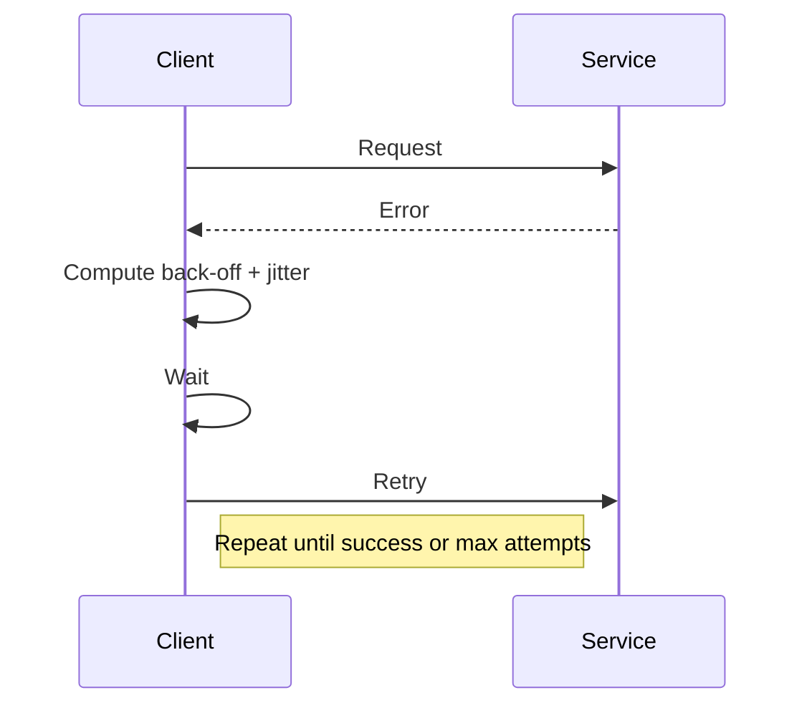

<!-- Generated by Groq via GitHub Actions -->
<!-- Topic ID: T147 -->
<!-- Category: Reliability Engineering -->
<!-- Generated at UTC: 2026-10-29T07:20:56.273662+00:00 -->

# Jitter

## 1. What problem does this solve?

**Motivation**  
When a backend system talks to another service, the round‑trip time (RTT) is rarely constant. Network congestion, load spikes, GC pauses, or even the way a database processes a query can cause the latency to fluctuate. These fluctuations are called **jitter**.

**What problem exists**  
- **Unpredictable response times**: A client may see 100 ms latency one request and 500 ms the next, even if the underlying service is healthy.  
- **Synchronized retries**: If many clients retry at the same deterministic interval, they can overwhelm the target service (the “thundering herd” problem).  
- **Time‑sensitive workflows**: Scheduled jobs or real‑time analytics that rely on precise timing can drift or miss deadlines.

**Why the problem matters**  
- **User experience**: High jitter can make an API feel flaky.  
- **Reliability**: Timeouts triggered by jitter can cascade into larger failures.  
- **Cost**: Spikes in traffic due to synchronized retries can increase load on downstream services, leading to higher infrastructure costs.

**What happens if this concept is not used**  
- Clients may hit hard timeouts, causing cascading failures.  
- Load balancers may see bursty traffic, leading to uneven resource utilization.  
- Scheduled tasks may drift, breaking time‑based contracts (e.g., daily batch jobs).

**Where this concept appears in real backend systems**  
- **API gateways**: Randomized retry delays to avoid thundering herd.  
- **Message brokers**: Consumer back‑off with jitter to smooth out processing bursts.  
- **Distributed tracing**: Jitter in timestamp resolution can affect correlation.  
- **Rate limiting**: Adding jitter to reset windows to avoid synchronized resets.  
- **Scheduled jobs**: Using jitter to spread job start times across a cluster.

---

## 2. Mental model

**Analogy**  
Imagine a group of runners starting a race. If everyone starts exactly at the same time, they will all hit the same traffic light simultaneously, causing a jam. If each runner starts a few seconds apart (randomly), the traffic light will see a smoother flow. Jitter is that random offset that prevents everyone from colliding at the same moment.

**Engineering model**  
- **Latency**: The base time it takes to complete a request.  
- **Jitter**: The *variation* around that base time, often measured as standard deviation or as a percentage of the mean.  
- **Jitter mitigation**: Adding a random component to delays (e.g., back‑off, scheduling) so that simultaneous events are spread out.

---

## 3. Deep explanation

### Internals
- **Latency distribution**: In practice, latency follows a *skewed* distribution (e.g., log‑normal).  
- **Jitter coefficient**: `jitter = stddev / mean`. A high coefficient indicates a highly variable system.  
- **Sources**: Network queues, GC pauses, CPU scheduling, disk I/O, database locks, external API rate limits.

### Important terminology
- **Round‑Trip Time (RTT)** – time from request sent to response received.  
- **Back‑off** – strategy to delay retries after a failure.  
- **Thundering herd** – many clients retrying at the same instant.  
- **Fixed‑delay vs. jittered‑delay** – deterministic vs. randomized retry intervals.

### Trade‑offs
| Approach | Pros | Cons |
|----------|------|------|
| Fixed delay | Predictable latency | Susceptible to thundering herd |
| Jittered delay | Smoothes traffic, reduces spikes | Slightly higher average latency, harder to predict |

### Failure modes
- **Timeout storms**: All clients timeout simultaneously, causing a cascade.  
- **Resource exhaustion**: Burst of retries overwhelms downstream services.  
- **Clock drift**: Scheduled tasks that rely on precise timing may drift if jitter is not accounted for.

### Limitations
- Jitter cannot eliminate latency; it only *spreads* it.  
- Over‑jittering can make latency too high for latency‑sensitive services.  
- Requires careful measurement; blindly adding random delays can mask underlying issues.

### Where this concept fits in a backend architecture
- **Retry layers**: HTTP clients, database drivers, message consumers.  
- **Load balancers**: Randomized health‑check intervals.  
- **Scheduler**: Adding jitter to cron‑like jobs to avoid all nodes starting at the same second.  
- **Rate limiting**: Randomized reset windows.

### Interaction with related concepts
- **Circuit breaker**: Jitter can be used to stagger retries after a breaker opens.  
- **Back‑off**: Jitter is often combined with exponential back‑off.  
- **Caching**: Jitter can help avoid cache stampedes by spreading cache‑miss retries.  
- **Observability**: Metrics should capture jitter (e.g., `latency_stddev_seconds`).

---

## 4. How it works

### Step‑by‑step flow for jittered retry

1. **Initial request** – Client sends request to service.  
2. **Failure detection** – Client receives error or times out.  
3. **Compute base back‑off** – e.g., `base = 2^attempt * 100ms`.  
4. **Add jitter** – `jitter = random(0, base)` (full jitter) or `jitter = base * random(0, 1)` (equal jitter).  
5. **Wait** – `setTimeout` for `base + jitter`.  
6. **Retry** – Send request again.  
7. **Repeat** until success or max attempts.



---

## 5. Practical implementation

### TypeScript/Node.js example – jittered exponential back‑off

```ts
// jitteredRetry.ts
import fetch from 'node-fetch';

/**
 * Exponential back‑off with full jitter.
 * @param url Target URL
 * @param options Fetch options
 * @param maxAttempts Maximum number of attempts
 */
export async function jitteredRetry(
  url: string,
  options: RequestInit = {},
  maxAttempts = 5
): Promise<Response> {
  let attempt = 0;

  while (attempt < maxAttempts) {
    try {
      const res = await fetch(url, options);
      if (!res.ok) throw new Error(`HTTP ${res.status}`);
      return res; // success
    } catch (err) {
      attempt++;
      if (attempt === maxAttempts) throw err;

      // Base delay: 2^attempt * 100ms
      const base = Math.pow(2, attempt) * 100;
      // Full jitter: random between 0 and base
      const jitter = Math.random() * base;
      const delay = base + jitter;

      console.warn(
        `Attempt ${attempt} failed: ${err}. Retrying in ${delay.toFixed(
          0
        )} ms.`
      );
      await new Promise((r) => setTimeout(r, delay));
    }
  }
  // Should never reach here
  throw new Error('Retry loop exited unexpectedly');
}
```

**Key lines explained**

- `Math.pow(2, attempt) * 100` – exponential growth of base delay.  
- `Math.random() * base` – full jitter: uniformly random between 0 and base.  
- `setTimeout` – non‑blocking wait.  
- `maxAttempts` – guard against infinite loops.

### Using the helper

```ts
import { jitteredRetry } from './jitteredRetry';

async function fetchData() {
  const res = await jitteredRetry('https://api.example.com/data');
  const json = await res.json();
  console.log(json);
}

fetchData().catch((e) => console.error('All retries failed:', e));
```

---

## 6. Production considerations

| Concern | What to watch for | Mitigation |
|---------|-------------------|------------|
| **Scalability** | Many concurrent retries can still create bursts. | Use a *distributed* back‑off queue (e.g., Redis sorted set) to coordinate delays. |
| **Reliability** | Jitter may mask underlying latency spikes. | Monitor `latency_stddev_seconds` and alert on high jitter. |
| **Security** | Random delays can affect timing‑based side‑channel attacks. | Keep jitter small for sensitive auth flows. |
| **Observability** | Need metrics for both mean latency and jitter. | Export Prometheus metrics: `http_request_duration_seconds` + `*_stddev`. |
| **Performance** | Extra CPU for random number generation is negligible. | Use built‑in `Math.random()` or crypto RNG if high entropy needed. |
| **Error handling** | Retries may hit rate limits. | Combine jitter with rate‑limit headers (`Retry-After`). |
| **Resource usage** | Long back‑off can tie up goroutines/threads. | Use async timers; avoid blocking loops. |
| **Operational concerns** | Misconfigured jitter can lead to long outages. | Provide configuration knobs (`maxDelay`, `jitterFactor`). |
| **Failure recovery** | If the target service is down for long, retries waste resources. | Implement circuit breaker to stop retries after threshold. |
| **Deployment** | Different environments may need different jitter ranges. | Use environment variables or feature flags. |

---

## 7. Common mistakes

| Mistake | Why it’s problematic |
|---------|----------------------|
| **No jitter** – using fixed delays | Causes thundering herd; spikes in downstream load. |
| **Too much jitter** – e.g., 200% of base | Increases average latency; may violate SLAs. |
| **Ignoring jitter in metrics** | Hard to detect latency spikes; alerts may miss issues. |
| **Using `Math.random()` in crypto‑heavy contexts** | Predictable RNG can be a side‑channel; use `crypto.randomBytes` if needed. |
| **Retrying on non‑idempotent operations** | May cause duplicate side effects. |
| **Hard‑coding back‑off values** | Not adaptable to changing traffic patterns. |
| **Not capping max delay** | Can lead to extremely long waits during outages. |
| **Assuming jitter eliminates all spikes** | Underlying issues (GC, network) still need addressing. |

---

## 8. Senior engineer perspective

### What changes at scale

- **Distributed coordination**: In a cluster, each node may independently apply jitter, but a shared back‑off queue (e.g., Redis) can ensure global smoothing.  
- **Observability depth**: Need to capture per‑service jitter, not just global averages.  
- **Cost trade‑offs**: Longer back‑offs reduce load but increase request latency, affecting user experience and SLA costs.  
- **Failure scenarios**: A sudden spike in jitter can indicate a deeper issue (e.g., GC pause).  
- **Monitoring**: Set up dashboards for `latency_stddev_seconds` and correlate with infrastructure metrics (CPU, memory).  
- **Cost/performance**: Jittered retries can reduce peak CPU usage on downstream services, lowering autoscaling costs.  
- **When NOT to use**: For ultra‑low‑latency services (e.g., real‑time gaming), jitter may be unacceptable; use deterministic back‑off or circuit breaker instead.

### Design decisions

- **Jitter strategy**: Full jitter vs. equal jitter vs. decorrelated jitter (e.g., [AWS SDK’s decorrelated jitter](https://aws.amazon.com/blogs/architecture/exponential-backoff-and-jitter/)).  
- **Back‑off parameters**: Base delay, multiplier, max delay.  
- **Retry limits**: Balance between resilience and resource consumption.  
- **Integration points**: HTTP clients, message consumers, scheduled jobs.  
- **Testing**: Simulate high jitter in staging to validate retry logic.

---

## 9. Interview questions

1. **Beginner**: *What is jitter in the context of backend services?*  
   *Answer:* Jitter is the variability in latency or timing of requests, often measured as the standard deviation of round‑trip times.

2. **Beginner**: *Why do we add jitter to retry back‑off?*  
   *Answer:* To avoid synchronized retries that can overwhelm downstream services (thundering herd problem).

3. **Senior**: *Explain the difference between full jitter, equal jitter, and decorrelated jitter. When would you choose each?*  
   *Answer:*  
   - *Full jitter:* delay = random(0, base). Simple, spreads evenly.  
   - *Equal jitter:* delay = base + random(0, base). Keeps base delay but adds randomness.  
   - *Decorrelated jitter:* delay = min(maxDelay, random(base/2, base*2)). Avoids exponential growth in bursty retries; useful when many nodes retry simultaneously.

4. **Senior**: *How would you monitor jitter in a production system? What metrics would you expose?*  
   *Answer:* Expose `http_request_duration_seconds` histogram with `stddev` or `percentile` buckets. Correlate with infrastructure metrics (CPU, memory). Set alerts on sudden spikes in `latency_stddev_seconds`.

5. **Scenario/Debugging**: *A microservice experiences intermittent 500 errors during peak traffic. You suspect jitter is causing a retry storm. How would you investigate and mitigate this?*  
   *Answer:*  
   - Enable detailed logging of retry attempts and delays.  
   - Check metrics for `latency_stddev_seconds` and `retry_count`.  
   - Verify back‑off configuration (max delay, jitter factor).  
   - Add a circuit breaker to stop retries after threshold.  
   - Consider decorrelated jitter or reducing max retries.  
   - If the target service is rate‑limited, honor `Retry-After` headers.

---

## 10. Hands‑on task

**Task**: Implement a retry wrapper for a database query that uses jittered exponential back‑off.  
- Use `pg` (PostgreSQL) client.  
- Wrap a simple `SELECT` query.  
- Add configuration for `maxAttempts`, `baseDelay`, and `maxDelay`.  
- Log each retry attempt and delay.  
- Verify that when the database is temporarily unavailable, the wrapper retries with jittered delays and eventually succeeds or fails after the max attempts.

**Hints**  
- Use `setTimeout` with `async/await`.  
- Use `Math.random()` for jitter.  
- Add a small unit test that simulates a failing connection.

---

## 11. Quick revision

- Jitter = variability in latency (stddev / mean).  
- Causes: network queues, GC, disk I/O, external API limits.  
- Jitter mitigates thundering herd by randomizing retry delays.  
- Full jitter: `delay = random(0, base)`; Equal jitter: `delay = base + random(0, base)`.  
- Decorrelated jitter: `delay = min(maxDelay, random(base/2, base*2))`.  
- Monitor `latency_stddev_seconds` and correlate with infrastructure metrics.  
- Avoid jitter on non‑idempotent ops; use circuit breaker.  
- Scale: coordinate jitter across cluster with shared queue or config.  
- Common mistakes: fixed delays, too much jitter, ignoring metrics.  
- Senior decisions: choose jitter strategy, back‑off parameters, max delay, retry limits, monitoring thresholds.

---

## 12. References

- [AWS Architecture Blog – Exponential Backoff and Jitter](https://aws.amazon.com/blogs/architecture/exponential-backoff-and-jitter/)  
- [Node.js `fetch` API – `node-fetch` documentation](https://github.com/node-fetch/node-fetch)  
- [PostgreSQL Node.js client – `pg` documentation](https://node-postgres.com/)  
- [Prometheus – Histogram and Summary metrics](https://prometheus.io/docs/practices/histograms/)  
- [RFC 1122 – Requirements for Internet Hosts – Section 8.1.4](https://www.ietf.org/rfc/rfc1122.txt) (latency variability discussion)
