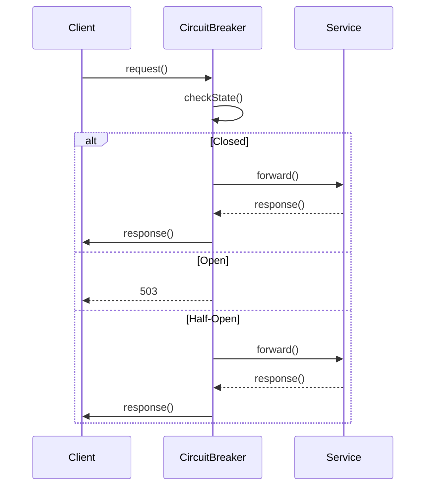

<!-- Generated by Groq via GitHub Actions -->
<!-- Topic ID: T148 -->
<!-- Category: Reliability Engineering -->
<!-- Generated at UTC: 2026-10-29T07:20:56.273662+00:00 -->

# Circuit breakers

## 1. What problem does this solve?

**Motivation**  
In a distributed system, a service may call another service, a database, or an external API. If the callee is slow, overloaded, or down, the caller can become blocked, consume resources, and cascade failures to other parts of the system.

**Problem exists**  
- *Unbounded retries*: A client keeps retrying a failing request, exhausting its own resources and the network.
- *Resource exhaustion*: Threads, connections, or memory are tied up waiting for a response that will never come.
- *Cascade failure*: One failing service can bring down many dependent services.

**Why it matters**  
- **Availability**: Users experience timeouts or errors.
- **Performance**: Latency increases as calls pile up.
- **Cost**: Extra compute and network usage.

**What happens if not used**  
- Services can deadlock or crash under load.
- A single failing dependency can bring down an entire application.
- Debugging becomes hard because the failure originates from a distant service.

**Real‑world appearance**  
- Microservice architectures (e.g., Netflix OSS, Spring Cloud).
- API gateways (e.g., Kong, Envoy).
- Client libraries that call external APIs (e.g., payment gateways, third‑party auth).

---

## 2. Mental model

**Analogy**  
Imagine a busy restaurant kitchen. If a dish is taking too long, the chef decides to *pause* that order and move on to other orders. After a while, the chef *retries* the paused order. If the kitchen is still busy, the chef *skips* the order entirely and serves a different dish. This prevents the kitchen from being overwhelmed and keeps the dining room moving.

**Engineering model**  
A circuit breaker is a guard that monitors the health of a call path.  
- **Closed**: Calls go through normally.  
- **Open**: Calls are short‑circuited (fail fast) to avoid waiting on a failing service.  
- **Half‑Open**: After a timeout, a few test calls are allowed to see if the service has recovered.

---

## 3. Deep explanation

| Concept | Description |
|---------|-------------|
| **State machine** | Closed → Open → Half‑Open → Closed. |
| **Thresholds** | Success/failure ratio, error count, latency percentiles. |
| **Timeout** | How long to stay in Open before trying Half‑Open. |
| **Reset timeout** | How long to stay in Half‑Open before deciding to close or reopen. |
| **Back‑off** | Exponential or fixed delay between retries. |

### Internals
- **Metrics collector**: Counts successes, failures, latency.
- **Decision engine**: Evaluates thresholds to transition states.
- **Policy**: Defines thresholds, timeouts, and back‑off strategy.

### Trade‑offs
- **Sensitivity**: Too low thresholds → frequent false positives; too high → delayed failure detection.
- **Latency**: Circuit breaker adds a small overhead (state check, short‑circuit).
- **Complexity**: More states and policies increase code complexity.

### Failure modes
- **Stuck in Open**: If the downstream service recovers but the breaker never transitions due to misconfigured thresholds.
- **Stuck in Half‑Open**: If test calls fail but the service is actually healthy (e.g., transient network glitch).
- **False positives**: Legitimate slow responses trigger Open, causing unnecessary failures.

### Limitations
- **Not a substitute for retries**: Circuit breaker should be combined with retry logic.
- **Does not fix the underlying issue**: It only protects the caller.
- **State synchronization**: In a distributed environment, each instance may have its own breaker state unless shared.

### Where it fits
- **Client side**: Wrapping HTTP or gRPC calls.
- **Service side**: Protecting internal calls to downstream services.
- **API gateway**: Centralized breaker for all outbound calls.

### Interaction with related concepts
- **Retries**: Circuit breaker often works with retry policies (e.g., exponential back‑off).
- **Bulkheads**: Limits concurrent calls to a resource.
- **Rate limiting**: Controls request volume; circuit breaker reacts to failures.
- **Observability**: Metrics, logs, and traces are essential for tuning.

---

## 4. How it works

1. **Call enters** → Check breaker state.  
2. **Closed** → Forward request.  
3. **Open** → Immediately return failure (e.g., `503 Service Unavailable`).  
4. **Half‑Open** → Allow a limited number of test requests.  
5. **Test result** →  
   - Success → Transition to Closed.  
   - Failure → Transition back to Open.  
6. **State transition** → Update timers and counters.



---

## 5. Practical implementation

Below is a minimal, production‑ready circuit breaker in TypeScript using Node.js.  
It uses `axios` for HTTP calls and `prom-client` for metrics.

```ts
// circuitBreaker.ts
import axios, { AxiosInstance, AxiosResponse } from 'axios';
import { Counter, Gauge } from 'prom-client';

type State = 'CLOSED' | 'OPEN' | 'HALF_OPEN';

interface Config {
  failureThreshold: number; // e.g., 0.5 for 50% failures
  successThreshold: number; // e.g., 0.5 for 50% successes to close
  timeout: number;          // ms to stay OPEN before HALF_OPEN
  maxConcurrent: number;    // bulkhead limit
  requestTimeout: number;   // ms per request
}

export class CircuitBreaker {
  private state: State = 'CLOSED';
  private failureCount = 0;
  private successCount = 0;
  private lastFailure = 0;
  private concurrent = 0;

  private readonly cfg: Config;
  private readonly client: AxiosInstance;

  // Prometheus metrics
  private readonly failures = new Counter({
    name: 'circuit_breaker_failures_total',
    help: 'Total failures',
  });
  private readonly opens = new Counter({
    name: 'circuit_breaker_opens_total',
    help: 'Total times circuit opened',
  });
  private readonly stateGauge = new Gauge({
    name: 'circuit_breaker_state',
    help: 'Current state (0=closed,1=open,2=half-open)',
    labelNames: ['state'],
  });

  constructor(cfg: Config, client?: AxiosInstance) {
    this.cfg = cfg;
    this.client = client ?? axios.create();
    this.updateStateGauge();
  }

  private updateStateGauge() {
    this.stateGauge.set({ state: 'CLOSED' }, this.state === 'CLOSED' ? 1 : 0);
    this.stateGauge.set({ state: 'OPEN' }, this.state === 'OPEN' ? 1 : 0);
    this.stateGauge.set({ state: 'HALF_OPEN' }, this.state === 'HALF_OPEN' ? 1 : 0);
  }

  private async transitionTo(state: State) {
    this.state = state;
    this.updateStateGauge();
    if (state === 'OPEN') {
      this.opens.inc();
      this.lastFailure = Date.now();
      // schedule half‑open
      setTimeout(() => this.transitionTo('HALF_OPEN'), this.cfg.timeout);
    } else if (state === 'HALF_OPEN') {
      // reset counters
      this.failureCount = 0;
      this.successCount = 0;
    }
  }

  async request<T = any>(config: any): Promise<AxiosResponse<T>> {
    if (this.state === 'OPEN') {
      // short‑circuit
      throw new Error('Circuit is open');
    }

    if (this.concurrent >= this.cfg.maxConcurrent) {
      throw new Error('Bulkhead limit reached');
    }

    this.concurrent++;
    try {
      const resp = await this.client.request<T>({
        ...config,
        timeout: this.cfg.requestTimeout,
      });

      this.recordSuccess();
      return resp;
    } catch (err) {
      this.recordFailure();
      throw err;
    } finally {
      this.concurrent--;
    }
  }

  private recordSuccess() {
    this.successes.inc();
    if (this.state === 'HALF_OPEN') {
      this.successCount++;
      if (this.successCount >= this.cfg.successThreshold * this.cfg.maxConcurrent) {
        this.transitionTo('CLOSED');
      }
    }
  }

  private recordFailure() {
    this.failures.inc();
    if (this.state === 'HALF_OPEN') {
      this.failureCount++;
      if (this.failureCount >= this.cfg.failureThreshold * this.cfg.maxConcurrent) {
        this.transitionTo('OPEN');
      }
    } else if (this.state === 'CLOSED') {
      this.failureCount++;
      const total = this.failureCount + this.successCount;
      if (total > 0 && this.failureCount / total >= this.cfg.failureThreshold) {
        this.transitionTo('OPEN');
      }
    }
  }
}
```

**Usage**

```ts
import express from 'express';
import { CircuitBreaker } from './circuitBreaker';

const app = express();
const breaker = new CircuitBreaker({
  failureThreshold: 0.5,
  successThreshold: 0.5,
  timeout: 5000,          // 5s
  maxConcurrent: 10,
  requestTimeout: 2000,   // 2s
});

app.get('/proxy', async (req, res) => {
  try {
    const resp = await breaker.request({
      url: 'https://api.example.com/data',
      method: 'GET',
    });
    res.json(resp.data);
  } catch (e) {
    res.status(503).json({ error: e.message });
  }
});

app.listen(3000);
```

The code is ready for Docker, can be instrumented with Prometheus, and respects bulkhead limits.

---

## 6. Production considerations

| Concern | How to address |
|---------|----------------|
| **Scalability** | Use shared state (e.g., Redis, etcd) if you need a global breaker. |
| **Reliability** | Combine with retries and bulkheads. |
| **Security** | Ensure breaker errors are not exposed to clients (use generic 503). |
| **Observability** | Expose metrics (`circuit_breaker_state`, `circuit_breaker_failures_total`). |
| **Performance** | Keep state checks fast; avoid heavy locks. |
| **Error handling** | Return consistent error codes; log stack traces. |
| **Resource usage** | Bulkhead limits prevent resource exhaustion. |
| **Operational concerns** | Alert on frequent opens; set thresholds based on SLIs. |
| **Failure recovery** | Use half‑open to test recovery; avoid long open periods. |
| **Deployment** | Incrementally enable breakers; monitor impact. |

---

## 7. Common mistakes

| Mistake | Why it’s problematic |
|---------|----------------------|
| **Using a single global breaker for all services** | One failing service can block all calls; fine‑grained breakers are safer. |
| **Setting thresholds too low** | Frequent false opens degrade availability. |
| **Ignoring latency thresholds** | Only counting errors misses slow responses that still waste resources. |
| **Not resetting counters** | Counters grow indefinitely, skewing decisions. |
| **Treating the breaker as a retry mechanism** | It only protects; you still need proper retry/back‑off logic. |
| **Not monitoring state transitions** | Hard to debug why a service is unavailable. |
| **Hard‑coding timeouts** | Different services have different latency profiles. |
| **Overlooking bulkhead limits** | A breaker alone can still exhaust connections if many concurrent calls are allowed. |

---

## 8. Senior engineer perspective

### What changes at scale?
- **State sharing**: Use a distributed cache (Redis, etcd) so all instances see the same breaker state.
- **Observability**: Central dashboards, alerting on open counts, latency percentiles.
- **Fine‑grained policies**: Separate breakers per endpoint, per tenant, or per user group.
- **Dynamic tuning**: Auto‑adjust thresholds based on real‑time metrics.

### Design decisions
- **Architecture**: Decide whether the breaker lives in the client, service, or gateway.
- **Trade‑offs**: More granular breakers increase complexity but reduce false positives.
- **Bottlenecks**: A shared breaker can become a single point of contention; use sharding or per‑service instances.
- **Failure scenarios**: Plan for cascading failures; use circuit breakers in combination with bulkheads and rate limiting.
- **Monitoring**: Expose state, open counts, and latency percentiles; set alerts for >10% opens.
- **Cost/performance**: Distributed state adds network latency; evaluate if local state suffices.
- **When NOT to use**: For idempotent, cheap calls where latency is negligible; or when the downstream service is highly reliable.

---

## 9. Interview questions

1. **Beginner**: *What is a circuit breaker and why is it useful?*  
   *Answer*: A pattern that stops repeated calls to a failing service, protecting resources and improving availability.

2. **Beginner**: *Describe the three states of a circuit breaker.*  
   *Answer*: Closed (normal), Open (fail‑fast), Half‑Open (testing recovery).

3. **Senior**: *How would you design a circuit breaker that works across multiple microservice instances?*  
   *Answer*: Use a shared state store (Redis, etcd) with atomic counters, or implement a distributed consensus algorithm. Discuss consistency, latency, and partition tolerance.

4. **Senior**: *Explain how you would tune the failure threshold and timeout for a high‑traffic API gateway.*  
   *Answer*: Use historical error rates, SLA requirements, and latency percentiles. Start with conservative thresholds, monitor open counts, adjust based on observed false positives/negatives.

5. **Scenario/Debugging**: *A service’s circuit breaker is stuck in the Open state for 30 minutes even after the downstream service has recovered. What steps would you take to diagnose and fix the issue?*  
   *Answer*:  
   - Check the breaker’s timeout configuration.  
   - Inspect metrics: open count, last failure timestamp.  
   - Verify that the downstream service is reachable (network, DNS).  
   - Ensure the breaker’s state is not persisted incorrectly (e.g., stale Redis key).  
   - Look for misconfigured thresholds causing immediate reopen.  
   - If using a shared store, confirm that all instances see the same state.  
   - As a fix, reset the breaker state or adjust the timeout.

---

## 10. Hands‑on task

**Implement a circuit breaker for a FastAPI endpoint that calls an external weather API.**

1. Create a FastAPI app with a `/weather` endpoint that forwards requests to `https://api.openweathermap.org/data/2.5/weather`.
2. Wrap the HTTP call with a circuit breaker (you can use the `pybreaker` library or implement a simple one).
3. Expose Prometheus metrics for the breaker state and failures.
4. Write a test that simulates the external API returning 500 errors for 10 consecutive requests and verify that the breaker opens.
5. Add a health‑check endpoint that returns the current breaker state.

*Goal*: Understand state transitions, metrics, and how to integrate a breaker into a Python backend.

---

## 11. Quick revision

- Circuit breaker protects callers from slow/failing dependencies.
- States: **Closed → Open → Half‑Open → Closed**.
- Thresholds: failure ratio, success ratio, timeouts.
- Combine with **retries**, **bulkheads**, and **rate limiting**.
- Expose metrics (`circuit_breaker_state`, `circuit_breaker_failures_total`).
- Avoid global breakers; use fine‑grained per‑service or per‑endpoint.
- Monitor state transitions; alert on frequent opens.
- In distributed systems, share state via Redis, etcd, or a dedicated service.
- Typical implementation: check state, forward request, record success/failure, transition logic.
- Common pitfalls: low thresholds, ignoring latency, not resetting counters, treating breaker as retry.
- Senior perspective: distributed state, dynamic tuning, cost/performance trade‑offs.

---

## 12. References

- [Netflix Hystrix – Circuit Breaker](https://github.com/Netflix/Hystrix)  
- [Spring Cloud Circuit Breaker](https://spring.io/projects/spring-cloud-circuitbreaker)  
- [Prometheus – Metrics](https://prometheus.io/docs/introduction/overview/)  
- [FastAPI – HTTP Client](https://fastapi.tiangolo.com/advanced/async-client/)  
- [Python PyBreaker](https://pypi.org/project/pybreaker/)  
- [Node.js Axios](https://axios-http.com/docs/intro)  
- [Docker – Exposing Prometheus Metrics](https://docs.docker.com/config/containers/resource_constraints/)  

*(All URLs are official or widely accepted documentation.)*
