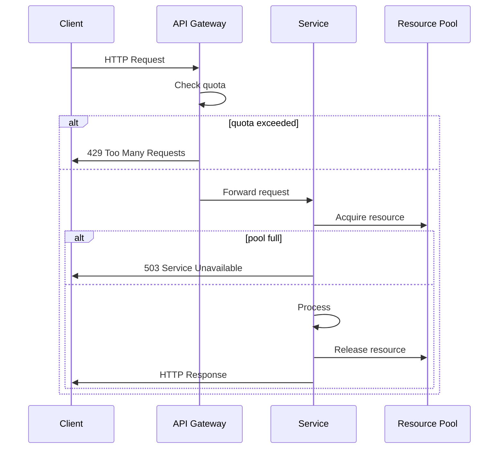

<!-- Generated by Groq via GitHub Actions -->
<!-- Topic ID: T149 -->
<!-- Category: Reliability Engineering -->
<!-- Generated at UTC: 2026-10-29T19:06:33.708193+00:00 -->

# Bulkheads

## 1. What problem does this solve?

**Motivation**  
In a distributed backend, a single failure can ripple through the entire system. If one component consumes too many resources (CPU, memory, DB connections, external API quota), it can starve the rest of the services, causing cascading outages. Bulkheads isolate failures so that a problem in one “section” of the system does not bring down the whole application.

**What problem exists**

- A long‑running request or a burst of traffic can exhaust a shared resource pool (e.g., database connections, thread pool, external API quota).
- A buggy downstream service can block or delay requests, causing timeouts for unrelated clients.
- Shared memory or CPU contention can degrade overall throughput.

**Why the problem matters**

- **Availability**: Users experience timeouts or errors even though the majority of the system is healthy.
- **SLA compliance**: Service level agreements often require high uptime; a single bottleneck can violate them.
- **Operational cost**: Uncontrolled resource usage can lead to higher cloud bills or infrastructure failures.

**What happens if bulkheads are not used**

- A single slow or failing dependency can block the entire request pipeline.
- Resource exhaustion can trigger OS‑level throttling or crashes.
- Recovery becomes difficult because the failure is not localized.

**Where this concept appears in real backend systems**

- **Database connection pools**: Limiting the number of connections per service.
- **Thread pools / worker pools**: Restricting concurrent tasks.
- **Container orchestration**: Using Kubernetes `Pod` limits and `ResourceQuota`.
- **Circuit breakers**: Combined with bulkheads to isolate failing calls.
- **API rate limiting**: Per‑client or per‑service quotas.

---

## 2. Mental model

**Analogy**  
Imagine a ship with multiple watertight compartments (bulkheads). If one compartment floods, the ship can still stay afloat because the other compartments remain dry. In software, each compartment is a *resource pool* or *execution context* that is isolated from the others. A failure in one compartment (e.g., a database connection leak) does not flood the entire ship.

**Precise engineering model**  
A bulkhead is an *isolation boundary* that limits the amount of shared resource a component can consume. It is usually implemented by:

1. **Resource limits** – e.g., a maximum number of concurrent connections or threads.
2. **Isolation mechanisms** – e.g., separate processes, containers, or worker pools.
3. **Fail‑fast policies** – e.g., rejecting new requests when the limit is reached.

---

## 3. Deep explanation

### Internals

| Layer | Typical implementation | Key APIs / libraries |
|-------|------------------------|----------------------|
| **Process isolation** | Docker containers, OS processes | `docker run`, `child_process.spawn` |
| **Thread/worker isolation** | Node.js worker threads, Java thread pools | `worker_threads`, `workerpool` |
| **Connection pooling** | DB connection pools, HTTP client pools | `pg.Pool`, `axios` with `http.Agent` |
| **Rate limiting** | Token bucket, leaky bucket | `bottleneck`, `rate-limiter-flexible` |
| **Circuit breaker + bulkhead** | Hystrix, Resilience4j | `opossum` (Node), `resilience4j` (Java) |

### Important terminology

- **Bulkhead** – The isolation boundary itself.
- **Resource pool** – A bounded set of reusable resources (connections, threads).
- **Quota** – The maximum allowed usage per unit time or per instance.
- **Fail‑fast** – Rejecting requests immediately when the quota is exhausted.
- **Isolation boundary** – The point at which a failure cannot propagate.

### Trade‑offs

| Benefit | Cost |
|---------|------|
| **Improved reliability** | **Resource underutilization** – you may leave capacity unused. |
| **Predictable performance** | **Complexity** – more moving parts to monitor and maintain. |
| **Isolation of failures** | **Latency** – extra hop or queueing can add delay. |
| **Scalability** | **Operational overhead** – managing multiple pools or containers. |

### Failure modes

- **Over‑conservative limits**: Legitimate traffic is blocked, leading to false positives.
- **Under‑conservative limits**: The bulkhead fails to protect, causing cascading failures.
- **Misconfigured isolation**: Shared resources still leak across boundaries (e.g., a global connection pool).

### Limitations

- Bulkheads protect *resource consumption*, not *logic errors* or *data corruption*.
- They cannot prevent a *distributed denial‑of‑service* that saturates all boundaries.
- Requires careful tuning; static limits may not adapt to traffic spikes.

### Where this concept fits in a backend architecture

```
mermaid
flowchart TD
  Client[Client] -->|HTTP| API[API Gateway]
  API -->|Auth| Auth[Auth Service]
  API -->|Data| Data[Data Service]
  Data -->|DB| DB[PostgreSQL]
  subgraph Bulkhead1
    Data -->|ConnPool| ConnPool[Connection Pool]
  end
  subgraph Bulkhead2
    Data -->|WorkerPool| WorkerPool[Worker Thread Pool]
  end
  API -->|RateLimit| RateLimiter[Rate Limiter]
```

- **API Gateway** often implements a bulkhead per client IP or API key.
- **Service layers** use connection pools and worker pools as bulkheads.
- **External APIs** are protected by circuit breakers + bulkheads.

### Interaction with related concepts

- **Circuit Breaker**: Stops calling a failing service; bulkhead limits how many calls can be in flight.
- **Rate Limiting**: Bulkhead can be a form of rate limiting at the resource level.
- **Service Mesh**: Provides network‑level bulkheads (e.g., Istio’s `requestConcurrency`).
- **Container Orchestration**: Kubernetes `Pod` limits act as bulkheads at the OS level.

---

## 4. How it works

1. **Request arrives** at the API gateway.
2. Gateway checks **client quota**; if exceeded, rejects immediately.
3. Request is forwarded to the **service**.
4. Service obtains a **resource** (DB connection, worker thread) from its **pool**.
5. If the pool is **full**, the request is queued or rejected (fail‑fast).
6. Service processes the request, releases the resource.
7. Response is sent back; metrics are emitted.



---

## 5. Practical implementation

### Example: Bulkhead with a worker pool in Node.js

We’ll create a simple service that calls an external API (`https://jsonplaceholder.typicode.com/posts`).  
We’ll limit concurrent outbound requests to **5** using the `workerpool` library.

```ts
// bulkhead-service.ts
import * as workerpool from 'workerpool';
import fetch from 'node-fetch';

// Create a worker pool with a maximum of 5 workers
const pool = workerpool.pool({
  maxWorkers: 5,          // Bulkhead limit
  workerType: 'thread',   // Use worker threads
  // Optional: set a timeout for tasks
  workerOptions: { execArgv: ['--max-old-space-size=128'] }
});

/**
 * Worker function that performs the HTTP request.
 * This runs inside a worker thread.
 */
async function fetchPost(id: number): Promise<any> {
  const res = await fetch(`https://jsonplaceholder.typicode.com/posts/${id}`);
  if (!res.ok) throw new Error(`HTTP ${res.status}`);
  return res.json();
}

// Expose the worker function to the pool
pool.exec(fetchPost, [1]).then(console.log).catch(console.error);

/**
 * Public API that enqueues a request to the pool.
 * If the pool is saturated, we reject immediately (fail‑fast).
 */
export async function getPost(id: number): Promise<any> {
  try {
    // `pool.exec` returns a Promise that resolves when a worker is free
    return await pool.exec(fetchPost, [id]);
  } catch (err) {
    // If the pool is full, we can throw a custom error
    throw new Error('Bulkhead limit reached, try again later');
  }
}
```

#### Key lines explained

- `maxWorkers: 5` – The bulkhead boundary: only 5 concurrent outbound calls.
- `pool.exec` – Queues the task; if the pool is full, the Promise is rejected immediately.
- `workerpool` uses **worker threads** to isolate CPU‑intensive work and avoid blocking the event loop.

### Using a connection pool as a bulkhead

```ts
// db-bulkhead.ts
import { Pool } from 'pg';

const pool = new Pool({
  max: 10,          // Max 10 concurrent DB connections
  idleTimeoutMillis: 30000,
  connectionTimeoutMillis: 2000,
});

export async function query(sql: string, params: any[]) {
  const client = await pool.connect(); // Acquire a connection
  try {
    return await client.query(sql, params);
  } finally {
    client.release(); // Release back to the pool
  }
}
```

- `max: 10` enforces the bulkhead: no more than 10 concurrent DB connections.

---

## 6. Production considerations

| Concern | How bulkheads help | Practical tips |
|---------|--------------------|----------------|
| **Scalability** | Limits per instance; horizontal scaling adds more bulkheads. | Use auto‑scaling; keep per‑instance limits consistent. |
| **Reliability** | Prevents resource exhaustion. | Monitor pool usage; alert on high occupancy. |
| **Security** | Isolate untrusted code (e.g., worker threads). | Run workers with minimal privileges. |
| **Observability** | Metrics: pool size, queue length, rejection rate. | Export Prometheus metrics (`pool.usage`, `pool.queueLength`). |
| **Performance** | Adds context switching overhead. | Tune `maxWorkers`/`max` to balance throughput vs. latency. |
| **Error handling** | Fail‑fast reduces cascading errors. | Return 503 or 429 with retry‑after header. |
| **Resource usage** | Caps memory/CPU per service. | Set `workerOptions` to limit memory. |
| **Operational concerns** | More moving parts to monitor. | Use centralized logging; keep configuration in env vars. |
| **Failure recovery** | Isolated failures can be retried independently. | Implement retry with exponential backoff per bulkhead. |
| **Deployment** | Container limits reinforce bulkheads. | Set `resources.limits` in Kubernetes. |

---

## 7. Common mistakes

| Mistake | Why it’s problematic |
|---------|----------------------|
| **Using a single global pool** | A bug in one part can exhaust the pool for all services. |
| **Setting limits too high** | Fails to protect; still allows cascading failures. |
| **Ignoring queueing** | Queueing can hide the problem; the system may appear healthy while requests pile up. |
| **Fail‑fast without back‑off** | Clients retry immediately, causing a burst that overwhelms the system again. |
| **Not monitoring pool metrics** | Hard to detect when limits are too tight or too loose. |
| **Mixing async/await with callbacks in workers** | Can lead to memory leaks if workers are not properly terminated. |
| **Over‑isolating (e.g., one worker per request)** | Excessive context switching; high overhead. |

---

## 8. Senior engineer perspective

### Design decisions at scale

1. **Granularity of bulkheads**  
   - *Fine‑grained*: separate pools per microservice, per tenant, or per API key.  
   - *Coarse‑grained*: a single pool for the entire cluster.  
   *Trade‑off*: fine‑grained gives better isolation but increases management overhead.

2. **Dynamic limits**  
   - Use auto‑scaling or adaptive algorithms to adjust limits based on load.  
   - Avoid static hard limits that become bottlenecks during traffic spikes.

3. **Integration with service mesh**  
   - Leverage Istio’s `requestConcurrency` or Envoy’s `maxConcurrentRequests`.  
   - Offloads bulkhead logic to the network layer, reducing application code complexity.

4. **Observability**  
   - Expose per‑bulkhead metrics (queue length, rejection rate).  
   - Correlate with latency and error rates to detect bottlenecks early.

5. **Failure scenarios**  
   - *Resource starvation*: monitor memory/CPU; trigger alerts.  
   - *Deadlocks*: ensure workers release resources even on exceptions.  
   - *Network partitions*: circuit breakers complement bulkheads.

6. **Cost/performance**  
   - More workers mean higher CPU usage; balance against throughput.  
   - Container limits reduce over‑provisioning but may lead to throttling.

7. **When NOT to use bulkheads**  
   - Simple monoliths with low traffic where resource contention is unlikely.  
   - Stateless services that do not share resources (e.g., pure cache lookups).  
   - Environments where adding complexity outweighs the marginal reliability gain.

---

## 9. Interview questions

| Level | Question | Key answer points |
|-------|----------|-------------------|
| Beginner | What is a bulkhead in software architecture? | Isolation boundary, limits resource usage, prevents cascading failures. |
| Beginner | How does a bulkhead differ from a circuit breaker? | Circuit breaker stops calls to a failing service; bulkhead limits concurrent usage. |
| Senior | In a microservices architecture, how would you design bulkheads for a database‑heavy service? | Separate connection pools per tenant, use connection pool limits, monitor pool occupancy, consider sharding. |
| Senior | Explain how you would integrate bulkheads with a service mesh like Istio. | Use Envoy’s `requestConcurrency`, set per‑service limits, expose metrics, coordinate with sidecar. |
| Scenario | A service is experiencing intermittent 503 errors during traffic spikes. You suspect a bulkhead is too restrictive. How would you investigate and resolve this? | Check pool metrics, queue lengths, latency; adjust `maxWorkers` or `max` values; add auto‑scaling; implement retry with back‑off; monitor impact. |

---

## 10. Hands‑on task

**Task**: Add a bulkhead to an existing Node.js Express API that fetches user data from a PostgreSQL database.

1. Create a `pg.Pool` with a maximum of 20 connections.  
2. Wrap the route handler so that if the pool is exhausted, it returns **503 Service Unavailable** immediately.  
3. Expose a `/metrics` endpoint that returns current pool usage (active, idle, waiting).  
4. Write a simple script that sends 50 concurrent requests to the endpoint and logs how many succeed vs. fail.  
5. Observe the effect of increasing the pool size to 50 and compare results.

*Deliverables*:  
- Updated `server.ts` with bulkhead logic.  
- `metrics.ts` exposing Prometheus‑style metrics.  
- `load-test.js` script.  
- README explaining how to run the test.

---

## 11. Quick revision

- Bulkheads isolate resource consumption to prevent cascading failures.  
- Implemented via limits on connections, threads, or containers.  
- Fail‑fast policy: reject new requests when limits are reached.  
- Common patterns: worker pools, DB connection pools, rate limiters.  
- Key metrics: pool size, queue length, rejection rate.  
- Combine with circuit breakers for full resilience.  
- Monitor and adjust limits based on load; avoid static hard limits.  
- In Kubernetes, use `resources.limits` and `PodDisruptionBudget`.  
- Avoid over‑isolation; balance granularity and operational overhead.  
- Use service mesh for network‑level bulkheads when scaling to many services.

---

## 12. References

- [Node.js worker_threads](https://nodejs.org/api/worker_threads.html)  
- [pg – PostgreSQL client for Node.js](https://node-postgres.com/)  
- [workerpool – Simple worker pool for Node.js](https://github.com/josdejong/workerpool)  
- [Resilience4j – Bulkhead](https://resilience4j.readme.io/docs/bulkhead)  
- [Istio – Request Concurrency](https://istio.io/latest/docs/tasks/traffic-management/request-concurrency/)  
- [Prometheus – Exporting metrics](https://prometheus.io/docs/instrumenting/exposition_formats/)  
- [Node.js fetch API](https://nodejs.org/api/globals.html#fetch)  

---
