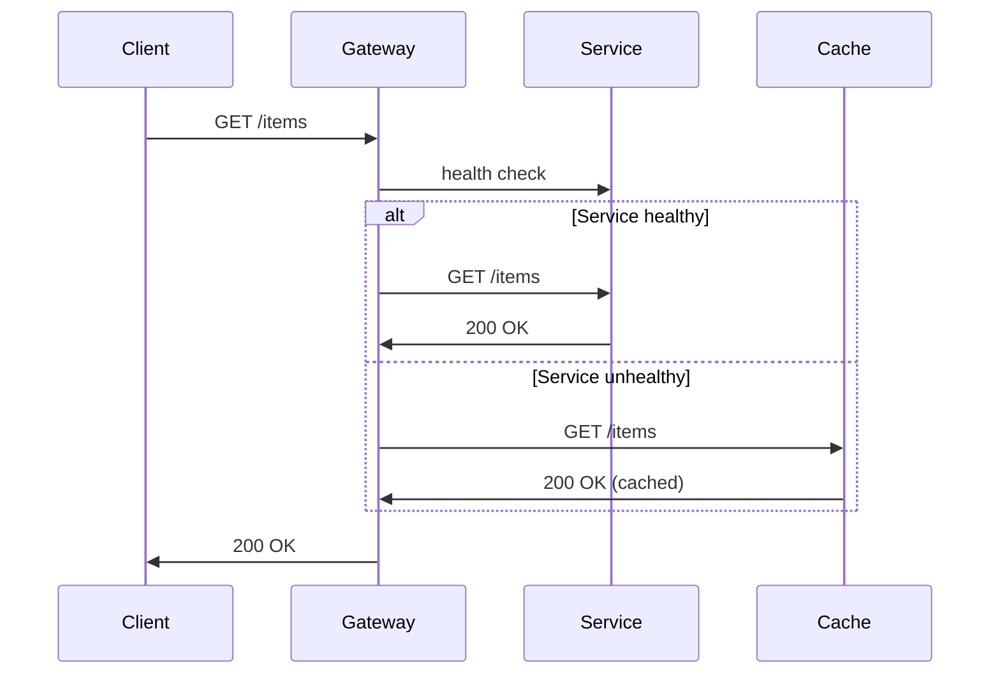

<!-- Generated by Groq via GitHub Actions -->
<!-- Topic ID: T150 -->
<!-- Category: Reliability Engineering -->
<!-- Generated at UTC: 2026-10-29T19:06:33.708193+00:00 -->

# Graceful Degradation

## 1. What problem does this solve?

In a distributed backend, components rarely work perfectly all the time.  
When a downstream service (e.g., a recommendation engine, a payment gateway, or a cache) fails or becomes slow, the whole system can still respond to users instead of giving a hard error or a long timeout.

**Why it matters**

* **User experience** – A 5‑second timeout feels worse than a slightly degraded response.  
* **System resilience** – One failing microservice shouldn’t bring down the entire stack.  
* **Operational stability** – Operators can see a graceful fallback instead of a cascade of alerts.

**What happens if it’s not used**

* Cascading failures: a single point of failure propagates through the system.  
* Poor UX: users see 5xx errors or timeouts.  
* Increased MTTR: debugging becomes harder because the failure surface is larger.

**Real‑world examples**

* A news site shows cached headlines when the live feed is down.  
* An e‑commerce checkout shows a “payment unavailable” banner but still lets users add items to the cart.  
* A social media app falls back to a static image when the image CDN is unreachable.

---

## 2. Mental model

**Analogy – The Road Trip**

Imagine driving to a city with a GPS that can’t find a route because a road is closed. Instead of stopping, the GPS shows a “partial route” that still gets you to the city, albeit slower. The driver keeps moving, and the trip continues.

**Engineering model**

* **Primary path** – The ideal, fully functional service chain.  
* **Fallback path** – A simpler, less feature‑rich but still functional alternative.  
* **Decision point** – A runtime check that chooses between the two based on health, latency, or error codes.

---

## 3. Deep explanation

### Internals

1. **Health checks** – Each service exposes `/health` or similar endpoints.  
2. **Circuit breakers** – Track failure rates; open the circuit after a threshold.  
3. **Timeouts & retries** – Limit how long we wait for a response.  
4. **Graceful fallback** – Return cached data, default values, or a reduced‑feature response.

### Important terminology

| Term | Meaning |
|------|---------|
| **Graceful degradation** | System continues to operate with reduced functionality. |
| **Circuit breaker** | Pattern that stops calling a failing service after a threshold. |
| **Fallback** | Alternative logic that runs when the primary path fails. |
| **Bulkhead** | Isolation of resources to prevent one component’s failure from affecting others. |

### Trade‑offs

| Benefit | Cost |
|---------|------|
| Improved uptime | Potentially stale or incomplete data |
| Better UX | Added complexity in code and monitoring |
| Faster recovery | Extra latency for fallback logic |

### Failure modes

* **Partial failure** – Only some fields are missing.  
* **Total failure** – All fallback paths are exhausted.  
* **Mis‑configured fallback** – Returning incorrect defaults that mislead users.

### Limitations

* Fallbacks can mask underlying problems if overused.  
* Requires careful design to avoid “fallback hell” where every service falls back to the same degraded state.

### Where it fits

* **API Gateway** – Decides whether to route to the real service or a cached response.  
* **Microservice** – Implements its own circuit breaker and fallback logic.  
* **Client** – May also implement graceful degradation (e.g., a React app shows a loading skeleton).

### Interaction with related concepts

* **Bulkheads** – Isolate resources so that a degraded component doesn’t starve others.  
* **Rate limiting** – Prevents fallback paths from being overwhelmed.  
* **Observability** – Metrics on fallback usage help detect hidden issues.

---

## 4. How it works

1. **Request arrives** at API Gateway.  
2. **Health check** of downstream service is consulted (cached status).  
3. If healthy → **Forward request**.  
4. If unhealthy or timeout → **Invoke fallback** (e.g., serve cached data).  
5. **Return response** to client.  
6. **Log** the fallback usage for observability.



---

## 5. Practical implementation

### TypeScript/Node.js example – Express + Redis cache

```ts
// src/server.ts
import express from 'express';
import axios from 'axios';
import Redis from 'ioredis';

const app = express();
const redis = new Redis(); // defaults to localhost:6379

const SERVICE_URL = 'http://items-service.local/items';
const CACHE_KEY = 'items:latest';
const CACHE_TTL = 60; // seconds

// Simple health cache (in-memory)
let serviceHealthy = true;
let lastHealthCheck = 0;

// Periodic health check
setInterval(async () => {
  try {
    await axios.get(`${SERVICE_URL}/health`);
    serviceHealthy = true;
  } catch {
    serviceHealthy = false;
  }
  lastHealthCheck = Date.now();
}, 5000);

app.get('/items', async (req, res) => {
  // 1. Decide path
  const useCache = !serviceHealthy || Date.now() - lastHealthCheck > 10000;

  if (!useCache) {
    try {
      // 2. Primary path
      const { data } = await axios.get(SERVICE_URL, { timeout: 2000 });
      // 3. Cache the fresh data
      await redis.set(CACHE_KEY, JSON.stringify(data), 'EX', CACHE_TTL);
      return res.json(data);
    } catch (e) {
      // 4. Fallback on error
      console.warn('Primary failed, falling back to cache', e.message);
    }
  }

  // 5. Fallback path
  const cached = await redis.get(CACHE_KEY);
  if (cached) {
    return res.json(JSON.parse(cached));
  }

  // 6. No fallback available
  res.status(503).json({ error: 'Service unavailable' });
});

app.listen(3000, () => console.log('Gateway listening on 3000'));
```

**Key points**

* `serviceHealthy` is a lightweight flag updated by a background health check.  
* Timeout on the primary call ensures we don’t wait forever.  
* Cached data is returned when the primary fails or is deemed unhealthy.  
* If no cache, we return a 503 to the client.

---

## 6. Production considerations

| Concern | How graceful degradation helps / what to watch |
|---------|----------------------------------------------|
| **Scalability** | Fallbacks can reduce load on a failing service, but caching may become a bottleneck if many clients hit it. |
| **Reliability** | Circuit breakers prevent repeated failed calls; monitor fallback hit rates. |
| **Security** | Ensure cached data is not sensitive or stale; use encryption at rest if needed. |
| **Observability** | Emit metrics: `fallback_hits`, `primary_failures`, `cache_misses`. |
| **Performance** | Cache latency is usually lower; but serialization/deserialization adds overhead. |
| **Error handling** | Distinguish between transient and permanent failures; avoid endless retries. |
| **Resource usage** | Redis memory consumption grows with cache size; set TTLs appropriately. |
| **Operational concerns** | Alert on high fallback usage; investigate root cause. |
| **Failure recovery** | When the primary recovers, gradually shift traffic back; use a canary approach. |
| **Deployment** | Deploy fallback logic in the same version as the primary to avoid version drift. |

---

## 7. Common mistakes

| Mistake | Why it’s problematic |
|---------|----------------------|
| **Over‑caching** | Stale data leads to user confusion; violates data freshness requirements. |
| **No fallback for critical fields** | Users see “null” values that break UI logic. |
| **Ignoring fallback metrics** | Hidden degradation goes unnoticed until user complaints. |
| **Hard‑coding fallback logic** | Makes it hard to change defaults or add new fallback sources. |
| **Using the same circuit breaker for all services** | One service’s failure can block unrelated services. |
| **Failing to test fallback paths** | Production bugs appear only when a service goes down. |

---

## 8. Senior engineer perspective

### What changes at scale?

* **Granular circuit breakers** per downstream dependency.  
* **Dynamic fallback selection** (e.g., use CDN cache vs. local cache).  
* **Feature flags** to enable/disable degradation paths per environment.  
* **Distributed tracing** to see which services are falling back.  
* **Capacity planning** for cache and fallback services.

### Design decisions

| Decision | Trade‑offs |
|----------|------------|
| **Cache size & eviction policy** | Larger cache = more memory, fewer cache misses. |
| **TTL vs. stale‑while‑revalidate** | Short TTL = fresher data but more load on primary. |
| **Fallback granularity** | Per‑field fallback reduces impact but increases code complexity. |
| **Circuit breaker thresholds** | Low threshold = quick fallback but may trigger on transient spikes. |
| **Fallback source** | External CDN vs. internal cache: latency vs. control. |

### Bottlenecks & failure scenarios

* **Cache saturation** → evicts useful data, leading to more primary calls.  
* **Circuit breaker stuck open** → no traffic to primary, even after recovery.  
* **Fallback path overload** → if many clients hit the cache simultaneously, it can become a hotspot.

### Monitoring & cost

* Track `fallback_hit_ratio` and alert if > 30%.  
* Cache cost: Redis instance sizing; consider managed services.  
* Latency: fallback should be faster than primary timeout.

### When NOT to use

* When data freshness is critical (e.g., financial transactions).  
* When fallback logic is too complex to maintain.  
* When the primary service is highly reliable and the cost of fallback outweighs benefits.

---

## 9. Interview questions

1. **Beginner** – *What is graceful degradation?*  
   *Answer:* The ability of a system to continue operating with reduced functionality when part of it fails.

2. **Beginner** – *Why do we use circuit breakers in graceful degradation?*  
   *Answer:* To stop repeated calls to a failing service, preventing cascading failures and giving the service time to recover.

3. **Senior** – *How would you design a fallback strategy for a microservice that provides user profiles, considering data freshness and consistency?*  
   *Answer points:* Use a read‑through cache with TTL, implement a “stale‑while‑revalidate” policy, keep a version stamp, use feature flags to toggle fallback, monitor cache hit rates, and ensure eventual consistency.

4. **Senior** – *Explain how graceful degradation interacts with bulkheads and rate limiting.*  
   *Answer points:* Bulkheads isolate resource pools so a degraded component doesn’t exhaust shared resources; rate limiting prevents fallback paths from being overwhelmed; together they ensure that degradation doesn’t lead to resource starvation.

5. **Scenario/Debugging** – *A production deployment shows a sudden spike in 503 responses from the `/orders` endpoint. The logs indicate that the fallback cache is being hit. What steps would you take to diagnose and resolve the issue?*  
   *Answer points:*  
   * Check health checks for the orders service.  
   * Verify circuit breaker state.  
   * Inspect cache hit/miss metrics.  
   * Look at latency of the primary service.  
   * Review recent deployments for configuration changes.  
   * If the service is down, restore it or increase cache TTL temporarily.  
   * Add alerts for fallback usage.

---

## 10. Hands‑on task

**Task:** Extend the Express gateway example to add a second fallback source: a static JSON file (`fallback-items.json`) that the gateway serves when both the primary service and Redis cache are unavailable.

**Steps**

1. Create `fallback-items.json` with sample data.  
2. Add a new route handler that reads the file asynchronously.  
3. Modify the `/items` endpoint to try the file after the cache.  
4. Add unit tests that simulate primary failure, cache miss, and file fallback.  
5. Deploy locally and verify that the fallback file is served when Redis is stopped.

---

## 11. Quick revision

- Graceful degradation keeps a system usable when parts fail.  
- Primary path → fallback path decision is based on health checks, timeouts, or circuit breakers.  
- Cache is a common fallback; use TTLs and eviction policies.  
- Circuit breakers prevent cascading failures.  
- Monitor fallback hit rates; high values indicate underlying issues.  
- Avoid stale data: keep TTL short or use stale‑while‑revalidate.  
- Fallback logic should be testable and version‑controlled.  
- At scale, use granular circuit breakers, feature flags, and distributed tracing.  
- Do not use fallback for critical, real‑time data that must be fresh.  
- Common mistakes: over‑caching, ignoring metrics, hard‑coding defaults.

---

## 12. References

- [Circuit Breaker Pattern – Netflix](https://github.com/Netflix/Hystrix/wiki/How-It-Works)  
- [Redis Cache Patterns](https://redis.io/docs/management/cache/)  
- [Express.js Documentation](https://expressjs.com/)  
- [Axios – Promise based HTTP client](https://axios-http.com/docs/intro)  
- [Node.js ioredis](https://github.com/luin/ioredis)  
- [Observability with OpenTelemetry](https://opentelemetry.io/docs/)  
- [Graceful Degradation vs. Fail‑Fast](https://martinfowler.com/bliki/GracefulDegradation.html)
