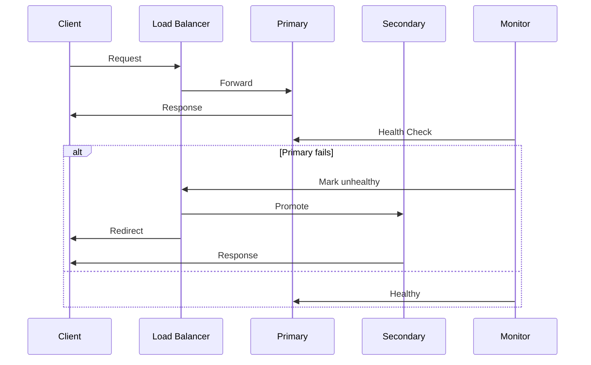

<!-- Generated by Groq via GitHub Actions -->
<!-- Topic ID: T151 -->
<!-- Category: Reliability Engineering -->
<!-- Generated at UTC: 2026-10-30T07:23:31.611018+00:00 -->

# Failover

## 1. What problem does this solve?

**Motivation**  
In a distributed backend, a single point of failure (SPOF) can bring the whole service down. Failover is the mechanism that detects a failure and automatically switches traffic to a healthy replica, keeping the system available.

**What problem exists**  
- A database node crashes, a cache instance goes offline, or a microservice instance dies.
- Clients experience timeouts or errors, leading to poor user experience and SLA violations.

**Why the problem matters**  
- **Availability**: Users expect 99.99 % uptime. Even a few seconds of outage can erode trust.
- **Business continuity**: E‑commerce, payments, or real‑time analytics cannot tolerate downtime.
- **Regulatory compliance**: Some industries mandate high availability and disaster recovery.

**What happens if this concept is not used**  
- Manual intervention is required to restore service.
- Downtime increases, leading to revenue loss and potential penalties.
- Scaling becomes difficult because you cannot rely on automatic recovery.

**Where this concept appears in real backend systems**  
- Database clusters (PostgreSQL streaming replication, MongoDB replica sets).
- Cache layers (Redis Sentinel, Amazon ElastiCache).
- Load balancers (NGINX, HAProxy, AWS ELB).
- Service meshes (Istio, Linkerd) with circuit breakers.
- Cloud provider managed services (RDS Multi-AZ, Cloud SQL HA).

---

## 2. Mental model

**Analogy**  
Think of a city’s water supply. There’s a main pipeline (primary) that delivers water to homes. If the main pipeline bursts, a backup pipeline (secondary) automatically takes over, ensuring residents still get water. The switch happens without the residents noticing.

**Engineering model**  
- **Primary**: The main instance that receives traffic.
- **Secondary**: A standby instance that stays in sync (replication, health checks).
- **Failover trigger**: Health check failure, heartbeat loss, or explicit promotion.
- **Failover action**: Route traffic to secondary, promote it to primary, optionally demote the old primary.

---

## 3. Deep explanation

### Internals
- **Health checks**: Periodic probes (HTTP, TCP, custom) that report status to a load balancer or orchestrator.
- **Replication**: Data is asynchronously or synchronously replicated from primary to secondary (e.g., PostgreSQL streaming replication, Redis replication).
- **Promotion**: The secondary becomes primary by changing its role and updating routing rules.
- **State synchronization**: For stateful services, ensure the secondary has a consistent snapshot (e.g., using WAL replay).

### Important terminology
| Term | Definition |
|------|------------|
| **Primary/Leader** | The active node handling writes. |
| **Secondary/Replica** | Node that mirrors the primary. |
| **Failover** | The process of switching to a secondary after failure detection. |
| **Promotion** | Making a secondary the new primary. |
| **Failback** | Returning to the original primary after recovery. |
| **Graceful shutdown** | Shutting down a node without data loss. |
| **Split-brain** | Scenario where two nodes think they are primary simultaneously. |

### Trade‑offs
| Aspect | Pros | Cons |
|--------|------|------|
| **Synchronous replication** | Zero data loss | Higher latency, limited throughput |
| **Asynchronous replication** | Lower latency | Potential data loss (lag) |
| **Active‑Active** | High availability, load sharing | Complexity, risk of split‑brain |
| **Active‑Standby** | Simpler, deterministic failover | Underutilized resources |

### Failure modes
- **Network partition**: Nodes lose connectivity; need to avoid split‑brain.
- **Hardware failure**: Disk crash, power loss.
- **Software bugs**: Deadlocks, memory leaks causing unresponsiveness.
- **Configuration errors**: Wrong replication slots, missing failover scripts.

### Limitations
- **Latency**: Failover can introduce a brief outage (seconds to minutes).
- **Consistency**: In asynchronous setups, data may be lost or out‑of‑sync.
- **Cost**: Running standby instances increases infrastructure spend.
- **Complexity**: Requires careful orchestration and monitoring.

### Where this concept fits in a backend architecture
- **Database layer**: PostgreSQL HA, MongoDB replica sets.
- **Cache layer**: Redis Sentinel, Amazon ElastiCache.
- **Service layer**: Load balancers, Kubernetes readiness probes.
- **Infrastructure layer**: Cloud provider managed failover (RDS Multi‑AZ).

### Interaction with related concepts
- **Load balancing**: Failover often relies on a load balancer to redirect traffic.
- **Circuit breakers**: Detect failures at the application level before failover.
- **Health checks**: The heartbeat that triggers failover.
- **Disaster recovery**: Failover is a subset of DR; DR includes backup restoration.

---

## 4. How it works

### Step‑by‑step flow

1. **Primary receives traffic**  
   Clients send requests to the primary node.

2. **Health checks run**  
   A monitoring system (e.g., Kubernetes liveness probe, custom script) pings the primary every *N* seconds.

3. **Failure detected**  
   If the primary fails to respond or returns an error, the health check marks it as unhealthy.

4. **Failover trigger**  
   The orchestrator (e.g., Kubernetes controller, HAProxy) initiates failover.

5. **Promotion**  
   The secondary is promoted to primary (e.g., `pg_ctl promote`, `redis-cli SLAVEOF NO ONE`).

6. **Routing update**  
   Traffic is redirected to the new primary (e.g., updating DNS, load balancer backend pool).

7. **Recovery**  
   The original primary is repaired or replaced and re‑synchronized as a secondary.

8. **Failback (optional)**  
   Once the original primary is healthy, traffic can be switched back.



---

## 5. Practical implementation

Below is a minimal Node.js example using **Redis Sentinel** for failover.  
The app connects to Redis via the sentinel client, which automatically switches to the master when a failover occurs.

```ts
// redisClient.ts
import { createClient } from 'redis';

// Sentinel configuration
const sentinelHosts = [
  { host: 'sentinel-1.example.com', port: 26379 },
  { host: 'sentinel-2.example.com', port: 26379 },
  { host: 'sentinel-3.example.com', port: 26379 },
];

// Create a Redis client that talks to Sentinel
const client = createClient({
  // Sentinel mode
  socket: {
    // Sentinel addresses
    host: sentinelHosts[0].host,
    port: sentinelHosts[0].port,
  },
  // Sentinel options
  sentinel: {
    // Name of the master as configured in Sentinel
    name: 'mymaster',
    // Optional: list of all sentinel nodes
    sentinels: sentinelHosts,
  },
});

client.on('error', (err) => console.error('Redis error:', err));

export default client;
```

```ts
// app.ts
import express from 'express';
import redisClient from './redisClient';

const app = express();
const PORT = process.env.PORT || 3000;

// Simple counter endpoint
app.get('/counter', async (req, res) => {
  try {
    // Increment counter atomically
    const count = await redisClient.incr('global:counter');
    res.json({ count });
  } catch (err) {
    console.error('Failed to increment counter', err);
    res.status(500).json({ error: 'Internal server error' });
  }
});

app.listen(PORT, () => {
  console.log(`Server listening on ${PORT}`);
});
```

**Key points**

- `redisClient` automatically follows the master reported by Sentinel.
- If the master fails, Sentinel promotes a replica and updates the client.
- No code changes are required for the application to handle failover.

**Running locally**

1. Spin up a Redis cluster with Sentinel (Docker compose example).  
2. Start the Node.js app.  
3. Simulate a failover by shutting down the master container.  
4. Observe that the app continues to increment the counter via the new master.

---

## 6. Production considerations

| Concern | What to watch for | Mitigation |
|---------|-------------------|------------|
| **Scalability** | Standby nodes consume resources. | Use cost‑effective instance types; scale replicas only when needed. |
| **Reliability** | Network partitions can cause split‑brain. | Use quorum‑based protocols (e.g., Raft, Paxos) or Sentinel’s majority vote. |
| **Security** | Exposed replication traffic. | Encrypt replication channels (TLS), restrict IP ranges. |
| **Observability** | Hard to detect silent failures. | Instrument health checks, metrics (Prometheus), alerts on failover events. |
| **Performance** | Promotion can be slow. | Keep replicas up‑to‑date; use synchronous replication for critical writes. |
| **Error handling** | Clients may retry during failover. | Implement idempotent operations; use retry back‑off. |
| **Resource usage** | Idle standby nodes waste money. | Use spot instances or auto‑scaling groups that pause when idle. |
| **Operational concerns** | Manual failback may be risky. | Automate failback with policy (e.g., after N successful heartbeats). |
| **Failure recovery** | Data loss risk in async replication. | Set acceptable RPO/RTO; use point‑in‑time recovery. |
| **Deployment considerations** | Rolling updates can trigger failover. | Use blue/green deployments; keep replicas healthy during updates. |

---

## 7. Common mistakes

| Mistake | Why it’s problematic |
|---------|----------------------|
| **Assuming replication is instant** | Asynchronous replication can lag; data loss may occur. |
| **Not configuring quorum** | Sentinel may promote a replica even if majority is down → split‑brain. |
| **Hard‑coding master address** | Bypasses failover; application crashes on master failure. |
| **Ignoring failback** | Stuck on secondary, missing performance of primary. |
| **Using single‑point health checks** | A single probe failure can trigger false failover. |
| **Not testing failover** | Uncovered bugs only surface in production. |
| **Over‑replicating** | Unnecessary cost without added reliability. |
| **Failing to monitor replication lag** | Hidden data loss risk. |

---

## 8. Senior engineer perspective

### What changes at scale?

- **Architecture decisions**  
  - Choose between **Active‑Standby** vs **Active‑Active** based on consistency requirements.  
  - Decide on **synchronous vs asynchronous** replication.  
  - Select a **distributed consensus** protocol (Raft, Paxos) for leader election.

- **Trade‑offs**  
  - **Latency vs consistency**: Synchronous replication guarantees no data loss but increases write latency.  
  - **Cost vs availability**: More replicas increase cost but improve fault tolerance.

- **Bottlenecks**  
  - **Replication bandwidth**: High write throughput can saturate network.  
  - **Promotion latency**: Slow promotion can lead to extended downtime.

- **Failure scenarios**  
  - **Network partition**: Must detect majority and avoid split‑brain.  
  - **Simultaneous node failures**: Design for multi‑AZ or multi‑region failover.

- **Monitoring**  
  - Track **replication lag**, **promotion events**, **failover frequency**.  
  - Set alerts for **unusual lag spikes** or **repeated failovers**.

- **Cost/performance**  
  - Use **spot instances** for standby nodes if acceptable.  
  - Employ **auto‑scaling** to spin up replicas only during peak load.

- **When NOT to use**  
  - For **low‑traffic, non‑critical services** where manual failover is acceptable.  
  - When **data consistency** is paramount and you cannot tolerate replication lag.  
  - In **single‑tenant environments** where a single node suffices.

---

## 9. Interview questions

1. **Beginner**: *What is the difference between a primary and a secondary node in a database cluster?*  
   *Answer*: Primary handles writes and serves reads; secondary replicates data and can take over if primary fails.

2. **Beginner**: *Why do we need health checks in a failover setup?*  
   *Answer*: Health checks detect node failures early, triggering failover before clients experience errors.

3. **Senior**: *Explain how you would design a failover strategy for a PostgreSQL cluster that requires zero data loss.*  
   *Answer*: Use synchronous replication with a WAL shipping setup, a quorum‑based failover manager (Patroni), and ensure the promotion script updates the load balancer atomically. Discuss trade‑offs in latency and cost.

4. **Senior**: *Describe a scenario where an active‑active failover could lead to split‑brain and how to mitigate it.*  
   *Answer*: If two nodes think they are primary due to a network partition, they may diverge. Mitigation: use Raft/Paxos for leader election, require majority for writes, or use a consensus‑based key‑value store.

5. **Scenario/Debugging**: *Your application uses Redis Sentinel for failover. After a master failure, the app starts throwing `ERR no such key` errors. What could be happening and how would you troubleshoot?*  
   *Answer*: Likely the sentinel promoted a replica that hasn't fully caught up, or the app is still pointing to the old master. Check sentinel logs, replication lag (`INFO replication`), ensure the client reconnects, and verify that the new master has the key.

---

## 10. Hands‑on task

**Task**: Implement a simple HTTP health‑check endpoint for a Node.js service that uses PostgreSQL. The endpoint should return `200 OK` only if the database connection is healthy. Then, configure a Docker Compose setup with two PostgreSQL instances (primary + replica) and a Node.js app. Simulate a primary failure and observe the health‑check response.

**Steps**  
1. Add `/health` route that runs `SELECT 1` on the DB.  
2. Use `pg` library with connection pooling.  
3. In `docker-compose.yml`, set up PostgreSQL with streaming replication.  
4. Use a script to kill the primary container.  
5. Verify the health endpoint still returns `200` after failover.

---

## 11. Quick revision

- Failover switches traffic from a failed primary to a healthy secondary.  
- Health checks (TCP/HTTP) trigger failover.  
- Replication can be synchronous (no loss) or asynchronous (possible lag).  
- Sentinel, Patroni, and cloud‑managed services automate failover.  
- Promotion updates routing (DNS, load balancer).  
- Split‑brain is avoided by quorum or consensus protocols.  
- Monitoring replication lag and failover events is critical.  
- Cost increases with standby nodes; balance with SLA requirements.  
- Idempotent operations help during transient failovers.  
- Test failover in staging before production.

---

## 12. References

- [Redis Sentinel Documentation](https://redis.io/docs/management/sentinel/)
- [PostgreSQL Streaming Replication](https://www.postgresql.org/docs/current/warm-standby.html)
- [Patroni – PostgreSQL High Availability](https://patroni.readthedocs.io/en/latest/)
- [Kubernetes Liveness and Readiness Probes](https://kubernetes.io/docs/tasks/configure-pod-container/configure-liveness-readiness-probes/)
- [AWS RDS Multi‑AZ Failover](https://docs.aws.amazon.com/AmazonRDS/latest/UserGuide/Concepts.MultiAZ.html)
- [Prometheus Alerting Rules for Failover](https://prometheus.io/docs/prometheus/latest/configuration/alerting_rules/)
- [Raft Consensus Algorithm](https://raft.github.io/)
- [Synchronous vs Asynchronous Replication Trade‑offs](https://www.postgresql.org/docs/current/replication.html)
