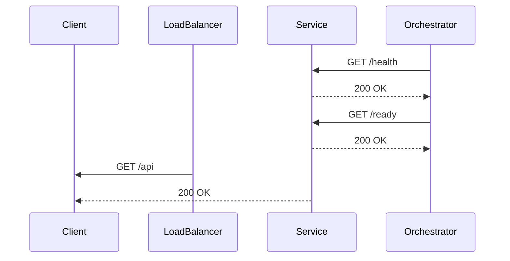

<!-- Generated by Groq via GitHub Actions -->
<!-- Topic ID: T152 -->
<!-- Category: Reliability Engineering -->
<!-- Generated at UTC: 2026-10-30T07:23:31.611018+00:00 -->

# Health checks

## 1. What problem does this solve?

Health checks are lightweight probes that let a monitoring system or orchestrator (Kubernetes, Docker‑Compose, load balancer, etc.) know whether a service is *alive* and *ready* to serve traffic.  
They solve several real‑world problems:

| Problem | Why it matters | Consequence if missing | Real‑world example |
|---------|----------------|------------------------|--------------------|
| **Unresponsive service** | Clients keep retrying, user experience degrades | Service appears up but is actually stuck | A Node.js API that hangs on a DB query |
| **Partial failure** | Some dependencies fail (DB, cache) but the service process is still running | Load balancer forwards traffic to a node that cannot serve requests | A FastAPI app that can’t reach PostgreSQL |
| **Rolling deployments** | New containers may start before they’re fully initialized | Traffic is sent to a container that hasn’t finished bootstrapping | Kubernetes `livenessProbe` vs `readinessProbe` |
| **Infrastructure monitoring** | Ops need a single source of truth for uptime | Manual checks, alerts miss critical downtime | Prometheus scraping `/health` endpoint |

Without health checks, you risk:

- **Silent failures**: a process is running but cannot serve requests.
- **Unnecessary traffic**: load balancers keep sending requests to dead nodes.
- **Delayed recovery**: operators may not notice a problem until a user reports it.

Health checks appear everywhere:  
- **Kubernetes** (`livenessProbe`, `readinessProbe`)  
- **Docker‑Compose** (`healthcheck` in `docker-compose.yml`)  
- **AWS ELB/ALB** (target group health checks)  
- **Prometheus** (scrape `/health` endpoints)  
- **CI/CD pipelines** (post‑deployment checks)

---

## 2. Mental model

### Analogy  
Think of a health check like a **doctor’s check‑up** for a server.  
- **Vitals** (CPU, memory, DB connectivity) are the *physical exam*.  
- **Lab tests** (ping a database, run a simple query) are the *blood tests*.  
- The doctor returns a *report* (`200 OK` or `503 Service Unavailable`).  
If the doctor says “all good”, the patient (service) can go out and work. If not, the patient stays home.

### Engineering model  
A health check is a **self‑contained HTTP endpoint** (or other protocol) that:

1. **Runs quickly** – < 100 ms.  
2. **Does minimal work** – only what is needed to decide “alive” or “ready”.  
3. **Returns a clear status** – 200 for healthy, 5xx for unhealthy.  
4. **Is idempotent** – repeated calls give the same result.

---

## 3. Deep explanation

### Internals
- **Liveness**: Does the process exist and is it not stuck?  
  *Implementation*: simple `/health` that returns 200 if the Node.js event loop is running.  
- **Readiness**: Are all *critical* dependencies available?  
  *Implementation*: `/ready` that pings DB, cache, external APIs.  
- **Probes**: In Kubernetes, `livenessProbe` restarts the pod if it fails; `readinessProbe` removes it from service endpoints.

### Important terminology
- **Probe** – a check performed by an orchestrator.  
- **Endpoint** – the URL exposed by the service.  
- **Status code** – 200 OK (healthy), 503 Service Unavailable (unhealthy).  
- **Timeout / interval** – how often and how long the probe waits.

### Trade‑offs
| Aspect | Trade‑off | Mitigation |
|--------|-----------|------------|
| **Depth vs speed** | Deep checks (full DB transaction) are slower but catch more failures. | Keep checks lightweight; use cached health status. |
| **Granularity** | Separate liveness/readiness vs single endpoint. | Use two endpoints if you need fine‑grained control. |
| **Security** | Exposing health endpoints can leak internal state. | Require auth or expose only on internal networks. |

### Failure modes
- **False positives**: A check passes but the service is still unresponsive (e.g., DB ping succeeds but query times out).  
- **False negatives**: A transient network glitch causes a check to fail.  
- **Resource exhaustion**: Health checks that run heavy queries can degrade performance.

### Limitations
- Health checks only detect *current* state; they cannot predict future failures.  
- They cannot replace proper error handling inside your application.  
- Over‑aggressive checks can cause unnecessary restarts.

### Where it fits
- **Service layer**: Exposed as `/health` and `/ready`.  
- **Orchestration layer**: Kubernetes probes, Docker healthcheck, load balancer health checks.  
- **Observability layer**: Prometheus scrapes health endpoints; logs can be correlated.

### Interaction with related concepts
- **Circuit breakers**: Health checks can be used to reset a circuit breaker.  
- **Graceful shutdown**: A readiness probe can be set to `false` before shutting down to stop new traffic.  
- **Rate limiting**: Health checks should bypass rate limits to avoid false negatives.

---

## 4. How it works

1. **Service starts** → registers `/health` and `/ready`.  
2. **Orchestrator** polls `/health` at `interval`.  
3. If `/health` returns 200 → service is *alive*.  
4. Orchestrator polls `/ready` at `interval`.  
5. If `/ready` returns 200 → service is *ready* to receive traffic.  
6. If any probe fails → orchestrator takes action (restart pod, remove from load balancer).  



---

## 5. Practical implementation

### Node.js / Express example

```ts
// src/health.ts
import express, { Request, Response } from 'express';
import { Pool } from 'pg';
import { createClient } from 'redis';

const app = express();
const dbPool = new Pool({ connectionString: process.env.DATABASE_URL });
const redis = createClient({ url: process.env.REDIS_URL });

app.get('/health', (_req: Request, res: Response) => {
  // Liveness: just check that the process is running
  res.status(200).send('OK');
});

app.get('/ready', async (_req: Request, res: Response) => {
  try {
    // Quick DB ping
    await dbPool.query('SELECT 1');
    // Quick Redis ping
    await redis.ping();
    res.status(200).send('Ready');
  } catch (err) {
    console.error('Readiness check failed', err);
    res.status(503).send('Not ready');
  }
});

export default app;
```

**Dockerfile**

```dockerfile
FROM node:20-alpine
WORKDIR /app
COPY package*.json ./
RUN npm ci
COPY . .
EXPOSE 3000
CMD ["node", "dist/index.js"]
```

**docker-compose.yml**

```yaml
services:
  api:
    build: .
    ports:
      - "3000:3000"
    environment:
      - DATABASE_URL=postgres://user:pass@db:5432/app
      - REDIS_URL=redis://redis:6379
    healthcheck:
      test: ["CMD", "curl", "-f", "http://localhost:3000/health"]
      interval: 10s
      timeout: 5s
      retries: 3
```

**Kubernetes example**

```yaml
apiVersion: apps/v1
kind: Deployment
metadata:
  name: api
spec:
  replicas: 3
  selector:
    matchLabels:
      app: api
  template:
    metadata:
      labels:
        app: api
    spec:
      containers:
        - name: api
          image: myrepo/api:latest
          ports:
            - containerPort: 3000
          livenessProbe:
            httpGet:
              path: /health
              port: 3000
            initialDelaySeconds: 10
            periodSeconds: 10
          readinessProbe:
            httpGet:
              path: /ready
              port: 3000
            initialDelaySeconds: 5
            periodSeconds: 5
```

**Key lines explained**

- `app.get('/health')`: minimal check, no DB or network calls.  
- `app.get('/ready')`: performs a lightweight DB and Redis ping.  
- Docker healthcheck uses `curl -f` to treat non‑200 as failure.  
- Kubernetes probes use `initialDelaySeconds` to allow startup time.

---

## 6. Production considerations

| Concern | How to address it |
|---------|-------------------|
| **Scalability** | Keep checks stateless; avoid heavy DB queries. Use connection pools. |
| **Reliability** | Separate liveness and readiness. Use retries and timeouts. |
| **Security** | Expose health endpoints only on internal networks or behind auth. |
| **Observability** | Log failures, expose metrics (`health_check_duration_seconds`). |
| **Performance** | Cache health status; run checks asynchronously if needed. |
| **Error handling** | Return 503 with a clear body; include diagnostic info in logs. |
| **Resource usage** | Avoid heavy operations; use lightweight pings. |
| **Operational concerns** | Monitor probe failures; set alert thresholds. |
| **Failure recovery** | Use graceful shutdown: set readiness to false before SIGTERM. |
| **Deployment** | Use rolling updates with readiness probes to avoid traffic to new pods. |

---

## 7. Common mistakes

| Mistake | Why it’s problematic |
|---------|----------------------|
| **Using the same endpoint for liveness and readiness** | A failing DB ping will restart the pod even if the process is alive. |
| **Heavy queries in health checks** | Slows down probes, can cause false negatives and degrade service. |
| **No timeout on external calls** | Health check can hang, blocking orchestrator. |
| **Exposing health endpoints publicly** | Can reveal internal architecture or allow DoS. |
| **Ignoring readiness during shutdown** | New traffic may hit a node that is shutting down. |
| **Not handling transient failures** | Temporary network glitches cause unnecessary restarts. |
| **Hardcoding credentials in health checks** | Security risk; use environment variables or secrets. |
| **Failing to log failures** | Makes debugging hard. |

---

## 8. Senior engineer perspective

### What changes at scale?

- **Distributed health**: In a micro‑service mesh, each service may need to expose multiple health endpoints (e.g., `/health/db`, `/health/cache`).  
- **Circuit breaker integration**: Health checks can be used to reset circuit breakers after a failure.  
- **Observability stack**: Export health metrics to Prometheus; correlate with latency and error rates.  
- **Dynamic configuration**: Health check intervals may vary per environment (dev vs prod).  
- **Cost**: Frequent DB pings can increase load; use lightweight health probes or cache results.

### Design decisions

| Decision | Trade‑offs |
|----------|------------|
| **Single vs multiple health endpoints** | Single endpoint is simpler but less granular; multiple endpoints give fine‑grained control but increase maintenance. |
| **Depth of checks** | Deeper checks catch more failures but add latency and load. |
| **Probe frequency** | High frequency gives quick detection but increases load; low frequency reduces load but delays detection. |
| **Timeouts** | Short timeouts reduce false positives but may miss slow dependencies. |
| **Security** | Exposing health endpoints publicly can aid attackers; internal only reduces risk but may limit external monitoring. |
| **Graceful shutdown** | Setting readiness to false before SIGTERM avoids traffic but may increase latency for users. |

### When NOT to use the approach

- **Serverless functions**: Health checks are unnecessary; the platform manages invocations.  
- **Stateless micro‑services**: If the service has no external dependencies, a simple liveness probe may suffice.  
- **Legacy monoliths**: Adding health endpoints may not integrate with existing monitoring; consider a sidecar instead.

---

## 9. Interview questions

1. **Beginner**: *What is the difference between a liveness probe and a readiness probe in Kubernetes?*  
   *Answer*: Liveness checks if the pod is alive and should be restarted if it fails; readiness checks if the pod is ready to receive traffic and can be removed from the load balancer if it fails.

2. **Beginner**: *Why should health checks be lightweight?*  
   *Answer*: Heavy checks can slow down the probe, cause false negatives, and add unnecessary load to the service and its dependencies.

3. **Senior**: *How would you design a health check for a service that depends on multiple external APIs, each with different latency characteristics?*  
   *Answer*: Use a composite readiness endpoint that performs asynchronous pings to each dependency with per‑dependency timeouts, aggregates results, and returns 200 only if all critical dependencies are healthy. Cache results or use a circuit breaker to avoid repeated expensive calls.

4. **Senior**: *Explain how you would integrate health checks with a service mesh like Istio or Linkerd.*  
   *Answer*: Expose `/health` and `/ready` endpoints; configure the mesh sidecar to use those endpoints for liveness/readiness. Use sidecar injection to automatically add probes, and expose metrics to the mesh’s telemetry stack. Consider mutual TLS and secure endpoints.

5. **Scenario/Debugging**: *A Kubernetes deployment has a `readinessProbe` that keeps failing with a 503, but the application logs show it is running fine. What could be causing this, and how would you troubleshoot?*  
   *Answer*: Possible causes:  
   - The readiness endpoint is performing a DB ping that times out due to network latency or DB overload.  
   - The probe interval is too short; the DB is slow to respond.  
   - The endpoint is behind authentication that the probe does not provide.  
   Troubleshooting steps:  
   - Inspect probe logs and metrics.  
   - Reduce probe timeout or increase interval.  
   - Verify the readiness handler’s code and dependencies.  
   - Check network policies and DNS resolution.  
   - Use `kubectl exec` to manually hit the endpoint from inside the pod.

---

## 10. Hands‑on task

**Task**: Add a *composite* readiness endpoint to an existing Express service that checks:

1. PostgreSQL connectivity (`SELECT 1`).  
2. Redis connectivity (`PING`).  
3. External API health (`GET https://api.example.com/health`).  

The endpoint should return 200 only if *all* checks succeed; otherwise 503. Add unit tests that mock each dependency. Deploy the service in Docker Compose and verify that the `docker-compose healthcheck` passes only when all dependencies are healthy.

---

## 11. Quick revision

- Health checks are lightweight probes that report service health to orchestrators.  
- **Liveness**: is the process alive? → `/health`.  
- **Readiness**: are all critical dependencies ready? → `/ready`.  
- Keep checks fast (< 100 ms) and stateless.  
- Separate liveness and readiness to avoid unnecessary restarts.  
- Use timeouts, retries, and proper status codes (200 OK, 503 Service Unavailable).  
- Secure health endpoints; expose only internally or with auth.  
- In Kubernetes, `livenessProbe` restarts pods; `readinessProbe` removes them from service endpoints.  
- Monitor health check metrics and logs for early failure detection.  
- Graceful shutdown: set readiness to false before SIGTERM.  
- Avoid heavy DB queries; use lightweight pings or cached status.  
- For distributed systems, expose multiple health endpoints for granular checks.

---

## 12. References

- [Kubernetes: Liveness and Readiness Probes](https://kubernetes.io/docs/tasks/configure-pod-container/configure-liveness-readiness-startup-probes/)  
- [Docker: Healthcheck](https://docs.docker.com/engine/reference/builder/#healthcheck)  
- [Express.js: Router](https://expressjs.com/en/guide/routing.html)  
- [Node.js: pg](https://node-postgres.com/)  
- [Redis: Node client](https://github.com/redis/node-redis)  
- [Prometheus: HTTP Exporter](https://prometheus.io/docs/instrumenting/exporters/)  
- [Istio: Health Checks](https://istio.io/latest/docs/tasks/traffic-management/health-checks/)
