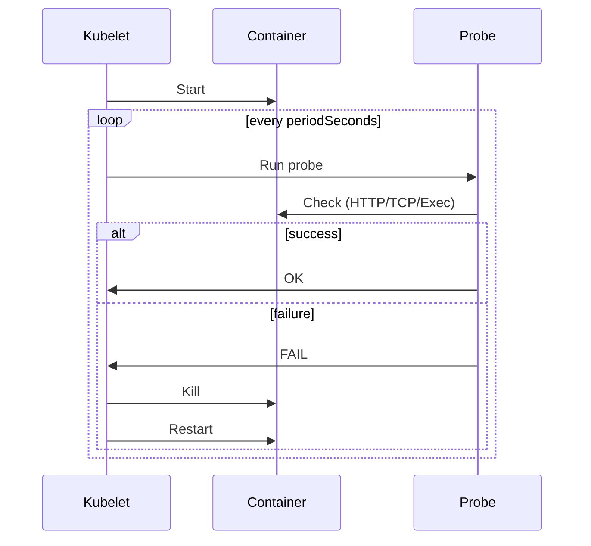

<!-- Generated by Groq via GitHub Actions -->
<!-- Topic ID: T153 -->
<!-- Category: Reliability Engineering -->
<!-- Generated at UTC: 2026-10-30T18:43:43.711761+00:00 -->

# Liveness probes

## 1. What problem does this solve?

**Motivation**  
In a distributed backend, a process can appear to be running (the OS shows a PID, the container is up) but its internal state may be corrupted, a deadlock may have occurred, or a critical resource (DB connection, cache, external API) may have become unreachable. If nothing watches the process, it will keep consuming resources and serve bad responses until a human intervenes.

**What problem exists**  
- A service can be “alive” at the OS level but not able to serve requests correctly.
- A stuck goroutine, infinite loop, or exhausted connection pool can silently degrade performance.
- Without detection, downstream services keep retrying, causing cascading failures.

**Why the problem matters**  
- **Availability**: Clients keep getting timeouts or errors.
- **Cost**: Resources (CPU, memory, network) are wasted on a non‑productive process.
- **Reliability**: The system may never recover automatically, requiring manual restarts.

**What happens if this concept is not used**  
- Services may stay up but become unresponsive.
- Manual intervention is needed to restart or replace the process.
- Orchestrators (K8s, Docker Swarm) cannot automatically recover the pod/container.

**Where this concept appears in real backend systems**  
- Kubernetes `livenessProbe` in pod specs.
- Docker `HEALTHCHECK` instructions.
- Cloud‑native platforms (ECS, GKE, AKS) expose similar health endpoints.
- Custom health‑check endpoints in microservice frameworks (Express, FastAPI, Spring Boot).

---

## 2. Mental model

**Analogy**  
Think of a factory assembly line. The line is powered on (the machine is running), but a critical sensor stops sending data. The line keeps moving, but the product is defective. A supervisor periodically checks the sensor status and stops the line if the sensor fails. The supervisor’s check is the *liveness probe*.

**Engineering model**  
A liveness probe is a lightweight, external check that verifies the *process is still alive and able to recover*. It is distinct from a *readiness probe* (is the service ready to accept traffic) and a *startup probe* (has the service finished booting). The probe typically:

1. Is invoked by an orchestrator or monitoring system.
2. Executes a simple operation (HTTP GET, TCP ping, exec command).
3. Returns success or failure.
4. Triggers a restart or alert if failure persists.

---

## 3. Deep explanation

### Internals
- **Probe type**: HTTP, TCP, or Exec.
- **Frequency**: `periodSeconds` (default 10 s), `timeoutSeconds` (default 1 s).
- **Failure threshold**: `failureThreshold` (default 3). After N consecutive failures, the process is killed.
- **Success threshold**: `successThreshold` (default 1). For startup probes, requires N consecutive successes.

### Important terminology
| Term | Meaning |
|------|---------|
| **Liveness** | Whether the process can recover from failure. |
| **Readiness** | Whether the process can accept traffic. |
| **Startup** | Whether the process has finished booting. |
| **Probe failure** | The probe returned a non‑zero exit code, non‑200 HTTP status, or TCP connection failed. |
| **Grace period** | Time allowed for the process to shut down cleanly after being killed. |

### Trade‑offs
| Aspect | Pros | Cons |
|--------|------|------|
| **HTTP probe** | Human‑readable, can run application logic (e.g., DB ping). | Adds network overhead; may expose internal endpoint. |
| **TCP probe** | Very lightweight, no HTTP stack. | Cannot run application logic; only checks port listening. |
| **Exec probe** | Can run arbitrary shell commands (e.g., check file locks). | Requires privileged container; harder to secure. |

### Failure modes
- **False positives**: Probe fails due to transient network glitch, causing unnecessary restarts.
- **False negatives**: Probe passes but the service is actually degraded (e.g., DB connection pool exhausted but still returns 200).
- **Probe starvation**: Probe runs too frequently, consuming CPU/memory.

### Limitations
- Only detects *process‑level* problems, not *distributed* issues (e.g., downstream service down).
- Requires careful design to avoid probing expensive operations.
- In multi‑service pods, a single probe may not capture all sub‑components.

### Where this concept fits in a backend architecture
- **Orchestrator layer**: Kubernetes, ECS, Docker Swarm.
- **Service layer**: Each microservice exposes a `/health/liveness` endpoint.
- **Infrastructure layer**: Load balancers, API gateways rely on readiness probes to route traffic.

### Interaction with related concepts
- **Readiness probes**: Ensure traffic only hits healthy instances.
- **Startup probes**: Prevent probes from running before the service is ready.
- **Circuit breakers**: Liveness probes can be the first line of defense before a circuit breaker trips.
- **Observability**: Probe results can be exported to Prometheus (`kubelet` metrics) or CloudWatch.

---

## 4. How it works

1. **Container starts** → Kubernetes schedules pod.
2. **Startup probe** (if defined) runs until success.
3. **Liveness probe** starts running every `periodSeconds`.
4. Probe performs its check (HTTP GET, TCP connect, exec).
5. If probe returns success → pod stays alive.
6. If probe fails `failureThreshold` times → kubelet kills the container.
7. Container restarts according to pod’s restart policy.
8. Probe continues until pod is healthy again.



---

## 5. Practical implementation

### 5.1 Node.js / Express liveness endpoint

```ts
// src/health.ts
import express from 'express';
import { Pool } from 'pg';

const app = express();
const dbPool = new Pool({ connectionString: process.env.DATABASE_URL });

app.get('/health/liveness', async (_req, res) => {
  try {
    // Quick DB ping to ensure connection pool is healthy
    await dbPool.query('SELECT 1');
    res.status(200).send('OK');
  } catch (err) {
    console.error('Liveness check failed', err);
    res.status(500).send('FAIL');
  }
});

export default app;
```

### 5.2 Dockerfile

```dockerfile
# Dockerfile
FROM node:20-alpine
WORKDIR /app
COPY package*.json ./
RUN npm ci --omit=dev
COPY . .
EXPOSE 3000
CMD ["node", "dist/index.js"]
```

### 5.3 Kubernetes pod spec

```yaml
apiVersion: v1
kind: Pod
metadata:
  name: my-service
spec:
  containers:
  - name: app
    image: myregistry/my-service:latest
    ports:
    - containerPort: 3000
    livenessProbe:
      httpGet:
        path: /health/liveness
        port: 3000
      initialDelaySeconds: 15
      periodSeconds: 10
      timeoutSeconds: 2
      failureThreshold: 3
    readinessProbe:
      httpGet:
        path: /health/ready
        port: 3000
      initialDelaySeconds: 5
      periodSeconds: 5
```

**Key lines explained**

- `initialDelaySeconds`: Wait before first probe to allow startup.
- `failureThreshold`: After 3 consecutive failures, container is killed.
- `timeoutSeconds`: Probe must finish within 2 s; otherwise considered failed.

### 5.4 Optional: Exec probe for file lock check

```yaml
    livenessProbe:
      exec:
        command: ["sh", "-c", "test -f /tmp/lockfile"]
      initialDelaySeconds: 5
      periodSeconds: 30
```

---

## 6. Production considerations

| Concern | Recommendation |
|---------|----------------|
| **Scalability** | Keep probe lightweight; avoid heavy DB queries or large payloads. |
| **Reliability** | Use `failureThreshold` > 1 to avoid flapping. |
| **Security** | Expose health endpoints only on internal networks; use TLS. |
| **Observability** | Export probe results to Prometheus (`kubelet` exposes `/metrics`). |
| **Performance** | Cache probe results if possible; avoid blocking main request thread. |
| **Error handling** | Return 500 on any internal error; log details for debugging. |
| **Resource usage** | Probe should consume < 5 % CPU/memory. |
| **Operational concerns** | Monitor probe failure counts; alert on repeated restarts. |
| **Failure recovery** | Ensure graceful shutdown hooks to release resources before kill. |
| **Deployment considerations** | Update `initialDelaySeconds` when adding new dependencies. |

---

## 7. Common mistakes

| Mistake | Why it’s problematic |
|---------|----------------------|
| Using a **readiness** endpoint as a liveness probe | Readiness may return 200 while the service is still stuck; liveness should detect stuck state. |
| Setting `periodSeconds` too low (e.g., 1 s) | Generates excessive traffic, can overwhelm the service. |
| Returning 200 on any error in the probe | Masks real failures; orchestrator never restarts. |
| Not adding `initialDelaySeconds` | Probe runs before the service is fully initialized, causing false failures. |
| Using a heavy DB query in the probe | Adds latency to the probe, potentially causing timeouts. |
| Exposing liveness endpoint publicly | Security risk; attackers could trigger restarts. |
| Ignoring probe failure metrics | Missed early warning of a degrading system. |

---

## 8. Senior engineer perspective

### Architecture decisions
- **Probe type**: Prefer HTTP for application‑level checks; TCP for simple port liveness; Exec for container‑level checks.
- **Endpoint placement**: Separate `/health/liveness` and `/health/ready` to avoid conflating concerns.
- **Probe frequency**: Balance between rapid failure detection and overhead.

### Trade‑offs
- **Latency vs. safety**: Faster probes detect issues sooner but risk false positives.
- **Complexity vs. observability**: Adding application logic to the probe increases code maintenance but provides richer health data.

### Bottlenecks
- **Database connection pool exhaustion** can cause probe failures even when the service can still serve some requests.
- **Network partitions** may cause probe failures unrelated to the service’s internal state.

### Failure scenarios
- **Stuck goroutine**: Probe may still succeed if it only checks a port; consider adding a health check that verifies background workers.
- **Resource starvation**: High CPU usage can delay probe responses; set `timeoutSeconds` appropriately.

### Monitoring
- Track `kubelet_container_liveness_failed` metrics.
- Correlate probe failures with application logs.
- Alert on repeated restarts (e.g., > 5 restarts in 5 min).

### Cost/performance
- Lightweight probes reduce CPU/memory usage.
- Heavy probes can increase cluster cost due to more frequent restarts.

### When NOT to use
- In a **single‑process, stateless** service where a crash is acceptable and manual restart is trivial.
- When the orchestrator already provides health checks (e.g., ECS health checks) and you prefer to centralize monitoring.

---

## 9. Interview questions

1. **Beginner**: *What is the difference between a liveness probe and a readiness probe?*  
   *Answer*: Liveness checks if the process can recover; readiness checks if it can accept traffic. Liveness may restart the pod, readiness only affects load balancer routing.

2. **Beginner**: *Why do we need `initialDelaySeconds` in a probe definition?*  
   *Answer*: It gives the container time to start up before the first probe runs, preventing false failures during boot.

3. **Senior**: *How would you design a liveness probe for a service that relies on an external API that can be flaky?*  
   *Answer*: Use a lightweight internal check (e.g., a health flag set by a background worker). Avoid making the probe depend on the flaky external API; instead, monitor the API separately and set a flag that the probe reads.

4. **Senior**: *Explain how probe failures can lead to a cascading restart loop in a Kubernetes cluster and how you would mitigate it.*  
   *Answer*: If a probe fails repeatedly, kubelet kills the container, which restarts, then the probe fails again. This can happen if the probe is too aggressive or the service is stuck. Mitigation: increase `failureThreshold`, add exponential backoff, or use a startup probe to delay liveness checks until the service is fully ready.

5. **Scenario/Debugging**: *Your service is running, but Kubernetes keeps killing it after 3 probe failures. The probe is an HTTP GET to `/health/liveness`. What steps would you take to debug the issue?*  
   *Answer*:  
   - Check pod logs for the probe failure messages.  
   - Verify the endpoint returns 200 under normal load.  
   - Inspect network policies and service ports.  
   - Ensure the probe’s `timeoutSeconds` is sufficient.  
   - Look for resource constraints (CPU/memory limits).  
   - Test the endpoint manually from inside the pod (`kubectl exec`).  
   - If the service uses a DB, confirm the DB connection pool is healthy.

---

## 10. Hands‑on task

**Task**: Add a liveness probe to an existing Express service that uses a PostgreSQL connection pool.  
1. Create a `/health/liveness` endpoint that pings the DB.  
2. Update the Dockerfile to expose port 3000.  
3. Write a `k8s/deployment.yaml` that includes the liveness probe with `periodSeconds: 10`, `timeoutSeconds: 2`, `failureThreshold: 3`.  
4. Deploy to a local Minikube cluster and observe the probe behavior when you stop the Postgres container (the pod should restart automatically).  
5. Add a log statement in the probe to record each failure.

---

## 11. Quick revision

- **Liveness probe** → Detects if a process can recover; triggers restart on failure.  
- **Readiness probe** → Indicates if a service can accept traffic.  
- **Probe types**: HTTP, TCP, Exec.  
- **Key fields**: `initialDelaySeconds`, `periodSeconds`, `timeoutSeconds`, `failureThreshold`.  
- **Common pitfall**: Using readiness as liveness; returning 200 on any error.  
- **Observability**: `kubelet_container_liveness_failed` metric; log probe failures.  
- **Security**: Keep health endpoints internal; use TLS.  
- **Performance**: Keep probe lightweight; avoid heavy DB queries.  
- **Failure recovery**: Graceful shutdown hooks; graceful termination.  
- **Deployment**: Adjust `initialDelaySeconds` when adding dependencies.  
- **Scaling**: Probe overhead scales with pod count; monitor cluster load.

---

## 12. References

- [Kubernetes: Probes](https://kubernetes.io/docs/tasks/configure-pod-container/configure-liveness-readiness-startup-probes/)
- [Docker: HEALTHCHECK](https://docs.docker.com/engine/reference/builder/#healthcheck)
- [Express.js: Health Check Middleware](https://expressjs.com/en/advanced/best-practice-performance.html#health-check)
- [PostgreSQL: Connection Pooling with pg](https://node-postgres.com/features/pooling)
- [Prometheus: kubelet metrics](https://github.com/kubernetes/kubelet/blob/master/docs/metrics.md)

---
