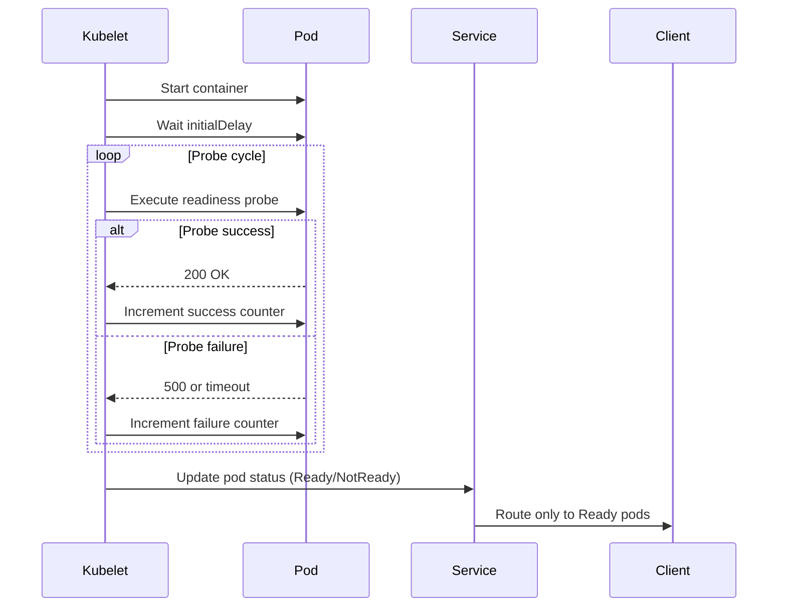

<!-- Generated by Groq via GitHub Actions -->
<!-- Topic ID: T154 -->
<!-- Category: Reliability Engineering -->
<!-- Generated at UTC: 2026-10-30T18:43:43.711761+00:00 -->

# Readiness probes

## 1. What problem does this solve?

In a distributed system, a service often needs to start up, load configuration, connect to databases, warm caches, or perform other one‑time work before it can safely accept traffic.  
If a load balancer or orchestrator forwards requests to a pod that is still initializing, those requests will fail, leading to:

- **Unnecessary retries** from clients or upstream services.
- **False alarms** in monitoring dashboards (e.g., “service down” when it’s just warming up).
- **Resource waste**: the pod may be killed or restarted because the orchestrator thinks it’s unhealthy, even though it will become healthy shortly.

Readiness probes let the orchestrator (e.g., Kubernetes) know *when* a pod is ready to receive traffic, separating **liveness** (is the process alive?) from **readiness** (is it ready to serve requests?).

### Why the problem matters
- **User experience**: Clients may see 5xx errors or timeouts while the service is still starting.
- **Cost**: Unnecessary restarts or traffic to unhealthy pods can increase compute usage.
- **Reliability**: A system that forwards traffic to unready services can cascade failures.

### What happens if this concept is not used
- Load balancers may send traffic to pods that cannot handle it, causing request failures.
- Orchestrators may kill pods that are actually healthy but not yet ready, leading to churn.
- Monitoring may misinterpret readiness as health, masking real issues.

### Where this concept appears in real backend systems
- Kubernetes deployments (`readinessProbe` in pod spec).
- Service meshes (Istio, Linkerd) that respect readiness gates.
- Cloud‑managed services (GKE, EKS, AKS) that expose readiness endpoints.
- CI/CD pipelines that wait for readiness before marking a deployment successful.

---

## 2. Mental model

### Analogy
Imagine a restaurant kitchen. The **chef** (the application) needs to prepare the menu, set up the station, and test a dish before the **waiter** (the load balancer) can start taking orders. Until the kitchen is ready, the waiter should not accept orders; otherwise, customers will receive incomplete meals or no service at all.

### Engineering model
- **Readiness probe** = “Is the kitchen fully prepared?”
- **Orchestrator** = “Waiter” that checks the readiness probe before routing traffic.
- **Pod** = “Kitchen” that must signal readiness before serving.

---

## 3. Deep explanation

### Internals
- In Kubernetes, a readiness probe is defined in the pod spec. It can be an HTTP GET, TCP socket, or exec command.
- The kubelet periodically executes the probe. If it succeeds, the pod’s status becomes *Ready*; otherwise, it is *NotReady*.
- Only pods marked *Ready* receive traffic from Services or Ingresses.

### Important terminology
- **Probe**: A health check performed by the orchestrator.
- **Liveness probe**: Checks if the process is alive; if it fails, the pod is restarted.
- **Readiness probe**: Checks if the pod can accept traffic; if it fails, traffic is stopped but the pod is not restarted.
- **Endpoint**: The URL or socket that the probe checks.
- **Initial delay**: Time to wait before starting probes after container start.
- **Timeout**: How long to wait for a probe response before marking it failed.
- **Period**: Frequency of probe execution.
- **Success threshold**: Number of consecutive successes required to mark Ready.
- **Failure threshold**: Number of consecutive failures before marking NotReady.

### Trade‑offs
| Aspect | Pros | Cons |
|--------|------|------|
| **HTTP GET** | Simple, idempotent, can return detailed status | Requires HTTP server; overhead |
| **TCP socket** | Lightweight, no HTTP overhead | Cannot return detailed health info |
| **Exec** | Full control, can run arbitrary checks | Requires container to have the command; more complex |

### Failure modes
- **False positives**: Probe passes but application still cannot serve (e.g., DB connection established but schema missing).
- **False negatives**: Probe fails due to transient network hiccup, causing unnecessary traffic drop.
- **Probe overload**: Too frequent probes can add load to the service.

### Limitations
- Readiness probes only indicate *availability* for traffic, not *correctness* of responses.
- They cannot detect downstream failures (e.g., DB outage) unless the probe itself checks them.
- In a multi‑service architecture, readiness of one service may depend on others; orchestrator cannot coordinate cross‑service readiness automatically.

### Where it fits in backend architecture
- **Ingress / Service Mesh**: Routes traffic only to Ready pods.
- **CI/CD**: Deployment pipelines wait for readiness before marking a release as successful.
- **Observability**: Readiness status can be exposed via metrics (e.g., `kube_pod_status_ready`).

### Interaction with related concepts
- **Liveness probes**: Restart the pod if the process hangs; readiness stops traffic but does not restart.
- **Horizontal Pod Autoscaler (HPA)**: Uses metrics that may depend on readiness (e.g., request latency).
- **Service discovery**: Only Ready instances are registered.

---

## 4. How it works

1. **Container starts** → kubelet waits `initialDelaySeconds`.
2. **Probe begins** → kubelet executes the probe at `periodSeconds`.
3. **Probe result**  
   - Success → increment success counter.  
   - Failure → increment failure counter.
4. **Threshold check**  
   - If successes ≥ `successThreshold` → pod status set to *Ready*.  
   - If failures ≥ `failureThreshold` → pod status set to *NotReady*.
5. **Traffic routing**  
   - Service/Ingress forwards requests only to pods marked *Ready*.
6. **Pod lifecycle**  
   - If liveness probe fails → pod is restarted.  
   - If readiness probe fails → traffic stops, but pod stays running.



---

## 5. Practical implementation

### TypeScript/Node.js example

```ts
// src/health.ts
import express, { Request, Response } from 'express';
import { Pool } from 'pg';

const app = express();
const dbPool = new Pool({
  connectionString: process.env.DATABASE_URL,
});

app.get('/ready', async (req: Request, res: Response) => {
  try {
    // 1. Check DB connectivity
    await dbPool.query('SELECT 1');

    // 2. Check Redis connectivity (optional)
    // const redisClient = new Redis();
    // await redisClient.ping();

    // 3. All checks passed
    res.status(200).send('OK');
  } catch (err) {
    console.error('Readiness check failed', err);
    res.status(503).send('Service not ready');
  }
});

const PORT = process.env.PORT ?? 3000;
app.listen(PORT, () => {
  console.log(`Health server listening on ${PORT}`);
});
```

**Dockerfile**

```dockerfile
FROM node:20-alpine
WORKDIR /app
COPY package*.json ./
RUN npm ci
COPY . .
EXPOSE 3000
CMD ["node", "dist/health.js"]
```

**Kubernetes pod spec**

```yaml
apiVersion: v1
kind: Pod
metadata:
  name: backend
spec:
  containers:
  - name: app
    image: myregistry/backend:latest
    ports:
    - containerPort: 3000
    readinessProbe:
      httpGet:
        path: /ready
        port: 3000
      initialDelaySeconds: 10
      periodSeconds: 5
      timeoutSeconds: 2
      successThreshold: 1
      failureThreshold: 3
```

**Explanation of key lines**

- `readinessProbe.httpGet`: The probe performs an HTTP GET to `/ready`.
- `initialDelaySeconds`: Gives the app time to start and load DB connections.
- `failureThreshold: 3`: The pod will be marked NotReady after 3 consecutive failures, preventing flapping.

---

## 6. Production considerations

| Concern | Tips |
|---------|------|
| **Scalability** | Keep probe logic lightweight; avoid heavy DB queries or external calls. |
| **Reliability** | Use `successThreshold` > 1 to avoid flapping on transient failures. |
| **Security** | Expose the probe endpoint only on the pod’s internal network; no external access. |
| **Observability** | Emit metrics (e.g., `probe_success_total`) and logs for probe failures. |
| **Performance** | Cache probe results if the check is expensive; e.g., use a health flag set by startup code. |
| **Error handling** | Return 503 on failure; 200 on success. Avoid 500 to prevent misinterpretation. |
| **Resource usage** | Probe frequency (`periodSeconds`) should balance responsiveness vs. load. |
| **Operational concerns** | Document probe behavior in deployment guides; monitor `kube_pod_status_ready` metrics. |
| **Failure recovery** | Combine with liveness probes to restart stuck pods. |
| **Deployment** | Use `preStop` hooks to gracefully shut down after readiness is lost. |

---

## 7. Common mistakes

| Mistake | Why it’s problematic |
|---------|----------------------|
| **Using the same endpoint for liveness and readiness** | Liveness should detect hangs; readiness should detect startup. Mixing them can cause premature restarts. |
| **Too frequent probes** | Adds load and can trigger false negatives during traffic spikes. |
| **Heavy DB queries in readiness** | Slows down probe, causing false negatives. Use lightweight checks or cache. |
| **Not setting `initialDelaySeconds`** | Probe may fail before the app is ready, causing traffic to be blocked. |
| **Returning 200 on failure** | Orchestrator thinks pod is ready; traffic will hit a failing service. |
| **Exposing probe endpoint publicly** | Security risk; attackers could probe internal health. |
| **Ignoring probe failures in logs** | Missed early warning signs of startup issues. |
| **Using exec probes that depend on external binaries** | Increases image size and complexity; may fail if binary missing. |

---

## 8. Senior engineer perspective

### What changes at scale

- **Multiple readiness checks**: In a microservice that depends on several downstream services, readiness may need to aggregate multiple checks (DB, cache, external API). A senior engineer designs a composite health endpoint that short‑circuits on first failure.
- **Distributed tracing**: Correlate readiness failures with traces to pinpoint root causes.
- **Dynamic thresholds**: Adjust `failureThreshold` based on traffic patterns or deployment stage.
- **Service mesh integration**: Configure Istio’s readiness gate to respect Kubernetes readiness.

### Design decisions

| Decision | Trade‑offs |
|----------|------------|
| **HTTP vs. TCP probe** | HTTP gives richer status; TCP is lighter. |
| **Probe frequency** | Faster detection vs. added load. |
| **Success threshold** | Avoid flapping vs. responsiveness. |
| **Probe endpoint location** | Internal vs. external; security vs. accessibility. |
| **Composite health** | Complexity vs. accuracy. |

### Bottlenecks

- **Database connection pool exhaustion** if readiness probe opens new connections each time.
- **Network latency** between pod and external services can cause probe timeouts.

### Monitoring

- Expose `probe_success_total` and `probe_failure_total` metrics.
- Alert on `kube_pod_status_ready{condition="false"}` spikes.
- Correlate with request latency to detect “slow start” issues.

### Cost/performance

- Each probe incurs network I/O; in large clusters, this can add measurable traffic.
- Heavy probes can increase CPU usage; keep them idempotent and fast.

### When NOT to use

- **Stateless services** that start instantly: a simple liveness probe may suffice.
- **Legacy monoliths** where adding a probe endpoint is impractical; consider external health checks instead.
- **Highly dynamic environments** where readiness changes frequently; may be better handled by service mesh sidecars.

---

## 9. Interview questions

1. **Beginner**: *What is the difference between a liveness probe and a readiness probe in Kubernetes?*  
   *Answer*: Liveness checks if the process is alive; if it fails, the pod is restarted. Readiness checks if the pod can accept traffic; if it fails, traffic is stopped but the pod is not restarted.

2. **Beginner**: *Why should a readiness probe return HTTP 200 on success and 503 on failure?*  
   *Answer*: Kubernetes interprets 200 as success; any other status (including 500) is treated as failure. 503 clearly indicates “service unavailable” to clients.

3. **Senior**: *How would you design a readiness probe for a service that depends on multiple downstream services (DB, cache, external API)?*  
   *Answer*: Create a composite health endpoint that performs lightweight checks for each dependency, short‑circuits on first failure, and returns 200 only when all are healthy. Use caching or async checks to keep the probe fast.

4. **Senior**: *Explain how readiness probes interact with a service mesh like Istio.*  
   *Answer*: Istio respects Kubernetes readiness; it will not route traffic to pods marked NotReady. Additionally, Istio can expose its own readiness gate that can be configured to consider sidecar health.

5. **Scenario/Debugging**: *A deployment shows that pods are repeatedly marked NotReady, but the `/ready` endpoint returns 200 when accessed manually. What could be causing this?*  
   *Answer*: Possible causes: probe timeout too short, network latency, probe runs on a different port or path, DNS resolution issues, or the probe is executed in a different namespace/network context. Check probe configuration, logs, and metrics.

---

## 10. Hands‑on task

**Task**: Add a readiness probe to the existing `express` service in the repository.

1. Create a `/ready` endpoint that checks:
   - PostgreSQL connection (`SELECT 1`).
   - Redis ping (optional).
2. Update the Dockerfile to expose port 3000.
3. Write a Kubernetes deployment YAML that includes a readiness probe with:
   - `initialDelaySeconds: 15`
   - `periodSeconds: 10`
   - `timeoutSeconds: 3`
   - `failureThreshold: 3`
4. Deploy to a local Minikube cluster and observe the pod status transitions.
5. Simulate a DB outage (stop the DB container) and watch the pod become NotReady.

---

## 11. Quick revision

- Readiness probes tell the orchestrator when a pod can receive traffic.
- Separate from liveness probes (restart on hang).
- Common types: HTTP GET, TCP socket, exec.
- Key settings: `initialDelaySeconds`, `periodSeconds`, `timeoutSeconds`, `successThreshold`, `failureThreshold`.
- Return 200 on success, 503 on failure.
- Keep probe logic lightweight; avoid heavy DB queries.
- Expose probe endpoint only internally.
- Monitor `kube_pod_status_ready` and probe metrics.
- Composite health checks for multi‑dependency services.
- In a service mesh, readiness gates control traffic routing.
- Avoid flapping: use success/failure thresholds.
- Use `preStop` hooks to gracefully shut down after readiness loss.

---

## 12. References

- [Kubernetes: Probes](https://kubernetes.io/docs/tasks/configure-pod-container/configure-liveness-readiness-startup-probes/)
- [Kubernetes: Pod Status](https://kubernetes.io/docs/concepts/workloads/pods/pod-lifecycle/#pod-conditions)
- [Istio: Service Mesh and Readiness](https://istio.io/latest/docs/tasks/traffic-management/traffic-routing/traffic-routing/)
- [Node.js: Express Health Check](https://expressjs.com/en/advanced/best-practice-performance.html#health-checks)
- [PostgreSQL: Node.js Client](https://node-postgres.com/)
