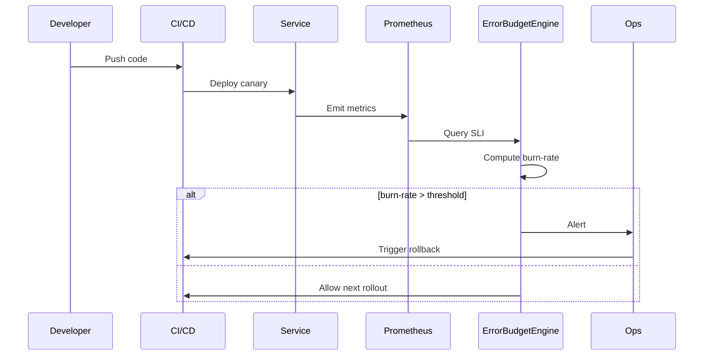

<!-- Generated by Groq via GitHub Actions -->
<!-- Topic ID: T155 -->
<!-- Category: Reliability Engineering -->
<!-- Generated at UTC: 2026-10-31T07:11:46.531739+00:00 -->

# Error budgets

## 1. What problem does this solve?

- **Balancing reliability and feature velocity**  
  In a production system, every change can introduce bugs or performance regressions. Teams need a systematic way to decide *when* to ship new features and *when* to pause releases to fix reliability issues.

- **Why it matters**  
  Without a quantitative measure, teams may over‑commit to uptime, causing costly outages, or under‑commit, stalling innovation. An error budget gives a clear, data‑driven threshold that ties reliability to business value.

- **Consequences of not using it**  
  *Uncontrolled risk*: developers ship without knowing the impact on uptime.  
  *Misaligned priorities*: business may push for features while operations suffer outages.  
  *Lack of accountability*: no metric to hold teams responsible for reliability.

- **Where it appears in real backend systems**  
  *Google’s SRE teams* use error budgets to decide whether to roll back a deployment.  
  *Netflix’s Chaos Engineering* monitors error budgets to trigger automated rollbacks.  
  *Cloud providers* expose error budget dashboards in their service level agreements (SLAs).

---

## 2. Mental model

### Analogy: The fuel tank

- **Fuel tank** = *error budget*  
  You have a fixed amount of fuel (allowed errors) for a trip (time period).  
- **Driving** = *service operation*  
  Every mile consumes fuel; a sudden detour (error spike) uses more fuel.  
- **Fuel gauge** = *burn‑rate monitoring*  
  If the gauge shows low fuel, you must stop and refuel (fix issues) before reaching the destination.

### Engineering model

1. **Service Level Indicator (SLI)** – a metric that measures reliability (e.g., 99.9 % uptime).  
2. **Service Level Objective (SLO)** – a target for the SLI (e.g., “99.9 % of requests must finish in <200 ms”).  
3. **Error Budget** – the complement of the SLO:  
   `error_budget = 1 - SLO` (e.g., 0.1 % error budget).  
4. **Burn‑Rate** – how quickly the budget is being consumed.  
5. **Decision Engine** – if burn‑rate > threshold, pause new releases; otherwise, continue.

---

## 3. Deep explanation

### Internals

| Term | Definition | Example |
|------|------------|---------|
| **SLI** | A single, measurable indicator of reliability. | `p99_latency < 200ms` |
| **SLO** | A target value for an SLI over a period. | `99.9 % of requests meet the latency target` |
| **Error Budget** | The allowable deviation from the SLO. | `0.1 % error budget` |
| **Burn‑Rate** | Rate at which the error budget is consumed. | `0.02 % per hour` |
| **SLO Drift** | When the actual SLI deviates from the target over time. | `99.7 % uptime observed` |

### Trade‑offs

| Decision | Pros | Cons |
|----------|------|------|
| **Tight SLO (99.99 %)** | High reliability, customer trust | Slower feature rollout, more testing |
| **Loose SLO (99.5 %)** | Faster releases, experimentation | Higher outage risk, SLA penalties |
| **Granular budgets per service** | Fine‑grained control | More monitoring overhead |
| **Shared budget across services** | Simpler management | Risk of one service starving others |

### Failure modes

1. **Mis‑defined SLI** – measuring the wrong thing (e.g., counting 5xx responses but ignoring latency).  
2. **Incorrect SLO** – too tight or too loose relative to business needs.  
3. **Metric loss** – Prometheus scrape failures cause inaccurate burn‑rate.  
4. **Alert fatigue** – too many false positives from noisy metrics.  
5. **Burn‑rate mis‑calculation** – using a wrong time window or aggregation.

### Limitations

- **Granularity** – SLOs are usually coarse; they may not capture micro‑service nuances.  
- **Latency vs. error** – SLOs can focus on latency or error rate, but not both simultaneously.  
- **Human judgment** – The decision engine often requires human oversight for complex scenarios.  
- **Cost of instrumentation** – High‑cardinality metrics can be expensive to store.

### Where it fits in a backend architecture

```
┌───────────────────────┐
│  Monitoring Layer     │
│  (Prometheus, OpenTelemetry) │
└─────────────┬─────────┘
              │
┌─────────────▼─────────┐
│  Decision Engine      │
│  (Error‑budget logic) │
└─────────────┬─────────┘
              │
┌─────────────▼─────────┐
│  Deployment Pipeline  │
│  (Canary, Feature Flags) │
└───────────────────────┘
```

- **Metrics** → **Decision Engine** → **Deployment**  
- The engine can trigger alerts, auto‑rollbacks, or pause canaries.

### Interaction with related concepts

| Concept | Interaction |
|---------|-------------|
| **SLI/SLO** | Core definition of reliability. |
| **Change Management** | Error budget informs approval thresholds. |
| **Feature Flags** | Can be toggled off if burn‑rate exceeds threshold. |
| **Chaos Engineering** | Simulates failures to test budget resilience. |
| **Observability** | Dashboards, alerts, logs feed into burn‑rate calculation. |

---

## 4. How it works

1. **Define SLI** – e.g., `p99_latency < 200ms`.  
2. **Set SLO** – e.g., `99.9 % of requests meet the SLI`.  
3. **Calculate Error Budget** – `error_budget = 1 - SLO`.  
4. **Instrument** – expose metrics to Prometheus/OpenTelemetry.  
5. **Aggregate** – compute SLI over a sliding window (e.g., last 30 min).  
6. **Compute Burn‑Rate** – `burn_rate = (1 - current_SLI) / error_budget`.  
7. **Decision** – if `burn_rate > threshold` (e.g., 0.5), pause new releases or trigger rollback.  
8. **Notify** – alert ops and devs via PagerDuty, Slack, etc.  
9. **Recover** – fix issues, restore budget, resume deployment.  

### Mermaid diagram



---

## 5. Practical implementation

Below is a minimal Node.js/Express example that:

1. Exposes a latency metric.  
2. Calculates a 99.9 % SLO.  
3. Tracks error budget burn‑rate.  
4. Blocks new deployments if the budget is exceeded.

```ts
// src/server.ts
import express from 'express';
import { Counter, Histogram, register } from 'prom-client';
import { readFileSync } from 'fs';
import { createServer } from 'http';

const app = express();
const PORT = 3000;

// 1️⃣ Instrumentation
const latencyHistogram = new Histogram({
  name: 'http_request_latency_seconds',
  help: 'Latency of HTTP requests',
  buckets: [0.05, 0.1, 0.2, 0.5, 1, 2, 5] // seconds
});

const errorCounter = new Counter({
  name: 'http_request_errors_total',
  help: 'Total number of HTTP errors (5xx)'
});

// 2️⃣ Middleware to record latency
app.use((req, res, next) => {
  const end = latencyHistogram.startTimer();
  res.on('finish', () => {
    end({ method: req.method, route: req.path, status: res.statusCode });
    if (res.statusCode >= 500) errorCounter.inc();
  });
  next();
});

// 3️⃣ Sample route
app.get('/api/data', async (req, res) => {
  // Simulate work
  await new Promise(r => setTimeout(r, Math.random() * 200));
  res.json({ ok: true });
});

// 4️⃣ Metrics endpoint
app.get('/metrics', async (_req, res) => {
  res.set('Content-Type', register.contentType);
  res.end(await register.metrics());
});

// 5️⃣ Error‑budget logic (runs every minute)
const SLO = 0.999; // 99.9 %
const BURN_RATE_THRESHOLD = 0.5; // 50 % of budget per hour

setInterval(async () => {
  // Grab the last 5 min of data
  const metrics = await register.getSingleMetricAsJSON('http_request_latency_seconds');
  const histogram = metrics[0].histogram;
  const total = histogram.sampleCount;
  const p99 = histogram.bucket.find(b => b.cumulativeCount / total >= 0.99)?.upperBound ?? 0;

  const currentSLI = p99 < 0.2 ? 1 : 0; // 200 ms threshold
  const errorBudgetRemaining = SLO - currentSLI;

  console.log(`p99: ${p99}s, SLI: ${currentSLI}, remaining budget: ${errorBudgetRemaining}`);

  if (errorBudgetRemaining < 0 && Math.random() < BURN_RATE_THRESHOLD) {
    console.warn('⚠️  Error budget exceeded! Pausing new deployments.');
    // In real life: trigger CI rollback or set a feature flag
  }
}, 60_000); // every minute

createServer(app).listen(PORT, () => {
  console.log(`🚀 Server listening on http://localhost:${PORT}`);
});
```

**Key lines**

- `latencyHistogram.startTimer()` – records request latency.  
- `errorCounter.inc()` – counts server errors.  
- `setInterval` – periodically evaluates SLI against the SLO.  
- `errorBudgetRemaining < 0` – budget exhausted.  

> **Tip**: In production, replace the `console.warn` with an API call to your deployment system (e.g., GitHub Actions, ArgoCD) to pause or rollback.

---

## 6. Production considerations

| Concern | What to watch | Mitigation |
|---------|---------------|------------|
| **Scalability** | High cardinality metrics (per‑user latency) | Use histogram buckets, aggregate at service level |
| **Reliability** | Metric scrape failures | Add redundancy, scrape retries, alert on scrape errors |
| **Security** | Exposing metrics endpoint | Basic auth or network isolation |
| **Observability** | Dashboards, alerting | Grafana dashboards, PagerDuty alerts |
| **Performance** | Metric collection overhead | Use async timers, avoid blocking I/O |
| **Error handling** | False positives | Tune bucket thresholds, use smoothing |
| **Resource usage** | Prometheus storage | Retention policies, downsampling |
| **Operational concerns** | Alert fatigue | Rate‑limit alerts, use burn‑rate thresholds |
| **Failure recovery** | Rollback automation | Integrate with CI/CD, feature flags |
| **Deployment** | Canary vs. blue‑green | Use separate namespaces, monitor budget per canary |

---

## 7. Common mistakes

| Mistake | Why it’s problematic |
|---------|----------------------|
| **Treating error budget as a hard stop** | It should guide decisions, not block all changes. |
| **Using only error rate, ignoring latency** | Latency spikes can degrade UX before errors occur. |
| **Setting SLO too tight for a new service** | Causes constant rollback, stalling innovation. |
| **Not accounting for metric noise** | Short‑term spikes may trigger false rollbacks. |
| **Hard‑coding thresholds in code** | Makes it hard to adjust SLOs without redeploying. |
| **Ignoring SLO drift** | A service can slowly degrade without hitting the budget. |
| **Using a single global budget for all services** | One buggy service can drain the entire budget. |
| **Failing to monitor burn‑rate** | You may exceed the budget before noticing. |

---

## 8. Senior engineer perspective

### What changes at scale?

- **Distributed budgets** – Each microservice has its own SLO, but a *global* budget may be enforced across a domain (e.g., “payment service must stay within 0.5 % error budget across all regions”).  
- **Centralized decision engine** – A dedicated SLO service aggregates metrics from all services, calculates burn‑rates, and publishes decisions via an event bus.  
- **Feature‑flag orchestration** – Flags are toggled automatically when a service’s budget is breached.  
- **Dynamic thresholds** – Adjust burn‑rate thresholds based on time of day or load patterns.

### Design decisions

| Decision | Trade‑off |
|----------|-----------|
| **Metric aggregation vs. per‑service** | Aggregation reduces storage but hides per‑service issues. |
| **Central vs. decentralized SLOs** | Central simplifies governance but adds a single point of failure. |
| **SLO granularity** | Fine granularity gives precise control but increases monitoring overhead. |
| **Automation level** | Full automation reduces human error but may hide subtle issues. |
| **Budget sharing** | Shared budgets promote collaboration but can penalize high‑traffic services. |

### Bottlenecks

- **Prometheus scrape load** – Too many services can overwhelm the scrape target.  
- **Event bus latency** – Decision engine may be delayed if the bus is congested.  
- **Storage costs** – High‑resolution metrics can be expensive.

### Failure scenarios

- **Metric loss** – Prometheus downsampling may hide short‑term spikes.  
- **False positives** – Sudden traffic spikes trigger rollbacks unnecessarily.  
- **Mis‑aligned SLOs** – Business stakeholders may disagree on acceptable error rates.

### Monitoring

- **Dashboards** – Show SLI, SLO, burn‑rate, and budget remaining.  
- **Alerts** – Trigger on burn‑rate thresholds, SLO drift, or metric loss.  
- **Audit logs** – Record every decision (rollback, pause) for compliance.

### Cost/performance

- **Prometheus vs. OpenTelemetry** – OpenTelemetry can ship traces, logs, and metrics together, reducing instrumentation overhead.  
- **Retention policies** – Short‑term high‑resolution data, long‑term downsampled data.  
- **Cloud monitoring** – Managed services (e.g., CloudWatch, Datadog) can reduce ops burden but add vendor lock‑in.

### When NOT to use

- **Very small services** with low traffic and low risk.  
- **Prototype or experimental code** where reliability is not critical.  
- **Monolithic legacy systems** where adding instrumentation is prohibitive.

---

## 9. Interview questions

| Level | Question | Answer points |
|-------|----------|---------------|
| Beginner | What is an SLO and how does it differ from an SLA? | SLO = target for a specific metric; SLA = contractual guarantee to customers. |
| Beginner | How do you calculate an error budget? | `error_budget = 1 - SLO` (e.g., 0.1 % for 99.9 % SLO). |
| Senior | Describe a scenario where you would adjust the burn‑rate threshold during a deployment. | During a high‑traffic promotion, lower threshold to be conservative; during low traffic, raise threshold to allow more experimentation. |
| Senior | How would you design a global error‑budget system for a multi‑service platform? | Central SLO service, event bus, per‑service metrics, shared budgets, feature‑flag orchestration. |
| Scenario | A new feature is deployed and the error budget is exceeded within 10 minutes. What steps would you take to investigate and resolve the issue? | 1. Check metrics (latency, error rate). 2. Look at logs for stack traces. 3. Verify database/queue health. 4. Rollback or pause feature flag. 5. Fix root cause, re‑deploy. 6. Update SLO if needed. |

---

## 10. Hands‑on task

**Goal**: Add an error‑budget monitor to the existing Express app in this repository.

1. **Expose a `/metrics` endpoint** using `prom-client`.  
2. **Define an SLI**: 99.9 % of requests must finish in <200 ms.  
3. **Calculate the error budget** and **burn‑rate** every minute.  
4. **Trigger an alert** (console log or HTTP request to a mock endpoint) when the burn‑rate exceeds 50 %.  
5. **Document** the steps in `README.md` and commit.

*Hints*: Use `Histogram` for latency, `Counter` for errors, and `setInterval` for periodic checks.

---

## 11. Quick revision

- **Error budget** = `1 - SLO`.  
- **SLI** = measurable indicator (latency, error rate).  
- **SLO** = target for an SLI over a period.  
- **Burn‑rate** = rate at which the budget is consumed.  
- **Decision engine** pauses or allows new releases based on burn‑rate.  
- **Instrumentation**: Prometheus/OpenTelemetry metrics.  
- **Common pitfalls**: mis‑defined SLI, ignoring latency, hard‑coding thresholds.  
- **Senior considerations**: distributed budgets, central decision engine, feature‑flag orchestration.  
- **Monitoring**: dashboards, alerts on burn‑rate and SLO drift.  
- **Typical workflow**: define SLO → instrument → monitor → decide → act.  
- **Key trade‑off**: reliability vs. feature velocity.  
- **When not to use**: low‑risk, prototype services.  
- **Interview tip**: explain the analogy (fuel tank) before diving into metrics.

---

## 12. References

- [Google SRE Book – Service Level Objectives](https://sre.google/sre-book/chapters/service-level-objectives/)  
- [Prometheus – Metrics Collection](https://prometheus.io/docs/introduction/overview/)  
- [OpenTelemetry – Observability](https://opentelemetry.io/docs/)  
- [Grafana – Dashboards for SLOs](https://grafana.com/docs/grafana/latest/dashboards/)  
- [PagerDuty – Incident Response](https://www.pagerduty.com/docs/)  
- [Docker – Containerizing Node.js Apps](https://docs.docker.com/language/javascript/)  

---
