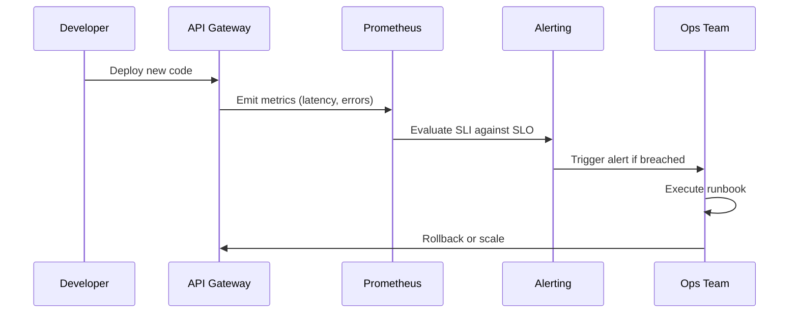

<!-- Generated by Groq via GitHub Actions -->
<!-- Topic ID: T156 -->
<!-- Category: Reliability Engineering -->
<!-- Generated at UTC: 2026-10-31T07:11:46.531739+00:00 -->

# SLO

## 1. What problem does this solve?

**Motivation**  
In a real‑world backend, multiple teams ship features, fix bugs, and deploy changes continuously. Clients expect a certain level of reliability, but developers often measure success by unit test pass rates or deployment counts. Those metrics don’t capture the *user‑experience* of the service.

**Problem**  
- No single, shared metric that ties engineering effort to business impact.  
- Teams may over‑optimize for latency or throughput while ignoring availability.  
- Stakeholders cannot negotiate priorities when they don’t know how much “downtime” is acceptable.

**Why it matters**  
- Customers pay for uptime; a 99.9 % SLA can cost millions in lost revenue.  
- Unclear expectations lead to firefighting, scope creep, and mistrust.  
- Without a clear target, monitoring becomes ad‑hoc and hard to interpret.

**Consequences of not using SLOs**  
- Over‑engineering for latency at the expense of availability.  
- Blindly adding capacity because “the system is slow” without knowing if that matters to users.  
- Inconsistent incident response: some teams treat a 1 % error rate as critical, others ignore it.

**Where it appears**  
- Cloud provider SLAs (e.g., AWS, GCP).  
- Internal dashboards (e.g., SRE teams publish SLOs for API endpoints).  
- Feature‑flag rollouts: “We’ll enable this only if the error rate stays below X% for 30 days.”  
- Incident post‑mortems: “We breached the 99.95 % SLO for the payment API.”

---

## 2. Mental model

**Analogy**  
Think of a SLO like a *traffic light* for a highway.  
- **Green**: The road is clear; cars move smoothly.  
- **Yellow**: Minor congestion; drivers should slow down.  
- **Red**: Major blockage; traffic stops.  

A SLO is the *rule* that defines when the light turns from green to yellow or red based on measurable traffic (requests, errors, latency). It tells engineers when to take action.

**Engineering model**  
- **Service** → **Metric** (e.g., error rate, latency percentile).  
- **Target** → **Threshold** (e.g., 99.9 % availability).  
- **Monitoring** → **Alerting** → **Remediation**.  

The SLO is the bridge between *what the service does* and *how we judge its quality*.

---

## 3. Deep explanation

### Internals
- **SLO**: A quantitative description of the level of service that a system should provide.  
- **Service Level Indicator (SLI)**: The metric that measures the service (e.g., uptime, error rate, latency).  
- **Service Level Agreement (SLA)**: The contractual promise to customers, often derived from the SLO.  
- **Error budget**: The amount of failure allowed before the SLO is breached (e.g., 0.1 % downtime in a month).

### Important terminology
| Term | Definition |
|------|------------|
| **Availability** | Fraction of time the service is up. |
| **Latency** | Time to complete a request. |
| **Throughput** | Requests per second. |
| **Error budget** | Allowed failures = 1 – SLO. |
| **Service degradation** | Acceptable drop in performance (e.g., higher latency). |

### Trade‑offs
| Trade‑off | Impact |
|-----------|--------|
| **Latency vs. Availability** | Lower latency may require more aggressive caching, which can increase failure risk. |
| **Feature rollout vs. Error budget** | Rolling out a new feature consumes part of the error budget; if the feature is buggy, the SLO may be breached. |
| **Observability vs. Performance** | More metrics mean more overhead; need to balance. |

### Failure modes
- **Metric drift**: The SLI metric changes definition (e.g., adding a new error type) without updating the SLO.  
- **Alert fatigue**: Too many alerts for minor deviations.  
- **Mis‑aligned SLOs**: SLO targets that are too aggressive or too lenient for the business.  
- **Unmonitored components**: A critical microservice not included in the SLO leads to blind spots.

### Limitations
- SLOs are *soft* guarantees; they don’t enforce hard limits.  
- They require continuous monitoring and tuning.  
- They can be gamed if teams focus on the metric rather than real user experience.

### Where it fits in backend architecture
- **API Gateway**: SLOs often defined per endpoint.  
- **Service Mesh**: Observability layer that collects SLIs.  
- **CI/CD pipeline**: Automated tests can check SLO compliance before promotion.  
- **Incident management**: SLO breaches trigger runbooks.

### Interaction with related concepts
- **Chaos Engineering**: Inject failures to test SLO resilience.  
- **Feature Flags**: Use error budgets to decide when to roll back.  
- **Auto‑Scaling**: Scale to keep latency within SLO bounds.  
- **Rate Limiting**: Protect downstream services to maintain availability.

---

## 4. How it works

1. **Define the SLO**: Choose an SLI (e.g., error rate) and target (e.g., 99.9 % uptime).  
2. **Instrument the service**: Emit metrics to a monitoring system (Prometheus, Datadog).  
3. **Set up alerting**: Trigger when the SLI deviates from the target beyond a tolerance.  
4. **Allocate an error budget**: Compute allowed failures for the period.  
5. **Monitor continuously**: Visualize in dashboards; track budget consumption.  
6. **Respond to breaches**: Run runbooks, roll back features, or scale resources.  
7. **Review and adjust**: Post‑mortems refine the SLO or SLI.



---

## 5. Practical implementation

### Example: 99.9 % availability SLO for a `/login` endpoint

```ts
// src/middleware/slo.ts
import { Request, Response, NextFunction } from 'express';
import promClient from 'prom-client';

const loginErrors = new promClient.Counter({
  name: 'login_errors_total',
  help: 'Total number of failed login attempts',
});

const loginRequests = new promClient.Counter({
  name: 'login_requests_total',
  help: 'Total number of login requests',
});

export function loginSLO(req: Request, res: Response, next: NextFunction) {
  loginRequests.inc(); // Count every request

  // Wrap the original handler
  const originalSend = res.send;
  res.send = function (body?: any) {
    if (res.statusCode >= 400) {
      loginErrors.inc(); // Count errors
    }
    return originalSend.call(this, body);
  };

  next();
}
```

```ts
// src/app.ts
import express from 'express';
import promClient from 'prom-client';
import { loginSLO } from './middleware/slo';

const app = express();
app.use(loginSLO);

app.post('/login', async (req, res) => {
  // Simulate auth logic
  const success = Math.random() > 0.1; // 10% failure
  if (!success) return res.status(401).send('Unauthorized');
  res.send('OK');
});

// Expose metrics
app.get('/metrics', async (_req, res) => {
  res.set('Content-Type', promClient.register.contentType);
  res.end(await promClient.register.metrics());
});

app.listen(3000, () => console.log('Server running on :3000'));
```

**Observability**  
- Prometheus scrapes `/metrics`.  
- Grafana dashboard shows `login_errors_total / login_requests_total`.  
- Alert rule (Prometheus) triggers if error rate > 0.1 % over 5 min.

### Calculating error budget

```ts
// utils/errorBudget.ts
export function errorBudget(available: number, target: number) {
  return (1 - target) * available; // e.g., 1 h * 0.001 = 3.6 s
}
```

Use this in CI/CD to gate releases: if the error budget is exhausted, block promotion.

---

## 6. Production considerations

| Concern | How SLO helps | Practical steps |
|---------|---------------|-----------------|
| **Scalability** | SLOs guide auto‑scaling thresholds. | Scale when latency percentile > 95 % of target. |
| **Reliability** | Error budget forces teams to prioritize fixes. | Monitor budget consumption; trigger rollback if exceeded. |
| **Security** | SLOs can include *security* SLIs (e.g., failed auth rate). | Add metric for brute‑force attempts. |
| **Observability** | Clear metrics and dashboards. | Use Prometheus + Grafana; alert on SLO breaches. |
| **Performance** | Latency SLIs drive optimization. | Profile hot paths; add caching. |
| **Error handling** | SLOs define acceptable error rates. | Implement graceful degradation. |
| **Resource usage** | SLOs prevent over‑provisioning. | Scale only when needed to meet latency SLO. |
| **Operational concerns** | SLOs provide a single source of truth for incidents. | Runbooks tied to SLO breaches. |
| **Failure recovery** | Error budget gives a buffer for recovery. | Plan for graceful shutdowns. |
| **Deployment** | SLO gates can be part of CI/CD. | Use feature flags and error‑budget checks. |

---

## 7. Common mistakes

| Mistake | Why it’s problematic |
|---------|----------------------|
| **Using uptime as the sole SLI** | Ignores latency spikes that hurt UX. |
| **Setting SLO too high** | Causes constant breaches, eroding trust. |
| **Not accounting for downstream services** | A downstream failure may inflate error rate but isn’t the root cause. |
| **Failing to update metrics after refactor** | Metric drift leads to false positives/negatives. |
| **Alerting on raw metrics instead of SLO breaches** | Generates noise; teams ignore alerts. |
| **Treating SLOs as hard limits** | Over‑reacting to minor deviations. |
| **Ignoring error budget** | Teams may push features without considering cumulative risk. |

---

## 8. Senior engineer perspective

### What changes at scale?

- **Granularity**: Define SLOs per service, per endpoint, even per user tier.  
- **Automation**: Use policy engines (OPA) to enforce SLO compliance in CI/CD.  
- **Observability stack**: Centralized tracing (Jaeger), metrics (Prometheus), logs (ELK).  
- **Chaos experiments**: Regularly inject failures to validate SLO resilience.  
- **Cost vs. reliability**: Balance extra replicas or caching layers against budget.  

### Design decisions

| Decision | Trade‑offs | Bottlenecks | Monitoring |
|----------|------------|-------------|------------|
| **Central vs. distributed SLOs** | Central simplifies dashboards; distributed reduces single point of failure. | Central can become a bottleneck. | Use sidecar collectors. |
| **Latency percentile vs. mean** | Percentile captures tail; mean can hide spikes. | Percentile requires more storage. | Store histograms in Prometheus. |
| **Error budget allocation** | Strict budgets enforce discipline; generous budgets allow experimentation. | Too strict can stifle innovation. | Visualize budget consumption in Grafana. |
| **Feature flag gating** | Allows safe rollouts; adds complexity. | Flag management overhead. | Use a flag service (LaunchDarkly). |
| **Auto‑scaling triggers** | Scale on SLO breach vs. on raw metrics. | Scaling lag can miss brief spikes. | Combine with predictive scaling. |

### When NOT to use the approach

- **Very small services** with trivial traffic: manual monitoring may suffice.  
- **Experimental prototypes**: SLOs add overhead that outweighs benefits.  
- **Highly regulated domains**: SLAs may be legally binding; SLOs must be carefully aligned.

---

## 9. Interview questions

| Level | Question | Answer points |
|-------|----------|---------------|
| Beginner | What is an SLO and how does it differ from an SLA? | SLO: internal target metric; SLA: contractual promise to customers. |
| Beginner | Why do we need an error budget? | Quantifies allowable failures; drives feature rollout decisions. |
| Senior | How would you design SLOs for a multi‑tenant SaaS platform? | Separate SLOs per tenant tier; aggregate budgets; use per‑tenant metrics. |
| Senior | Explain how you would integrate SLOs into a CI/CD pipeline. | Automated tests compute SLI; gate deployments if SLO breached; use feature flags. |
| Scenario | A new feature increases error rate from 0.05 % to 0.12 % over a week. The 99.9 % availability SLO is breached. What steps do you take? | 1. Verify metric accuracy. 2. Check error budget consumption. 3. Roll back or pause rollout. 4. Investigate root cause (e.g., code, config). 5. Fix and re‑test. 6. Update SLO if business tolerance changes. |

---

## 10. Hands‑on task

**Task**: Add a 99.9 % latency SLO for the `/search` endpoint in the existing Node.js project.

1. Instrument latency using `prom-client` histograms.  
2. Create a Grafana dashboard to display the 95th percentile latency.  
3. Write a Prometheus alert rule that fires if the 95th percentile exceeds 200 ms for 5 min.  
4. Update the CI pipeline to block a merge if the alert is active.  
5. Simulate a latency spike (e.g., by adding `await sleep(300)` in the handler) and observe the alert.

---

## 11. Quick revision

- **SLO**: Quantitative target for service quality.  
- **SLI**: Metric that measures the service (error rate, latency, uptime).  
- **Error budget**: Allowed failures = 1 – SLO.  
- **SLA**: Contractual promise derived from SLO.  
- **Monitoring**: Collect SLI, compute SLO compliance, alert on breaches.  
- **Trade‑offs**: Latency vs. availability; strictness vs. innovation.  
- **Automation**: Gate CI/CD with SLO checks; use feature flags.  
- **Observability stack**: Prometheus + Grafana + tracing.  
- **Common pitfalls**: Metric drift, alert fatigue, ignoring downstream services.  
- **Senior perspective**: Granular SLOs, error‑budget allocation, chaos testing.  
- **Interview nuggets**: Distinguish SLO vs. SLA; explain error budget; design for multi‑tenant.

---

## 12. References

- [Google SRE Book – Service Level Objectives](https://sre.google/sre-book/chapters/service-level-objectives/)  
- [Prometheus – Recording Rules](https://prometheus.io/docs/prometheus/latest/alerting/)  
- [Datadog – SLOs](https://docs.datadoghq.com/slo/)  
- [OpenTelemetry – Observability](https://opentelemetry.io/docs/)  
- [GitHub Actions – CI/CD with SLO checks](https://docs.github.com/en/actions)  

---
