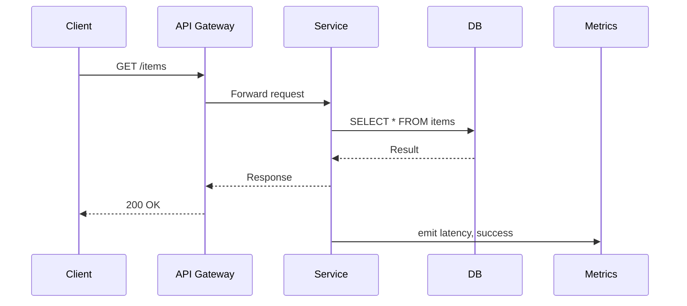

<!-- Generated by Groq via GitHub Actions -->
<!-- Topic ID: T157 -->
<!-- Category: Reliability Engineering -->
<!-- Generated at UTC: 2026-10-31T17:51:58.729521+00:00 -->

# SLA

## 1. What problem does this solve?

In a production backend, you have many moving parts: databases, caches, message queues, external APIs, and the application code itself. Clients (web browsers, mobile apps, other services) expect the system to behave predictably. An **SLA (Service Level Agreement)** is a contract that defines *how much* of that predictability you guarantee—usually expressed as uptime, latency, or error rate.

- **Problem**: Without a formal SLA, stakeholders (product managers, customers, ops) have no clear metric to measure success or failure. Bugs, outages, or performance regressions can go unnoticed until a user complains.
- **Why it matters**: SLAs drive engineering priorities. They force you to think about monitoring, alerting, redundancy, and graceful degradation. They also influence architecture decisions (e.g., whether to use a CDN, a read replica, or a circuit breaker).
- **What happens if you ignore SLAs**: You may ship features that break under load, lose customer trust, or incur penalties if you’re in a contractual agreement. Even internal services can suffer from cascading failures when one component silently degrades.
- **Real‑world appearance**: Every SaaS platform (Stripe, SendGrid, GitHub) publishes uptime SLAs. Internal microservices often have internal SLAs (e.g., “search service must return 95 % of queries under 200 ms”). Even simple “health‑check” endpoints are part of an SLA.

## 2. Mental model

**Analogy**: Think of an SLA like a *traffic light* for a road. The light tells drivers when it’s safe to go, when to slow down, and when to stop. If the light is broken, drivers might collide or get stuck. An SLA is the traffic light for your service: it tells users and other services how fast they can expect a response, how often they can hit the service, and what to do when the service is down.

**Engineering model**:  
- **Metric**: A measurable quantity (e.g., uptime % or latency percentile).  
- **Target**: The value you promise (e.g., 99.9 % uptime).  
- **Measurement window**: The period over which you aggregate data (e.g., a calendar month).  
- **Compliance**: Whether the observed metric meets the target.  
- **Remediation**: What happens if the target is missed (e.g., service credits, incident response).

## 3. Deep explanation

### Internals
- **Monitoring**: Collect metrics (Prometheus, Datadog, CloudWatch).  
- **Alerting**: Trigger alerts when thresholds are breached.  
- **Reporting**: Generate SLA reports (e.g., monthly uptime reports).  
- **Automation**: Auto‑scale, failover, or circuit breakers to maintain SLA.

### Important terminology
- **Availability**: % of time the service is reachable.  
- **Latency**: Time from request to response.  
- **Error budget**: The amount of downtime or error rate you can tolerate before violating the SLA.  
- **SLO (Service Level Objective)**: The target metric you aim for.  
- **SLI (Service Level Indicator)**: The actual measurement you collect.  
- **SLA**: The contractual agreement that may include penalties.

### Trade‑offs
- **Performance vs. Reliability**: Aggressive caching improves latency but may serve stale data.  
- **Cost vs. Availability**: Adding replicas or load balancers increases cost.  
- **Feature richness vs. Simplicity**: Complex circuit breakers reduce errors but add code complexity.

### Failure modes
- **Single point of failure**: No redundancy → 100 % downtime.  
- **Hidden latency**: Slow database queries hidden behind caching layers.  
- **Burst traffic**: Sudden spikes exceed capacity → throttling or 5xx errors.

### Limitations
- SLAs are only as good as the metrics you collect.  
- They don’t guarantee *correctness* of data, only *availability* or *latency*.  
- Over‑optimizing for an SLA can lead to “SLA‑driven” architecture that ignores other concerns (e.g., security).

### Where it fits
- **Backend architecture**: SLAs influence load balancers, health checks, auto‑scaling groups, and circuit breakers.  
- **Related concepts**:  
  - **Health checks**: Basic availability indicator.  
  - **Circuit breakers**: Prevent cascading failures.  
  - **Rate limiting**: Protect against abuse, indirectly affecting SLA.  
  - **Graceful degradation**: Fallback paths when SLA is at risk.

## 4. How it works

1. **Define SLIs**: e.g., `request_latency_ms`, `request_error_rate`.  
2. **Set SLOs**: e.g., 99.9 % of requests < 200 ms, < 0.1 % error rate.  
3. **Instrument code**: Emit metrics to a monitoring system.  
4. **Aggregate metrics**: Use Prometheus queries or CloudWatch dashboards.  
5. **Alert**: If SLO is breached, trigger incident.  
6. **Remediate**: Auto‑scale, restart pods, or fallback to cached data.  
7. **Report**: Generate monthly SLA compliance reports.



## 5. Practical implementation

Below is a minimal Node.js/Express service that emits an SLI (latency) to Prometheus and enforces an SLO via a simple circuit breaker.

```ts
// src/server.ts
import express from 'express';
import { Counter, Histogram, register } from 'prom-client';
import { createClient } from 'redis';
import { CircuitBreaker } from 'opossum';

const app = express();
const redis = createClient();

const latency = new Histogram({
  name: 'http_request_latency_ms',
  help: 'Latency of HTTP requests',
  labelNames: ['method', 'route', 'status'],
  buckets: [50, 100, 200, 500, 1000, 2000],
});

const errorCounter = new Counter({
  name: 'http_request_errors_total',
  help: 'Total number of HTTP errors',
  labelNames: ['method', 'route'],
});

app.use((req, res, next) => {
  const end = latency.startTimer({ method: req.method, route: req.route?.path ?? 'unknown' });
  res.on('finish', () => {
    end({ status: res.statusCode.toString() });
    if (res.statusCode >= 400) {
      errorCounter.inc({ method: req.method, route: req.route?.path ?? 'unknown' });
    }
  });
  next();
});

// Simple circuit breaker around Redis
const redisCommand = async (key: string) => {
  return await redis.get(key);
};

const breaker = new CircuitBreaker(redisCommand, {
  timeout: 500, // 500ms
  errorThresholdPercentage: 20,
  resetTimeout: 30000, // 30s
});

app.get('/cache/:key', async (req, res) => {
  try {
    const value = await breaker.fire(req.params.key);
    res.send(value ?? 'not found');
  } catch (err) {
    // Circuit open or Redis error
    res.status(503).send('Service unavailable');
  }
});

app.get('/metrics', async (_req, res) => {
  res.set('Content-Type', register.contentType);
  res.end(await register.metrics());
});

app.listen(3000, () => console.log('Server listening on :3000'));
```

**Key lines**

- `Histogram` records latency per request.  
- `Counter` tracks error count.  
- `CircuitBreaker` from `opossum` protects Redis; if Redis fails 20 % of the time, the breaker opens for 30 s.  
- `/metrics` endpoint exposes Prometheus metrics.

**Prometheus config (prometheus.yml)**

```yaml
scrape_configs:
  - job_name: 'node-backend'
    static_configs:
      - targets: ['localhost:3000']
```

**SLO enforcement**: In Prometheus, create a recording rule:

```yaml
groups:
- name: slo
  rules:
  - record: http_request_latency_95th
    expr: histogram_quantile(0.95, sum(rate(http_request_latency_ms_bucket[5m])) by (le))
```

Alert if `http_request_latency_95th > 200` ms.

## 6. Production considerations

| Concern | How SLA impacts it | Mitigation |
|---------|--------------------|------------|
| **Scalability** | SLA may require auto‑scaling to meet latency targets. | Horizontal scaling, load balancers, CDN. |
| **Reliability** | SLA enforces redundancy (replicas, failover). | Multi‑AZ deployments, health checks, graceful degradation. |
| **Security** | SLA does not directly address security, but monitoring can detect anomalous traffic. | Rate limiting, WAF, TLS termination. |
| **Observability** | SLA drives metric collection, dashboards, and alerting. | Prometheus, Grafana, distributed tracing. |
| **Performance** | SLA targets latency; must profile hot paths. | Profiling, caching, query optimization. |
| **Error handling** | SLA defines acceptable error rate; must handle errors gracefully. | Circuit breakers, retries, fallbacks. |
| **Resource usage** | SLA may push for higher throughput, increasing CPU/memory. | Capacity planning, cost monitoring. |
| **Operational concerns** | SLA requires incident response plans. | Runbooks, on‑call rotations, post‑mortems. |
| **Failure recovery** | SLA drives automated failover and rollback. | Blue/green deployments, canary releases. |
| **Deployment** | SLA may dictate zero‑downtime deployments. | Rolling updates, health checks. |

## 7. Common mistakes

| Mistake | Why it’s problematic |
|---------|----------------------|
| **Measuring the wrong metric** (e.g., only counting 200 responses) | Misses 5xx errors that degrade user experience. |
| **Hard‑coding thresholds** without considering traffic patterns | SLA may be violated during peak load. |
| **Ignoring error budgets** | Over‑optimizing for latency can cause higher error rates. |
| **Not instrumenting external dependencies** | Latency from third‑party APIs can inflate SLA metrics. |
| **Using a single point of failure for metrics** | If Prometheus goes down, you lose SLA visibility. |
| **Failing to alert on metric degradation** | You may not know SLA is slipping until a customer complains. |
| **Treating SLA as a checkbox** | Neglects continuous improvement and capacity planning. |

## 8. Senior engineer perspective

### What changes at scale?

- **Distributed tracing** becomes essential to pinpoint latency sources across services.  
- **Error budgets** are used to balance feature velocity and reliability.  
- **Chaos engineering** tests SLA resilience by injecting failures.  
- **Cost‑aware scaling**: Auto‑scaling must consider cloud spend vs. SLA compliance.

### Design decisions

| Decision | Trade‑offs | Bottlenecks | Monitoring |
|----------|------------|-------------|------------|
| **Read replicas** | Improves read latency but adds replication lag. | Replication lag can cause stale reads. | Monitor `pg_replication_lag`. |
| **Circuit breaker thresholds** | Too low → false positives; too high → delayed failure. | Misconfigured thresholds can hide real issues. | Alert on `circuit_breaker_open` metrics. |
| **Rate limiting** | Protects backend but may block legitimate traffic. | Hard to set thresholds for bursty workloads. | Log rate‑limit hits. |
| **Batching vs. single requests** | Batching reduces overhead but increases latency per request. | Queue backlogs can grow. | Monitor queue depth. |
| **Service mesh** | Provides observability and traffic control. | Adds complexity and overhead. | Monitor `istio_request_duration`. |

### When NOT to use the approach

- If the service is *purely internal* and *low‑traffic*, a simple health check may suffice.  
- If the SLA target is *very low* (e.g., 90 % uptime) and cost is a concern, you might skip expensive redundancy.  
- If the service is *stateless* and *short‑lived*, adding circuit breakers may add unnecessary latency.

## 9. Interview questions

1. **Beginner**: *What is the difference between an SLI, SLO, and SLA?*  
   *Answer*: SLI is a metric you measure (e.g., latency). SLO is the target you set for that metric (e.g., 95 % of requests < 200 ms). SLA is the contractual promise that may include penalties if the SLO is not met.

2. **Beginner**: *How would you expose latency metrics in an Express app?*  
   *Answer*: Use a histogram from `prom-client`, start a timer at request start, end it on response finish, and expose `/metrics` for Prometheus.

3. **Senior**: *Explain how you would design an error budget for a service with a 99.9 % uptime SLA.*  
   *Answer*: Calculate allowable downtime: 0.1 % of 30 days ≈ 43 minutes. Allocate this budget across incidents, feature releases, and experiments. Use monitoring to track budget consumption and enforce throttling if budget is exhausted.

4. **Senior**: *Describe a scenario where a circuit breaker could actually worsen latency instead of improving it.*  
   *Answer*: If the breaker opens too early due to transient spikes, subsequent requests are rejected (503) and must be retried by clients, adding round‑trip latency. Also, if the fallback path is slower, overall latency increases.

5. **Scenario/Debugging**: *Your service’s latency has spiked from 100 ms to 800 ms during a 5 % traffic surge. What steps would you take to diagnose and fix the issue?*  
   *Answer*:  
   - Check Prometheus for latency distribution.  
   - Look at database query plans; maybe a new index is missing.  
   - Inspect cache hit rates; cold cache can cause slow DB hits.  
   - Verify if a new feature path is introduced.  
   - Scale horizontally or add a read replica.  
   - If necessary, add a rate limiter or circuit breaker to protect downstream services.

## 10. Hands‑on task

**Task**: Add an SLO for *95 th percentile latency* to the existing Node.js service and set up an alert that triggers when the latency exceeds 200 ms for more than 5 minutes.

**Steps**:
1. Add a Prometheus recording rule for the 95th percentile.  
2. Configure Alertmanager to send a Slack message when the rule is violated.  
3. Deploy the updated service and generate traffic to trigger the alert.  
4. Verify the alert is received and the dashboard shows the latency spike.

## 11. Quick revision

- SLA = contractual guarantee; SLO = target; SLI = metric.  
- Common SLIs: uptime, latency percentiles, error rate.  
- Use Prometheus histograms for latency, counters for errors.  
- Circuit breakers protect downstream services; set thresholds carefully.  
- Error budget = allowed downtime; drives feature release cadence.  
- Monitoring, alerting, and dashboards are essential for SLA compliance.  
- Auto‑scaling, read replicas, and graceful degradation help meet SLAs.  
- Chaos engineering tests SLA resilience.  
- Avoid over‑instrumentation; focus on actionable metrics.  
- SLA violations trigger incident response and post‑mortems.  
- Cost vs. reliability trade‑offs must be balanced at scale.

## 12. References

- https://prometheus.io/docs/introduction/overview/  
- https://opossum.js.org/  
- https://prometheus.io/docs/prometheus/latest/querying/basics/  
- https://cloud.google.com/monitoring/alerts  
- https://www.atlassian.com/incident-management/incident-response  
- https://learn.microsoft.com/en-us/azure/architecture/guide/architecture-studio/architecture-library  
- https://cloud.google.com/architecture/error-budgeting  
- https://cloud.google.com/architecture/chaos-engineering  
- https://www.sre.google/sre-book/chapters/monitoring/  

---
