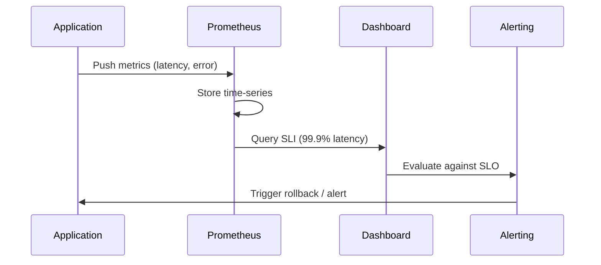

<!-- Generated by Groq via GitHub Actions -->
<!-- Topic ID: T158 -->
<!-- Category: Reliability Engineering -->
<!-- Generated at UTC: 2026-10-31T17:51:58.729521+00:00 -->

# SLI

## 1. What problem does this solve?

**Motivation**  
When you run a backend service, you need to know *how well* it is performing. Clients expect low latency, high availability, and correct results. Without a quantitative measure, you can’t decide whether a change is good, bad, or neutral.

**What problem exists**  
- Developers and ops teams often rely on anecdotal evidence (e.g., “the API feels slow”) or ad‑hoc logs.  
- There’s no single, repeatable metric that captures the quality of service from the user’s perspective.

**Why the problem matters**  
- Poor performance leads to unhappy users, churn, and revenue loss.  
- Unnoticed regressions can accumulate, causing large outages.  
- Without a clear metric, it’s impossible to enforce SLAs or negotiate with customers.

**What happens if this concept is not used**  
- You’ll deploy code that silently degrades service quality.  
- You can’t quantify “error budget” or decide when to roll back.  
- Incident response becomes reactive rather than proactive.

**Where this concept appears in real backend systems**  
- Google’s SRE teams define SLIs for latency, error rate, and throughput.  
- Cloud providers expose SLIs in dashboards (e.g., AWS CloudWatch metrics).  
- CI/CD pipelines often include SLI checks before merging.

---

## 2. Mental model

**Analogy**  
Think of a water pipeline that supplies a city.  
- **SLI** is like the *flow rate* measured at a tap: it tells you how much water is actually reaching the user.  
- **SLO** is the *contract* that the city promises: “We’ll deliver at least 10 L/min.”  
- **SLA** is the *legal agreement* with the city: “If we fail to meet the SLO, you’ll pay us X.”

**Engineering model**  
- **Instrumentation**: add counters, histograms, or gauges in your code.  
- **Collection**: push or pull metrics to a monitoring backend.  
- **Aggregation**: compute the SLI (e.g., 99.9 % latency).  
- **Decision**: compare the SLI against the SLO; if it falls below, trigger alerts or rollbacks.

---

## 3. Deep explanation

| Term | Definition | Typical Use |
|------|------------|-------------|
| **SLI (Service Level Indicator)** | A quantitative measure of a service’s performance (e.g., latency, error rate, throughput). | Used to monitor health and to drive alerts. |
| **SLO (Service Level Objective)** | A target value for an SLI (e.g., “latency < 200 ms 99.5 % of the time”). | Defines acceptable quality. |
| **SLA (Service Level Agreement)** | A contractual guarantee between provider and customer. | Legal enforcement. |
| **Error budget** | The allowable amount of failure before violating the SLO. | Drives risk‑based deployment decisions. |

### Internals
- **Metrics types**: counters (total requests), histograms (latency buckets), gauges (current connections).  
- **Sampling**: to reduce overhead, you may sample requests (e.g., 1 % of traffic).  
- **Time windows**: SLIs are usually computed over sliding windows (5 min, 1 h, 24 h).  
- **Aggregation**: Prometheus, OpenTelemetry, or custom collectors aggregate raw data into SLI values.

### Trade‑offs
| Aspect | Trade‑off | Impact |
|--------|-----------|--------|
| **Granularity vs. overhead** | Finer metrics give better insight but cost CPU/memory. | Balance sampling rate. |
| **Sampling vs. accuracy** | Sampling reduces load but introduces variance. | Use statistical confidence intervals. |
| **Push vs. pull** | Push (e.g., StatsD) gives low latency but requires agent. | Pull (Prometheus) is simpler but may miss short‑lived data. |

### Failure modes
- **Metric loss**: network hiccups can drop samples.  
- **Drift**: clock skew between services can misalign timestamps.  
- **Mis‑instrumentation**: wrong labels or missing dimensions lead to misleading SLIs.  
- **Outliers**: a single slow request can skew percentiles if not handled properly.

### Limitations
- SLIs capture *what* happened, not *why*.  
- They can’t express business‑specific nuances (e.g., “critical path” vs. “background job”).  
- Requires careful definition; a poorly chosen SLI can mask real problems.

### Where it fits in a backend architecture
```
┌───────────────────────┐
│  Application Code     │
│  (Express, FastAPI)   │
└───────┬───────┬───────┘
        │       │
        ▼       ▼
   Metrics   Traces
   (Prometheus)  (OpenTelemetry)
        │
        ▼
   Monitoring Backend
   (Prometheus, Grafana, Datadog)
        │
        ▼
   Alerting / Dashboards
```

### Interaction with related concepts
- **Observability**: SLIs are the *observable* part of the system.  
- **Tracing**: Helps explain why an SLI failed (e.g., a database timeout).  
- **Logging**: Correlate logs with SLI spikes.  
- **CI/CD**: Automated SLI checks before merge.  
- **Feature flags**: Use error budgets to decide when to roll back a flag.

---

## 4. How it works

1. **Instrument** the application to record relevant metrics.  
2. **Export** metrics to a monitoring backend (push or pull).  
3. **Aggregate** raw data into time‑series.  
4. **Compute** the SLI (e.g., 99.9 % latency).  
5. **Compare** the SLI to the SLO.  
6. **Alert** or trigger automated rollback if the SLO is violated.  
7. **Review** dashboards and logs to diagnose.

### Mermaid diagram



---

## 5. Practical implementation

Below is a minimal Express middleware that records request latency and error rate, exposing them for Prometheus.

```ts
// metrics.ts
import { Counter, Histogram, register } from 'prom-client';

// Counter for total requests
export const requestCounter = new Counter({
  name: 'http_requests_total',
  help: 'Total number of HTTP requests',
  labelNames: ['method', 'route', 'status'],
});

// Histogram for request latency
export const requestLatency = new Histogram({
  name: 'http_request_duration_seconds',
  help: 'Latency of HTTP requests in seconds',
  labelNames: ['method', 'route', 'status'],
  buckets: [0.005, 0.01, 0.025, 0.05, 0.1, 0.25, 0.5, 1, 2.5, 5, 10],
});

// Export metrics endpoint
export const metricsEndpoint = async (req: any, res: any) => {
  res.set('Content-Type', register.contentType);
  res.end(await register.metrics());
};
```

```ts
// middleware.ts
import { requestCounter, requestLatency } from './metrics';

export const metricsMiddleware = (req: any, res: any, next: any) => {
  const end = requestLatency.startTimer({
    method: req.method,
    route: req.route?.path ?? req.path,
  });

  res.on('finish', () => {
    const status = res.statusCode.toString();
    requestCounter.inc({ method: req.method, route: req.route?.path ?? req.path, status });
    end({ status });
  });

  next();
};
```

```ts
// server.ts
import express from 'express';
import { metricsMiddleware } from './middleware';
import { metricsEndpoint } from './metrics';

const app = express();

app.use(metricsMiddleware);

// Example route
app.get('/api/hello', (req, res) => {
  // Simulate latency
  setTimeout(() => res.json({ message: 'Hello' }), Math.random() * 200);
});

app.get('/metrics', metricsEndpoint);

app.listen(3000, () => console.log('Server running on :3000'));
```

**Running**  
```bash
npm install express prom-client
node server.ts
```

Visit `http://localhost:3000/metrics` to see Prometheus‑compatible metrics.

---

## 6. Production considerations

| Concern | Recommendation |
|---------|----------------|
| **Scalability** | Use a pull model (Prometheus) to avoid network bottlenecks; keep metric cardinality low. |
| **Reliability** | Ensure metrics endpoint is highly available; use a sidecar or agent to scrape. |
| **Security** | Expose metrics only over TLS; restrict access via firewall or service mesh. |
| **Observability** | Combine SLIs with traces and logs; use labels to correlate. |
| **Performance** | Sample high‑volume endpoints; avoid blocking the request path. |
| **Error handling** | Record errors before sending response; use `res.on('finish')` to capture status. |
| **Resource usage** | Keep histograms with a limited number of buckets; use exponential buckets for latency. |
| **Operational concerns** | Rotate Prometheus data retention; set up alerting rules (e.g., `if latency > 200ms for 5min`). |
| **Failure recovery** | Use error budgets to trigger automated rollbacks; integrate with CI/CD. |
| **Deployment** | Containerize metrics agent; use sidecar pattern for language‑agnostic collection. |

---

## 7. Common mistakes

| Mistake | Why it’s problematic |
|---------|----------------------|
| **Measuring the wrong metric** (e.g., request count instead of latency) | Gives a false sense of health; misses performance regressions. |
| **Using coarse buckets** (e.g., only 0–1 s) | Masks outliers; percentiles become inaccurate. |
| **Ignoring label cardinality** | High cardinality (e.g., per‑user labels) can exhaust Prometheus memory. |
| **Not correlating with SLO** | SLIs without SLOs are meaningless; you can’t decide when to alert. |
| **Over‑sampling** | Adds CPU/memory overhead; can degrade the very service you’re measuring. |
| **Failing to handle clock skew** | Misaligned timestamps lead to incorrect aggregations. |
| **Not handling outliers** | A single slow request can skew percentiles if not filtered or capped. |
| **Hard‑coding thresholds** | Static thresholds ignore traffic patterns; use dynamic baselines. |

---

## 8. Senior engineer perspective

### What changes at scale?
- **Metric cardinality**: Use label aggregation (e.g., `route` instead of `full_path`).  
- **Distributed tracing**: Combine SLIs with trace spans to pinpoint root causes.  
- **Sampling strategy**: Dynamically adjust sample rates based on traffic volume.  
- **Alert fatigue**: Implement alert suppression and noise‑reduction rules.  
- **Cost**: Prometheus storage can become expensive; consider remote write to long‑term storage (Cortex, Thanos).  
- **Reliability**: Deploy metrics collectors as sidecars to avoid single points of failure.  
- **Security**: Expose metrics via mTLS; use service mesh for fine‑grained access control.

### Design decisions
- **Metric type**: Prefer histograms for latency; counters for error counts.  
- **Time windows**: Use sliding windows that match SLO horizons (e.g., 5‑min for latency, 24‑h for availability).  
- **Aggregation**: Push‑based vs. pull‑based; choose based on network topology.  
- **Alerting**: Use “error budget” alerts to trigger automated rollbacks.  
- **Observability stack**: Integrate Prometheus, Grafana, Loki, and OpenTelemetry for a unified view.

### When NOT to use the approach
- **Low‑traffic services**: Simple logs may suffice; SLI overhead outweighs benefits.  
- **Short‑lived experiments**: Use temporary metrics; avoid long‑term retention.  
- **Highly dynamic labels**: Avoid per‑request labels that explode cardinality.

---

## 9. Interview questions

1. **Beginner**: *What is an SLI and how does it differ from an SLA?*  
   *Answer*: SLI is a measurable indicator (e.g., latency), SLA is a contractual guarantee.  
2. **Beginner**: *Why do we use histograms for latency instead of simple averages?*  
   *Answer*: Histograms capture distribution and percentiles; averages hide outliers.  
3. **Senior**: *Explain how you would design an SLI for a microservice that has both a fast API path and a long‑running background job.*  
   *Answer*: Separate metrics per operation, use different buckets, aggregate per‑service SLOs, and consider error budgets per path.  
4. **Senior**: *What are the trade‑offs between push and pull metrics collection in a large Kubernetes cluster?*  
   *Answer*: Pull is simpler and scales horizontally; push reduces load on the collector but requires agent reliability and can cause data loss.  
5. **Scenario**: *Your 99.9 % latency SLO is being violated after a recent deployment. Describe the steps you would take to diagnose and fix the issue.*  
   *Answer*: Check metrics for latency spikes, correlate with traces to find slow spans, review recent code changes, roll back if within error budget, and adjust SLO or SLI if necessary.

---

## 10. Hands‑on task

**Goal**: Add an SLI for the `/api/hello` endpoint that measures error rate and latency, expose it via `/metrics`, and set up a Grafana dashboard to display the 99.9 % latency percentile.

**Steps**  
1. Instrument the endpoint using the provided middleware.  
2. Run Prometheus locally and configure it to scrape `http://localhost:3000/metrics`.  
3. Import the Prometheus data source into Grafana.  
4. Create a panel that shows the 99.9 % latency (`histogram_quantile(0.999, sum(rate(http_request_duration_seconds_bucket[5m])) by (le))`).  
5. Trigger a few slow responses (e.g., add `await new Promise(r=>setTimeout(r, 500))`) and observe the dashboard.  
6. Document the SLI definition and the Grafana query.

---

## 11. Quick revision

- **SLI**: Quantitative measure of service quality (latency, error rate, throughput).  
- **SLO**: Target value for an SLI (e.g., 99.9 % latency < 200 ms).  
- **SLA**: Contractual guarantee between provider and customer.  
- **Error budget**: Allowed deviation before violating the SLO.  
- **Metrics types**: Counter, Gauge, Histogram, Summary.  
- **Sampling**: Reduces overhead but introduces variance.  
- **Cardinality**: Too many labels can exhaust storage.  
- **Percentiles**: Use histograms + `histogram_quantile`.  
- **Alerting**: Compare SLI to SLO; trigger alerts or rollbacks.  
- **Observability stack**: Prometheus + Grafana + OpenTelemetry + Loki.  
- **Common pitfalls**: Wrong metric, coarse buckets, high cardinality, missing SLO.

---

## 12. References

- [Prometheus Metrics Guide](https://prometheus.io/docs/introduction/overview/)  
- [OpenTelemetry Metrics](https://opentelemetry.io/docs/specs/otel/metrics/)  
- [Google SRE Book – Service Level Objectives](https://sre.google/sre-book/chapters/service-level-objectives/)  
- [Prometheus Client for Node.js](https://github.com/siimon/prom-client)  
- [Grafana Documentation – Prometheus Data Source](https://grafana.com/docs/grafana/latest/datasources/prometheus/)  
- [Kubernetes Monitoring with Prometheus](https://kubernetes.io/docs/tasks/debug-application-cluster/resource-metrics-pipeline/)
