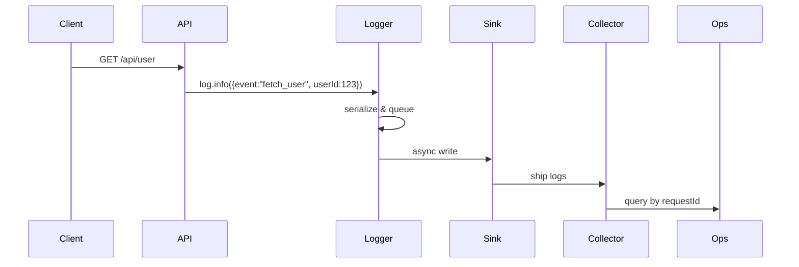

<!-- Generated by Groq via GitHub Actions -->
<!-- Topic ID: T159 -->
<!-- Category: Observability -->
<!-- Generated at UTC: 2026-11-01T07:44:35.006271+00:00 -->

# Structured logging

## 1. What problem does this solve?

- **Problem**: Traditional log messages are free‑text strings. When a service crashes or a request fails, developers must sift through noisy, unstructured logs to find the root cause.  
- **Why it matters**: In production, logs are the primary source of truth for debugging, monitoring, and compliance. Unstructured logs make it hard to search, filter, and correlate events across distributed systems.  
- **Consequences of not using structured logging**:  
  - *Hard to automate*: No reliable way to extract fields for alerts or dashboards.  
  - *Inconsistent context*: Missing request IDs, user IDs, or error codes.  
  - *Security risk*: Sensitive data may be logged in plain text.  
  - *Performance hit*: Parsing large unstructured logs is expensive.  
- **Real‑world appearance**:  
  - Microservice backends (Node.js, FastAPI) ship logs to ELK/EFK stacks.  
  - Serverless functions use structured logs to correlate cold starts.  
  - AI model serving pipelines log inference latency and input shapes.

## 2. Mental model

**Analogy**  
Think of a diary. A free‑text diary is great for storytelling, but if you want to find *all* entries about “rain” you have to read every page. A structured diary has tags (e.g., `weather:rain`, `mood:happy`) so you can instantly filter. Structured logging is that tagged diary for your backend.

**Engineering model**  
- **Log entry** = a JSON object with a *schema* (fixed set of keys).  
- **Log level** = severity (`debug`, `info`, `warn`, `error`).  
- **Correlation ID** = a unique token that ties all events of a single request.  
- **Transport** = async writer that pushes logs to a sink (file, stdout, log aggregator).  

## 3. Deep explanation

| Topic | Explanation |
|-------|-------------|
| **Internals** | A logger serializes a message object to JSON, attaches a timestamp, level, and optional metadata. The serializer is usually non‑blocking; logs are queued and written asynchronously. |
| **Important terminology** | `log level`, `structured field`, `schema`, `correlation ID`, `log sink`, `log rotation`, `log aggregation`. |
| **Trade‑offs** | <ul><li>**Verbosity**: More fields give more context but increase size.</li><li>**Schema drift**: Changing field names breaks downstream consumers.</li><li>**Performance**: Synchronous logging stalls requests; async logging can lose messages on crash.</li></ul> |
| **Failure modes** | <ul><li>**Lost logs**: Disk full or network failure before shipping.</li><li>**Corrupted JSON**: Malformed data breaks parsers.</li><li>**Sensitive data leakage**: Logging passwords or tokens.</li></ul> |
| **Limitations** | Structured logs capture key/value pairs but may not preserve stack traces unless explicitly included. They also require a schema that all services agree on. |
| **Where it fits** | At the application layer (middleware, service code). It feeds into the observability stack: logs → log aggregator → dashboards/alerting. |
| **Interactions** | • **Tracing**: Correlation IDs are shared with trace spans.<br>• **Metrics**: Log‑based metrics (e.g., error rates) complement Prometheus counters.<br>• **Security**: Log sanitization works with data‑masking middleware. |

## 4. How it works

1. **Request enters** → middleware generates a `requestId`.  
2. **Application code** logs events: `logger.info({ event: 'user_login', userId })`.  
3. **Logger** serializes to JSON, queues the message.  
4. **Async writer** flushes the queue to the sink (file, stdout, or remote collector).  
5. **Collector** ingests, indexes, and stores logs.  
6. **Ops** query logs by `requestId`, `userId`, or `level`.  



## 5. Practical implementation

Below is a minimal Express + Pino example that demonstrates structured logging with request correlation.

```ts
// logger.ts
import pino from 'pino';
import { randomUUID } from 'crypto';

const logger = pino({
  level: process.env.LOG_LEVEL ?? 'info',
  // Pretty printing only in dev
  transport: process.env.NODE_ENV === 'development'
    ? { target: 'pino-pretty', options: { colorize: true } }
    : undefined,
});

export default logger;

// middleware.ts
import { Request, Response, NextFunction } from 'express';
import logger from './logger';

export function requestLogger(req: Request, res: Response, next: NextFunction) {
  const requestId = randomUUID();
  // Attach to request for downstream use
  (req as any).requestId = requestId;

  // Log request start
  logger.info({
    event: 'request_start',
    requestId,
    method: req.method,
    url: req.originalUrl,
    headers: req.headers,
  });

  // Ensure requestId is in all logs
  const originalLog = logger.info.bind(logger);
  logger.info = (msg, meta) => {
    originalLog({ ...meta, requestId, ...msg });
  };

  res.on('finish', () => {
    logger.info({
      event: 'request_end',
      requestId,
      statusCode: res.statusCode,
      durationMs: Date.now() - (req as any).startTime,
    });
  });

  next();
}

// app.ts
import express from 'express';
import logger from './logger';
import { requestLogger } from './middleware';

const app = express();
app.use(requestLogger);

app.get('/api/user/:id', async (req, res) => {
  const userId = req.params.id;
  try {
    // Simulate DB call
    const user = { id: userId, name: 'Alice' };
    logger.info({ event: 'user_fetched', userId, user });
    res.json(user);
  } catch (err) {
    logger.error({ event: 'db_error', error: err.message });
    res.status(500).json({ error: 'Internal' });
  }
});

app.listen(3000, () => logger.info('Server started on :3000'));
```

**Key points**

- `pino` writes JSON to stdout; container orchestrators capture it.  
- `requestId` is propagated to all logs for a single request.  
- Errors are logged with `error` level and stack trace (`err.stack`).  
- In production, set `LOG_LEVEL=warn` to reduce noise.

## 6. Production considerations

| Concern | Recommendation |
|---------|----------------|
| **Scalability** | Use asynchronous, batched writers. Offload to a log shipper (e.g., Fluentd, Logstash). |
| **Reliability** | Implement retry logic for network failures. Keep a local buffer with disk persistence. |
| **Security** | Mask or omit sensitive fields (`password`, `token`). Use a sanitization middleware. |
| **Observability** | Index logs in Elasticsearch or Loki. Create dashboards for error rates, latency, and request volumes. |
| **Performance** | Avoid synchronous I/O. Use `pino`’s `transport` for pretty logs only in dev. |
| **Error handling** | Log stack traces at `error` level. Use structured `error` objects (`{ code, message, details }`). |
| **Resource usage** | Compress log files. Rotate logs daily. Set retention policies. |
| **Operational concerns** | Monitor log volume; alert on spikes. Ensure log shippers are healthy. |
| **Failure recovery** | Fallback to console if shipper fails. Persist unsent logs to disk. |
| **Deployment** | Use environment variables for log level and format. Separate dev/prod configs. |

## 7. Common mistakes

| Mistake | Why it’s bad |
|---------|--------------|
| Logging raw request bodies | Exposes PII; bloats logs. |
| Hard‑coding strings instead of structured fields | Makes filtering impossible. |
| Forgetting correlation IDs | Hard to trace a request across services. |
| Logging at `debug` level in prod | Generates huge volumes, slows I/O. |
| Not handling async context | Logs may miss requestId or userId. |
| Over‑logging (e.g., every DB query) | Increases cost and noise. |
| Logging stack traces as plain strings | Breaks JSON parsers. |
| Ignoring log rotation | Disk space exhaustion. |

## 8. Senior engineer perspective

At scale, structured logging becomes a **contract** between services.

- **Architecture decisions**  
  - Centralized vs. distributed log ingestion.  
  - Choosing a schema registry to enforce field consistency.  
  - Deciding between JSON vs. binary (e.g., Protobuf) for log transport.  
- **Trade‑offs**  
  - More fields → richer context but higher bandwidth.  
  - Strict schema → easier downstream processing but harder to evolve.  
- **Bottlenecks**  
  - Log shipping can become a network bottleneck; use compression.  
  - Log aggregation services may saturate CPU if parsing huge volumes.  
- **Failure scenarios**  
  - Log shipper crash → loss of logs; mitigate with local buffering.  
  - Schema drift → downstream dashboards break; mitigate with versioned schemas.  
- **Monitoring**  
  - Set up alerts on log volume, error rates, and missing correlation IDs.  
  - Use log‑based metrics (e.g., `rate{level="error"}`) in Prometheus.  
- **Cost/performance**  
  - Cloud log services charge per GB ingested; keep logs lean.  
  - Use log sampling for high‑volume services.  
- **When NOT to use**  
  - Small, single‑purpose scripts where console output suffices.  
  - Legacy systems that cannot ship structured logs without major refactor.

## 9. Interview questions

1. **Beginner**: *What is a structured log and how does it differ from a plain text log?*  
   *Answer*: Structured log is a key/value JSON object; plain text is an unstructured string. Structured logs allow programmatic filtering and indexing.

2. **Beginner**: *Why do we need a correlation ID in logs?*  
   *Answer*: It ties all log entries of a single request together across services, enabling end‑to‑end tracing.

3. **Senior**: *Describe how you would design a log schema for a microservice that handles user authentication.*  
   *Answer*: Include fields like `event`, `userId`, `status`, `timestamp`, `requestId`, `source`, `errorCode` (if any). Use a versioned schema and enforce via a schema registry.

4. **Senior**: *How would you handle log shipping failures in a production system?*  
   *Answer*: Implement local buffering with disk persistence, retry logic, and fallback to console. Use health checks on the shipper and alert on failures.

5. **Scenario/Debugging**: *A user reports intermittent 500 errors. Your logs show `error` level entries with `event: "db_error"` but no stack trace. What steps would you take to investigate?*  
   *Answer*:  
   - Enable stack traces in the logger for `error` level.  
   - Add a `traceId` to correlate with distributed tracing.  
   - Check database connection pool metrics.  
   - Look for patterns in timestamps or request IDs.  
   - Verify log ingestion pipeline is not dropping messages.

## 10. Hands‑on task

**Goal**: Add structured logging to an existing Next.js API route that returns a list of users from PostgreSQL.

**Steps**

1. Install `pino` and `pino-http` (`npm i pino pino-http`).  
2. Create a `logger.ts` that exports a Pino logger.  
3. Wrap the API route with `pino-http` middleware to automatically log requests.  
4. In the route handler, log the number of users fetched and any errors.  
5. Run the server, hit the endpoint with `curl`, and verify that logs appear as JSON with fields `event`, `userCount`, `requestId`.  
6. (Optional) Add a `requestId` middleware that injects a UUID into each log.

## 11. Quick revision

- Structured logs are JSON objects with fixed keys.  
- Use a correlation ID to tie logs across services.  
- `pino` is a fast Node.js logger that writes JSON to stdout.  
- Log levels: `debug`, `info`, `warn`, `error`.  
- Avoid logging sensitive data; sanitize before logging.  
- Asynchronous, batched writers prevent blocking requests.  
- Log shipping to a collector (ELK, Loki) enables search and alerting.  
- Schema evolution should be versioned; use a registry.  
- In production, set `LOG_LEVEL=warn` or `error` to reduce noise.  
- Monitor log volume and error rates; alert on spikes.  
- Use log‑based metrics for real‑time dashboards.  
- Always include a timestamp, level, and event name.  

## 12. References

- [Pino – Fast Node.js logger](https://github.com/pinojs/pino)  
- [Pino‑http – HTTP request logging middleware](https://github.com/pinojs/pino-http)  
- [OpenTelemetry – Structured Logging](https://opentelemetry.io/docs/concepts/logs/)  
- [ELK Stack – Log ingestion](https://www.elastic.co/what-is/elk-stack)  
- [Loki – Grafana Loki](https://grafana.com/docs/loki/latest/)  
- [Node.js Logging Best Practices](https://nodejs.org/en/docs/guides/logging/)
