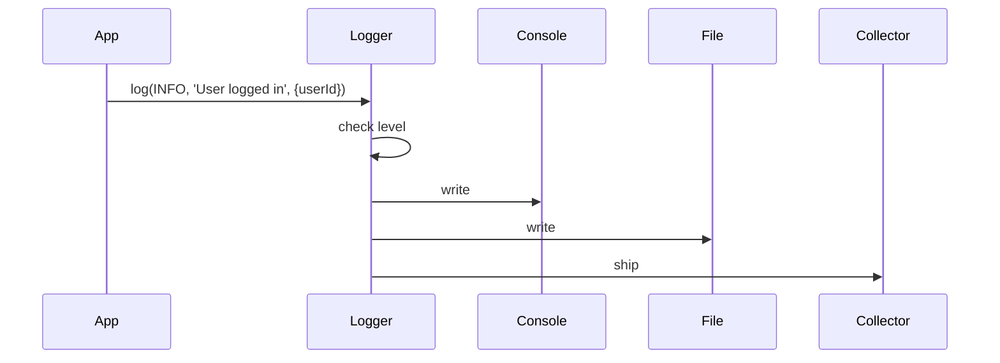

<!-- Generated by Groq via GitHub Actions -->
<!-- Topic ID: T160 -->
<!-- Category: Observability -->
<!-- Generated at UTC: 2026-11-01T07:44:35.006271+00:00 -->

# Log levels

## 1. What problem does this solve?

- **Noise vs. insight** – In a busy backend you can generate thousands of log messages per second. If every message is written verbatim, the logs become unreadable and expensive to store.
- **Prioritization** – Not all events are equally important. A failed database query is more critical than a cache hit. Log levels let you filter by severity.
- **Operational efficiency** – Engineers can focus on high‑severity logs during incidents while ignoring routine information in normal operation.
- **Compliance & auditing** – Certain levels (e.g., `ERROR`, `FATAL`) must be retained for audit trails, whereas debug logs can be discarded.
- **Performance** – Writing logs has CPU and I/O cost. Lowering the level in production reduces this overhead.

If you ignore log levels you’ll end up with:

- **Excessive storage costs** (every debug message stored forever).
- **Hard‑to‑diagnose incidents** (critical errors buried under noise).
- **Security risks** (PII or secrets accidentally logged at high levels).

Log levels appear everywhere in real backend stacks: Express middleware, FastAPI logging, PostgreSQL `log_min_error_statement`, Redis `loglevel`, and even AI inference pipelines that log model inference latency.

---

## 2. Mental model

### Analogy: The Thermostat

| Temperature | Thermostat setting | Log level |
|-------------|--------------------|-----------|
| 70 °F (comfortable) | `OFF` | `DEBUG` |
| 75 °F (slight heat) | `LOW` | `INFO` |
| 80 °F (warm) | `MEDIUM` | `WARN` |
| 90 °F (hot) | `HIGH` | `ERROR` |
| 100 °F (danger) | `CRITICAL` | `FATAL` |

Just as a thermostat only triggers heating when the temperature rises above a threshold, a logger only emits messages when the event’s severity meets or exceeds the configured level.

### Engineering model

```
Event ──► Severity (DEBUG, INFO, WARN, ERROR, FATAL) ──► Logger
            │
            └─► Configured level (e.g., INFO) ──► Filter
```

The logger receives an event with a severity. If the severity ≥ configured level, the event is emitted; otherwise it is discarded.

---

## 3. Deep explanation

### Internals

- **Logger API** – A thin wrapper that accepts a message, optional metadata, and a severity.
- **Transport** – Where the log goes: console, file, syslog, remote service (e.g., Loki, CloudWatch).
- **Formatter** – Serializes the message (plain text, JSON, etc.).
- **Level filter** – A numeric mapping (`DEBUG=10`, `INFO=20`, …) that decides whether to emit.

### Important terminology

| Term | Meaning |
|------|---------|
| **Severity** | The importance of an event (`DEBUG`, `INFO`, `WARN`, `ERROR`, `FATAL`). |
| **Log level** | The threshold set in configuration. |
| **Structured log** | Log entries that are JSON objects with key/value pairs. |
| **Log rotation** | Automatically archiving or deleting old log files. |
| **Sampling** | Randomly dropping low‑severity logs to reduce volume. |

### Trade‑offs

| Aspect | Low level (DEBUG) | High level (ERROR) |
|--------|-------------------|--------------------|
| **Visibility** | Full insight | Only critical events |
| **Storage** | High | Low |
| **Performance** | CPU & I/O overhead | Minimal |
| **Security** | Risk of leaking secrets | Safe |

### Failure modes

- **Missing logs** – If the logger crashes or the transport fails, you lose data. Mitigate with retries or local buffering.
- **Log injection** – Untrusted input logged verbatim can break parsers or reveal secrets. Sanitize or escape.
- **Level misconfiguration** – Setting level too low in production floods storage; too high hides issues.

### Limitations

- **Human readability** – Raw text logs are hard to parse; structured logs help but require tooling.
- **Context loss** – A single log line may not contain enough context; correlation IDs are essential.
- **Dynamic changes** – Changing levels at runtime can be complex in distributed systems.

### Where it fits

- **Application layer** – Middleware, service handlers, background workers.
- **Infrastructure layer** – Database logs, message broker logs.
- **Observability stack** – Tracing, metrics, and logs are complementary; logs often carry the raw event data that traces reference.

### Interaction with related concepts

- **Tracing** – Logs often include trace IDs to correlate with spans.
- **Metrics** – Log levels can be aggregated into counters (`error_count`).
- **Alerting** – Thresholds on `ERROR` counts trigger incidents.

---

## 4. How it works

1. **Configuration** – Load the desired log level from env (`LOG_LEVEL=INFO`).
2. **Event creation** – Code calls `logger.info('User logged in', { userId })`.
3. **Severity check** – Logger compares `INFO` (20) against configured level (20). Passes.
4. **Formatting** – Message is serialized to JSON with timestamp, level, message, metadata.
5. **Transport** – Serialized log is written to console, file, or shipped to a remote collector.
6. **Aggregation** – Log collector indexes logs; dashboards display them.



---

## 5. Practical implementation

Below is a minimal, production‑ready logger using **pino** (fast, JSON‑based) with environment‑based level selection and request‑scoped IDs.

```ts
// src/logger.ts
import pino from 'pino';
import { randomUUID } from 'crypto';

const env = process.env.NODE_ENV ?? 'development';
const level = process.env.LOG_LEVEL ?? (env === 'production' ? 'info' : 'debug');

export const logger = pino({
  level,
  base: { pid: process.pid, hostname: process.env.HOSTNAME ?? 'localhost' },
  timestamp: pino.stdTimeFunctions.isoTime,
  // Pretty print in dev, raw JSON in prod
  prettyPrint: env !== 'production',
});
```

### Express middleware example

```ts
// src/middleware/logRequest.ts
import { Request, Response, NextFunction } from 'express';
import { logger } from '../logger';

export function logRequest(req: Request, res: Response, next: NextFunction) {
  const requestId = randomUUID();
  req.headers['x-request-id'] = requestId; // propagate downstream

  logger.info({
    event: 'request.start',
    requestId,
    method: req.method,
    url: req.originalUrl,
    ip: req.ip,
  });

  const start = Date.now();
  res.on('finish', () => {
    const duration = Date.now() - start;
    logger.info({
      event: 'request.end',
      requestId,
      statusCode: res.statusCode,
      durationMs: duration,
    });
  });

  next();
}
```

### FastAPI example (Python)

```python
# app/main.py
import logging
from fastapi import FastAPI, Request

app = FastAPI()
logging.basicConfig(level=logging.INFO, format="%(asctime)s %(levelname)s %(message)s")

@app.middleware("http")
async def log_requests(request: Request, call_next):
    logger = logging.getLogger("app")
    logger.info(f"Start request {request.method} {request.url}")
    response = await call_next(request)
    logger.info(f"End request {request.method} {request.url} status={response.status_code}")
    return response
```

> **Note**: The Node.js example uses `pino` because it writes JSON logs at ~10 MB/s on a single core, which is ideal for high‑throughput services.

---

## 6. Production considerations

| Concern | How to address |
|---------|----------------|
| **Scalability** | Ship logs asynchronously (e.g., via `pino-http` + `pino-multi-stream`), use log shippers (Fluentd, Logstash). |
| **Reliability** | Buffer logs locally (file or in‑memory) before shipping; retry on failure. |
| **Security** | Never log secrets; use a sanitization middleware; mask PII. |
| **Observability** | Correlate logs with traces (`traceId`) and metrics (`error_count`). |
| **Performance** | Use binary JSON (pino) and avoid `console.log`. |
| **Error handling** | Catch logger errors; fallback to console. |
| **Resource usage** | Rotate files (`pino-rotating-file-stream`), set retention policies. |
| **Operational concerns** | Centralized log store (Loki, Elastic), alerting on `ERROR` thresholds. |
| **Failure recovery** | If shipper fails, logs are retained locally until recovered. |
| **Deployment** | Use environment variables to set level; container logs to stdout for orchestration tools. |

---

## 7. Common mistakes

| Mistake | Why it hurts |
|---------|--------------|
| **Using `console.log` everywhere** | No level control, no structured data, high overhead. |
| **Logging secrets or PII** | Violates compliance, risks data leaks. |
| **Hardcoding log levels** | Hard to change in prod; leads to noisy logs. |
| **Not rotating logs** | Disk fills up, process crashes. |
| **Ignoring log context** | Makes debugging impossible; missing trace IDs. |
| **Over‑logging at `DEBUG` in prod** | Wastes storage and CPU. |
| **Synchronous file writes** | Blocks event loop, hurts latency. |
| **Not handling logger errors** | Silent failures, lost logs. |

---

## 8. Senior engineer perspective

### Architecture decisions

- **Centralized vs. decentralized** – Decide whether each service writes to a shared log store or to local files that are shipped.
- **Log format** – Prefer JSON for machine parsing; include `service`, `environment`, `traceId`.
- **Sampling** – For high‑volume services, sample `DEBUG` logs to reduce cost.
- **Retention policy** – Balance compliance (e.g., 90‑day retention) with storage cost.

### Trade‑offs

| Decision | Pros | Cons |
|----------|------|------|
| **Local file + ship** | Low latency, fault‑tolerant | Requires extra storage |
| **Direct to cloud** | No local disk, easy scaling | Network cost, potential latency |
| **Structured logs** | Easier querying | Slightly higher CPU overhead |

### Bottlenecks

- **Disk I/O** – High write throughput can saturate disks; use SSDs or networked storage.
- **Network** – Shipping logs over the network can become a bottleneck; batch writes.
- **Parsing** – Querying large JSON logs can be slow; index key fields.

### Failure scenarios

- **Log shipper crash** – Use local buffering and graceful shutdown hooks.
- **Log store outage** – Fallback to local files; alert immediately.
- **Misconfigured level** – Implement a health check that verifies the level is not too low in prod.

### Monitoring

- **Error rate** – Alert when `ERROR` count spikes.
- **Log volume** – Detect sudden increases that may indicate a bug or attack.
- **Latency of log shipping** – Ensure logs are not delayed.

### Cost/performance

- **Storage** – JSON logs are larger; consider compression.
- **Compute** – Use a lightweight logger (pino) to keep CPU < 5 % of a core.

### When NOT to use

- **Low‑traffic services** – Plain `console.log` may suffice.
- **Development only** – Use `debug` or `winston` with colorized output.

---

## 9. Interview questions

1. **Beginner** – *What is the purpose of log levels?*  
   *Answer:* They filter log output by severity, reducing noise and focusing on important events.

2. **Beginner** – *How would you prevent sensitive data from being logged?*  
   *Answer:* Sanitize inputs, mask or omit fields, use a dedicated middleware to strip secrets before logging.

3. **Senior** – *Describe how you would design a logging system for a microservice architecture with 50 services, each generating 10k logs/s.*  
   *Answer:* Use a lightweight JSON logger (pino), ship logs asynchronously to a central collector (Loki/Elastic), include trace IDs, apply sampling for DEBUG, rotate files, set retention, monitor error rates, and secure transport.

4. **Senior** – *Explain the trade‑offs between writing logs to stdout vs. a local file in a containerized environment.*  
   *Answer:* Stdout is captured by orchestrators (K8s) and easier to aggregate; local files give more control and buffering but require extra storage and shipping logic.

5. **Scenario/Debugging** – *You notice that after a recent deployment, the error rate in production has spiked, but the logs show no new `ERROR` entries. What could be happening?*  
   *Answer:* Possible causes: log level misconfigured (e.g., set to `WARN`), logger crashed silently, logs are being dropped due to buffer overflow, or the new code path is throwing exceptions that are not caught and logged. Investigate logger health, check level, enable fallback to console, and add try/catch around critical sections.

---

## 10. Hands‑on task

**Goal:** Add a request‑scoped logger to a Next.js API route that logs at `INFO` for successful responses and `ERROR` for failures, with an environment‑based log level.

1. Install `pino` and `pino-http` in your Next.js project.
2. Create a `logger.ts` that configures pino with `LOG_LEVEL` env.
3. Wrap the API handler with `pino-http` middleware.
4. In the handler, log a success message (`info`) and deliberately throw an error to see an `error` log.
5. Run the API locally, set `LOG_LEVEL=debug` to see all logs, then set it to `error` to see only errors.
6. Verify that logs are JSON and include a request ID.

---

## 11. Quick revision

- Log levels filter events by severity: `DEBUG < INFO < WARN < ERROR < FATAL`.
- Use numeric mapping for comparison; higher number = more severe.
- Structured logs (JSON) enable machine parsing and correlation.
- Always include context: request ID, service name, environment.
- Avoid logging secrets; sanitize inputs.
- In production, set level to `INFO` or `WARN`; use `DEBUG` only in dev.
- Ship logs asynchronously; buffer locally on failure.
- Rotate and compress logs; set retention policies.
- Correlate logs with traces (`traceId`) for end‑to‑end debugging.
- Monitor error rates and log volume; alert on anomalies.
- Use lightweight loggers (pino) for high throughput.

---

## 12. References

- [Node.js Logging – pino](https://github.com/pinojs/pino)
- [pino-http middleware](https://github.com/pinojs/pino-http)
- [Winston Logging Library](https://github.com/winstonjs/winston)
- [FastAPI Logging](https://fastapi.tiangolo.com/advanced/logging/)
- [OpenTelemetry Logging](https://opentelemetry.io/docs/concepts/logs/)
- [Elasticsearch Log Management](https://www.elastic.co/guide/en/elasticsearch/reference/current/logging.html)
- [Loki – Grafana Labs](https://grafana.com/docs/loki/latest/)
- [Node.js `console` API](https://nodejs.org/api/console.html)
