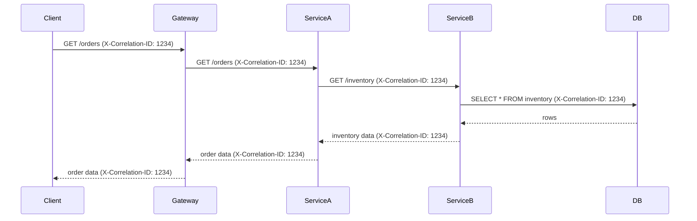

<!-- Generated by Groq via GitHub Actions -->
<!-- Topic ID: T161 -->
<!-- Category: Observability -->
<!-- Generated at UTC: 2026-11-01T18:28:49.484647+00:00 -->

# Correlation IDs

## 1. What problem does this solve?

When a request travels through a distributed system—say a Next.js frontend calls a FastAPI micro‑service, which in turn talks to PostgreSQL, Redis, and a Kafka producer—there are many independent logs, metrics, and traces generated.  
Without a single identifier that follows the request through every hop, it becomes impossible to:

- **Reconstruct the full path** of a request when debugging a failure.
- **Aggregate metrics** (latency, error rates) per user or per business flow.
- **Correlate logs** across services that otherwise have unrelated timestamps.

If correlation IDs are missing:

- A stack trace in Service A may not match the error in Service B.
- Performance bottlenecks are hidden because you cannot see which request caused them.
- Support tickets become time‑consuming because engineers must manually search logs.

In real systems, correlation IDs appear in HTTP headers (`X-Request-ID`, `X-Correlation-ID`), gRPC metadata, message queue headers, and database query tags.

---

## 2. Mental model

**Analogy:**  
Think of a postal package with a tracking number. Every time the package moves from one facility to another, the tracking number is stamped on the package. When the customer asks “Where is my package?”, you can look up that number and see the entire journey.

**Engineering model:**  
A correlation ID is that tracking number. It is a unique, immutable value that is attached to a request at the entry point and propagated unchanged through every downstream component. Each component logs the ID, so later you can filter logs by that ID to see the whole path.

---

## 3. Deep explanation

| Topic | Explanation |
|-------|-------------|
| **Internals** | The ID is usually a UUIDv4 or a ULID. It is generated once at the API gateway or the first service that receives the request. It is passed via HTTP headers, gRPC metadata, or message headers. Each service extracts it, attaches it to its own logs, and forwards it unchanged. |
| **Important terminology** | *Correlation ID* (sometimes *Request ID*), *Trace ID* (used by distributed tracing systems), *Span ID* (individual operation within a trace). |
| **Trade‑offs** | <ul><li>**Uniqueness vs. size** – UUIDv4 is 36 chars; ULID is 26 chars but still large for logs.</li><li>**Propagation cost** – adding headers to every request adds a few bytes; negligible for HTTP but can matter in high‑volume message queues.</li><li>**Security** – IDs are public; avoid embedding sensitive data.</li></ul> |
| **Failure modes** | • Header lost or overwritten → logs cannot be correlated.<br>• ID collision (extremely rare with UUIDv4).<br>• Services that do not propagate the ID break the chain. |
| **Limitations** | Correlation IDs do not provide causality or timing; they only link events. For full observability you still need distributed tracing (OpenTelemetry). |
| **Where it fits** | It sits at the edge of the system (API gateway, load balancer) and is passed through all layers: HTTP, gRPC, message queues, database drivers, and even external APIs if you choose to forward it. |
| **Interaction with related concepts** | • **Distributed tracing**: correlation ID can be the trace ID.<br>• **Logging**: use structured logs with the ID as a field.<br>• **Metrics**: tag counters and histograms with the ID for per‑request aggregation.<br>• **Security**: do not log the ID in public logs if it could be used for enumeration. |

---

## 4. How it works

1. **Client sends request** → includes optional `X-Correlation-ID` header.  
2. **API Gateway** checks header; if missing, generates a new UUIDv4.  
3. **Gateway attaches** the ID to the request context and forwards it to Service A.  
4. **Service A** extracts the ID, logs it, and forwards it to Service B.  
5. **Service B** does the same, possibly adding its own span ID.  
6. **All logs** contain the same correlation ID, enabling filtering.  
7. **Response** propagates the ID back to the client for end‑to‑end tracing.



---

## 5. Practical implementation

### TypeScript / Node.js (Express + PostgreSQL)

```ts
// middleware/correlationId.ts
import { Request, Response, NextFunction } from 'express';
import { v4 as uuidv4 } from 'uuid';

export const correlationIdMiddleware = (
  req: Request,
  res: Response,
  next: NextFunction
) => {
  // 1. Grab header or generate new ID
  const header = req.headers['x-correlation-id'] as string | undefined;
  const correlationId = header ?? uuidv4();

  // 2. Attach to request context
  (req as any).correlationId = correlationId;

  // 3. Make sure it is sent back to the client
  res.setHeader('X-Correlation-ID', correlationId);

  // 4. Log the start of the request
  console.log(`[${correlationId}] Incoming ${req.method} ${req.url}`);

  next();
};
```

```ts
// app.ts
import express from 'express';
import { correlationIdMiddleware } from './middleware/correlationId';
import { getOrder } from './services/orderService';

const app = express();
app.use(correlationIdMiddleware);

app.get('/orders/:id', async (req, res) => {
  const correlationId = (req as any).correlationId;
  try {
    const order = await getOrder(req.params.id, correlationId);
    res.json(order);
  } catch (err) {
    console.error(`[${correlationId}] Error:`, err);
    res.status(500).send('Internal Server Error');
  }
});

app.listen(3000, () => console.log('Server listening on 3000'));
```

```ts
// services/orderService.ts
import { Client } from 'pg';

const client = new Client({ connectionString: process.env.DATABASE_URL });
await client.connect();

export const getOrder = async (id: string, correlationId: string) => {
  const res = await client.query(
    'SELECT * FROM orders WHERE id = $1',
    [id]
  );
  // Log with correlation ID
  console.log(`[${correlationId}] Queried order ${id}`);
  return res.rows[0];
};
```

**Key points**

- The middleware guarantees every request has an ID.
- The ID is propagated to downstream services via headers.
- Structured logs (`[${correlationId}]`) make filtering trivial.

### FastAPI (Python) – quick reference

```python
# middleware.py
from fastapi import FastAPI, Request, Response
import uuid

app = FastAPI()

@app.middleware("http")
async def correlation_id_middleware(request: Request, call_next):
    correlation_id = request.headers.get("X-Correlation-ID") or str(uuid.uuid4())
    request.state.correlation_id = correlation_id
    response: Response = await call_next(request)
    response.headers["X-Correlation-ID"] = correlation_id
    return response
```

---

## 6. Production considerations

| Concern | How correlation IDs help / what to watch for |
|---------|----------------------------------------------|
| **Scalability** | IDs are lightweight; no extra state needed. |
| **Reliability** | Ensure every service forwards the header; otherwise the chain breaks. |
| **Security** | IDs are public; avoid using them as authentication tokens. |
| **Observability** | Combine with structured logging and tracing for full context. |
| **Performance** | Header overhead is minimal; avoid generating IDs in hot paths if already present. |
| **Error handling** | Log the ID on every exception; propagate it to client for support. |
| **Resource usage** | No extra memory; just a string per request. |
| **Operational concerns** | Centralized log aggregation (ELK, Loki) should index by `correlation_id`. |
| **Failure recovery** | If a service crashes, the ID remains in the log; you can replay the request with the same ID. |
| **Deployment** | API gateways (NGINX, Envoy) can generate IDs automatically; keep the header name consistent. |

---

## 7. Common mistakes

| Mistake | Why it’s problematic |
|---------|----------------------|
| **Generating a new ID at every service** | Breaks the chain; you lose end‑to‑end traceability. |
| **Using a mutable ID (e.g., user ID)** | Exposes sensitive data and can be spoofed. |
| **Not propagating the header** | Logs become uncorrelated; debugging becomes impossible. |
| **Logging the ID as a plain string without structure** | Hard to filter in log aggregators. |
| **Over‑logging the ID in every log line** | Adds noise; use structured logs instead. |
| **Assuming correlation ID == trace ID** | They are related but not the same; tracing adds spans and timing. |

---

## 8. Senior engineer perspective

When scaling to thousands of requests per second:

- **Architecture**: Place ID generation at the edge (API gateway, load balancer) to avoid duplicate work. Use a consistent header name (`X-Request-ID` is common).  
- **Trade‑offs**: UUIDv4 is safe but verbose; ULID or NanoID can reduce log size if needed.  
- **Bottlenecks**: None in ID propagation, but ensure downstream services don’t block on header extraction.  
- **Failure scenarios**: If a service drops the header, downstream logs lose context; implement a health check that verifies propagation.  
- **Monitoring**: Index logs by `correlation_id`; set alerts on missing IDs or high error rates per ID.  
- **Cost/performance**: Minimal; the real cost is in log storage and query performance. Use compressed logs and proper indexing.  
- **When NOT to use**: In very low‑latency micro‑services where header overhead is critical, or when the system is single‑service and logs are already correlated by timestamp.  

---

## 9. Interview questions

1. **Beginner**: *What is a correlation ID and why do we use it?*  
   *Answer:* A unique identifier that travels with a request across services, enabling us to link logs, metrics, and traces for that request.

2. **Beginner**: *How do you propagate a correlation ID in an HTTP request?*  
   *Answer:* By adding a custom header (e.g., `X-Correlation-ID`) at the entry point and forwarding it unchanged to downstream services.

3. **Senior**: *Explain the difference between a correlation ID, trace ID, and span ID in distributed tracing.*  
   *Answer:* Correlation ID is a simple unique key for correlating logs; trace ID identifies a single end‑to‑end request in a tracing system; span ID identifies an individual operation within that trace.

4. **Senior**: *What are the trade‑offs of using UUIDv4 vs ULID for correlation IDs in a high‑volume system?*  
   *Answer:* UUIDv4 is universally unique but 36 chars; ULID is shorter (26 chars) and lexicographically sortable, which can improve log indexing and storage efficiency. However, ULID generation is slightly more complex.

5. **Scenario/Debugging**: *A user reports that their request timed out after 30 s, but the logs show no error. How would you investigate using correlation IDs?*  
   *Answer:* Ask the user for the `X-Correlation-ID` from the response header. Search all services’ logs for that ID to trace the request path, identify where it stalled, and check metrics or traces for latency spikes.

---

## 10. Hands‑on task

Add correlation ID support to the existing Express app in this repository:

1. Create a middleware that generates or extracts `X-Correlation-ID`.  
2. Propagate the ID to a downstream micro‑service (you can mock it with a simple `/mock` endpoint).  
3. Log the ID in both services.  
4. Verify that the same ID appears in logs when you make a request from the client.

---

## 11. Quick revision

- Correlation ID links logs across services for a single request.  
- Generated once at the edge; propagated unchanged.  
- Use a header (`X-Correlation-ID`) or metadata.  
- Prefer UUIDv4 or ULID; keep it public and immutable.  
- Combine with structured logs (`{ correlationId, level, message }`).  
- Ensure every service forwards the header; otherwise the chain breaks.  
- Useful for debugging, metrics aggregation, and support.  
- Not a replacement for distributed tracing; it’s a lightweight complement.  
- Watch out for header loss, ID collisions, and unnecessary logging noise.  
- In production, index logs by `correlation_id` and alert on missing IDs.  

---

## 12. References

- [Node.js HTTP headers](https://nodejs.org/api/http.html#http_http_incomingmessage_headers)  
- [Express middleware](https://expressjs.com/en/guide/writing-middleware.html)  
- [FastAPI middleware](https://fastapi.tiangolo.com/tutorial/middleware/)  
- [OpenTelemetry tracing concepts](https://opentelemetry.io/docs/concepts/)  
- [UUID v4 spec](https://www.ietf.org/rfc/rfc4122.txt)  
- [ULID spec](https://github.com/ulid/spec)  
- [Logging best practices](https://www.elastic.co/guide/en/ecs/current/ecs-logging.html)
