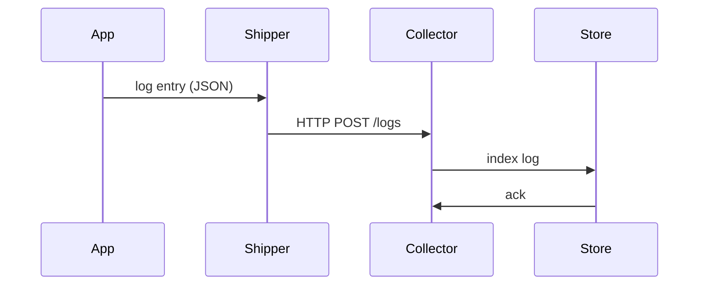

<!-- Generated by Groq via GitHub Actions -->
<!-- Topic ID: T162 -->
<!-- Category: Observability -->
<!-- Generated at UTC: 2026-11-01T18:28:49.484647+00:00 -->

# Centralized logging

## 1. What problem does this solve?

**Problem**  
In a distributed backend, logs are produced by many services, containers, and infrastructure components. Each service writes to its own local file or console, making it hard to:

- Correlate events that span multiple services (e.g., a user request that touches API, DB, cache, and background job).
- Search for errors or performance regressions across the whole system.
- Detect security incidents or compliance violations that involve multiple components.

**Why it matters**  
- **Debugging**: Without a unified view, reproducing and fixing bugs becomes a time‑consuming hunt.
- **Observability**: Metrics and traces alone can miss subtle failures; logs provide the raw data.
- **Compliance**: Auditing requires a tamper‑proof, searchable log archive.
- **Alerting**: Detecting patterns (e.g., repeated 500s) across services needs aggregated data.

**What happens if it’s not used**  
- Developers spend hours tailing logs on each pod.
- Incidents are missed or misdiagnosed, leading to longer MTTR (Mean Time to Recovery).
- Security breaches may go unnoticed because logs are siloed.
- Compliance audits fail due to incomplete evidence.

**Real‑world appearance**  
- A microservice architecture on Kubernetes where each pod writes to stdout.
- A monolith that writes to local files but needs to be monitored by a central SIEM.
- A serverless function that logs to CloudWatch but must be correlated with API Gateway logs.

---

## 2. Mental model

**Analogy**  
Think of each service as a **department in a company**. Each department keeps its own notebook (local logs). A CEO (the ops team) needs a single **company ledger** that records every transaction, meeting, and incident. Centralized logging is that ledger: it collects, normalizes, and stores every entry from all departments in one place, so the CEO can review the whole picture.

**Engineering model**  
- **Producer**: Service emits log entries (structured JSON, plain text, etc.).
- **Transport**: Log entry is sent over a reliable channel (HTTP, gRPC, Kafka, syslog, etc.).
- **Collector**: A log shipper (e.g., Fluentd, Logstash, Filebeat) receives entries, enriches them, and forwards them.
- **Aggregator**: A log store (Elasticsearch, Loki, CloudWatch Logs, Splunk) indexes and persists logs.
- **Consumer**: Dashboards, alerts, and forensic queries.

---

## 3. Deep explanation

### Internals
- **Structured logging**: JSON objects with fields like `timestamp`, `level`, `service`, `requestId`, `message`. Enables filtering and correlation.
- **Context propagation**: Pass a unique `requestId` (or trace ID) through middleware so logs from all services for a single request can be joined.
- **Log shippers**: Lightweight agents that tail files or listen to stdout, batch logs, and forward them.
- **Indexing**: Log stores create inverted indexes on key fields for fast search.

### Important terminology
- **Log level**: `debug`, `info`, `warn`, `error`, `fatal`.
- **Log rotation**: Automatically archiving or deleting old log files.
- **Retention policy**: How long logs are kept.
- **Sampling**: Reducing volume by dropping less critical logs.
- **Backpressure**: Handling overload when the collector is slower than producers.

### Trade‑offs
| Aspect | High volume | Low volume |
|--------|-------------|------------|
| **Cost** | Higher storage & ingest costs | Lower |
| **Latency** | Potential delays if buffering | Near real‑time |
| **Complexity** | Requires robust shippers & deduplication | Simpler setup |
| **Reliability** | Need graceful degradation | Easier to maintain |

### Failure modes
- **Network partitions**: Logs lost if shipper cannot reach collector.
- **Collector overload**: Backpressure or dropped logs.
- **Mis‑enrichment**: Missing request IDs leads to orphaned logs.
- **Security**: Exposing sensitive data in logs.

### Limitations
- **Eventual consistency**: Logs may arrive out of order.
- **Storage cost**: Long retention can be expensive.
- **Parsing overhead**: Structured logs require parsing before indexing.

### Where it fits
- **Observability stack**: Works alongside metrics (Prometheus) and tracing (OpenTelemetry).
- **CI/CD pipelines**: Capture build logs centrally.
- **Security**: SIEM ingestion for threat detection.

### Interaction with related concepts
- **Tracing**: Logs and traces share the same trace ID for correlation.
- **Metrics**: Log patterns can be turned into metrics (e.g., error rate).
- **Configuration management**: Log levels can be adjusted via feature flags.

---

## 4. How it works

1. **Application emits log**  
   ```ts
   logger.info({ requestId, userId, action: 'createOrder' });
   ```
2. **Middleware injects context**  
   ```ts
   app.use((req, res, next) => {
     req.requestId = uuidv4();
     next();
   });
   ```
3. **Log shipper tails stdout**  
   - Fluentd watches `/var/log/app.log`.
   - Batches logs, adds metadata (`host`, `service`).
4. **Transport to collector**  
   - HTTP POST to `/logs` endpoint.
   - Or Kafka topic `app-logs`.
5. **Collector indexes**  
   - Elasticsearch parses JSON, creates fields.
6. **Consumer queries**  
   - Kibana dashboard shows logs by `requestId`.
   - Alert: `count(error) > 5` in 1 min.



---

## 5. Practical implementation

### 5.1. Node.js example with Winston + Fluentd

```ts
// logger.ts
import { createLogger, format, transports } from 'winston';
import { v4 as uuidv4 } from 'uuid';

const logger = createLogger({
  level: 'info',
  format: format.combine(
    format.timestamp(),
    format.json()
  ),
  transports: [
    new transports.Console(),          // local console
    new transports.File({ path: 'app.log' }) // file for shipper
  ]
});

export default logger;
```

```ts
// server.ts
import express from 'express';
import logger from './logger';

const app = express();

app.use((req, res, next) => {
  // inject requestId into request and logger
  const requestId = uuidv4();
  (req as any).requestId = requestId;
  logger.defaultMeta = { requestId };
  next();
});

app.get('/orders/:id', async (req, res) => {
  const { id } = req.params;
  logger.info({ action: 'fetchOrder', orderId: id });
  // ... fetch from DB
  res.json({ id, status: 'shipped' });
});

app.listen(3000, () => logger.info('Server started'));
```

**Fluentd config (`fluent.conf`)**

```conf
<source>
  @type tail
  path /path/to/app.log
  pos_file /var/log/fluentd/app.log.pos
  tag app.logs
  format json
</source>

<match app.logs>
  @type forward
  <server>
    host logs-collector.example.com
    port 24224
  </server>
</match>
```

**Collector (Elasticsearch)**  
- Run `docker run -d -p 9200:9200 -e "discovery.type=single-node" docker.elastic.co/elasticsearch/elasticsearch:8.12.0`

**Query**  
```bash
curl -XGET 'http://localhost:9200/app-logs/_search?q=requestId:<id>&pretty'
```

### 5.2. Python FastAPI example (optional)

```python
# logger.py
import logging
import json
from uuid import uuid4

class JsonFormatter(logging.Formatter):
    def format(self, record):
        payload = {
            'timestamp': self.formatTime(record, self.datefmt),
            'level': record.levelname,
            'message': record.getMessage(),
            'service': 'orders',
            'requestId': getattr(record, 'requestId', None)
        }
        return json.dumps(payload)

handler = logging.StreamHandler()
handler.setFormatter(JsonFormatter())
logger = logging.getLogger('orders')
logger.addHandler(handler)
logger.setLevel(logging.INFO)
```

```python
# main.py
from fastapi import FastAPI, Request
from logger import logger

app = FastAPI()

@app.middleware("http")
async def add_request_id(request: Request, call_next):
    request_id = str(uuid4())
    request.state.request_id = request_id
    logger = logging.getLogger('orders')
    logger = logging.LoggerAdapter(logger, {'requestId': request_id})
    request.state.logger = logger
    response = await call_next(request)
    return response

@app.get("/orders/{order_id}")
async def get_order(order_id: str, request: Request):
    request.state.logger.info(f"Fetching order {order_id}")
    return {"order_id": order_id, "status": "shipped"}
```

---

## 6. Production considerations

| Concern | How to address |
|---------|----------------|
| **Scalability** | Use a message queue (Kafka) for buffering; shard Elasticsearch indices. |
| **Reliability** | Enable retries in shippers; use durable queues; monitor backpressure. |
| **Security** | Mask PII; encrypt logs in transit (TLS) and at rest. |
| **Observability** | Correlate logs with traces; set up alerting on error patterns. |
| **Performance** | Batch logs; avoid synchronous I/O in request path. |
| **Error handling** | Graceful degradation: if collector down, shipper writes to local file. |
| **Resource usage** | Monitor disk usage; rotate and purge old logs per retention policy. |
| **Operational concerns** | Centralized log ingestion pipeline, automated scaling, health checks. |
| **Failure recovery** | Replay from Kafka if collector restarts; use checkpointing. |
| **Deployment** | Containerize shippers; use sidecar pattern; separate log ingestion tier. |

---

## 7. Common mistakes

| Mistake | Why it’s bad |
|---------|--------------|
| **Plain text logs only** | Hard to query; no structured fields for filtering. |
| **No request ID** | Cannot correlate logs across services. |
| **Logging inside hot path without async** | Adds latency to request handling. |
| **Hard‑coded log levels** | Cannot adjust verbosity in production. |
| **Sending logs over insecure channel** | Sensitive data exposed. |
| **Ignoring log rotation** | Disk fill, performance hit. |
| **Over‑logging** | Generates noise, increases cost. |
| **Not handling shipper failures** | Logs lost during outages. |

---

## 8. Senior engineer perspective

### Architecture decisions
- **Central vs. distributed**: Choose a dedicated log ingestion cluster vs. in‑pod shippers.
- **Transport protocol**: HTTP for simplicity vs. Kafka for high throughput.
- **Indexing strategy**: Time‑based indices vs. service‑based indices.

### Trade‑offs
- **Latency vs. durability**: Immediate HTTP push vs. Kafka buffering.
- **Cost vs. compliance**: Long retention vs. cheaper archival (S3 Glacier).
- **Complexity vs. observability**: Full ELK stack vs. lightweight Loki.

### Bottlenecks
- **Collector ingest rate**: Exceeding write throughput leads to backpressure.
- **Search latency**: Large indices slow queries; need proper sharding.

### Failure scenarios
- **Collector crash**: Shipments queued in Kafka; ensure at‑least‑once delivery.
- **Network partition**: Shipments buffered; monitor queue depth.

### Monitoring
- **Queue depth**: Kafka topic lag.
- **Shipper health**: Export metrics (`fluentd_status`).
- **Index health**: Elasticsearch cluster health.

### Cost/performance
- **Storage tiering**: Hot tier for recent logs, cold tier for older logs.
- **Sampling**: Reduce volume for high‑frequency logs.

### When NOT to use
- **Small monolith**: Local file + simple tail may suffice.
- **Low compliance**: If audit isn’t required, lightweight logging is fine.
- **Very low traffic**: Overkill to run a full ELK stack.

---

## 9. Interview questions

| Level | Question | Answer points |
|-------|----------|---------------|
| Beginner | What is the purpose of a log level? | Controls verbosity; filters logs; `debug` for dev, `error` for prod. |
| Beginner | How can you correlate logs from multiple services? | Use a shared trace/request ID propagated through middleware. |
| Senior | Explain how you would design a log ingestion pipeline for a system that processes 10k logs per second. | Use Kafka for buffering, multiple Fluentd workers, sharded Elasticsearch indices, autoscaling collectors, monitoring lag. |
| Senior | What are the trade‑offs between using HTTP vs. Kafka for log transport? | HTTP: simple, low latency, but no buffering; Kafka: high throughput, durability, but added complexity. |
| Scenario | A production service suddenly stops sending logs. What steps would you take to diagnose and fix the issue? | Check shipper health, network connectivity, collector availability, backpressure metrics, verify log level, inspect disk usage, roll back recent config changes. |

---

## 10. Hands‑on task

**Task**: Add centralized logging to an existing Express/Next.js API.

1. Install `winston` and `fluentd` in the repo.
2. Create a `logger.ts` that emits JSON logs with `timestamp`, `level`, `service`, `requestId`.
3. Add middleware to inject a `requestId` into every request.
4. Configure Fluentd to tail the log file and forward to a local Elasticsearch instance.
5. Verify that logs appear in Kibana and that you can filter by `requestId`.

**Goal**: Demonstrate end‑to‑end flow from application to searchable log store.

---

## 11. Quick revision

- Centralized logging aggregates logs from all services into a single store.
- Structured JSON logs enable filtering, correlation, and alerting.
- Context propagation (request ID) is essential for cross‑service tracing.
- Log shippers (Fluentd, Filebeat) batch and forward logs to collectors.
- Common transports: HTTP, gRPC, Kafka, syslog.
- Retention policies balance compliance and cost.
- Failure modes: network partitions, collector overload, missing context.
- Senior‑level design: choose transport, scaling, cost, compliance.
- Avoid over‑logging, insecure transport, and missing request IDs.
- Use monitoring (queue depth, shipper health) to detect bottlenecks.
- Interview: explain log levels, correlation, transport trade‑offs, debugging steps.

---

## 12. References

- [Winston – Node.js logging library](https://github.com/winstonjs/winston)
- [Fluentd – Open‑source data collector](https://docs.fluentd.org/)
- [Elasticsearch – Search and analytics engine](https://www.elastic.co/guide/en/elasticsearch/reference/current/index.html)
- [OpenTelemetry – Observability framework](https://opentelemetry.io/docs/)
- [FastAPI – Modern Python web framework](https://fastapi.tiangolo.com/)
- [Kafka – Distributed streaming platform](https://kafka.apache.org/documentation/)
- [Kibana – Log visualization](https://www.elastic.co/kibana/)
- [Docker – Container platform](https://docs.docker.com/)
