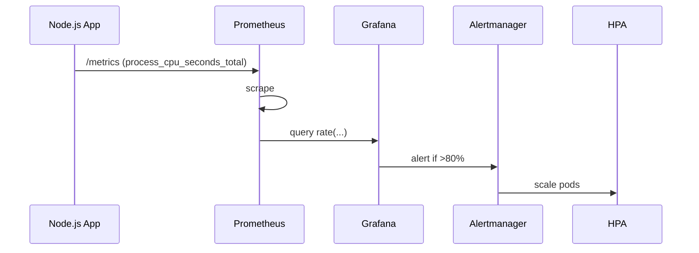

<!-- Generated by Groq via GitHub Actions -->
<!-- Topic ID: T163 -->
<!-- Category: Observability -->
<!-- Generated at UTC: 2026-11-02T07:51:15.918009+00:00 -->

# CPU metrics

## 1. What problem does this solve?

**Motivation**  
When a backend runs, the CPU is the engine that turns code into work.  
If the engine is over‑worked, requests slow down, queues grow, and the system can crash.  
If the engine is under‑utilized, you’re wasting money on idle cores.

**What problem exists**  
- **Performance bottlenecks**: A single request can hog the CPU, blocking others.  
- **Resource contention**: Multiple services share the same host; one can starve the others.  
- **Scaling decisions**: Horizontal scaling (adding more pods/VMs) or vertical scaling (more cores) requires data.  
- **Cost control**: Cloud providers bill per CPU usage; you need to know if you’re over‑provisioned.

**Why the problem matters**  
- **SLI/SLO violations**: Latency or error rates rise when CPU is saturated.  
- **Revenue loss**: Slow APIs lead to unhappy users and lost business.  
- **Operational risk**: Unchecked CPU spikes can trigger OOM kills or kernel panics.

**What happens if this concept is not used**  
- You’ll deploy without knowing if your instance size is adequate.  
- Autoscaling rules may be wrong, leading to over‑ or under‑provisioning.  
- You’ll miss early warning signs of a runaway process or memory leak that also consumes CPU.

**Where this concept appears in real backend systems**  
- Kubernetes metrics server exposes per‑pod CPU usage.  
- Prometheus scrapes `/metrics` endpoints for `process_cpu_seconds_total`.  
- Cloud provider dashboards (AWS CloudWatch, GCP Stackdriver) show CPU utilization per instance.  
- Docker stats (`docker stats`) report per‑container CPU %.

---

## 2. Mental model

**Analogy**  
Think of a CPU like a kitchen stove with multiple burners.  
Each burner can cook one dish at a time.  
If you put too many pots on a single burner, the flame gets weaker for each pot, and the stove can overheat.  
If you leave burners idle, you’re wasting the stove’s capacity.

**Engineering model**  
- **CPU cores** = burners.  
- **CPU cycles** = flame intensity.  
- **Process/Thread** = pot.  
- **CPU usage %** = how much of the flame a pot consumes.  
- **CPU time** = total flame time a pot has used.  
- **CPU throttling** = turning off a burner to protect the stove.

---

## 3. Deep explanation

### Internals
- **OS scheduler** allocates CPU time slices to processes/threads.  
- **`/proc/stat`** (Linux) or `GetProcessTimes` (Windows) expose raw CPU counters.  
- **`process.cpuUsage()`** (Node.js) returns user + system microseconds since process start.  
- **`os.cpus()`** gives per‑core times (user, nice, sys, idle, irq).  
- **Prometheus** scrapes counters and calculates deltas to produce rates (e.g., `cpu_seconds_total` → `rate(...)`).

### Important terminology
| Term | Meaning |
|------|---------|
| **CPU utilization** | Percentage of CPU time spent doing work vs idle. |
| **CPU time** | Sum of user + system time spent by a process. |
| **CPU core** | Physical or logical processing unit. |
| **CPU throttling** | OS or container limits that reduce available CPU. |
| **CPU affinity** | Binding a process to specific cores. |
| **CPU burst** | Short, intense CPU usage spikes. |
| **CPU steal** | Time a VM or container spends waiting for CPU because the host is busy. |

### Trade‑offs
- **High granularity** (per‑core metrics) gives better insight but increases overhead.  
- **Sampling interval**: Short intervals catch spikes but generate more data; long intervals smooth noise but miss brief bursts.  
- **Prometheus vs StatsD**: Prometheus gives richer query language but requires pull; StatsD is push‑based but less expressive.

### Failure modes
- **Metric drift**: If the counter resets (e.g., container restart), rate calculations can spike.  
- **Clock skew**: Different hosts with unsynced clocks produce inaccurate deltas.  
- **Container limits**: If CPU limits are set too low, the process will be throttled, masking true load.

### Limitations
- CPU metrics alone don’t reveal *why* CPU is high (e.g., inefficient algorithm vs external I/O).  
- They don’t capture *memory* or *I/O* contention, which often co‑occur.  
- In multi‑tenant environments, CPU share can be affected by other tenants (cgroups, namespaces).

### Where this concept fits in a backend architecture
- **Service layer**: Each microservice exposes `/metrics`.  
- **Infrastructure layer**: Kubernetes metrics server aggregates per‑pod CPU.  
- **Observability stack**: Prometheus → Grafana dashboards → Alertmanager.  
- **Autoscaling**: Horizontal Pod Autoscaler (HPA) uses CPU percent to decide scaling.

### Interaction with related concepts
- **Memory usage**: High CPU + high memory can indicate a memory leak that eventually forces GC, which is CPU‑heavy.  
- **Thread pool size**: In Node.js, the libuv thread pool size (`UV_THREADPOOL_SIZE`) affects CPU usage for async I/O.  
- **Container limits**: Docker `--cpus` or Kubernetes `resources.limits.cpu` directly influence observed CPU usage.  
- **Load balancer**: If backend CPU is saturated, the LB may start rejecting connections.

---

## 4. How it works

1. **Process starts** → OS assigns it to a core.  
2. **Scheduler** gives it a time slice → process runs, consuming CPU cycles.  
3. **Node.js** tracks CPU usage via `process.cpuUsage()` (user + system).  
4. **Prometheus client** exposes a counter `process_cpu_seconds_total`.  
5. **Prometheus server** scrapes the endpoint every 15 s.  
6. **Prometheus** calculates `rate(process_cpu_seconds_total[5m])` → CPU usage per second.  
7. **Grafana** visualizes the rate as a percentage of total cores.  
8. **Alertmanager** triggers if usage > threshold (e.g., 80 % for 5 min).  
9. **HPA** reads the metric and scales pods up/down.



---

## 5. Practical implementation

### 5.1 Node.js CPU metric endpoint

```ts
// src/metrics.ts
import { Counter, register } from 'prom-client';
import { cpuUsage, hrtime } from 'process';
import { createServer } from 'http';

// Counter that Prometheus will scrape
const cpuSecondsTotal = new Counter({
  name: 'process_cpu_seconds_total',
  help: 'Total user + system CPU time spent in seconds.',
  labelNames: ['instance'],
});

// Helper to push CPU usage to the counter
function pushCpuUsage() {
  const usage = cpuUsage(); // { user: µs, system: µs }
  const seconds = (usage.user + usage.system) / 1e6;
  cpuSecondsTotal.inc({ instance: process.env.INSTANCE_ID || 'local' }, seconds);
}

// Push every 5 seconds
setInterval(pushCpuUsage, 5000);

// Expose /metrics endpoint
const server = createServer((req, res) => {
  if (req.url === '/metrics') {
    res.setHeader('Content-Type', register.contentType);
    res.end(register.metrics());
  } else {
    res.statusCode = 404;
    res.end();
  }
});

server.listen(9100, () => {
  console.log('Metrics server listening on :9100');
});
```

**Key lines**

- `cpuUsage()` gives microseconds of user + system time since last call.  
- `cpuSecondsTotal.inc()` increments the Prometheus counter.  
- Exposing `/metrics` allows Prometheus to scrape.

### 5.2 Dockerfile with CPU limits

```dockerfile
# Dockerfile
FROM node:20-alpine
WORKDIR /app
COPY package*.json ./
RUN npm ci
COPY . .
CMD ["node", "dist/metrics.js"]
```

Run with a CPU limit:

```bash
docker run --cpus="0.5" -p 9100:9100 my-node-metrics
```

### 5.3 Prometheus config snippet

```yaml
scrape_configs:
  - job_name: 'node-metrics'
    static_configs:
      - targets: ['host.docker.internal:9100']
```

### 5.4 Kubernetes HPA based on CPU

```yaml
apiVersion: autoscaling/v2
kind: HorizontalPodAutoscaler
metadata:
  name: node-metrics-hpa
spec:
  scaleTargetRef:
    apiVersion: apps/v1
    kind: Deployment
    name: node-metrics
  minReplicas: 1
  maxReplicas: 10
  metrics:
    - type: Resource
      resource:
        name: cpu
        target:
          type: Utilization
          averageUtilization: 70
```

---

## 6. Production considerations

| Concern | What to watch for | Mitigation |
|---------|-------------------|------------|
| **Scalability** | CPU metrics per pod can generate high cardinality. | Use `instance` label sparingly; aggregate at the cluster level. |
| **Reliability** | Metric endpoint can be hit during high load, adding overhead. | Keep `/metrics` lightweight; use `prom-client`’s `collectDefaultMetrics()` only once. |
| **Security** | Exposing `/metrics` publicly leaks internal state. | Bind to localhost or secure with basic auth / mTLS. |
| **Observability** | Spurious spikes due to GC or V8 JIT. | Correlate CPU spikes with GC logs (`--trace-gc`). |
| **Performance** | Prometheus scrape interval too short increases load. | Default 15 s is usually fine; adjust if CPU usage is highly volatile. |
| **Error handling** | Counter increments may fail if process crashes. | Wrap in try/catch; ensure graceful shutdown. |
| **Resource usage** | CPU counters themselves consume CPU. | `prom-client` counters are lightweight; avoid per‑request instrumentation. |
| **Operational concerns** | Over‑provisioning leads to wasted cost. | Use alerts to trigger scaling decisions; review after incidents. |
| **Failure recovery** | Container restarts reset counters; Prometheus may misinterpret. | Use `rate()` over a window; Prometheus handles counter resets automatically. |
| **Deployment** | Different environments (dev, staging, prod) may have different CPU limits. | Parameterize limits via environment variables or Helm values. |

---

## 7. Common mistakes

| Mistake | Why it’s problematic |
|---------|----------------------|
| **Using `process.cpuUsage()` without resetting** | It returns cumulative time since process start; you must compute deltas. |
| **Scraping `/metrics` too often** | Increases load and network traffic; can cause false positives. |
| **Ignoring CPU steal** | In VMs, high steal time means the host is busy; CPU usage appears low but requests are delayed. |
| **Setting CPU limits too low** | The process gets throttled, masking real load and causing latency spikes. |
| **Not labeling metrics** | Without labels (e.g., `instance`, `service`), you can’t distinguish between pods. |
| **Relying solely on CPU for autoscaling** | CPU may be high due to GC or JIT; combine with request latency or queue length. |
| **Using `--cpus=1` on Docker but not setting `resources.limits.cpu` in Kubernetes** | Inconsistent limits across environments lead to unpredictable behavior. |
| **Not handling counter resets** | A restart can cause a sudden drop in the counter, leading to a huge spike in `rate()` calculations. |

---

## 8. Senior engineer perspective

### What changes at scale?

- **Metric cardinality**: Hundreds of services → thousands of unique series. Must aggregate or downsample.  
- **Distributed tracing**: Combine CPU metrics with span data to pinpoint hot spots.  
- **Multi‑tenant clusters**: CPU share per namespace; need to enforce quotas.  
- **Cost optimization**: Use CPU utilization to right‑size instances; integrate with cloud cost APIs.  
- **Chaos engineering**: Simulate CPU throttling to test resilience.

### Design decisions

| Decision | Trade‑offs |
|----------|------------|
| **Prometheus vs OpenTelemetry** | Prometheus is mature for metrics; OpenTelemetry offers unified tracing + metrics but may require more setup. |
| **Scrape interval** | 15 s vs 5 s: finer granularity vs overhead. |
| **Metric aggregation** | Store raw per‑pod metrics vs aggregated per‑service to reduce cardinality. |
| **CPU limits** | Strict limits prevent runaway processes but can cause throttling; soft limits with alerts may be better. |
| **Autoscaling strategy** | CPU‑based HPA vs custom metrics (e.g., request latency) depending on workload characteristics. |
| **Monitoring stack** | Grafana + Alertmanager vs commercial APM (Datadog, New Relic). |

### Bottlenecks & failure scenarios

- **High GC pause**: Node.js V8 GC can consume >50 % CPU for a few ms, causing latency spikes.  
- **Thread pool exhaustion**: `UV_THREADPOOL_SIZE` too low → I/O ops block CPU.  
- **CPU steal**: In shared hosts, CPU usage may look low but requests wait.  
- **Metric ingestion overload**: Prometheus may drop samples if scrape target is slow.  

### When NOT to use CPU metrics alone

- **I/O‑bound services**: CPU may be low but latency high; need disk/DB metrics.  
- **Stateless microservices**: CPU may not be the primary bottleneck; focus on request rate.  
- **Batch jobs**: CPU spikes are expected; use job duration instead.

---

## 9. Interview questions

| Level | Question | Answer points |
|-------|----------|---------------|
| Beginner | What does `process.cpuUsage()` return in Node.js? | User + system microseconds since last call; cumulative. |
| Beginner | Why do we expose a `/metrics` endpoint in a backend service? | Allows Prometheus to scrape counters; enables observability. |
| Senior | How would you design a CPU‑based autoscaling policy for a stateless API that also has a heavy background worker? | Separate metrics per component; use custom metrics; avoid scaling worker based on API CPU. |
| Senior | Explain how CPU steal time can affect a containerized application’s performance. | Host busy → container waits; CPU usage appears low but latency high; need to monitor `cpu_steal` or `container_cpu_cfs_throttled_seconds_total`. |
| Scenario | A service’s CPU usage spikes to 95 % for 30 s, then drops to 10 %. What could be causing this, and how would you investigate? | Possible GC pause, JIT compilation, or external API call; check GC logs, V8 flags, trace logs; correlate with request latency. |

---

## 10. Hands‑on task

**Goal**: Build a simple Node.js service that exposes CPU metrics, run it in Docker with a CPU limit, and set up a Prometheus scrape to visualize the data.

**Steps**

1. Create a new Node.js project (`npm init -y`).  
2. Add `prom-client` and `express` (or use `http`).  
3. Implement `/metrics` endpoint as shown in section 5.1.  
4. Write a Dockerfile that builds the image.  
5. Run the container with `--cpus="0.5"`.  
6. Spin up a local Prometheus instance (use the official Docker image).  
7. Configure Prometheus to scrape the container’s `/metrics`.  
8. Open Grafana, add Prometheus data source, and create a dashboard panel for `rate(process_cpu_seconds_total[5m])`.  
9. Observe how the CPU metric behaves when you send requests to the service (e.g., `ab -n 1000 -c 10 http://localhost:9100/metrics`).  

**Deliverable**: A GitHub repo with Dockerfile, `metrics.ts`, `prometheus.yml`, and a README explaining how to run and observe the metrics.

---

## 11. Quick revision

- CPU metrics measure *time spent doing work* vs *idle*.
- `process.cpuUsage()` gives cumulative user + system µs; use deltas for rates.
- Prometheus exposes counters; `rate()` converts to per‑second usage.
- Docker `--cpus` and Kubernetes `resources.limits.cpu` enforce CPU caps.
- High CPU can indicate algorithmic inefficiency, GC, or external I/O stalls.
- CPU steal time shows host contention; monitor `container_cpu_cfs_throttled_seconds_total`.
- Autoscaling can be CPU‑based (HPA) but often needs custom metrics.
- Label metrics (`instance`, `service`) for multi‑tenant visibility.
- Avoid over‑scraping; 15 s is a good default.
- Correlate CPU spikes with latency, GC logs, and tracing.

---

## 12. References

- [Node.js `process.cpuUsage()` docs](https://nodejs.org/api/process.html#processcpuusage)  
- [Prometheus client for Node.js](https://github.com/siimon/prom-client)  
- [Prometheus documentation – rate function](https://prometheus.io/docs/prometheus/latest/querying/functions/#rate)  
- [Kubernetes HPA documentation](https://kubernetes.io/docs/tasks/run-application/horizontal-pod-autoscale/)  
- [Docker CPU limits](https://docs.docker.com/config/containers/resource_constraints/#cpu)  
- [OpenTelemetry – CPU metrics](https://opentelemetry.io/docs/specs/otel/metrics/)  
- [Prometheus – scrape configuration](https://prometheus.io/docs/prometheus/latest/configuration/configuration/#scrape_config)  

---
