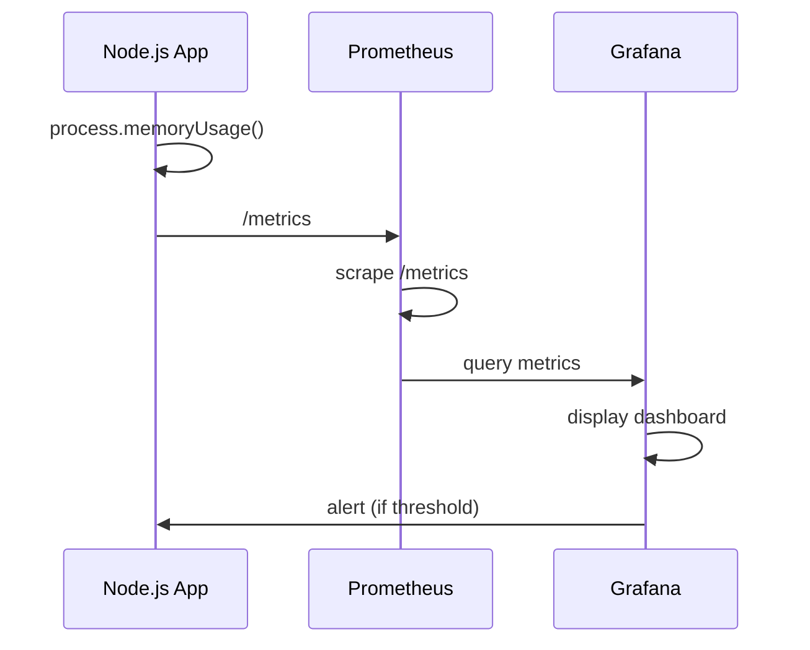

<!-- Generated by Groq via GitHub Actions -->
<!-- Topic ID: T164 -->
<!-- Category: Observability -->
<!-- Generated at UTC: 2026-11-02T07:51:15.918009+00:00 -->

# Memory metrics

## 1. What problem does this solve?

Memory metrics let you **measure, understand, and control** how much RAM your backend processes consume.  
Without them you risk:

- **Out‑of‑Memory (OOM) crashes** that bring down services and cause downtime.
- **Hidden memory leaks** that slowly degrade performance and increase infrastructure costs.
- **Mis‑scaled deployments** – allocating too little memory wastes resources, too much wastes money.
- **Unpredictable latency** – garbage collection pauses can spike response times if you don’t know how much memory is in play.

In real systems, memory metrics surface in:

- **Node.js** servers (heap, RSS, external memory).
- **Python/FastAPI** apps (process memory, garbage‑collector stats).
- **Databases** (PostgreSQL shared buffers, Redis memory usage).
- **Container orchestrators** (Docker/Kubernetes memory limits/requests).
- **Monitoring stacks** (Prometheus, Grafana, Datadog).

They are the foundation for **capacity planning, alerting, and performance tuning**.

---

## 2. Mental model

### Analogy  
Think of a backend process as a **house**.  
- **House size** → total RAM allocated.  
- **Furniture** → objects allocated in the heap.  
- **Garbage** → unused objects that should be removed.  
- **Household chores** → garbage collection.  

If you keep adding furniture without cleaning up, the house eventually becomes overcrowded and you can’t move in new guests (OOM). Memory metrics are the **utility bills** that tell you how much space you’re using and when you need to tidy up.

### Engineering model  
- **RSS (Resident Set Size)**: physical memory the process occupies.  
- **Heap**: dynamic memory for JS objects.  
- **External**: memory used by native bindings (e.g., buffers).  
- **Stack**: call‑stack frames (small, usually ignored).  
- **GC cycles**: how often and how long the engine pauses to reclaim heap.  

Monitoring these gives you a clear picture of the “house” and its “utility usage”.

---

## 3. Deep explanation

| Concept | What it is | Why it matters | Typical values |
|---------|------------|----------------|----------------|
| **RSS** | Total physical memory used by the process. | Includes heap, stack, code, shared libs. | 200 MiB – 2 GiB for a typical Node service |
| **Heap total / used** | V8’s managed memory region. | Directly tied to object allocation. | 100 MiB – 1 GiB |
| **External** | Memory allocated by native addons (e.g., `Buffer`). | Can grow independently of heap. | 10 MiB – 200 MiB |
| **GC pause time** | Time spent stopping the world to clean heap. | Causes latency spikes. | 1 ms – 50 ms |
| **Heap fragmentation** | Unused gaps in heap. | Can lead to OOM even if free space exists. | Hard to quantify, but high fragmentation → more GC |

### Internals
- **V8** splits heap into *new space* (young generation) and *old space* (tenured objects).  
- **Garbage collection** is generational: young objects are collected more frequently.  
- **Node.js** exposes `process.memoryUsage()` which returns an object with `rss`, `heapTotal`, `heapUsed`, `external`, `arrayBuffers`.  
- **Prometheus** metrics like `nodejs_heap_size_bytes` are derived from these values.

### Trade‑offs
- **Higher heap limits** → fewer GC pauses but more memory consumption.  
- **Lower heap limits** → more GC but lower cost.  
- **Enabling heap snapshots** → useful for debugging but expensive in production.

### Failure modes
- **Memory leaks**: objects referenced unintentionally, never freed.  
- **Fragmentation**: GC cannot reclaim memory due to layout.  
- **OOM**: process killed by OS or container runtime.  
- **GC thrashing**: too frequent GC causing high CPU usage.

### Limitations
- Metrics are snapshots; they don’t show *historical* trends unless stored.  
- `process.memoryUsage()` reports *process‑level* memory; not per‑request.  
- GC pause metrics require instrumentation (e.g., `v8-profiler` or `node --trace_gc`).

### Where it fits
- **Observability stack**: Prometheus scrape, Grafana dashboards, alerting.  
- **CI/CD**: automated tests that fail if memory usage exceeds thresholds.  
- **Auto‑scaling**: Kubernetes HPA can use memory metrics to trigger pod scaling.

### Interaction with related concepts
- **CPU**: GC pauses consume CPU; high CPU + high memory → performance bottleneck.  
- **Networking**: Large payloads increase buffer memory.  
- **Databases**: Connection pools consume memory; monitor pool size.  
- **Container limits**: Set `--memory` flag; OOM kills if exceeded.

---

## 4. How it works

1. **Collect**: `process.memoryUsage()` is called periodically (e.g., every 10 s).  
2. **Transform**: Convert raw numbers into Prometheus metrics (`nodejs_heap_size_bytes`, `nodejs_heap_used_bytes`, etc.).  
3. **Expose**: Serve `/metrics` endpoint.  
4. **Scrape**: Prometheus pulls the endpoint.  
5. **Store & Alert**: Grafana visualizes; alerts fire when thresholds are breached.  
6. **Investigate**: On alert, take heap snapshot or enable GC tracing to diagnose leaks.



---

## 5. Practical implementation

### 5.1 Express + prom-client

```ts
// src/metrics.ts
import { collectDefaultMetrics, register, Gauge } from 'prom-client';
import { Request, Response, NextFunction } from 'express';

// Collect Node.js default metrics (CPU, memory, etc.)
collectDefaultMetrics();

// Custom memory gauges
const heapUsed = new Gauge({
  name: 'nodejs_heap_used_bytes',
  help: 'V8 heap used in bytes',
});
const heapTotal = new Gauge({
  name: 'nodejs_heap_total_bytes',
  help: 'V8 heap total in bytes',
});
const rss = new Gauge({
  name: 'nodejs_rss_bytes',
  help: 'Resident Set Size in bytes',
});
const external = new Gauge({
  name: 'nodejs_external_bytes',
  help: 'External memory in bytes',
});

export function memoryMetricsMiddleware(
  req: Request,
  res: Response,
  next: NextFunction
) {
  const mem = process.memoryUsage();
  heapUsed.set(mem.heapUsed);
  heapTotal.set(mem.heapTotal);
  rss.set(mem.rss);
  external.set(mem.external);
  next();
}

// src/server.ts
import express from 'express';
import { memoryMetricsMiddleware } from './metrics';
import { register } from 'prom-client';

const app = express();

app.use(memoryMetricsMiddleware);

app.get('/health', (_, res) => res.send('OK'));

app.get('/metrics', async (_, res) => {
  res.set('Content-Type', register.contentType);
  res.end(await register.metrics());
});

app.listen(3000, () => console.log('Server listening on :3000'));
```

**What it does**

- `collectDefaultMetrics()` automatically exposes CPU, memory, and GC stats.
- Custom gauges keep the latest values; they’re updated on every request.
- `/metrics` endpoint is Prometheus‑friendly.

### 5.2 Docker memory limits

```dockerfile
# Dockerfile
FROM node:20-alpine
WORKDIR /app
COPY package*.json ./
RUN npm ci --only=production
COPY . .
EXPOSE 3000
CMD ["node", "dist/server.js"]
```

Run with a memory cap:

```bash
docker run -d -p 3000:3000 --memory=512m --memory-swap=512m myapp
```

If the process exceeds 512 MiB, Docker will OOM‑kill it.

### 5.3 Heap snapshot on high memory

```ts
import { writeFileSync } from 'fs';
import { createHeapSnapshot } from 'v8';

function maybeSnapshot() {
  const mem = process.memoryUsage();
  if (mem.heapUsed > 400 * 1024 * 1024) { // >400 MiB
    const file = `heap-${Date.now()}.heapsnapshot`;
    writeFileSync(file, createHeapSnapshot());
    console.log(`Heap snapshot written to ${file}`);
  }
}
```

Call `maybeSnapshot()` in a background interval or after a request.

---

## 6. Production considerations

| Concern | How to address |
|---------|----------------|
| **Scalability** | Use container memory limits; auto‑scale based on memory metrics. |
| **Reliability** | Set alerts for high GC pause times; use graceful shutdown on OOM. |
| **Security** | Avoid exposing raw memory data to untrusted clients; `/metrics` should be protected. |
| **Observability** | Combine memory metrics with latency, CPU, and request counts in dashboards. |
| **Performance** | Tune `--max-old-space-size`; avoid excessive heap snapshots in prod. |
| **Error handling** | Catch OOM errors; log stack traces and restart workers. |
| **Resource usage** | Keep memory usage below 80 % of container limit to avoid swap. |
| **Operational concerns** | Rotate heap snapshots; clean up old metrics files. |
| **Failure recovery** | Use Kubernetes `livenessProbe` that checks memory thresholds. |
| **Deployment** | Incrementally increase memory limits; monitor before rolling out. |

---

## 7. Common mistakes

| Mistake | Why it’s bad |
|---------|--------------|
| **Ignoring RSS** | RSS includes shared libs; focusing only on heap can miss overall usage. |
| **Setting too high heap limits** | Leads to long GC pauses and higher costs. |
| **Not protecting `/metrics`** | Exposes sensitive data to attackers. |
| **Using `process.memoryUsage()` once** | Gives a single snapshot; misses trends. |
| **Relying on GC pause logs only** | GC pause logs are noisy; better to use metrics. |
| **Not accounting for external memory** | Buffers can grow large (e.g., file uploads). |
| **Treating memory spikes as normal** | Often indicates a leak or unbounded cache. |
| **Not correlating memory with request latency** | Misses the root cause of slow responses. |

---

## 8. Senior engineer perspective

### When used at scale

- **Clustered Node**: Each worker has its own memory profile; aggregate across workers.
- **Micro‑services**: Each service exposes its own `/metrics`; central Prometheus scrapes all.
- **Serverless**: Memory limits are part of the function configuration; monitor per‑invocation usage.

### Design decisions

| Decision | Trade‑offs |
|----------|------------|
| **Per‑request vs. periodic metrics** | Per‑request gives fine granularity but adds overhead; periodic is lighter. |
| **Heap snapshot frequency** | Frequent snapshots help debug leaks but consume disk and CPU. |
| **GC tuning** | `--max-old-space-size` vs. `--gc-interval` – balance latency vs. memory. |
| **Container memory limits** | Tight limits reduce cost but risk OOM; loose limits give headroom but waste resources. |
| **Alert thresholds** | Too low → noise; too high → delayed response. |
| **Instrumentation library** | `prom-client` is lightweight; APM tools (Datadog, New Relic) provide richer insights but add cost. |

### Bottlenecks & failure scenarios

- **GC thrashing**: High allocation rate → frequent GC → CPU saturation.  
- **Memory fragmentation**: Long‑running services may hit OOM even with free space.  
- **Container OOM kills**: Sudden spikes (e.g., bulk uploads) can kill workers.  
- **Prometheus scrape failures**: If `/metrics` is slow, Prometheus may miss data.

### Monitoring & cost

- **Dashboards**: Show heap usage, RSS, GC pause, and request latency side‑by‑side.  
- **Alerting**: Thresholds at 80 % of container limit; alert on GC pause > 50 ms.  
- **Cost**: More memory → higher instance cost; GC pauses → higher CPU cost.

### When NOT to use

- **Stateless, short‑lived functions** (e.g., Lambda) – memory metrics are less useful; rely on provider metrics.  
- **Very small services** with <10 MiB usage – overhead of instrumentation outweighs benefit.

---

## 9. Interview questions

| Level | Question | Answer points |
|-------|----------|---------------|
| Beginner | What does `process.memoryUsage()` return? | `rss`, `heapTotal`, `heapUsed`, `external`, `arrayBuffers`; all in bytes. |
| Beginner | Why should we expose memory metrics to Prometheus? | Enables alerting, capacity planning, trend analysis; integrates with observability stack. |
| Senior | How would you mitigate a memory leak in a Node service? | Use heap snapshots, `--trace_gc`, monitor `heapUsed` growth, isolate problematic modules, add unit tests for memory usage. |
| Senior | Explain the trade‑off between `--max-old-space-size` and GC pause time. | Larger heap → fewer pauses but more memory; smaller heap → more frequent GC, higher CPU, lower cost. |
| Scenario | A production deployment starts OOM‑killing workers after a large file upload. How would you debug and fix this? | 1. Check `/metrics` for `nodejs_external_bytes` spike. 2. Enable `--trace_gc` to see GC activity. 3. Use `heapdump` to capture snapshot. 4. Inspect code for unbounded buffers or streams. 5. Increase container memory or stream data in chunks. 6. Add back‑pressure handling. |

---

## 10. Hands‑on task

**Goal**: Add a memory‑leak detector to the existing Express app.

1. **Create a background job** that runs every minute.  
2. **Record `heapUsed`** to a local file (`mem.log`).  
3. **If `heapUsed` grows by >10 % over 5 minutes**, write a warning to the console and trigger a heap snapshot.  
4. **Expose a `/memlog` endpoint** that returns the last 10 log entries.  
5. **Run the app in Docker** with a 256 MiB memory limit and observe the detector in action when you simulate a leak (e.g., by adding a global array that grows).

---

## 11. Quick revision

- `process.memoryUsage()` → RSS, heapTotal, heapUsed, external.  
- **Heap**: V8’s managed memory; **RSS**: total physical memory.  
- **GC pause** → latency spikes; monitor via `nodejs_gc_duration_seconds`.  
- **Prometheus metrics**: `nodejs_heap_size_bytes`, `nodejs_heap_used_bytes`, `nodejs_rss_bytes`.  
- **Docker memory limits**: `--memory`, `--memory-swap`.  
- **Heap snapshots**: `v8.createHeapSnapshot()`.  
- **Common leak signs**: steady `heapUsed` growth, high GC frequency.  
- **Alert thresholds**: 80 % container memory, GC pause > 50 ms.  
- **Security**: protect `/metrics` with auth or network policies.  
- **Scaling**: aggregate per‑worker metrics; use HPA on memory.  
- **Debugging**: enable `--trace_gc`, use `heapdump`, correlate with request latency.

---

## 12. References

- [Node.js process.memoryUsage()](https://nodejs.org/api/process.html#process_process_memoryusage)  
- [Prometheus client for Node.js](https://github.com/siimon/prom-client)  
- [V8 Heap Snapshot API](https://v8.dev/docs/heap-snapshot)  
- [Docker memory limits](https://docs.docker.com/config/containers/resource_constraints/#memory)  
- [Kubernetes memory requests/limits](https://kubernetes.io/docs/tasks/configure-pod-container/assign-memory-resource/)  
- [Prometheus best practices](https://prometheus.io/docs/practices/)  
- [Node.js GC flags](https://nodejs.org/api/cli.html#--max-old-space-size-number)  

---
