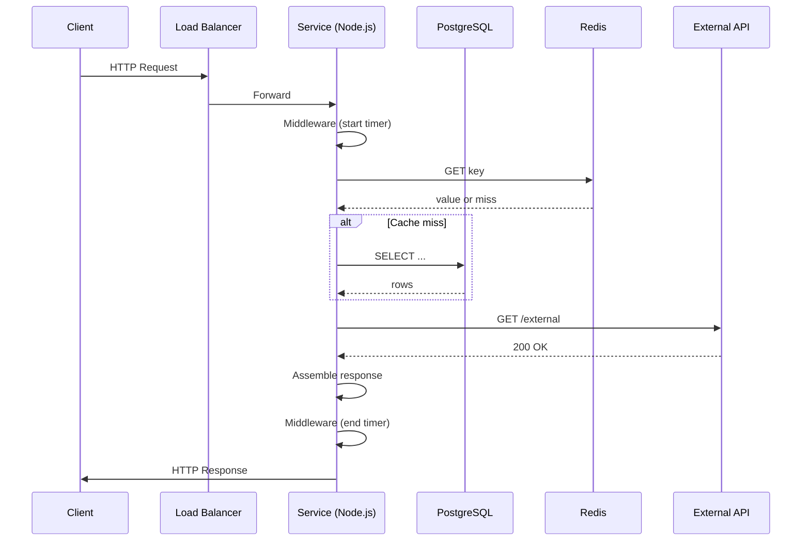

<!-- Generated by Groq via GitHub Actions -->
<!-- Topic ID: T165 -->
<!-- Category: Observability -->
<!-- Generated at UTC: 2026-11-02T22:24:34.562118+00:00 -->

# Request latency

## 1. What problem does this solve?

**Motivation**  
When a client (browser, mobile app, another service) sends an HTTP request, the user expects a response within a reasonable time. If the response takes too long, the user may abandon the action, the client may retry, or downstream services may time out. In a distributed system, latency can compound: a slow database query, a slow cache miss, or a slow external API call can make the whole request sluggish.

**What problem exists**  
- **User experience degradation**: Slow pages or API responses lead to poor UX and churn.  
- **Resource contention**: Long‑running requests tie up server threads or event loop ticks, reducing throughput.  
- **Cost**: Cloud providers bill per request or per compute time; higher latency can increase billable time.  
- **Reliability**: Timeouts can cascade, causing cascading failures or back‑pressure.

**Why the problem matters**  
- **SLAs**: Many services promise 95 % of requests under 200 ms.  
- **Competitive advantage**: Faster services win users.  
- **Operational cost**: More compute time = higher cost.

**What happens if this concept is not used**  
- **Unobserved slow paths**: Without measuring latency, you cannot identify bottlenecks.  
- **Uncontrolled growth**: A slow component can silently grow, causing outages.  
- **Poor scaling**: You may over‑provision resources to compensate for unknown latency.

**Where this concept appears in real backend systems**  
- **Web servers**: Express, Fastify, Next.js API routes.  
- **Microservices**: gRPC, HTTP/REST calls between services.  
- **Databases**: Query latency in PostgreSQL, MongoDB.  
- **Caches**: Redis get/put latency.  
- **Message brokers**: Kafka consumer/producer round‑trip time.  
- **Observability stacks**: OpenTelemetry traces, Prometheus metrics, Grafana dashboards.

---

## 2. Mental model

**Analogy**  
Think of a request as a **delivery order**.  
- The **customer** (client) places an order.  
- The **delivery person** (server) picks up the order, goes to the kitchen (database/cache), prepares it, and returns.  
- **Latency** is the total time from order placement to delivery.  
If the kitchen is slow or the delivery route is congested, the customer waits longer. The same applies to a backend: the request travels through layers (HTTP, middleware, DB, external APIs) and each layer adds time.

**Engineering model**  
- **Latency** = **Processing time** + **Waiting time**.  
  - *Processing time*: CPU, I/O, GC, network stack.  
  - *Waiting time*: Queues, locks, external service response.  
- **Latency distribution**: Not just the average; the tail (e.g., 99th percentile) often matters more than the mean.  
- **Latency budget**: Allocate a fraction of the total SLA to each component (e.g., 50 ms for DB, 30 ms for cache, 20 ms for external API).

---

## 3. Deep explanation

### Internals
- **Event loop**: Node.js handles I/O asynchronously; a long synchronous block blocks the loop, increasing latency.  
- **Thread pool**: libuv’s thread pool handles file I/O, DNS, crypto; heavy use can saturate it.  
- **Database drivers**: Connection pooling, query planning, network round‑trips.  
- **Middleware stack**: Each middleware adds overhead; order matters.  
- **Network stack**: TCP handshake, TLS negotiation, packet loss, congestion control.

### Important terminology
- **Latency**: Time from request arrival to response sent.  
- **Throughput**: Requests per second.  
- **Jitter**: Variability in latency.  
- **Tail latency**: High percentile latency (e.g., 99th).  
- **Latency budget**: Portion of total allowed latency allocated to a component.  
- **Cold start**: First request after deployment or idle period; can be slower.  
- **Back‑pressure**: When a downstream component is slow, upstream must slow down.

### Trade‑offs
| Aspect | Trade‑off |
|--------|-----------|
| **Caching** | Improves latency but adds cache‑miss overhead and consistency complexity. |
| **Parallelism** | Reduces latency but increases resource usage and potential contention. |
| **Synchronous vs async** | Synchronous code is simpler but blocks the event loop; async is non‑blocking but more complex. |
| **Connection pooling** | Reduces latency but consumes more memory. |
| **Batching** | Lowers per‑request latency but may increase overall latency for small payloads. |

### Failure modes
- **Blocking I/O**: `fs.readFileSync` or `await` on a slow DB query.  
- **Unbounded queues**: Too many concurrent requests saturate the thread pool.  
- **External service timeouts**: Not handling timeouts properly leads to hanging requests.  
- **Resource exhaustion**: CPU, memory, or network bandwidth limits cause queuing delays.

### Limitations
- **Network variability**: Even with optimal code, network congestion can cause latency spikes.  
- **Hardware limits**: Disk I/O, memory bandwidth, or CPU core count cap achievable latency.  
- **Observability granularity**: Measuring at the wrong level (e.g., only at the HTTP layer) hides deeper bottlenecks.

### Where this concept fits in a backend architecture
- **Layered stack**: HTTP → Middleware → Business logic → Data access → External APIs.  
- **Observability layer**: Tracing, metrics, logs.  
- **Infrastructure**: Load balancers, reverse proxies, autoscaling groups.  
- **Deployment**: Container orchestration (K8s), serverless functions.

### Interaction with related concepts
- **Throughput**: Lower latency can increase throughput up to a point.  
- **Scalability**: Horizontal scaling can reduce per‑instance latency.  
- **Caching**: Reduces DB latency but introduces cache‑miss penalties.  
- **Circuit breakers**: Prevent cascading latency by short‑circuiting failing services.  
- **Rate limiting**: Protects against spikes that could inflate latency.

---

## 4. How it works

1. **Client sends HTTP request** to the API gateway or load balancer.  
2. **Load balancer forwards** to an instance of the service.  
3. **Node.js event loop** receives the request and passes it through middleware.  
4. **Middleware** may add tracing headers, log start time, or perform auth.  
5. **Business logic** executes, possibly querying PostgreSQL, Redis, or an external API.  
6. **Database driver** obtains a connection from the pool, sends the query, and waits for the response.  
7. **External API call** uses an HTTP client with a timeout; the request is sent over TLS.  
8. **Response** is assembled, middleware may log end time, and the response is sent back to the client.  
9. **Tracing system** records timestamps at each hop, aggregates them, and exposes them via Prometheus or Jaeger.



---

## 5. Practical implementation

### Measuring request latency in an Express app

```ts
// src/middleware/latency.ts
import { Request, Response, NextFunction } from 'express';
import { performance } from 'perf_hooks';

export function latencyMiddleware(req: Request, res: Response, next: NextFunction) {
  const start = performance.now();

  // Capture when the response is finished
  res.on('finish', () => {
    const duration = performance.now() - start;
    // Emit to Prometheus or log
    console.log(`[${req.method}] ${req.originalUrl} took ${duration.toFixed(2)} ms`);
    // Example: record to a Prometheus histogram
    // requestLatencyHistogram.labels(req.method, req.originalUrl).observe(duration);
  });

  next();
}
```

```ts
// src/index.ts
import express from 'express';
import { latencyMiddleware } from './middleware/latency';
import { pool } from './db'; // pg pool
import redisClient from './redis';

const app = express();
app.use(latencyMiddleware);

app.get('/users/:id', async (req, res) => {
  const id = req.params.id;

  // Try cache first
  const cacheKey = `user:${id}`;
  const cached = await redisClient.get(cacheKey);
  if (cached) {
    return res.json(JSON.parse(cached));
  }

  // DB query
  const { rows } = await pool.query('SELECT * FROM users WHERE id = $1', [id]);
  const user = rows[0];

  // Cache result
  await redisClient.set(cacheKey, JSON.stringify(user), 'EX', 60);

  res.json(user);
});

app.listen(3000, () => console.log('Server listening on :3000'));
```

**Key points**

- `performance.now()` gives high‑resolution timestamps.  
- `res.on('finish')` fires after the response is sent, ensuring full request latency.  
- Use a **Prometheus histogram** to capture latency distribution (e.g., 50th, 90th, 99th percentiles).  
- Cache hits are typically < 1 ms; DB queries can be 10–50 ms; external APIs often 100–200 ms.

### Measuring latency of a PostgreSQL query

```ts
import { pool } from './db';
import { performance } from 'perf_hooks';

async function getUser(id: string) {
  const start = performance.now();
  const { rows } = await pool.query('SELECT * FROM users WHERE id = $1', [id]);
  const duration = performance.now() - start;
  console.log(`DB query took ${duration.toFixed(2)} ms`);
  return rows[0];
}
```

### Using OpenTelemetry for distributed tracing

```ts
import { NodeTracerProvider } from '@opentelemetry/sdk-trace-node';
import { SimpleSpanProcessor } from '@opentelemetry/sdk-trace-base';
import { ConsoleSpanExporter } from '@opentelemetry/sdk-trace-base';
import { registerInstrumentations } from '@opentelemetry/instrumentation';
import { HttpInstrumentation } from '@opentelemetry/instrumentation-http';
import { PgInstrumentation } from '@opentelemetry/instrumentation-pg';
import { RedisInstrumentation } from '@opentelemetry/instrumentation-redis';

const provider = new NodeTracerProvider();
provider.addSpanProcessor(new SimpleSpanProcessor(new ConsoleSpanExporter()));
provider.register();

registerInstrumentations({
  tracerProvider: provider,
  instrumentations: [
    HttpInstrumentation,
    PgInstrumentation,
    RedisInstrumentation,
  ],
});
```

Now every HTTP request, DB query, and Redis call is automatically traced, and you can view the latency per hop in Jaeger or Zipkin.

---

## 6. Production considerations

| Concern | What to do |
|---------|------------|
| **Scalability** | Use connection pools, async I/O, and horizontal scaling. Keep latency budgets per component. |
| **Reliability** | Set timeouts on external calls, use circuit breakers (e.g., `opossum`), and retry with back‑off. |
| **Security** | Avoid exposing internal latency metrics to clients; use authentication for metrics endpoints. |
| **Observability** | Emit Prometheus metrics (histograms), OpenTelemetry traces, and logs with timestamps. |
| **Performance** | Profile hot paths with `clinic.js` or `node --inspect`. Avoid synchronous I/O. |
| **Error handling** | Return proper HTTP status codes; log errors with context. |
| **Resource usage** | Monitor CPU, memory, and thread pool usage; adjust pool sizes. |
| **Operational concerns** | Use health checks that include latency thresholds. |
| **Failure recovery** | Auto‑restart containers, use graceful shutdown to finish in‑flight requests. |
| **Deployment** | Use blue/green or canary deployments to monitor latency changes before full rollout. |

---

## 7. Common mistakes

| Mistake | Why it’s problematic |
|---------|----------------------|
| **Measuring only the HTTP layer** | Misses latency in DB, cache, or external APIs. |
| **Using `console.log` for latency** | Adds I/O overhead and pollutes logs; use structured metrics. |
| **Blocking the event loop** | `fs.readFileSync`, `await` on slow DB queries without pooling. |
| **Ignoring tail latency** | Focusing on mean latency hides rare but costly slow requests. |
| **Hard‑coding timeouts** | Too short → false positives; too long → wasted resources. |
| **Not using connection pooling** | Creates new connections per request → high latency and resource waste. |
| **Over‑caching** | Cache stale data or cache everything, leading to memory pressure. |
| **Not handling retries** | A single transient failure can block the entire request chain. |

---

## 8. Senior engineer perspective

### What changes at scale
- **Distributed tracing** becomes essential to pinpoint latency sources across services.  
- **Latency budgets** are formalized; each microservice owns a portion of the overall SLA.  
- **Observability stack** (Prometheus + Grafana + Jaeger) is deployed in a highly available cluster.  
- **Auto‑scaling** is configured based on latency metrics, not just CPU.  
- **Service meshes** (Istio, Linkerd) provide built‑in retries, timeouts, and circuit breakers.

### Design decisions
| Decision | Trade‑off |
|----------|-----------|
| **Use a dedicated latency monitoring service** | Adds operational overhead but gives deep insight. |
| **Batch DB writes** | Reduces per‑request latency but can increase latency for read‑heavy workloads. |
| **Cache invalidation strategy** | Strict consistency → higher latency; eventual consistency → lower latency. |
| **Synchronous vs asynchronous processing** | Synchronous keeps code simple but can block; async improves throughput but increases complexity. |
| **Circuit breaker thresholds** | Low thresholds protect downstream services but may cause false positives. |
| **Deployment strategy** | Canary releases reduce risk but require sophisticated monitoring. |

### Bottlenecks to watch
- **Thread pool saturation** (libuv).  
- **Database connection exhaustion**.  
- **Network congestion** (e.g., VPC peering limits).  
- **Cache eviction** leading to frequent misses.

### Monitoring
- **Latency histograms** per endpoint.  
- **95th/99th percentile alerts**.  
- **Service‑level latency dashboards**.  
- **Correlation IDs** for end‑to‑end tracing.

### When NOT to use the approach
- **Very small services** where the overhead of tracing outweighs benefits.  
- **High‑frequency, low‑latency micro‑tasks** (e.g., IoT ingestion) where a lightweight approach is preferable.  
- **Legacy monoliths** where refactoring to distributed tracing is impractical.

---

## 9. Interview questions

1. **Beginner**: *What is request latency and why is it important?*  
   *Answer*: Latency is the time from request arrival to response sent. It affects user experience, throughput, and cost; high latency can lead to timeouts and poor SLAs.

2. **Intermediate**: *How would you measure the latency of a database query in Node.js?*  
   *Answer*: Use `performance.now()` before and after `await pool.query(...)`, compute the difference, and record it in a histogram or log it.

3. **Senior**: *Explain how you would design a latency budget for a microservice that calls two external APIs and a database.*  
   *Answer*: Allocate total SLA (e.g., 200 ms) across components: 50 ms for DB, 70 ms for API A, 70 ms for API B, leaving 10 ms for overhead. Use monitoring to enforce each budget and trigger alerts if any component exceeds its share.

4. **Senior**: *Describe a scenario where tail latency becomes a problem and how you would mitigate it.*  
   *Answer*: In a payment service, 1 % of requests take 5 s due to a slow DB index. Mitigation: add a cache, optimize the query, use read replicas, or implement a circuit breaker to return a fallback.

5. **Scenario/Debugging**: *You notice that the 99th percentile latency of your `/orders` endpoint has spiked from 120 ms to 450 ms after a recent deployment. What steps would you take to diagnose and fix the issue?*  
   *Answer*:  
   - Check the deployment logs for errors or new code paths.  
   - Enable distributed tracing to see which hop is slow.  
   - Inspect database query plans; look for missing indexes.  
   - Verify cache hit rates; a cache miss could be the culprit.  
   - Check external API latency; add timeouts or retries.  
   - If a new feature introduced synchronous I/O, refactor to async.  
   - Roll back if the issue cannot be resolved quickly.

---

## 10. Hands‑on task

**Goal**: Add request latency monitoring to an existing Express API.

1. Create a middleware that records the start time and logs the duration when the response finishes.  
2. Expose a `/metrics` endpoint that serves Prometheus metrics, including a histogram for request latency.  
3. Write a simple test (e.g., using `axios`) that sends 100 concurrent requests to a slow endpoint (e.g., one that sleeps for 200 ms).  
4. Verify that the histogram shows the correct distribution and that the 95th percentile is close to 200 ms.

*Hints*: Use `prom-client` for metrics, `async/await` for the sleep endpoint, and `Promise.all` for concurrency.

---

## 11. Quick revision

- Latency = processing time + waiting time.  
- Tail latency (99th percentile) often matters more than mean.  
- Use `performance.now()` or `process.hrtime()` for high‑resolution timing.  
- Middleware `res.on('finish')` captures full request latency.  
- Prometheus histograms capture latency distribution.  
- OpenTelemetry auto‑traces HTTP, DB, and Redis calls.  
- Timeouts, circuit breakers, and retries mitigate external latency.  
- Connection pools reduce DB latency and resource usage.  
- Cache hits are ~1 ms; DB queries 10–50 ms; external APIs 100–200 ms.  
- Avoid blocking I/O; keep event loop free.  
- Monitor 95th/99th percentile; alert on spikes.  
- At scale, formal latency budgets and distributed tracing are essential.

---

## 12. References

- [Node.js Performance Hooks](https://nodejs.org/api/perf_hooks.html)  
- [Express.js Middleware](https://expressjs.com/en/guide/writing-middleware.html)  
- [Prometheus Client for Node.js](https://github.com/siimon/prom-client)  
- [OpenTelemetry Node.js](https://opentelemetry.io/docs/instrumentation/node/)  
- [PostgreSQL Connection Pooling](https://node-postgres.com/features/pooling)  
- [Redis Node.js Client](https://github.com/redis/node-redis)  
- [Jaeger Tracing](https://www.jaegertracing.io/docs/1.21/)  
- [Istio Service Mesh](https://istio.io/latest/docs/)  

---
