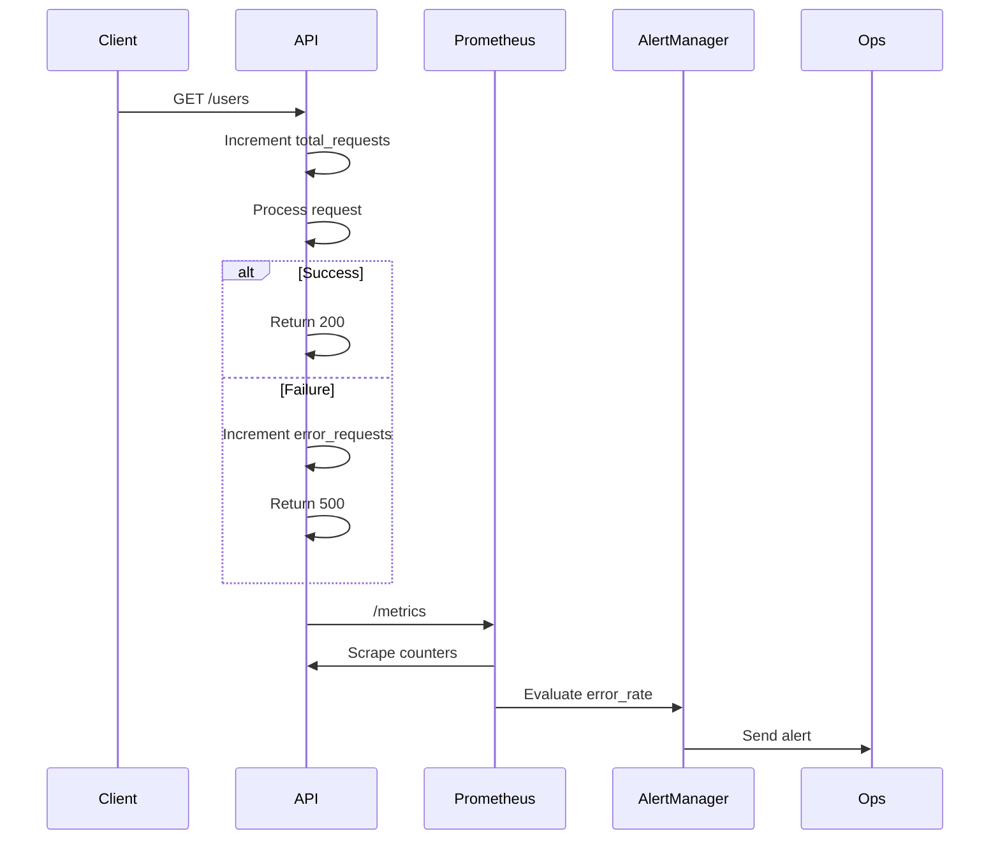

<!-- Generated by Groq via GitHub Actions -->
<!-- Topic ID: T166 -->
<!-- Category: Observability -->
<!-- Generated at UTC: 2026-11-02T22:24:34.562118+00:00 -->

# Error rate

## 1. What problem does this solve?

**Motivation**  
In a production backend, you rarely get a single error. Instead you see a *rate* of failures—HTTP 5xx, database timeouts, message queue rejections, etc. Knowing the *error rate* lets you:

- Detect anomalies before users notice.
- Trigger alerts that a service is degrading.
- Correlate spikes with deployments, traffic changes, or external dependencies.
- Prioritize debugging effort where it matters most.

**What problem exists**  
Without a quantitative view of failures, you rely on logs or manual checks. This is slow, error‑prone, and often misses subtle patterns (e.g., a 1 % error rate that grows over time).

**Why the problem matters**  
A small, sustained error rate can erode user trust, violate SLAs, and lead to cascading failures in distributed systems. It also inflates support tickets and can hide deeper infrastructure issues.

**What happens if this concept is not used**  
- Silent degradation: users experience intermittent failures without any alert.
- Late detection: incidents are discovered only after a major outage.
- Poor capacity planning: you cannot correlate error spikes with load.

**Where this concept appears in real backend systems**  
- API gateways (e.g., Kong, Envoy) expose error‑rate metrics.
- Service meshes (Istio, Linkerd) aggregate per‑service error rates.
- Monitoring stacks (Prometheus + Grafana, Datadog, New Relic) expose `http_requests_total{status=~"5.."} / http_requests_total` as a metric.
- CI/CD pipelines use error‑rate thresholds to gate deployments.

---

## 2. Mental model

**Analogy**  
Think of a factory line that produces widgets. Each widget is a request. The *error rate* is the proportion of widgets that are defective. If the defect rate rises, you know something is wrong with the machinery or the raw materials.

**Engineering model**  
- **Metric**: `error_rate = (number_of_errors / total_requests) * 100%`
- **Window**: compute over a sliding window (e.g., last 5 min) to smooth short‑term noise.
- **Alerting**: trigger when `error_rate` exceeds a threshold (e.g., 2 %) for a sustained period.

---

## 3. Deep explanation

### Internals
- **Instrumentation**: intercept request/response lifecycle (middleware, decorators, or instrumentation libraries).
- **Counting**: increment counters for total requests and for failures (HTTP status ≥ 500, exceptions, timeouts).
- **Aggregation**: push counters to a time‑series database (Prometheus, InfluxDB) or a distributed log (Kafka).

### Important terminology
| Term | Meaning |
|------|---------|
| **Error** | Any response that indicates a failure (HTTP 5xx, exception, timeout). |
| **Error rate** | Ratio of error responses to total responses over a period. |
| **Rolling window** | Sliding time window over which the metric is calculated. |
| **Alert threshold** | Predefined error‑rate value that triggers an alert. |
| **SLO/SLA** | Service Level Objective/Agreement that may include an error‑rate target. |

### Trade‑offs
| Aspect | Trade‑off |
|--------|-----------|
| **Granularity** | Finer granularity (per‑endpoint) gives more insight but increases metric cardinality and storage cost. |
| **Window size** | Short windows detect spikes quickly but are noisy; long windows smooth noise but delay detection. |
| **Instrumentation overhead** | Adding counters to every request adds minimal CPU/memory cost, but too many metrics can overwhelm the monitoring system. |

### Failure modes
- **Metric leakage**: if counters are not reset correctly, error counts can accumulate incorrectly.
- **Mis‑classification**: treating 4xx as errors inflates the rate; ignoring 5xx can hide problems.
- **Clock drift**: distributed services with unsynced clocks can produce inconsistent timestamps.

### Limitations
- **Does not reveal root cause**: a high error rate tells you *something* is wrong, not *what*.
- **Threshold tuning**: setting thresholds too low triggers noise; too high misses issues.
- **Non‑HTTP errors**: database deadlocks or message queue failures may not be captured by HTTP metrics alone.

### Where this concept fits in a backend architecture
- **API layer**: middleware captures request counts.
- **Service layer**: internal calls (gRPC, REST) also instrumented.
- **Infrastructure layer**: load balancers, proxies, and message brokers expose error metrics.
- **Observability stack**: metrics are collected, stored, visualized, and alerted on.

### Interaction with related concepts
- **Latency**: high latency often precedes errors; correlating both gives better diagnostics.
- **Throughput**: a drop in throughput combined with a spike in error rate indicates a bottleneck.
- **Health checks**: error‑rate thresholds can be used as a health‑check metric for service discovery.

---

## 4. How it works

1. **Request enters the server** – middleware records a `total_requests` increment.
2. **Processing occurs** – if an exception is thrown or a 5xx status is set, an `error_requests` counter is incremented.
3. **Counters are exported** – via an `/metrics` endpoint (Prometheus) or pushed to a collector.
4. **Prometheus scrapes** – aggregates counters over the last `N` seconds.
5. **Error rate calculation** – `error_rate = (error_requests / total_requests) * 100`.
6. **Alerting** – if `error_rate` > threshold for `M` minutes, trigger an alert.



---

## 5. Practical implementation

### TypeScript / Node.js (Express)

```ts
// src/middleware/errorRate.ts
import { Request, Response, NextFunction } from 'express';
import client from 'prom-client';

const totalRequests = new client.Counter({
  name: 'http_requests_total',
  help: 'Total number of HTTP requests',
  labelNames: ['method', 'route'],
});

const errorRequests = new client.Counter({
  name: 'http_requests_errors_total',
  help: 'Total number of HTTP error responses (5xx)',
  labelNames: ['method', 'route'],
});

export function errorRateMiddleware(req: Request, res: Response, next: NextFunction) {
  const labels = { method: req.method, route: req.route?.path ?? req.path };
  totalRequests.inc(labels);

  // Capture status code after response finishes
  res.on('finish', () => {
    if (res.statusCode >= 500) {
      errorRequests.inc(labels);
    }
  });

  next();
}
```

```ts
// src/app.ts
import express from 'express';
import { errorRateMiddleware } from './middleware/errorRate';
import client from 'prom-client';

const app = express();

// expose /metrics endpoint for Prometheus
app.get('/metrics', async (_req, res) => {
  res.set('Content-Type', client.register.contentType);
  res.end(await client.register.metrics());
});

app.use(errorRateMiddleware);

// Example route
app.get('/users', async (req, res) => {
  // Simulate occasional failure
  if (Math.random() < 0.05) {
    res.status(500).send('Internal error');
  } else {
    res.json({ users: [] });
  }
});

app.listen(3000, () => console.log('Server listening on :3000'));
```

**Running locally**

```bash
npm install express prom-client
node src/app.ts
```

Prometheus can scrape `http://localhost:3000/metrics`.  
Grafana can display `http_requests_errors_total / http_requests_total * 100`.

### Python / FastAPI (optional)

```python
# metrics.py
from prometheus_client import Counter, start_http_server

total_requests = Counter('http_requests_total', 'Total requests', ['method', 'route'])
error_requests = Counter('http_requests_errors_total', 'Total error requests', ['method', 'route'])

start_http_server(8001)  # expose /metrics on port 8001
```

```python
# main.py
from fastapi import FastAPI, Request, Response, HTTPException
from metrics import total_requests, error_requests

app = FastAPI()

@app.middleware("http")
async def error_rate_middleware(request: Request, call_next):
    total_requests.labels(request.method, request.url.path).inc()
    try:
        response = await call_next(request)
    except Exception:
        error_requests.labels(request.method, request.url.path).inc()
        raise
    if response.status_code >= 500:
        error_requests.labels(request.method, request.url.path).inc()
    return response
```

---

## 6. Production considerations

| Concern | What to watch for |
|---------|-------------------|
| **Scalability** | Use a shared metrics endpoint or push gateway; avoid per‑instance heavy counters that exceed Prometheus limits. |
| **Reliability** | Ensure counters are atomic (Prometheus client libraries are thread‑safe). |
| **Security** | `/metrics` should be protected (basic auth, network ACLs) to prevent leaking internal state. |
| **Observability** | Combine error‑rate with latency and throughput dashboards. |
| **Performance** | Counter increments are cheap; avoid heavy serialization in middleware. |
| **Error handling** | Log detailed stack traces for 5xx; keep counters lightweight. |
| **Resource usage** | Keep metric cardinality low; avoid labeling by user ID or request body. |
| **Operational concerns** | Set alert thresholds that balance noise vs. missed incidents. |
| **Failure recovery** | Use circuit breakers if error rate spikes to prevent cascading failures. |
| **Deployment** | Incrementally roll out instrumentation; validate metrics before promotion. |

---

## 7. Common mistakes

| Mistake | Why it’s problematic |
|---------|----------------------|
| **Counting only HTTP 5xx** | Ignores application‑level errors that return 200 but contain failure payloads. |
| **Using a static window** | A 5‑minute window may miss short bursts; a 1‑hour window may delay alerts. |
| **High cardinality labels** | Labeling by user ID or request payload inflates storage and slows queries. |
| **Not resetting counters** | Prometheus counters are cumulative; mis‑resetting can produce negative rates. |
| **Alerting on absolute error count** | A single 500 in a low‑traffic service triggers an alert; use rate instead. |
| **Ignoring 4xx errors** | Some services treat 4xx as user errors; including them can skew the metric. |
| **Not correlating with latency** | A high error rate with low latency may indicate data corruption rather than overload. |

---

## 8. Senior engineer perspective

### What changes at scale
- **Metric cardinality**: per‑endpoint counters become thousands of series; need to aggregate or drop low‑volume labels.
- **Distributed tracing**: link error‑rate spikes to specific service calls via OpenTelemetry traces.
- **Alert fatigue**: use anomaly detection (e.g., Prometheus `rate()` + `increase()`) instead of fixed thresholds.
- **Cost**: storing millions of time‑series can be expensive; consider downsampling or remote write.
- **Reliability**: a single point of failure in the metrics exporter can hide errors; use sidecar or push gateway.

### Design decisions
- **Instrumentation granularity**: decide between per‑service vs. per‑endpoint metrics.
- **Aggregation strategy**: use `histogram` or `summary` for latency; combine with error counters.
- **Alerting model**: use `alertmanager` with `for` clauses to avoid flapping.
- **Observability stack**: choose between Prometheus + Grafana vs. managed services (Datadog, New Relic).
- **Security**: expose metrics only to internal networks; use mutual TLS if needed.
- **Deployment**: containerize metrics exporter; use sidecar pattern for legacy services.

### When NOT to use
- **Very low‑traffic services**: a simple log‑based alert may suffice.
- **Stateless micro‑services**: if you already have a global error‑rate monitor, per‑service counters add noise.
- **Legacy monoliths**: instrumenting every request may be too costly; start with critical endpoints.

---

## 9. Interview questions

1. **Beginner**: *What is an error rate and why is it useful?*  
   *Answer*: Ratio of failed requests to total requests; helps detect service degradation early.

2. **Beginner**: *How would you expose error‑rate metrics in an Express app?*  
   *Answer*: Use middleware to increment counters, expose `/metrics` endpoint for Prometheus.

3. **Senior**: *Explain how you would design an error‑rate monitoring system for a fleet of 1,000 micro‑services.*  
   *Answer*: Use a shared Prometheus server with remote write, aggregate per‑service metrics, apply label cardinality limits, use alertmanager with anomaly detection, integrate with tracing.

4. **Senior**: *What trade‑offs arise when choosing a sliding window size for error‑rate calculation?*  
   *Answer*: Short windows detect spikes quickly but are noisy; long windows smooth noise but delay alerts; choose based on SLA tolerance and traffic patterns.

5. **Scenario/Debugging**: *A new deployment causes a 3 % error rate for 2 minutes, then it drops to 0.5 %. What steps would you take to investigate?*  
   *Answer*:  
   - Check deployment logs for failures.  
   - Correlate with latency and throughput.  
   - Look at recent code changes, config changes, or external dependency updates.  
   - Use distributed tracing to pinpoint failing service.  
   - Verify metrics labeling to ensure correct aggregation.  
   - If the spike is benign, adjust alert thresholds; otherwise, roll back or patch.

---

## 10. Hands‑on task

**Task**: Add error‑rate monitoring to the existing `next-auth` API in the repository.

1. Create a middleware that counts total and error requests per route.  
2. Expose a `/metrics` endpoint that Prometheus can scrape.  
3. Configure Prometheus (or use `prom-client`’s built‑in HTTP server) to collect the metrics.  
4. Write a Grafana dashboard that shows the error rate per route over the last 15 minutes.  
5. Set an alert that triggers when any route’s error rate exceeds 1 % for 5 minutes.

*Deliverable*: Commit the middleware, metrics endpoint, and a `docker-compose.yml` that runs Prometheus, Grafana, and your app.

---

## 11. Quick revision

- Error rate = (errors / total requests) × 100 %.  
- Instrument via middleware or decorators.  
- Use Prometheus counters (`http_requests_total`, `http_requests_errors_total`).  
- Compute rate with `rate()` or `increase()` over a sliding window.  
- Avoid high‑cardinality labels; aggregate by service/endpoint.  
- Alert on sustained spikes, not single incidents.  
- Combine with latency and throughput for root‑cause analysis.  
- Protect `/metrics` endpoint; secure with network policies.  
- Scale by aggregating metrics, using remote write, and downsampling.  
- Use tracing to correlate errors with upstream calls.  
- Tune window size and thresholds based on SLA and traffic patterns.  
- Remember: error rate tells *that* something is wrong, not *why*.

---

## 12. References

- Prometheus documentation – [https://prometheus.io/docs/introduction/overview/](https://prometheus.io/docs/introduction/overview/)  
- Prometheus client for Node.js – [https://github.com/siimon/prom-client](https://github.com/siimon/prom-client)  
- Express middleware guide – [https://expressjs.com/en/guide/writing-middleware.html](https://expressjs.com/en/guide/writing-middleware.html)  
- FastAPI middleware – [https://fastapi.tiangolo.com/tutorial/middleware/](https://fastapi.tiangolo.com/tutorial/middleware/)  
- OpenTelemetry for Node.js – [https://opentelemetry.io/docs/instrumentation/node/](https://opentelemetry.io/docs/instrumentation/node/)  
- Grafana dashboards – [https://grafana.com/grafana/dashboards](https://grafana.com/grafana/dashboards)  
- Alertmanager – [https://prometheus.io/docs/alerting/latest/alertmanager/](https://prometheus.io/docs/alerting/latest/alertmanager/)  
- Next.js API routes – [https://nextjs.org/docs/api-routes/introduction](https://nextjs.org/docs/api-routes/introduction)
