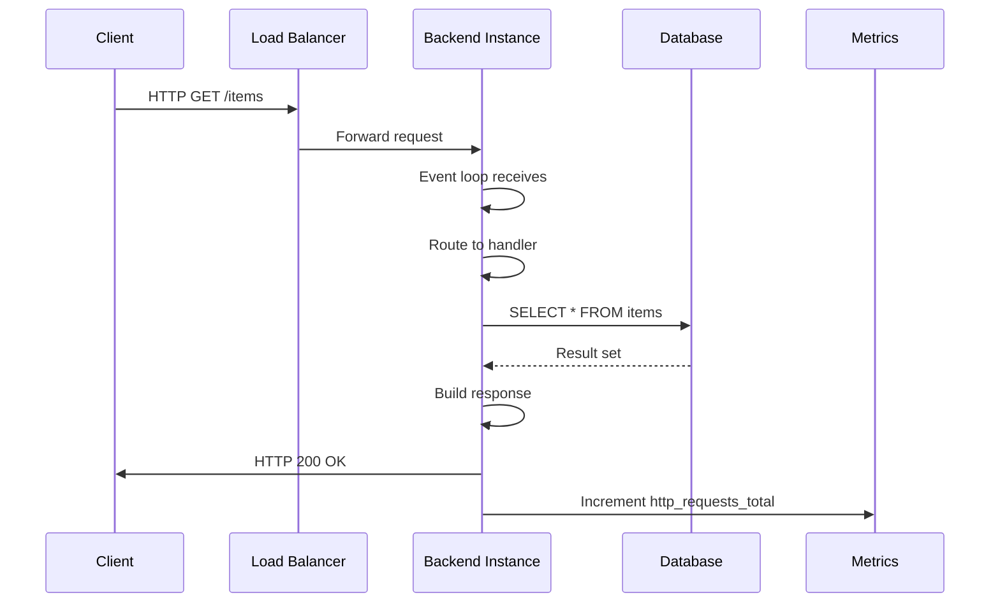

<!-- Generated by Groq via GitHub Actions -->
<!-- Topic ID: T167 -->
<!-- Category: Observability -->
<!-- Generated at UTC: 2026-11-03T08:08:22.766343+00:00 -->

# Throughput

## 1. What problem does this solve?

**Motivation**  
When a backend receives traffic, it must finish each request fast enough that the overall system can keep up with the incoming load. *Throughput* is the number of requests (or operations) a system can process per unit time (usually per second). It tells you how many users can be served simultaneously before latency starts to climb.

**What problem exists**  
- Users experience slow responses or timeouts when the system is overloaded.  
- Resources (CPU, memory, DB connections) are exhausted, causing crashes or degraded performance.  
- Business metrics (e.g., revenue, engagement) suffer if the service cannot handle peak traffic.

**Why the problem matters**  
- Poor throughput leads to lost revenue, bad user experience, and higher support costs.  
- It forces you to over‑provision hardware or add more services, inflating operational costs.  
- In regulated industries, failing to meet throughput guarantees can violate SLAs or compliance requirements.

**What happens if this concept is not used**  
- You may deploy a system that works fine in dev but collapses under real load.  
- Without throughput measurement, you cannot prove that scaling decisions are effective.  
- You risk hidden bottlenecks (e.g., a single slow DB query) that only appear under load.

**Where this concept appears in real backend systems**  
- Web servers (NGINX, Express, FastAPI) expose requests per second.  
- Message brokers (Kafka, RabbitMQ) report messages per second.  
- Databases expose queries per second or transactions per second.  
- API gateways and load balancers use throughput to decide scaling policies.

---

## 2. Mental model

**Analogy – Highway traffic**  
Imagine a highway with cars (requests) traveling from one city to another.  
- **Throughput** is the number of cars that can pass a checkpoint per minute.  
- If the highway is narrow (single lane) or has a traffic light (blocking operation), cars pile up and the flow slows.  
- Adding more lanes (horizontal scaling) or better traffic lights (async I/O, caching) increases throughput.

**Engineering model**  
- **Requests** → **Processing pipeline** (routing → business logic → I/O) → **Response**.  
- Throughput = *Number of requests completed per second*.  
- It depends on the slowest stage (bottleneck) and the concurrency model of the runtime.

---

## 3. Deep explanation

### Internals
- **Event loop & async I/O**: Node.js processes many requests concurrently by offloading I/O to the OS.  
- **Thread pools**: CPU‑bound tasks (e.g., crypto, compression) use libuv’s thread pool.  
- **Connection pools**: DB clients reuse connections to avoid handshake overhead.  
- **Backpressure**: Streams and queues can signal when they’re full, preventing overload.  
- **Load balancers**: Distribute traffic across instances, balancing throughput.

### Important terminology
| Term | Meaning |
|------|---------|
| **Throughput** | Requests/operations per second. |
| **Latency** | Time from request arrival to response sent. |
| **Concurrency** | Number of requests being processed simultaneously. |
| **Parallelism** | Number of CPU cores or threads executing work. |
| **Bottleneck** | The stage that limits overall throughput. |
| **Backpressure** | Mechanism to slow producers when consumers are busy. |
| **Rate limiting** | Throttling requests to protect downstream services. |

### Trade‑offs
| Aspect | Trade‑off |
|--------|-----------|
| **Concurrency vs. Latency** | More concurrent requests can increase throughput but may raise latency if resources are oversubscribed. |
| **Thread pool size** | Larger pool → more parallel CPU work but higher memory usage and context switching. |
| **Caching** | Improves throughput but adds consistency complexity. |
| **Horizontal scaling** | Adds capacity but increases operational complexity and cost. |

### Failure modes
- **Blocking code** (e.g., synchronous file read) stalls the event loop, dropping throughput.  
- **Unbounded queues** cause memory exhaustion.  
- **Connection leaks** in DB pools lead to exhaustion and request failures.  
- **Race conditions** in shared state can corrupt data under high concurrency.

### Limitations
- Throughput is *not* a guarantee; it’s a measurable metric that can fluctuate.  
- High throughput may mask poor latency or error rates.  
- Measuring throughput requires realistic load patterns; synthetic tests can be misleading.

### Where it fits in a backend architecture
- **API Gateway** → **Load Balancer** → **Service Instances** → **Databases / Cache**.  
- Throughput is measured at each hop to identify bottlenecks.  
- It informs auto‑scaling policies, capacity planning, and SLA definitions.

### Interaction with related concepts
- **Observability**: Metrics (e.g., `http_requests_total`) and traces help correlate throughput with latency.  
- **Reliability**: Circuit breakers prevent cascading failures when downstream throughput drops.  
- **Security**: Rate limiting protects against DoS attacks that would otherwise degrade throughput.  
- **Performance**: Profiling identifies CPU‑bound vs. I/O‑bound paths that limit throughput.

---

## 4. How it works

1. **Client sends HTTP request** →  
2. **Load balancer forwards** to a backend instance →  
3. **Event loop receives** the request →  
4. **Routing middleware** dispatches to handler →  
5. **Handler performs async I/O** (DB query, external API) →  
6. **I/O completes** → callback or promise resolves →  
7. **Response is sent** back to client →  
8. **Metrics collector** records request count and latency.



---

## 5. Practical implementation

### 5.1 Measuring throughput in Node.js

```ts
// src/server.ts
import express from 'express';
import { performance } from 'perf_hooks';
import { Pool } from 'pg';

const app = express();
const pool = new Pool({
  connectionString: process.env.DATABASE_URL,
  max: 20, // connection pool size
});

let totalRequests = 0;
let startTime = performance.now();

app.get('/items', async (req, res) => {
  const client = await pool.connect();
  try {
    const { rows } = await client.query('SELECT * FROM items LIMIT 10');
    res.json(rows);
  } finally {
    client.release();
  }
  totalRequests += 1;
});

app.listen(3000, () => {
  console.log('Server listening on :3000');
  // Periodically log throughput
  setInterval(() => {
    const now = performance.now();
    const elapsed = (now - startTime) / 1000; // seconds
    console.log(`Throughput: ${(totalRequests / elapsed).toFixed(2)} req/s`);
  }, 5000);
});
```

**Key lines**

- `Pool` with `max` limits DB connections, preventing exhaustion.  
- `totalRequests` and `performance.now()` give a simple throughput counter.  
- The interval logs throughput every 5 s.

### 5.2 Load testing with `autocannon`

```bash
npx autocannon -c 100 -d 30 http://localhost:3000/items
```

- `-c 100` – 100 concurrent connections.  
- `-d 30` – run for 30 s.  
- The output shows *requests per second* and *average latency*.

### 5.3 Improving throughput

1. **Use async/await** to avoid blocking the event loop.  
2. **Increase DB pool size** if queries are I/O‑bound.  
3. **Add Redis cache** for hot data to reduce DB load.  
4. **Cluster** the Node.js process to use all CPU cores:

```ts
// src/cluster.ts
import cluster from 'cluster';
import os from 'os';
import { spawn } from 'child_process';

if (cluster.isPrimary) {
  const cpuCount = os.cpus().length;
  console.log(`Master ${process.pid} is running`);
  for (let i = 0; i < cpuCount; i++) {
    cluster.fork();
  }
  cluster.on('exit', (worker) => {
    console.log(`Worker ${worker.process.pid} died, restarting`);
    cluster.fork();
  });
} else {
  require('./server'); // start the server in the worker
}
```

Run with `node cluster.js`.  
Each worker runs its own event loop, increasing overall throughput.

---

## 6. Production considerations

| Concern | How throughput impacts it | Mitigation |
|---------|---------------------------|------------|
| **Scalability** | Higher throughput requires more instances or better hardware. | Auto‑scaling groups, load balancers, horizontal scaling. |
| **Reliability** | Overload can cause cascading failures. | Circuit breakers, graceful degradation, backpressure. |
| **Security** | DoS attacks can flood the system, reducing throughput for legitimate users. | Rate limiting, WAF, IP blacklisting. |
| **Observability** | Need to correlate throughput with latency & errors. | Prometheus metrics (`http_requests_total`, `http_request_duration_seconds`), distributed tracing. |
| **Performance** | CPU, memory, and I/O limits bound throughput. | Profiling, connection pooling, efficient algorithms. |
| **Error handling** | Unhandled rejections can stall the event loop. | Global error handlers, `process.on('unhandledRejection')`. |
| **Resource usage** | Too many concurrent DB connections waste memory. | Tune pool size, use connection pooling. |
| **Operational concerns** | Monitoring throughput trends helps spot capacity issues. | Dashboards, alerts on throughput dips. |
| **Failure recovery** | If throughput drops, need to detect and recover quickly. | Health checks, auto‑restart, graceful shutdown. |
| **Deployment** | Rolling updates must not drop throughput. | Blue/green deployments, canary releases. |

---

## 7. Common mistakes

| Mistake | Why it’s problematic |
|---------|----------------------|
| **Blocking synchronous code** (e.g., `fs.readFileSync`) | Stalls the event loop, throttling all requests. |
| **No connection pooling** | Each request opens a new DB connection → high latency, exhaustion. |
| **Ignoring backpressure** | Unbounded queues consume memory, leading to OOM. |
| **Over‑optimistic concurrency** | Setting `maxConcurrentRequests` too high → resource contention. |
| **Not measuring** | Assuming code is fast without metrics leads to hidden bottlenecks. |
| **Using a single thread for CPU work** | CPU‑bound tasks block the event loop. |
| **Hard‑coding limits** | Fixed concurrency limits don’t adapt to load changes. |
| **Skipping caching** | Re‑querying expensive data on every request reduces throughput. |

---

## 8. Senior engineer perspective

### What changes at scale?
- **Architectural decisions**: microservices vs. monolith, event‑driven vs. request‑response.  
- **Bottleneck identification**: use distributed tracing to pinpoint slow services.  
- **Capacity planning**: model throughput per instance, then compute required instances for peak load.  
- **Cost vs. performance**: sometimes a slightly lower throughput is acceptable if it reduces cloud spend.  
- **Resilience patterns**: circuit breakers, bulkheads, retries, and graceful degradation become essential.  
- **Observability depth**: metrics, logs, and traces must be correlated across services.

### Design decisions a senior engineer would consider

| Decision | Trade‑offs | Bottlenecks | Monitoring |
|----------|------------|-------------|------------|
| **Horizontal scaling vs. vertical scaling** | Cost, complexity | Network latency, consistency | Instance count, CPU/Memory usage |
| **Cache strategy** | Consistency vs. freshness | Cache misses, invalidation | Cache hit/miss ratios |
| **Database sharding** | Complexity, cross‑shard joins | Shard imbalance | Query latency per shard |
| **Message queue vs. direct HTTP** | Decoupling vs. latency | Queue backlog | Queue depth, consumer lag |
| **Rate limiting** | Protects downstream vs. user experience | Over‑aggressive limits | Request per second per IP |
| **Use of async workers** | Parallelism vs. memory | Worker starvation | Worker queue length |

### When NOT to use throughput‑centric optimizations
- For **low‑traffic, latency‑critical** services where a single request must finish quickly.  
- When **data consistency** is paramount and caching would introduce staleness.  
- In **short‑lived scripts** where the overhead of pooling or clustering outweighs benefits.

---

## 9. Interview questions

| Level | Question | Answer points |
|-------|----------|---------------|
| Beginner | What is throughput in a backend system? | Number of requests processed per second; differs from latency. |
| Beginner | Why is connection pooling important for throughput? | Reduces connection handshake overhead; limits resource exhaustion. |
| Senior | How would you design a system to handle 10k requests per second while keeping latency under 200 ms? | Horizontal scaling, load balancer, async I/O, caching, connection pools, profiling, auto‑scaling, observability. |
| Senior | Explain how backpressure works in Node.js streams and why it matters for throughput. | Streams signal `pause`/`resume`; prevents memory blowup; ensures producers don’t overwhelm consumers. |
| Scenario | A production API shows high throughput but users report high latency. What steps would you take to debug? | Check slowest stage via tracing; inspect DB query plans; look for blocking code; evaluate connection pool size; monitor GC pauses; analyze load balancer logs. |

---

## 10. Hands‑on task

**Goal**: Build a simple REST endpoint that retrieves items from PostgreSQL, cache hot items in Redis, and measure throughput before and after caching.

1. **Setup**  
   - Spin up PostgreSQL and Redis containers (Docker Compose).  
   - Create a table `items` with 1 M rows.  
2. **Implement**  
   - Express server with `/items/:id`.  
   - First version: direct DB query.  
   - Second version: check Redis cache first, fallback to DB, then cache result.  
3. **Measure**  
   - Use `autocannon` to benchmark both versions.  
   - Record throughput and latency.  
4. **Analyze**  
   - Compare results.  
   - Identify which stage was the bottleneck.  
5. **Optional**  
   - Add clustering to see scaling effect.  
   - Add Prometheus metrics to visualize throughput over time.

---

## 11. Quick revision

- Throughput = requests/operations per second; distinct from latency.  
- Bottleneck determines overall throughput.  
- Async I/O and connection pooling are key to high throughput.  
- Blocking code stalls the event loop → throughput drop.  
- Caching reduces I/O load, boosting throughput.  
- Backpressure prevents memory exhaustion under high concurrency.  
- Load balancers and horizontal scaling increase capacity.  
- Observability (metrics, traces) is essential to identify bottlenecks.  
- Rate limiting protects throughput from abuse.  
- Profiling and benchmarking guide optimization decisions.

---

## 12. References

- [Node.js Event Loop](https://nodejs.org/en/docs/guides/event-loop-timers-and-nexttick/)  
- [Node.js libuv Thread Pool](https://nodejs.org/api/worker_threads.html)  
- [Express.js Documentation](https://expressjs.com/)  
- [pg – PostgreSQL client for Node.js](https://node-postgres.com/)  
- [Redis Node.js Client](https://github.com/redis/node-redis)  
- [Prometheus Node Exporter](https://prometheus.io/docs/instrumenting/node_exporter/)  
- [Autocannon Load Testing Tool](https://github.com/mcollina/autocannon)  
- [OpenTelemetry for Node.js](https://opentelemetry.io/docs/instrumentation/node/)  
- [AWS Auto Scaling](https://docs.aws.amazon.com/autoscaling/)  
- [Google Cloud Load Balancing](https://cloud.google.com/load-balancing)
