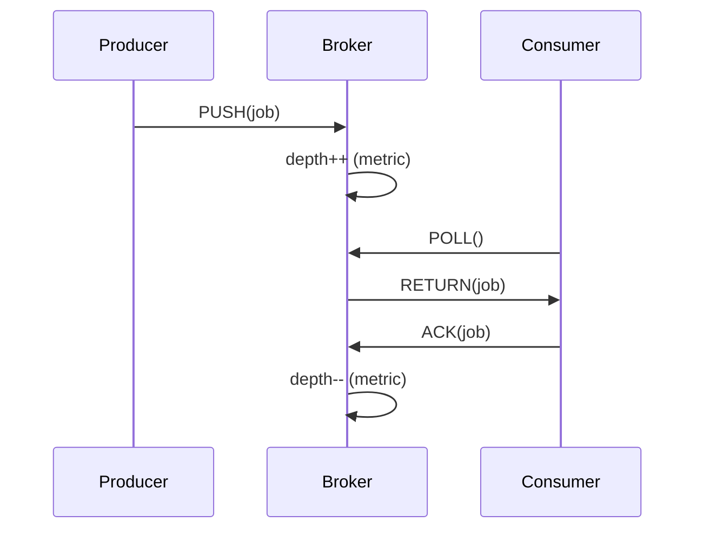

<!-- Generated by Groq via GitHub Actions -->
<!-- Topic ID: T168 -->
<!-- Category: Observability -->
<!-- Generated at UTC: 2026-11-03T08:08:22.766343+00:00 -->

# Queue depth

## 1. What problem does this solve?

**Motivation**  
When a backend system processes work asynchronously (image resizing, email sending, AI inference), it usually pushes jobs into a queue and lets workers consume them. The *queue depth*—the number of jobs waiting to be processed—acts as a real‑time indicator of system load and health.

**What problem exists?**  
- **Hidden back‑pressure**: A sudden spike in incoming requests can fill the queue, but the API layer may still return 200s, hiding that workers are overloaded.  
- **Resource starvation**: If the queue grows unchecked, workers may exhaust CPU, memory, or external API limits.  
- **Unpredictable latency**: Clients experience variable delays; without queue depth monitoring you cannot predict when a job will finish.

**Why the problem matters**  
- **Service level agreements (SLAs)**: Many services promise “≤ 5 s processing time”; a deep queue violates that.  
- **Cost**: Running more workers than needed is wasteful; under‑provisioning leads to retries and higher latency.  
- **Reliability**: Extremely deep queues can cause message loss or timeouts in the broker.

**What happens if this concept is not used?**  
- **Silent failures**: Clients may time out while the system is still busy.  
- **Resource exhaustion**: Workers may crash or be throttled.  
- **Poor observability**: Ops teams cannot correlate spikes in latency with queue growth.

**Where this concept appears in real backend systems**  
- **Message brokers**: RabbitMQ, Kafka, Redis Streams, Amazon SQS.  
- **Job queues**: Bull/BullMQ, Sidekiq, Celery.  
- **Event‑driven architectures**: Event sourcing, CQRS pipelines.  
- **Microservice pipelines**: A service may enqueue work for downstream services; queue depth signals when to scale.

---

## 2. Mental model

**Analogy**  
Think of a queue depth like the number of people standing in line at a coffee shop.  
- **Line length** → queue depth.  
- **Barista speed** → worker throughput.  
- If the line gets too long, customers start leaving (timeouts) and the shop becomes unhappy.  
- The shop owner (monitor) watches the line and decides to add more baristas or close the shop early.

**Engineering model**  
- **Producer** pushes a message → **Broker** stores it → **Consumer** pulls it.  
- The broker keeps a counter of pending messages; that counter is the *queue depth*.  
- A deep queue indicates that consumers are slower than producers or that consumers are saturated.

---

## 3. Deep explanation

### Internals
- **Broker storage**: In Redis, a list or stream; in Kafka, a partition log; in RabbitMQ, a queue data structure.  
- **Metadata**: Brokers expose metrics like `queue_length`, `consumer_lag`, `pending_messages`.  
- **Visibility**: Some brokers allow peeking at the next message; others only expose counts.

### Important terminology
| Term | Meaning |
|------|---------|
| **Queue depth / length** | Number of messages waiting to be consumed. |
| **Consumer lag** | In Kafka, the difference between the latest offset and the consumer’s committed offset. |
| **Back‑pressure** | Mechanism to slow producers when the queue is too deep. |
| **Throughput** | Messages processed per second. |
| **Batch size** | Number of messages a consumer pulls in one round. |

### Trade‑offs
| Aspect | Trade‑off |
|--------|-----------|
| **Batch size** | Larger batches reduce network overhead but increase latency per message. |
| **Pre‑fetch** | Higher pre‑fetch improves throughput but risks over‑loading workers. |
| **Queue persistence** | Durable queues guarantee no loss but add I/O overhead. |
| **Back‑pressure** | Slowing producers preserves resources but can cause request timeouts. |

### Failure modes
- **Message loss**: If the broker crashes and persistence is disabled.  
- **Consumer starvation**: All workers busy, queue grows indefinitely.  
- **Producer overload**: Producers send too fast, exceeding broker limits.  
- **Broker bottleneck**: Single broker node becomes a single point of failure.

### Limitations
- **Granularity**: Queue depth is a snapshot; it doesn’t reveal message age or priority.  
- **Visibility lag**: Some brokers expose depth only after a polling interval.  
- **Multi‑queue systems**: Depth per queue may not reflect overall system load.

### Where it fits in a backend architecture
```
┌───────────────┐   ┌───────────────┐   ┌───────────────┐
│  API Gateway  │   │  Producer      │   │  Consumer     │
└───────┬───────┘   └───────┬───────┘   └───────┬───────┘
        │                │                │
        ▼                ▼                ▼
   ┌───────────────────────────────────────┐
   │          Message Broker (Queue)        │
   └───────────────────────────────────────┘
```
- The broker sits between producers and consumers.  
- Queue depth is a metric collected from the broker and fed into monitoring dashboards.

### Interaction with related concepts
- **Rate limiting**: Producers may throttle based on queue depth.  
- **Auto‑scaling**: Scale workers when depth exceeds a threshold.  
- **Dead‑letter queues**: Messages that fail repeatedly are moved; depth of DLQ indicates systemic issues.  
- **Back‑pressure protocols**: HTTP/2 flow control, gRPC back‑pressure, or custom headers.

---

## 4. How it works

1. **Producer** receives a request → creates a job object.  
2. **Producer** serializes the job → pushes to the broker (e.g., `LPUSH` in Redis).  
3. **Broker** increments internal counter → updates `queue_depth` metric.  
4. **Consumer** polls the broker (e.g., `BRPOP` or `XREADGROUP`).  
5. **Consumer** processes the job → acknowledges (e.g., `DEL` or `ACK`).  
6. **Broker** decrements counter → updates metric.  
7. **Monitoring system** pulls `queue_depth` → triggers alerts or autoscaling.



---

## 5. Practical implementation

Below is a minimal Node.js example using **BullMQ** (Redis‑backed queue) that exposes queue depth via a simple HTTP endpoint.

```ts
// queue.ts
import { Queue, Worker, QueueEvents } from 'bullmq';
import { createClient } from 'redis';

const redisOpts = { host: 'localhost', port: 6379 };
const connection = createClient(redisOpts);

export const jobQueue = new Queue('image-processing', { connection });

export const worker = new Worker(
  'image-processing',
  async job => {
    // Simulate processing
    await new Promise(r => setTimeout(r, 2000));
    console.log(`Processed ${job.id}`);
  },
  { connection }
);

export const events = new QueueEvents('image-processing', { connection });
```

```ts
// server.ts
import express from 'express';
import { jobQueue } from './queue';

const app = express();
app.use(express.json());

// Enqueue a job
app.post('/jobs', async (req, res) => {
  const { imageUrl } = req.body;
  const job = await jobQueue.add('resize', { imageUrl });
  res.json({ jobId: job.id });
});

// Expose queue depth
app.get('/metrics', async (req, res) => {
  const depth = await jobQueue.getJobCount('waiting', 'delayed', 'paused');
  res.json({ depth });
});

app.listen(3000, () => console.log('API listening on 3000'));
```

**Important lines**

- `getJobCount('waiting', 'delayed', 'paused')`: aggregates all jobs that are not yet processed.  
- `BullMQ` automatically persists jobs in Redis; the depth metric is derived from Redis list lengths.  
- The `/metrics` endpoint can be scraped by Prometheus or viewed in a dashboard.

> **Tip**: For production, expose Prometheus metrics (`/metrics`) using `prom-client` and let Prometheus scrape the queue depth.

---

## 6. Production considerations

| Concern | What to do |
|---------|------------|
| **Scalability** | Use a distributed broker (Kafka, Redis Cluster). Partition queues to spread load. |
| **Reliability** | Enable persistence, replication, and enable `retry` policies. Use DLQs. |
| **Security** | Secure broker with TLS, authentication, and ACLs. Restrict API keys. |
| **Observability** | Export metrics (`queue_depth`, `consumer_lag`, `processing_time`). Add logs per job. |
| **Performance** | Tune batch size and pre‑fetch. Use async workers. |
| **Error handling** | Retry with exponential back‑off. Move to DLQ after N attempts. |
| **Resource usage** | Monitor memory/CPU of workers; scale horizontally. |
| **Operational concerns** | Set up health checks, graceful shutdown, and graceful back‑pressure. |
| **Failure recovery** | Auto‑restart workers, use supervisor (PM2, systemd). |
| **Deployment** | Containerize workers; use Kubernetes Jobs or Deployments with horizontal pod autoscaler based on queue depth. |

---

## 7. Common mistakes

| Mistake | Why it’s problematic |
|---------|----------------------|
| **Ignoring queue depth** | Leads to silent back‑pressure and SLA violations. |
| **Setting batch size too high** | Increases latency; workers may hold many messages and crash if one fails. |
| **No DLQ** | Failed jobs pile up, causing queue depth to stay high and masking real issues. |
| **Over‑provisioning workers** | Wastes resources; workers idle while queue is shallow. |
| **Using in‑memory queues** | Data loss on crash; no persistence for critical jobs. |
| **Not monitoring consumer lag** | In Kafka, lag can grow silently; consumers may fall behind. |
| **Blocking workers** | Performing synchronous I/O blocks the event loop, reducing throughput. |

---

## 8. Senior engineer perspective

### What changes at scale?
- **Distributed brokers**: Kafka or Redis Cluster; need to handle partitioning, replication, and network partitions.  
- **Autoscaling**: Workers scale based on queue depth or consumer lag; requires robust metrics and thresholds.  
- **Cost**: Running many workers or a large broker cluster increases cloud spend; need to balance throughput vs. cost.  
- **Security**: Multi‑tenant environments demand strict ACLs and encryption.  
- **Observability**: Centralized dashboards, alerting, and tracing (e.g., OpenTelemetry) become mandatory.

### Design decisions
- **Broker choice**: Kafka for high throughput and exactly‑once semantics; Redis for low latency and simple use‑cases.  
- **Partitioning strategy**: Key‑based sharding vs. round‑robin.  
- **Back‑pressure**: Implement producer throttling (e.g., token bucket) vs. broker‑side flow control.  
- **DLQ policy**: How many retries, exponential back‑off, and whether to alert on DLQ depth.  
- **Monitoring**: Which metrics to expose (`queue_depth`, `consumer_lag`, `processing_time`, `error_rate`).  
- **Deployment**: Use Kubernetes StatefulSets for brokers, Deployments for workers, and HPA based on metrics.

### When NOT to use a queue depth approach
- **Very low volume**: A simple in‑process queue may suffice.  
- **Real‑time constraints**: If latency must be < 10 ms, a queue may add unacceptable delay.  
- **Stateless micro‑tasks**: If tasks are idempotent and can be retried on failure, a queue may be overkill.

---

## 9. Interview questions

1. **Beginner** – *What is queue depth and why is it useful?*  
   - *Answer*: The number of messages waiting in a queue; it signals load, helps detect back‑pressure, and informs scaling decisions.

2. **Beginner** – *How would you expose queue depth to a monitoring system?*  
   - *Answer*: Query the broker’s API or use built‑in metrics (e.g., `getJobCount` in BullMQ) and expose them via an HTTP endpoint that Prometheus scrapes.

3. **Senior** – *Describe how consumer lag in Kafka differs from queue depth in Redis.*  
   - *Answer*: Kafka’s consumer lag is the offset difference between the latest log entry and the consumer’s committed offset; it reflects how far behind a consumer is. Redis queue depth is a simple count of pending items; it doesn’t capture message age or ordering guarantees.

4. **Senior** – *Design a system that automatically scales workers based on queue depth. What metrics, thresholds, and scaling policies would you use?*  
   - *Answer*: Use `queue_depth` and `processing_time` metrics; set thresholds (e.g., depth > 1000 → add 2 workers, depth < 200 → remove 1). Use Kubernetes HPA with custom metrics; ensure graceful shutdown and stateful worker persistence.

5. **Scenario/Debugging** – *A production service shows increasing latency but queue depth remains low. What could be causing this?*  
   - *Answer*: Possible causes:  
     - Worker CPU/memory contention (workers saturated).  
     - External API rate limits causing workers to block.  
     - Long‑running jobs (e.g., AI inference) that are not reflected in depth.  
     - Mis‑configured batch size causing workers to process fewer jobs per poll.  
     - Network latency between workers and broker.  
   - *Approach*: Profile workers, check external API metrics, inspect job timestamps, and adjust batch size or add more workers.

---

## 10. Hands‑on task

**Goal**: Build a simple image‑processing pipeline that exposes queue depth and automatically scales workers.

1. **Create a Node.js project** with `bullmq`, `express`, and `prom-client`.  
2. **Implement**:  
   - `/jobs` endpoint to enqueue a dummy image URL.  
   - `/metrics` endpoint exposing `queue_depth`.  
   - A worker that processes jobs with a 2‑second delay.  
3. **Run** the API and worker locally.  
4. **Simulate load**: Use `ab` or `wrk` to POST many jobs.  
5. **Observe** queue depth increasing.  
6. **Add a simple autoscaler**: A script that reads the `/metrics` endpoint and spawns additional worker processes when depth > 500.  
7. **Verify** that depth stabilizes and latency improves.

---

## 11. Quick revision

- Queue depth = number of pending messages; key metric for back‑pressure.  
- Producer → Broker → Consumer flow; depth is broker‑side counter.  
- High depth → need more workers or throttling.  
- Use `getJobCount` (BullMQ) or `XLEN` (Redis Streams) to read depth.  
- Persist jobs for reliability; use DLQs for failures.  
- Monitor depth, consumer lag, processing time, and error rate.  
- Autoscale workers based on depth thresholds.  
- Avoid large batch sizes that increase latency.  
- Protect broker with TLS, ACLs, and authentication.  
- In Kafka, consumer lag is the offset difference; in Redis, depth is a simple count.  
- For production, expose metrics via Prometheus, use Docker/K8s, and implement graceful shutdown.

---

## 12. References

- [BullMQ Documentation](https://docs.bullmq.io/)  
- [Redis Streams](https://redis.io/docs/manual/data-types/streams/)  
- [Kafka Consumer Lag](https://kafka.apache.org/documentation/#consumer_lag)  
- [Prometheus Client for Node.js](https://github.com/siimon/prom-client)  
- [OpenTelemetry for Node.js](https://opentelemetry.io/docs/instrumentation/node/)  
- [Kubernetes Horizontal Pod Autoscaler](https://kubernetes.io/docs/tasks/run-application/horizontal-pod-autoscale/)  
- [Redis Security](https://redis.io/docs/management/security/)  

---
