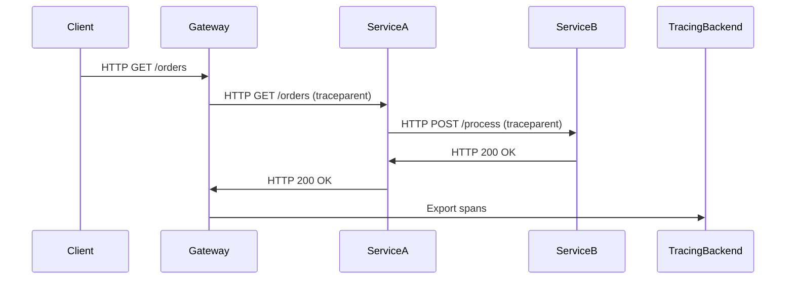

<!-- Generated by Groq via GitHub Actions -->
<!-- Topic ID: T169 -->
<!-- Category: Observability -->
<!-- Generated at UTC: 2026-11-03T20:13:07.847042+00:00 -->

# Distributed tracing

## 1. What problem does this solve?

**Motivation**  
In a modern micro‑service stack, a single user request often touches dozens of services, databases, message queues, and external APIs. When something goes wrong—latency spikes, errors, or data inconsistencies—debugging becomes a game of guesswork. You can see a 500 error in a single service, but you have no visibility into *how* that error propagated through the system.

**What problem exists**  
- **Opaque request flow**: A request may traverse many services, each with its own logs.
- **Hard to correlate logs**: Logs are timestamped locally; aligning them across services is error‑prone.
- **Performance bottlenecks**: Identifying which hop is slow requires manual instrumentation.

**Why the problem matters**  
- **Customer impact**: Slow or failing requests degrade user experience.
- **Operational cost**: Manual debugging consumes engineering time and can lead to incorrect fixes.
- **Security & compliance**: Auditing request paths is required for some regulations.

**What happens if this concept is not used**  
- **Blind debugging**: Engineers rely on stack traces and ad‑hoc logging, leading to longer MTTR (Mean Time To Recovery).
- **Inconsistent metrics**: Without a unified trace, metrics may be duplicated or missing.
- **Poor observability**: Teams cannot answer “Where did the latency come from?” quickly.

**Where this concept appears in real backend systems**  
- E‑commerce checkout flows (frontend → auth → inventory → payment → notification).
- Data pipelines (API → Kafka → microservice → PostgreSQL → Redis cache).
- AI inference pipelines (frontend → model‑service → feature‑store → monitoring).

---

## 2. Mental model

### Analogy: The Postal Service  
Imagine a package that starts at a customer’s home, goes through a sorting center, travels by truck, passes through a regional hub, and finally arrives at the recipient’s mailbox. Each location stamps the package with a unique identifier and a timestamp. By following the stamps, you can reconstruct the entire journey, see where delays occurred, and verify that the package reached its destination.

### Engineering model  
- **Trace**: The entire journey of a request (the “package”).
- **Spans**: Individual hops or operations (the “stamps”).
- **Context propagation**: Passing the trace ID and span ID through headers or message payloads.
- **Sampling**: Deciding which requests to record to avoid overload.
- **Storage & UI**: Aggregating spans in a backend (e.g., Jaeger, Zipkin) and visualizing them.

---

## 3. Deep explanation

### Internals
1. **Context propagation**  
   - A unique **Trace ID** is generated at the entry point.  
   - Each service creates a **Span ID** for its operation.  
   - The parent‑child relationship is encoded in the `parent_span_id` field.

2. **Instrumentation**  
   - Automatic instrumentation libraries (e.g., OpenTelemetry) hook into HTTP, gRPC, database drivers, etc.  
   - Manual instrumentation is required for custom code paths.

3. **Exporters**  
   - Spans are exported to a tracing backend (Jaeger, Zipkin, Tempo, etc.) via gRPC, HTTP, or OTLP.

4. **Storage**  
   - Traces are stored in a time‑series or document store.  
   - Retrieval is optimized for trace ID queries.

### Important terminology
- **Trace**: Collection of spans for a single request.
- **Span**: A single operation with start/end timestamps, attributes, and events.
- **Context**: The set of identifiers (trace ID, span ID, baggage) carried across service boundaries.
- **Baggage**: Key/value pairs propagated with the context, useful for debugging.
- **Sampling**: Strategy to decide whether to record a trace.
- **Propagation format**: HTTP headers (`traceparent`, `baggage`) or message attributes.

### Trade‑offs
| Aspect | Pros | Cons |
|--------|------|------|
| **Automatic instrumentation** | Low effort, consistent | May miss custom logic; overhead |
| **Manual instrumentation** | Full control | Higher maintenance |
| **Sampling** | Reduces storage & load | Loss of data for rare events |
| **OpenTelemetry vs vendor SDKs** | Standard, vendor‑agnostic | Slightly higher learning curve |

### Failure modes
- **Missing context**: If a service fails to propagate headers, spans become orphaned.
- **Clock skew**: Inconsistent system clocks can distort latency measurements.
- **Exporter failure**: Loss of spans if the exporter crashes; mitigated by buffering.
- **High cardinality**: Too many unique attributes can bloat storage.

### Limitations
- **Overhead**: Even minimal instrumentation adds latency (~10–30 µs per span).
- **Sampling bias**: Rare errors may be missed if not sampled.
- **Complexity**: Requires coordination across teams and services.

### Where this concept fits in a backend architecture
- **Observability layer**: Tracing sits alongside metrics and logs.
- **Service mesh integration**: Envoy or Istio can automatically inject spans.
- **CI/CD pipelines**: Tracing can be used to validate performance regressions.

### Interaction with related concepts
- **Metrics**: Traces provide fine‑grained latency; metrics aggregate over time.
- **Logs**: Spans can include log events; logs can be correlated via trace ID.
- **Tracing vs Monitoring**: Tracing gives causal chains; monitoring gives health dashboards.

---

## 4. How it works

### Step‑by‑step flow

1. **Client request** arrives at the API gateway.  
2. Gateway generates a **Trace ID** and starts a root span.  
3. Gateway forwards the request to Service A, adding `traceparent` header.  
4. Service A starts a child span, performs DB query, and forwards to Service B.  
5. Service B starts its own span, processes data, and returns to Service A.  
6. Service A completes its span, returns response to gateway.  
7. Gateway ends root span and exports all spans to the tracing backend.  
8. UI visualizes the trace, showing latency per hop.



---

## 5. Practical implementation

Below is a minimal Node.js/TypeScript example using **OpenTelemetry** with an HTTP server and a downstream service. The example uses the `@opentelemetry/api`, `@opentelemetry/sdk-node`, and `@opentelemetry/exporter-jaeger` packages.

```bash
npm init -y
npm install @opentelemetry/api @opentelemetry/sdk-node @opentelemetry/exporter-jaeger @opentelemetry/instrumentation-http express
```

### `tracing.ts` – OpenTelemetry bootstrap

```ts
// tracing.ts
import { NodeSDK } from '@opentelemetry/sdk-node';
import { getNodeAutoInstrumentations } from '@opentelemetry/auto-instrumentations-node';
import { JaegerExporter } from '@opentelemetry/exporter-jaeger';
import { diag, DiagConsoleLogger, DiagLogLevel } from '@opentelemetry/api';

// Optional: enable debug logs
diag.setLogger(new DiagConsoleLogger(), DiagLogLevel.INFO);

export const sdk = new NodeSDK({
  // Exporter sends spans to Jaeger
  traceExporter: new JaegerExporter({
    serviceName: 'orders-service',
    // Jaeger agent defaults to localhost:6831
  }),
  // Auto‑instrument HTTP, Express, etc.
  instrumentations: [getNodeAutoInstrumentations()],
});

sdk.start()
  .then(() => console.log('Tracing initialized'))
  .catch((err) => console.error('Error initializing tracing', err));
```

### `server.ts` – Express server with manual span

```ts
// server.ts
import express from 'express';
import { context, trace, SpanKind } from '@opentelemetry/api';
import './tracing'; // bootstrap tracing

const app = express();
const port = 3000;

// Manual instrumentation for a custom route
app.get('/orders', async (req, res) => {
  // Start a child span for this request
  const span = trace.getTracer('orders-tracer').startSpan('handle /orders', {
    kind: SpanKind.SERVER,
  });

  // Run the handler within the span context
  await context.with(trace.setSpan(context.active(), span), async () => {
    // Simulate downstream call
    const order = await fetchOrderFromDB(req.query.id as string);
    res.json(order);
    span.end(); // mark span finished
  });
});

async function fetchOrderFromDB(id: string) {
  // Simulated DB call – automatically instrumented by OpenTelemetry
  return { id, item: 'Widget', qty: 3 };
}

app.listen(port, () => console.log(`Server listening on ${port}`));
```

### Running the example

```bash
# Start Jaeger (Docker)
docker run -d --name jaeger \
  -e COLLECTOR_ZIPKIN_HOST_PORT=:9411 \
  -p 16686:16686 -p 6831:6831/udp \
  jaegertracing/all-in-one:1.47

# Run the server
node server.ts
```

Open `http://localhost:16686` to view traces. Hit `http://localhost:3000/orders?id=123` and you’ll see a trace with spans for the HTTP request and the simulated DB call.

---

## 6. Production considerations

| Concern | What to watch for | Mitigation |
|---------|-------------------|------------|
| **Scalability** | High volume of spans can overwhelm storage | Use sampling, tiered storage, or a dedicated tracing backend |
| **Reliability** | Exporter failures cause span loss | Buffer spans locally (e.g., `OTLP` exporter with retry) |
| **Security** | Trace IDs can leak sensitive data | Never log trace IDs in public logs; use secure transport (TLS) |
| **Observability** | Missing spans break causal chains | Enforce context propagation across all services |
| **Performance** | Instrumentation adds latency | Profile, adjust sampling rate, use async instrumentation |
| **Error handling** | Unhandled exceptions may skip span.end() | Use `try/finally` or middleware to ensure spans close |
| **Resource usage** | High memory for in‑memory exporters | Use persistent exporters or flush to disk |
| **Deployment** | Different environments need different exporters | Use environment variables to switch exporters (e.g., Jaeger vs Zipkin) |
| **Failure recovery** | Network partitions between services | Implement retries and graceful degradation |
| **Cost** | Storing all traces can be expensive | Sample aggressively, prune old traces, use cheaper storage tiers |

---

## 7. Common mistakes

| Mistake | Why it’s problematic |
|---------|----------------------|
| **Not propagating context** | Spans become orphaned; traces are incomplete |
| **Sampling too aggressively** | Miss rare but critical errors |
| **Instrumenting only HTTP, not DB** | Miss latency in database calls |
| **Using synchronous instrumentation in async code** | Corrupted timestamps, lost spans |
| **Hard‑coding trace IDs** | Violates uniqueness, breaks correlation |
| **Ignoring clock skew** | Inaccurate latency calculations |
| **Exporting to console only** | No persistence, no UI |
| **Not handling exporter errors** | Span loss during network outages |

---

## 8. Senior engineer perspective

### What changes at scale?

- **Architecture decisions**  
  - Deploy a dedicated tracing backend (Jaeger, Tempo) with high‑availability clusters.  
  - Use a service mesh (Istio, Linkerd) for automatic instrumentation.  
  - Centralize configuration via a feature flag or config service.

- **Trade‑offs**  
  - **Sampling vs fidelity**: Balance cost and observability.  
  - **Latency vs detail**: More spans → more detail but higher overhead.  
  - **Storage vs retention**: Decide how long to keep traces.

- **Bottlenecks**  
  - Exporter throughput: gRPC limits, network bandwidth.  
  - Storage ingestion: Write amplification if using a document store.

- **Failure scenarios**  
  - Tracing backend down → fallback to local buffering.  
  - Clock drift → use NTP or PTP across nodes.

- **Monitoring**  
  - Track exporter queue size, span drop rate, and trace latency.  
  - Alert on missing context propagation errors.

- **Cost/performance**  
  - Estimate storage cost: ~1 KB per span → 1 M spans/day ≈ 1 GB/day.  
  - Use tiered storage or delete old traces automatically.

- **When NOT to use**  
  - Extremely low‑latency services where instrumentation overhead is unacceptable.  
  - Legacy monoliths where adding context propagation is infeasible.  
  - Environments with strict regulatory constraints on data retention.

---

## 9. Interview questions

1. **Beginner** – *What is a trace and a span?*  
   - A trace is the full journey of a request; a span is a single operation within that journey.

2. **Beginner** – *How does context propagation work in HTTP?*  
   - The `traceparent` header carries the trace ID, span ID, and trace flags; services read it to continue the trace.

3. **Senior** – *Explain the trade‑offs of sampling in distributed tracing.*  
   - Sampling reduces storage and overhead but risks missing rare events; must balance fidelity vs cost.

4. **Senior** – *How would you design a tracing system for a globally distributed micro‑service architecture?*  
   - Use a globally replicated tracing backend, enforce consistent clocks, propagate context across regions, and consider cross‑region latency.

5. **Scenario/Debugging** – *A user reports a 2‑second latency on a checkout flow. Traces show a 1‑second delay in Service C, but logs show no errors. What steps would you take?*  
   - Verify context propagation, check Service C’s internal spans, inspect DB query plans, look for external API calls, and correlate with metrics.

---

## 10. Hands‑on task

**Task**: Add distributed tracing to a simple Express API that calls a PostgreSQL database and a Redis cache.

1. **Set up** a new Node.js project with `express`, `pg`, `redis`, and `@opentelemetry/*` packages.  
2. **Instrument** the HTTP server and database/Redis clients automatically.  
3. **Add manual spans** around a route that performs a DB query and a cache lookup.  
4. **Export** spans to Jaeger (or Zipkin) and verify the trace in the UI.  
5. **Experiment** with different sampling rates and observe the effect on trace volume and latency.

---

## 11. Quick revision

- Tracing captures the *full path* of a request across services.  
- A **trace** is a collection of **spans**; each span has a start/end time, attributes, and events.  
- Context propagation uses the `traceparent` header (W3C Trace Context).  
- **OpenTelemetry** is the vendor‑agnostic standard for instrumentation.  
- **Sampling** controls how many traces are recorded; trade‑off between cost and fidelity.  
- **Exporters** send spans to backends like Jaeger, Zipkin, or Tempo.  
- **Baggage** carries key/value pairs across services for debugging.  
- Missing context → orphaned spans; clock skew → inaccurate latency.  
- Production concerns: scalability, reliability, security, performance, cost.  
- Common mistakes: not propagating context, over‑sampling, ignoring DB spans.  
- Senior‑level decisions: backend architecture, sampling strategy, storage retention, monitoring of exporter health.

---

## 12. References

- OpenTelemetry Specification: https://opentelemetry.io/docs/specs/  
- OpenTelemetry Node.js SDK: https://opentelemetry.io/docs/instrumentation/node/  
- Jaeger Documentation: https://www.jaegertracing.io/docs/  
- Zipkin Documentation: https://zipkin.io/pages/quickstart.html  
- W3C Trace Context: https://www.w3.org/TR/trace-context/  
- OpenTelemetry Auto‑Instrumentation: https://opentelemetry.io/docs/instrumentation/node/auto-instrumentation/  
- OpenTelemetry Exporter Jaeger: https://github.com/open-telemetry/opentelemetry-js/tree/main/exporters/jaeger  
- OpenTelemetry Sampling: https://opentelemetry.io/docs/concepts/sampling/  

---
