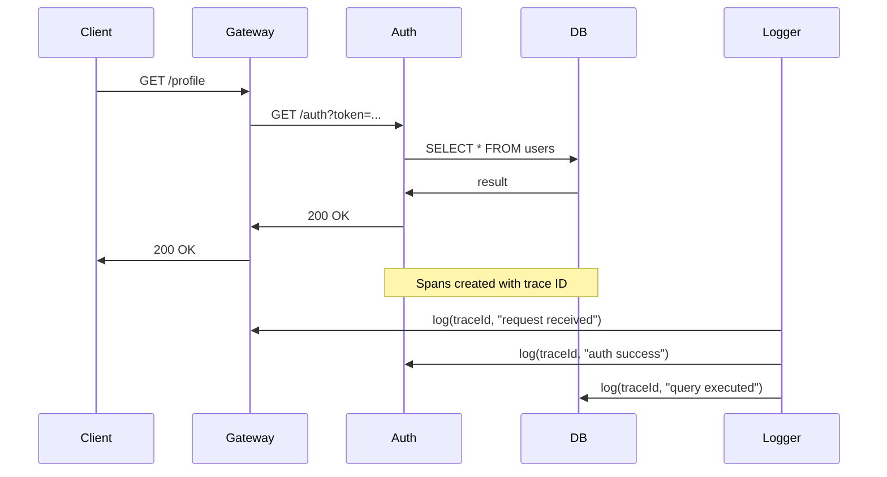

<!-- Generated by Groq via GitHub Actions -->
<!-- Topic ID: T170 -->
<!-- Category: Observability -->
<!-- Generated at UTC: 2026-11-03T20:13:07.847042+00:00 -->

# Trace IDs

## 1. What problem does this solve?

When a request travels through a distributed system—multiple services, databases, message queues, and external APIs—it becomes hard to understand *which* request caused which log entry, error, or metric.  
Without a unique identifier that travels with the request, you end up with:

- **Confused logs**: Logs from different requests interleaved, making debugging impossible.
- **Hard-to-reproduce bugs**: You cannot replay the exact sequence of events that led to a failure.
- **Poor observability**: Metrics and traces cannot be correlated, so you cannot see the full request path.
- **Security and compliance gaps**: Auditing who did what becomes impossible.

In real backend systems, trace IDs are ubiquitous: a user logs in, the auth service generates a trace ID, passes it to the API gateway, which forwards it to microservices, databases, and finally to a monitoring system like Jaeger or Datadog. Every log line, metric, and span carries that ID, enabling end‑to‑end visibility.

## 2. Mental model

### Analogy  
Think of a trace ID as a **post‑alike tracking number** for a package.  
- **Package** = the user request.  
- **Tracking number** = trace ID.  
- **Post office** = your backend services.  
Every time the package moves from one post office to another, the tracking number is stamped on the envelope. Later, you can look up the tracking number and see the entire journey.

### Engineering model  
- **Trace ID**: A globally unique identifier (often a UUID or a 128‑bit hex string) that is attached to a request at the entry point (API gateway, load balancer, or client).  
- **Propagation**: The ID is passed through HTTP headers, gRPC metadata, message queue properties, or database context.  
- **Spans**: Each service creates a *span* (a timed unit of work) that references the trace ID.  
- **Tracing system**: Collects spans, reconstructs the trace graph, and visualizes the request path.

## 3. Deep explanation

### Internals
- **Generation**: Usually a UUIDv4 or a 128‑bit random value. Some systems use a *trace context* header (e.g., `traceparent` per W3C Trace Context).
- **Propagation**:  
  - **HTTP**: `X-Request-Id` or `traceparent`.  
  - **gRPC**: metadata.  
  - **Message queues**: message properties or headers.  
  - **Databases**: context objects or session variables.
- **Storage**: Tracing backends (Jaeger, Zipkin, Datadog) store spans in a time‑series database or distributed log.

### Important terminology
- **Trace**: The entire journey of a request across services.
- **Span**: A single operation within a trace (e.g., a DB query, an HTTP call).
- **Parent/Child**: Spans can be nested; a child span is a sub‑operation of its parent.
- **Sampling**: To reduce overhead, only a subset of traces are fully recorded.

### Trade‑offs
| Aspect | Pros | Cons |
|--------|------|------|
| **UUIDv4** | Simple, collision‑free | 16 bytes → 32 hex chars, overhead in logs |
| **Short IDs** | Less overhead | Higher collision risk |
| **Sampling** | Lower storage & CPU | Loss of detail for sampled traces |

### Failure modes
- **Missing propagation**: If a service forgets to forward the trace ID, the trace is broken.
- **Header tampering**: Malicious clients can inject arbitrary IDs; mitigated by validating format.
- **High cardinality**: Too many unique IDs can overwhelm storage or cause high cardinality metrics.

### Limitations
- **Not a security token**: Trace IDs are not authentication; they should not be used for access control.
- **No guarantee of order**: Spans may arrive out of order; tracing systems re‑order them.
- **Limited to request scope**: Long‑running background jobs may need separate IDs.

### Where it fits
- **Observability stack**: Logging, metrics, and tracing all rely on trace IDs for correlation.
- **Distributed tracing**: Services instrumented with OpenTelemetry, Jaeger, or Datadog.
- **Error handling**: When an exception occurs, the trace ID is included in the error response for client debugging.

### Interaction with related concepts
- **Correlation IDs**: Often synonymous; some systems use separate correlation IDs for business flows.
- **Request IDs**: The same concept but sometimes used for synchronous flows only.
- **Context propagation**: Libraries like `cls-hooked` or `async_hooks` in Node.js help maintain trace context across async calls.

## 4. How it works

1. **Client** sends a request with a `traceparent` header (or none).
2. **API Gateway** checks header; if missing, generates a new trace ID.
3. **Gateway** forwards the trace ID in the header to downstream services.
4. **Each service** extracts the trace ID, creates a span, and records it.
5. **Tracing backend** collects spans, reconstructs the trace graph.
6. **Logs** and **metrics** include the trace ID for correlation.



## 5. Practical implementation

### Node.js / TypeScript example with Express and OpenTelemetry

```ts
// src/server.ts
import express from 'express';
import { NodeTracerProvider } from '@opentelemetry/sdk-trace-node';
import { registerInstrumentations } from '@opentelemetry/instrumentation';
import { HttpInstrumentation } from '@opentelemetry/instrumentation-http';
import { JaegerExporter } from '@opentelemetry/exporter-jaeger';
import { SimpleSpanProcessor } from '@opentelemetry/sdk-trace-base';
import { context, propagation, trace } from '@opentelemetry/api';

const provider = new NodeTracerProvider();
provider.addSpanProcessor(
  new SimpleSpanProcessor(new JaegerExporter({ serviceName: 'user-service' }))
);
provider.register();

// Auto‑instrument HTTP
registerInstrumentations({
  instrumentations: [new HttpInstrumentation()],
});

const app = express();
const tracer = trace.getTracer('user-service');

app.get('/profile', async (req, res) => {
  // Extract trace ID from incoming request
  const ctx = propagation.extract(context.active(), req.headers);
  const span = tracer.startSpan('handle /profile', undefined, ctx);

  try {
    // Simulate DB call
    const user = await getUserFromDB(req.query.id as string);
    res.json(user);
    span.setStatus({ code: 1 }); // OK
  } catch (err) {
    span.recordException(err);
    span.setStatus({ code: 2, message: 'Internal error' });
    res.status(500).send('Internal error');
  } finally {
    span.end();
  }
});

async function getUserFromDB(id: string) {
  // Pretend async DB call
  return { id, name: 'Alice' };
}

app.listen(3000, () => console.log('Listening on :3000'));
```

**Key points**

- `NodeTracerProvider` sets up OpenTelemetry.
- `HttpInstrumentation` automatically extracts/propagates trace IDs for outbound HTTP calls.
- `propagation.extract` pulls the trace ID from incoming headers.
- Each handler creates a span; the span is automatically linked to the parent trace.

### Adding trace ID to logs

```ts
import pino from 'pino';
const logger = pino({
  hooks: {
    logMethod(args, method) {
      const [obj] = args;
      if (obj && obj.traceId) {
        obj.traceId = obj.traceId; // keep it
      } else {
        const span = trace.getSpan(context.active());
        if (span) obj.traceId = span.spanContext().traceId;
      }
      method.apply(this, args);
    },
  },
});
```

Now every log line automatically contains `traceId`.

## 6. Production considerations

| Concern | What to watch for | Mitigation |
|---------|-------------------|------------|
| **Scalability** | High cardinality of trace IDs can bloat logs and metrics. | Use sampling; store trace IDs only in tracing backend, not in every log. |
| **Reliability** | If a service crashes before ending a span, the trace is incomplete. | Use graceful shutdown hooks; ensure spans are flushed on exit. |
| **Security** | Trace IDs are public; avoid leaking them in error responses. | Strip trace IDs from client‑facing error payloads. |
| **Observability** | Inconsistent propagation breaks trace reconstruction. | Enforce header validation; use OpenTelemetry context propagation. |
| **Performance** | Generating and serializing UUIDs adds overhead. | Cache trace IDs per request; use lightweight IDs if acceptable. |
| **Error handling** | Exceptions may skip span creation. | Wrap handlers in try/catch and always end spans. |
| **Resource usage** | Tracing exporters can consume network and storage. | Configure batch processors; adjust export intervals. |
| **Deployment** | Different environments may need different sampling rates. | Use environment variables to control sampling. |

## 7. Common mistakes

| Mistake | Why it’s bad |
|---------|--------------|
| **Generating a new trace ID per service** | Breaks end‑to‑end correlation; you lose the full trace. |
| **Using the same header for auth tokens** | Security risk; tokens can be exposed in logs. |
| **Not propagating trace ID in async callbacks** | Spans lose context; logs miss the ID. |
| **Logging trace ID as a separate field instead of part of the log context** | Harder to filter by trace ID in log aggregation tools. |
| **Ignoring sampling** | Overwhelms storage and slows down the system. |
| **Using a non‑unique ID (e.g., timestamp)** | Collisions cause trace merging. |

## 8. Senior engineer perspective

### At scale
- **Architecture**: Adopt a *single source of truth* for trace IDs—usually the API gateway or load balancer. All services must honor the header.
- **Trade‑offs**:  
  - **Sampling vs. fidelity**: 1% sampling may be enough for latency analysis but insufficient for debugging rare errors.  
  - **Tracing backend choice**: Jaeger (open‑source) vs. Datadog (managed). Consider cost, retention, and query performance.
- **Bottlenecks**:  
  - **Exporter throughput**: Batch exporters can become a bottleneck if not tuned.  
  - **Log ingestion**: High trace ID cardinality can slow down log aggregation (e.g., Loki, Elasticsearch).
- **Failure scenarios**:  
  - **Missing trace ID**: Implement a fallback that generates a trace ID if absent, but flag the request for investigation.  
  - **Exporter failure**: Ensure spans are queued locally and retried.
- **Monitoring**:  
  - **Trace latency dashboards**: Track end‑to‑end latency per trace ID.  
  - **Error rate per trace**: Detect services with high error rates.
- **Cost/performance**:  
  - **Storage**: Traces can be expensive; adjust retention policies.  
  - **CPU**: Span creation is lightweight but can add overhead under high load.
- **When NOT to use**:  
  - **Very small monoliths**: If you have a single service, a simple request ID may suffice.  
  - **Stateless micro‑services**: If services are truly stateless and you only need basic logging, tracing may be overkill.

## 9. Interview questions

1. **Beginner**: *What is a trace ID and why do we need it?*  
   - *Answer*: A unique identifier that follows a request through all services, enabling correlation of logs, metrics, and traces.

2. **Beginner**: *How do you propagate a trace ID in an HTTP request?*  
   - *Answer*: By adding a header (e.g., `X-Request-Id` or `traceparent`) to the request and ensuring downstream services forward it.

3. **Senior**: *Explain the trade‑offs between using UUIDv4 vs. a short, sequential trace ID in a high‑traffic system.*  
   - *Answer*: UUIDv4 guarantees uniqueness but adds 16 bytes per log; short IDs reduce overhead but risk collisions and may require additional collision‑checking logic.

4. **Senior**: *Describe how you would design a tracing system that can handle 10k requests per second while keeping storage costs manageable.*  
   - *Answer*: Use sampling (e.g., 1% or adaptive), batch exporters, a cost‑effective backend (e.g., Jaeger with Cassandra), and retention policies that delete old traces.

5. **Scenario/Debugging**: *A user reports a latency spike. Your tracing system shows a long span in Service B, but Service B’s logs show no errors. What steps would you take to investigate?*  
   - *Answer*:  
     1. Verify trace ID propagation.  
     2. Inspect Service B’s span details (start/end timestamps, child spans).  
     3. Check external dependencies (DB, cache) called by Service B.  
     4. Look at resource metrics (CPU, memory, I/O).  
     5. Correlate with logs that include the trace ID.  
     6. If needed, increase sampling or add instrumentation to deeper layers.

## 10. Hands‑on task

**Goal**: Add distributed tracing to an existing Express API that calls a PostgreSQL database and a Redis cache.

**Steps**

1. Install OpenTelemetry packages:  
   ```bash
   npm install @opentelemetry/api @opentelemetry/sdk-node @opentelemetry/instrumentation-http @opentelemetry/instrumentation-pg @opentelemetry/instrumentation-redis @opentelemetry/exporter-jaeger
   ```
2. Create `tracing.ts` that sets up the tracer provider, registers HTTP, PG, and Redis instrumentations, and exports the tracer.
3. In `server.ts`, import `tracing.ts` before creating the Express app.
4. Add a middleware that extracts the trace ID from the request and attaches it to the request context.
5. In a route handler, create a span for the database query and another for the Redis cache lookup.
6. Run Jaeger locally (Docker) and verify that traces appear in the UI.

**Deliverable**: A Git commit that shows the tracing setup and a screenshot of a trace in Jaeger.

## 11. Quick revision

- Trace ID = unique request identifier that travels through all services.  
- Propagated via headers (`traceparent`, `X-Request-Id`).  
- Each service creates *spans* linked to the trace ID.  
- OpenTelemetry standardizes instrumentation and propagation.  
- Sampling reduces overhead but may miss rare errors.  
- Missing propagation breaks trace reconstruction.  
- Use batch exporters and proper shutdown hooks for reliability.  
- Trace IDs are not auth tokens; never use them for security.  
- High cardinality can hurt log/metric storage; consider log aggregation strategies.  
- In production, enforce header validation and fallback generation.  
- For debugging, correlate logs, metrics, and traces by trace ID.

## 12. References

- [OpenTelemetry Specification – Trace Context](https://opentelemetry.io/docs/specs/otel/trace/)
- [Jaeger Documentation](https://www.jaegertracing.io/docs/)
- [Datadog Tracing Guide](https://docs.datadoghq.com/tracing/)
- [W3C Trace Context](https://www.w3.org/TR/trace-context/)
- [Node.js OpenTelemetry SDK](https://github.com/open-telemetry/opentelemetry-js/tree/main/packages/opentelemetry-sdk-node)
