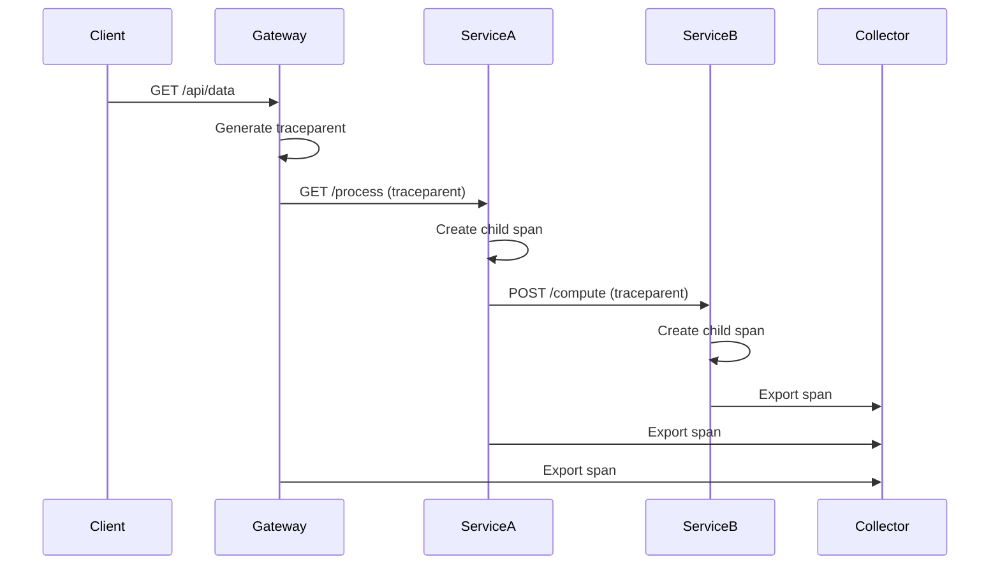

<!-- Generated by Groq via GitHub Actions -->
<!-- Topic ID: T171 -->
<!-- Category: Observability -->
<!-- Generated at UTC: 2026-11-04T07:40:52.443856+00:00 -->

# Span IDs

## 1. What problem does this solve?

When a request travels through a distributed system—say a Next.js frontend calls a FastAPI microservice, which in turn talks to PostgreSQL, Redis, and a Kafka producer—there are many independent operations (spans).  
Without a way to correlate these operations, observability tools cannot reconstruct the full journey of a single request.  

**Problems that span IDs solve**

- **Traceability**: Link all the micro‑service calls that belong to the same logical request.
- **Root cause analysis**: Quickly locate which span caused a latency spike or error.
- **Performance monitoring**: Aggregate metrics per trace (e.g., total latency, error rates).
- **Security & compliance**: Attach audit logs to a single trace ID for regulatory reporting.

**Why it matters**

If you cannot correlate spans, you end up with a noisy log stream where each service logs its own timestamps. Debugging a failure that spans multiple services becomes a manual, error‑prone hunt.

**What happens if it’s not used**

- Logs are siloed; you cannot reconstruct end‑to‑end latency.
- Alerting on distributed latency becomes impossible.
- Auditing and compliance become difficult.

**Where it appears in real backend systems**

- OpenTelemetry/Jaeger/Zipkin traces.
- Cloud provider tracing (AWS X-Ray, GCP Cloud Trace).
- Service meshes (Istio, Linkerd) automatically inject span IDs into HTTP headers.

---

## 2. Mental model

**Analogy**  
Think of a postal delivery system.  
- The *trace ID* is the envelope’s tracking number.  
- Each *span ID* is a stamp that shows the envelope’s current location (post office, sorting center, delivery truck).  
When you scan the envelope at any point, you can see the entire journey by following the stamps.

**Engineering model**  
- **Trace ID**: A globally unique identifier for the entire request.  
- **Span ID**: A unique identifier for a single operation within that trace.  
- **Parent Span ID**: The span that started the current span (null for the root).  
- **Context propagation**: Span IDs travel in headers (e.g., `traceparent`, `baggage`) so downstream services can continue the trace.

---

## 3. Deep explanation

### Internals

| Term | Meaning | Typical format |
|------|---------|----------------|
| **Trace ID** | 128‑bit hex string (32 hex chars) | `4bf92f3577b34da6a3ce929d0e0e4736` |
| **Span ID** | 64‑bit hex string (16 hex chars) | `00f067aa0ba902b7` |
| **Parent Span ID** | Span ID of the caller | Same format |
| **Trace Flags** | 1 byte, e.g., `01` for sampled | `01` |
| **Trace State** | Optional vendor‑specific key/value pairs | `vendor=1` |

OpenTelemetry’s `traceparent` header follows the W3C spec:

```
traceparent: 00-4bf92f3577b34da6a3ce929d0e0e4736-00f067aa0ba902b7-01
```

### Important terminology

- **Sampling**: Deciding whether to record a trace. A span ID is still generated, but the span may be dropped if not sampled.
- **Baggage**: Key/value pairs propagated with the trace; useful for cross‑service context (e.g., user ID).
- **Context propagation**: Mechanism to carry trace information across process boundaries.

### Trade‑offs

| Aspect | Trade‑off |
|--------|-----------|
| **Granularity** | More spans → richer data but higher overhead. |
| **Sampling rate** | High rate → more storage and processing; low rate → missing insights. |
| **ID format** | 128‑bit trace ID reduces collision risk but increases header size. |

### Failure modes

- **Missing parent span**: Leads to orphaned spans; trace appears incomplete.
- **Clock skew**: If services have unsynchronized clocks, timestamps may be misleading.
- **Header tampering**: Malicious actors could inject fake trace IDs; mitigated by validating trace state.

### Limitations

- Span IDs alone do not guarantee causal ordering; you need timestamps and parent relationships.
- In highly parallel systems, spans may overlap; visualizing them requires proper tooling.
- Some legacy services do not support context propagation.

### Where it fits in a backend architecture

```
Client (Next.js) → API Gateway → Service A (FastAPI) → Service B (Node.js) → DB / Cache / Kafka
```

Each hop creates a new span; the trace ID travels unchanged, while each span gets a unique span ID. The root span is created by the gateway.

### Interaction with related concepts

- **Distributed tracing**: Span IDs are the building blocks.
- **Metrics**: Span durations feed into latency metrics.
- **Logging**: Log entries include the trace ID for correlation.
- **Tracing libraries**: OpenTelemetry, Jaeger client, etc., automatically generate span IDs.

---

## 4. How it works

1. **Incoming request**  
   The gateway receives an HTTP request and checks for an existing `traceparent` header.
2. **Root span creation**  
   If none, the gateway generates a new trace ID and a root span ID.
3. **Propagation**  
   The gateway injects `traceparent` into the outgoing HTTP headers to Service A.
4. **Child span creation**  
   Service A extracts the trace ID, creates a new span ID, and sets its parent to the incoming span ID.
5. **Further propagation**  
   Service A forwards the updated `traceparent` to Service B, which repeats step 4.
6. **Span completion**  
   Each service records the end time and sends the span data to the collector.
7. **Aggregation**  
   The collector stitches spans by trace ID to reconstruct the full trace.



---

## 5. Practical implementation

### Node.js (Express) – OpenTelemetry

```ts
// tracing.ts
import { NodeTracerProvider } from '@opentelemetry/sdk-trace-node';
import { SimpleSpanProcessor } from '@opentelemetry/sdk-trace-base';
import { ConsoleSpanExporter } from '@opentelemetry/sdk-trace-base';
import { registerInstrumentations } from '@opentelemetry/instrumentation';
import { HttpInstrumentation } from '@opentelemetry/instrumentation-http';
import { ExpressInstrumentation } from '@opentelemetry/instrumentation-express';
import { Resource } from '@opentelemetry/resources';
import { SemanticResourceAttributes } from '@opentelemetry/semantic-conventions';

const provider = new NodeTracerProvider({
  resource: new Resource({
    [SemanticResourceAttributes.SERVICE_NAME]: 'service-a',
  }),
});

provider.addSpanProcessor(new SimpleSpanProcessor(new ConsoleSpanExporter()));
provider.register();

registerInstrumentations({
  tracerProvider: provider,
  instrumentations: [
    new HttpInstrumentation(),
    new ExpressInstrumentation(),
  ],
});

export const tracer = provider.getTracer('service-a');
```

```ts
// app.ts
import express from 'express';
import { tracer } from './tracing';

const app = express();

app.get('/process', async (req, res) => {
  // The OpenTelemetry HTTP instrumentation automatically creates a span
  // for the incoming request. We can add child spans manually.
  const child = tracer.startSpan('process-data');
  try {
    // Simulate async work
    await new Promise(r => setTimeout(r, 100));
    child.setAttribute('status', 'ok');
    res.send('done');
  } catch (e) {
    child.recordException(e);
    res.status(500).send('error');
  } finally {
    child.end();
  }
});

app.listen(3000, () => console.log('Service A listening on 3000'));
```

### FastAPI (Python) – OpenTelemetry

```python
# tracing.py
from opentelemetry import trace
from opentelemetry.sdk.resources import Resource
from opentelemetry.sdk.trace import TracerProvider
from opentelemetry.sdk.trace.export import BatchSpanProcessor, ConsoleSpanExporter
from opentelemetry.instrumentation.fastapi import FastAPIInstrumentor

trace.set_tracer_provider(
    TracerProvider(
        resource=Resource.create({"service.name": "service-b"})
    )
)
tracer = trace.get_tracer(__name__)

span_processor = BatchSpanProcessor(ConsoleSpanExporter())
trace.get_tracer_provider().add_span_processor(span_processor)
```

```python
# main.py
from fastapi import FastAPI
from tracing import tracer

app = FastAPI()
FastAPIInstrumentor.instrument_app(app)

@app.post("/compute")
async def compute():
    with tracer.start_as_current_span("compute-task") as span:
        # Simulate work
        await asyncio.sleep(0.2)
        span.set_attribute("result", 42)
    return {"result": 42}
```

---

## 6. Production considerations

| Concern | How span IDs help | Practical tips |
|---------|------------------|----------------|
| **Scalability** | Each service can generate spans locally; no central coordination needed. | Use efficient ID generators (e.g., ULID, NanoID). |
| **Reliability** | If a service crashes, its spans are still recorded. | Ensure graceful shutdown to flush spans. |
| **Security** | Trace IDs can be logged; avoid exposing sensitive data in baggage. | Sanitize baggage; use sampling to limit data exposure. |
| **Observability** | End‑to‑end latency, error rates, and causal chains become visible. | Integrate with APM (Datadog, New Relic) or open‑source (Jaeger). |
| **Performance** | Minimal overhead (~10–20 µs per span). | Batch export; avoid synchronous exporters in hot paths. |
| **Error handling** | Errors are attached to the span that caused them. | Use `recordException` and `setStatus` consistently. |
| **Resource usage** | Spans are lightweight; storage cost depends on retention policy. | Rotate or delete old traces; use sampling. |
| **Operational concerns** | Need a collector and storage backend. | Deploy OpenTelemetry Collector as sidecar or cluster‑wide. |
| **Failure recovery** | If collector is down, spans are buffered locally. | Configure retry and back‑pressure. |
| **Deployment** | Span IDs propagate automatically; no code changes for new services. | Keep instrumentation libraries up to date. |

---

## 7. Common mistakes

| Mistake | Why it’s problematic |
|---------|----------------------|
| **Generating trace IDs manually** | Inconsistent formats; risk of collisions. |
| **Not propagating `traceparent`** | Spans become orphaned; trace incomplete. |
| **Over‑instrumenting** | Too many spans → high overhead, noisy data. |
| **Ignoring sampling** | Collecting all traces can overwhelm storage. |
| **Using mutable baggage** | Security risk; can leak user data. |
| **Not closing spans** | Missing end timestamps; inaccurate durations. |
| **Hard‑coding span names** | Makes it hard to refactor; reduces readability. |
| **Not handling context propagation in async code** | Spans may be lost or mis‑parented. |

---

## 8. Senior engineer perspective

### Architecture decisions

- **Collector placement**: Sidecar vs. centralized vs. cloud‑managed.
- **Export format**: OTLP over gRPC vs. Jaeger over Thrift.
- **Sampling strategy**: Adaptive vs. static; per‑service vs. global.

### Trade‑offs

- **Centralized collector** simplifies management but becomes a single point of failure.
- **Sidecar collector** isolates per‑service overhead but increases pod count.

### Bottlenecks

- **Network**: Large headers can increase latency; compress headers if possible.
- **Storage**: Long‑term retention of traces can be expensive; consider down‑sampling.

### Failure scenarios

- **Collector crash**: Configure local buffering; use `BatchSpanProcessor` with retry.
- **Clock skew**: Use NTP or PTP; consider logical timestamps if needed.

### Monitoring

- **Trace latency dashboards**: End‑to‑end, per‑service, per‑span.
- **Error rates**: Correlate with span status.
- **Sampling coverage**: Ensure enough traces are collected.

### Cost/performance

- **Sampling**: Reduces cost but may miss rare errors.
- **Exporter choice**: gRPC is efficient but requires TLS; HTTP/JSON is easier to debug.

### When NOT to use

- **Simple monoliths**: Overkill; use simple logging.
- **Highly stateless services**: If you never need end‑to‑end visibility, skip tracing.

---

## 9. Interview questions

1. **Beginner**: *What is a span ID and how does it differ from a trace ID?*  
   *Answer*: Span ID uniquely identifies a single operation within a trace; trace ID identifies the entire request. Span IDs are children of a trace ID.

2. **Beginner**: *Why do we need to propagate span IDs across services?*  
   *Answer*: To correlate operations belonging to the same logical request and reconstruct end‑to‑end latency and causal chains.

3. **Senior**: *Explain how you would design a sampling strategy for a high‑traffic microservice architecture.*  
   *Answer*: Use adaptive sampling based on error rate or latency thresholds; sample 1% of normal traffic, 100% of errors; configure the collector to enforce the policy.

4. **Senior**: *Describe a scenario where span IDs could mislead you about the root cause of a latency spike.*  
   *Answer*: If clocks are skewed, timestamps may be wrong; or if spans are incorrectly parented due to missing propagation, the causal chain appears broken.

5. **Scenario/Debugging**: *You notice that a trace contains a span with a missing parent ID. What steps would you take to investigate and fix this?*  
   *Answer*:  
   - Verify that the upstream service correctly injected `traceparent`.  
   - Check instrumentation for context propagation in async code.  
   - Look at logs for missing headers.  
   - Add unit tests for context extraction.  
   - Ensure the collector is not dropping spans.

---

## 10. Hands‑on task

**Goal**: Add distributed tracing to an existing Express + FastAPI microservice pair.

1. **Setup**  
   - Clone the repository `backend-tracing-demo`.  
   - Install dependencies: `npm install` in the Node folder, `pip install -r requirements.txt` in the Python folder.

2. **Instrumentation**  
   - In `service-a/app.ts`, enable OpenTelemetry as shown in section 5.  
   - In `service-b/main.py`, enable OpenTelemetry.

3. **Propagation**  
   - Ensure the Express app forwards the `traceparent` header to the FastAPI service.

4. **Run**  
   - Start the OpenTelemetry Collector locally (`docker run -p 4317:4317 otel/opentelemetry-collector:latest`).  
   - Run both services.  
   - Make a request to `http://localhost:3000/process`.

5. **Verify**  
   - Check the console output of the collector for spans.  
   - Use Jaeger UI (`docker run -p 16686:16686 jaegertracing/all-in-one:latest`) to view the trace.

6. **Bonus**  
   - Add a custom attribute to the FastAPI span (`span.set_attribute("user_id", 123)`).  
   - Verify it appears in Jaeger.

---

## 11. Quick revision

- Span ID = unique ID for a single operation; trace ID = ID for the whole request.
- `traceparent` header carries trace ID, span ID, and flags.
- Parent span ID links child spans to their caller.
- OpenTelemetry automatically generates and propagates IDs.
- Sampling controls how many traces are recorded.
- Missing propagation → orphaned spans; clock skew → misleading timestamps.
- Use `recordException` and `setStatus` to attach errors.
- Collector can be sidecar or centralized; choose based on scale.
- Adaptive sampling reduces cost while keeping critical traces.
- Verify propagation by inspecting headers and Jaeger traces.

---

## 12. References

- [W3C Trace Context Specification](https://www.w3.org/TR/trace-context/)
- [OpenTelemetry Documentation](https://opentelemetry.io/docs/)
- [Jaeger Tracing](https://www.jaegertracing.io/)
- [OpenTelemetry Collector](https://opentelemetry.io/docs/collector/)
- [OpenTelemetry Node.js SDK](https://github.com/open-telemetry/opentelemetry-js)
- [OpenTelemetry Python SDK](https://github.com/open-telemetry/opentelemetry-python)
- [FastAPI Instrumentation](https://github.com/open-telemetry/opentelemetry-python-contrib/tree/main/instrumentation/opentelemetry-instrumentation-fastapi)
- [Express Instrumentation](https://github.com/open-telemetry/opentelemetry-js-contrib/tree/main/instrumentation/opentelemetry-instrumentation-express)
