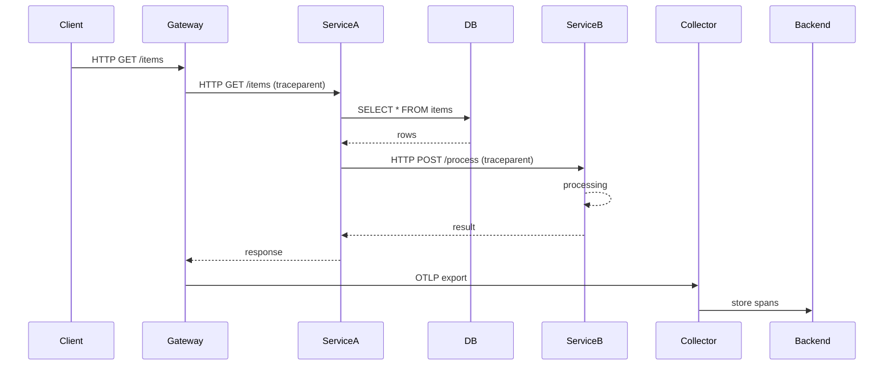

<!-- Generated by Groq via GitHub Actions -->
<!-- Topic ID: T172 -->
<!-- Category: Observability -->
<!-- Generated at UTC: 2026-11-04T07:40:52.443856+00:00 -->

# OpenTelemetry

## 1. What problem does this solve?

### Motivation

When a backend system grows, requests travel through many services, databases, queues, and external APIs.  
Without a unified way to capture **when**, **where**, and **how long** each operation takes, engineers are left with fragmented logs, ad‑hoc metrics, and blind spots.  
OpenTelemetry (OTel) provides a single, vendor‑agnostic framework to **collect, propagate, and export telemetry data** (traces, metrics, logs) across distributed systems.

### What problem exists

- **Fragmented observability**: Each library or framework may expose its own logging or metrics API, leading to inconsistent data.
- **Hard to correlate events**: A request that starts in a web server, goes to a database, and triggers a background job becomes a chain of unrelated logs.
- **Vendor lock‑in**: Using a proprietary tracing system ties you to a specific provider’s SDK and data model.

### Why the problem matters

- **Debugging latency**: Without traces, pinpointing a slow database query or a network hop is time‑consuming.
- **Root cause analysis**: When an error propagates, you need to see the entire call chain to understand why.
- **Service level objectives (SLOs)**: Accurate metrics are required to enforce SLAs and trigger alerts.

### Consequences of not using OTel

- **Increased mean time to resolution (MTTR)** for incidents.
- **Poor user experience** due to unobserved performance regressions.
- **Higher operational cost** from manual instrumentation and duplicated tooling.

### Real‑world appearance

- **Microservice architectures**: Each service emits traces that are collected by a central collector (e.g., Jaeger, Zipkin, or a cloud provider).
- **Serverless functions**: Traces are propagated via context headers across cold starts.
- **Batch jobs**: Metrics and logs are exported to monitoring dashboards.

---

## 2. Mental model

### Analogy

Think of a **postal system**.  
- **Mail (request)** travels from the sender to the recipient through multiple post offices.  
- Each post office **adds a stamp** (a trace span) indicating when it handled the mail and how long it took.  
- The stamps are **linked** to form a complete journey, allowing anyone to see the entire path.

### Engineering model

- **Trace** = a single request journey.  
- **Span** = a unit of work inside that journey (e.g., HTTP handler, DB query).  
- **Context propagation** = passing a unique trace ID and span ID through headers or message attributes.  
- **Export** = sending the collected spans to a backend (Jaeger, Tempo, etc.) for storage and visualization.

---

## 3. Deep explanation

### Internals

| Component | Role |
|-----------|------|
| **SDK** | Provides APIs for creating spans, metrics, and logs. |
| **Instrumentation libraries** | Auto‑instrument popular frameworks (Express, FastAPI, PostgreSQL drivers). |
| **Context propagation** | Uses W3C Trace Context (`traceparent`, `tracestate`) to carry trace IDs across process boundaries. |
| **Exporters** | Send telemetry to backends (OTLP, Jaeger, Zipkin, Prometheus). |
| **Collector** | Optional middle‑layer that receives, processes, and forwards telemetry. |

### Important terminology

- **Trace ID** – 128‑bit identifier for a request.
- **Span ID** – 64‑bit identifier for a unit of work.
- **Parent/Child relationship** – Spans form a tree.
- **Attributes** – Key/value metadata attached to spans.
- **Events** – Time‑stamped notes inside a span.
- **Links** – Cross‑trace references (e.g., async callbacks).

### Trade‑offs

| Aspect | Benefit | Cost |
|--------|---------|------|
| **Granularity** | Fine‑grained spans give detailed insight. | Higher overhead (CPU, memory, network). |
| **Sampling** | Reduces data volume. | Loss of detail for sampled requests. |
| **Auto‑instrumentation** | Minimal code changes. | Potentially noisy data if not filtered. |
| **Export format** | OTLP is standard. | Some backends may not support all features. |

### Failure modes

- **Context loss**: If headers are stripped or corrupted, spans cannot be correlated.
- **Exporter failure**: Telemetry may be dropped if the exporter crashes or is overloaded.
- **High cardinality attributes**: Can cause storage bloat and slow queries.

### Limitations

- **Not a replacement for logs**: Traces capture flow, logs capture content.
- **Limited to request‑driven workloads**: Background jobs need explicit context injection.
- **Vendor‑specific backends**: While OTel is standard, each backend has quirks (e.g., Jaeger’s storage limits).

### Where it fits in a backend architecture

```
[Client] --> [API Gateway] --> [Service A] --> [DB] --> [Service B] --> [Cache]
```

Each hop emits spans; the collector aggregates them into a single trace that can be visualized in a UI.

### Interaction with related concepts

- **Metrics**: OTel metrics API can export counters, histograms, gauges.
- **Logs**: OTel log API can attach logs to spans.
- **Tracing vs. Monitoring**: Tracing gives causal chains; monitoring gives aggregated health.

---

## 4. How it works

### Step‑by‑step flow

1. **Incoming request** arrives at the API gateway.  
2. The gateway creates a **root span** (`traceparent` header is parsed or generated).  
3. The span context is propagated via HTTP headers to downstream services.  
4. Each service creates **child spans** for internal operations (DB query, external API call).  
5. Spans record **attributes** (e.g., status code, query text).  
6. When the request completes, the root span ends and is exported.  
7. The **collector** receives spans, optionally processes them (sampling, enrichment), and forwards to a backend.  
8. The backend stores spans and provides a UI for exploration.

### Mermaid diagram



---

## 5. Practical implementation

### 5.1 Install OTel SDK and Express instrumentation

```bash
npm install @opentelemetry/api @opentelemetry/sdk-node @opentelemetry/auto-instrumentations-node @opentelemetry/exporter-otlp-http
```

### 5.2 Create `otel.ts`

```ts
// otel.ts
import { NodeSDK } from '@opentelemetry/sdk-node';
import { getNodeAutoInstrumentations } from '@opentelemetry/auto-instrumentations-node';
import { OTLPTraceExporter } from '@opentelemetry/exporter-otlp-http';
import { diag, DiagConsoleLogger, DiagLogLevel } from '@opentelemetry/api';

// Enable diagnostics for debugging
diag.setLogger(new DiagConsoleLogger(), DiagLogLevel.INFO);

// Exporter sends traces to an OTLP endpoint (e.g., Tempo, Jaeger)
const traceExporter = new OTLPTraceExporter({
  url: 'http://localhost:4318/v1/traces', // adjust to your collector
});

const sdk = new NodeSDK({
  traceExporter,
  instrumentations: [getNodeAutoInstrumentations()],
});

sdk.start()
  .then(() => console.log('OpenTelemetry initialized'))
  .catch((err) => console.error('OTel init error', err));
```

### 5.3 Hook into your app

```ts
// server.ts
import express from 'express';
import './otel'; // initialize OTel

const app = express();

app.get('/items', async (req, res) => {
  // Example: manual span for a custom operation
  const { trace } = require('@opentelemetry/api');
  const span = trace.getTracer('app').startSpan('fetch-items');
  try {
    // Simulate DB call
    const items = await fetchItemsFromDB();
    span.setAttribute('db.count', items.length);
    res.json(items);
  } catch (e) {
    span.recordException(e);
    res.status(500).send('Error');
  } finally {
    span.end();
  }
});

app.listen(3000, () => console.log('Server running on :3000'));
```

### 5.4 Running the collector (Jaeger)

```bash
docker run -d --name jaeger \
  -e COLLECTOR_ZIPKIN_HOST_PORT=:9411 \
  -p 16686:16686 -p 4318:4318 \
  jaegertracing/all-in-one:1.48
```

Now, visiting `http://localhost:3000/items` will generate traces visible at `http://localhost:16686`.

---

## 6. Production considerations

| Concern | Recommendation |
|---------|----------------|
| **Scalability** | Use **sampling** (e.g., 1% of requests) to limit data volume. Configure collector to batch exports. |
| **Reliability** | Exporter should retry with exponential backoff. Use a local queue if the collector is down. |
| **Security** | Ensure trace headers are not logged. Use TLS for OTLP endpoints. |
| **Observability** | Combine traces with metrics (e.g., request latency histograms) for a full picture. |
| **Performance** | Avoid blocking I/O in spans. Use async context propagation. |
| **Error handling** | Record exceptions and set span status to `ERROR`. |
| **Resource usage** | Monitor exporter memory; high cardinality attributes can explode. |
| **Operational concerns** | Rotate collector logs, monitor exporter health, set up alerts for export failures. |
| **Failure recovery** | Implement graceful shutdown to flush pending spans. |
| **Deployment** | Use sidecar pattern for collectors in Kubernetes. Keep OTel SDK in a separate layer to avoid code changes. |

---

## 7. Common mistakes

| Mistake | Why it’s problematic |
|---------|----------------------|
| **Instrumenting only the API layer** | Misses downstream calls (DB, cache, external APIs). |
| **Using high‑cardinality attributes** (e.g., user IDs) | Causes storage bloat and slows queries. |
| **Not sampling** | Overwhelms the collector and backend, leading to dropped data. |
| **Ignoring context propagation** | Spans become orphaned, breaking trace continuity. |
| **Exporting to multiple backends without deduplication** | Duplicate data and higher cost. |
| **Hard‑coding exporter URLs** | Breaks in CI/CD or multi‑environment deployments. |
| **Not handling exporter failures** | Telemetry loss during outages. |
| **Using synchronous code inside spans** | Blocks event loop, skewing latency metrics. |

---

## 8. Senior engineer perspective

### Architecture decisions

- **Collector placement**: Sidecar vs. centralized. Sidecars reduce network hops but increase pod count.
- **Sampling strategy**: Adaptive sampling based on error rates or request size.
- **Export format**: OTLP over gRPC for performance vs. HTTP for simplicity.
- **Instrumentation granularity**: Balance detail vs. overhead; e.g., instrument only critical services.

### Trade‑offs

- **Cost vs. visibility**: More spans = higher storage and query cost.
- **Latency impact**: Synchronous context propagation can add ~1–2 ms per span; acceptable for most services but must be measured.
- **Vendor lock‑in**: While OTel is standard, backend choice (Jaeger vs. Tempo) affects query speed and retention.

### Bottlenecks

- **Collector throughput**: A single collector can become a choke point; consider sharding or multiple collectors.
- **Exporter backpressure**: If the backend is slow, the exporter’s buffer may overflow.

### Failure scenarios

- **Collector crash**: Telemetry lost; implement health checks and auto‑restart.
- **Network partition**: Context headers may be lost; fallback to root spans.
- **High cardinality**: Monitor and throttle attribute cardinality.

### Monitoring

- **Exporter metrics**: `otel_exporter_sent_spans`, `otel_exporter_failed_spans`.
- **Collector metrics**: `collector_exporter_queue_size`, `collector_exporter_export_errors`.
- **Application metrics**: Request latency histograms, error rates.

### Cost/performance

- **Storage**: Traces can consume 10–30 MB per million requests; plan retention accordingly.
- **CPU**: Instrumentation adds ~0.5–1 % CPU overhead; acceptable for most workloads.

### When NOT to use

- **Simple monoliths**: If you have a single service and no distributed calls, basic logging may suffice.
- **Very low traffic**: The overhead may outweigh benefits; consider lightweight metrics only.

---

## 9. Interview questions

1. **Beginner**: *What is a trace and a span in OpenTelemetry?*  
   *Answer*: A trace is the entire journey of a request; a span is a single unit of work within that trace, identified by a span ID and linked to a parent span.

2. **Beginner**: *How does OpenTelemetry propagate context across services?*  
   *Answer*: It uses the W3C Trace Context standard, passing `traceparent` (and optionally `tracestate`) headers over HTTP or message attributes.

3. **Senior**: *Explain how you would design a sampling strategy for a high‑traffic API gateway.*  
   *Answer*: Use adaptive sampling based on error rates or request size, configure the SDK to sample 1% of normal traffic but 100% of error traffic, and adjust thresholds based on observed load.

4. **Senior**: *What are the trade‑offs between using a sidecar collector versus a centralized collector in Kubernetes?*  
   *Answer*: Sidecars reduce network hops and provide per‑pod isolation but increase pod count and resource usage; centralized collectors simplify deployment but can become a bottleneck and single point of failure.

5. **Scenario/Debugging**: *A request that starts in Service A ends up with a trace that has no child spans for the database call. What could be wrong and how would you investigate?*  
   *Answer*: Possible causes: missing instrumentation for the DB driver, context not propagated to the DB client, or the DB call is synchronous and not wrapped in a span. Investigate by enabling auto‑instrumentation logs, checking that the DB client is instrumented, and ensuring the span context is passed to the DB query function.

---

## 10. Hands‑on task

**Goal**: Add OpenTelemetry tracing to an existing Express + PostgreSQL project.

1. Install OTel SDK and Express instrumentation.  
2. Create `otel.ts` to initialize the SDK with an OTLP exporter pointing to a local Jaeger collector.  
3. In `app.ts`, wrap the `/users` endpoint with a manual span that records the number of users returned.  
4. Run the app, trigger the endpoint, and verify the trace appears in Jaeger UI.  
5. Add a custom attribute (`db.query`) to the span that contains the executed SQL.  
6. Experiment with a 5% sampling rate and observe the difference in exported data.

---

## 11. Quick revision

- **Trace** = request journey; **Span** = unit of work.  
- **Context propagation** uses `traceparent` header (W3C).  
- **SDK** + **instrumentations** auto‑capture common libraries.  
- **Exporter** sends spans to a backend (OTLP, Jaeger, Tempo).  
- **Sampling** reduces data volume; configure via SDK.  
- **High cardinality attributes** → storage bloat; filter them.  
- **Collector** can batch, filter, and forward telemetry.  
- **Metrics & logs** can be attached to spans for richer context.  
- **Common pitfalls**: missing propagation, no sampling, too many attributes.  
- **Senior considerations**: sidecar vs. centralized collector, adaptive sampling, cost of storage.

---

## 12. References

- [OpenTelemetry Specification](https://opentelemetry.io/docs/specs/)  
- [OpenTelemetry Node.js SDK](https://github.com/open-telemetry/opentelemetry-js)  
- [OpenTelemetry Auto‑instrumentations](https://github.com/open-telemetry/opentelemetry-js-auto-instrumentations-node)  
- [OTLP Exporter Docs](https://github.com/open-telemetry/opentelemetry-js/tree/main/exporters/otlp)  
- [Jaeger All‑in‑One Docker](https://www.jaegertracing.io/docs/1.48/getting-started/#all-in-one)  
- [W3C Trace Context](https://www.w3.org/TR/trace-context/)
