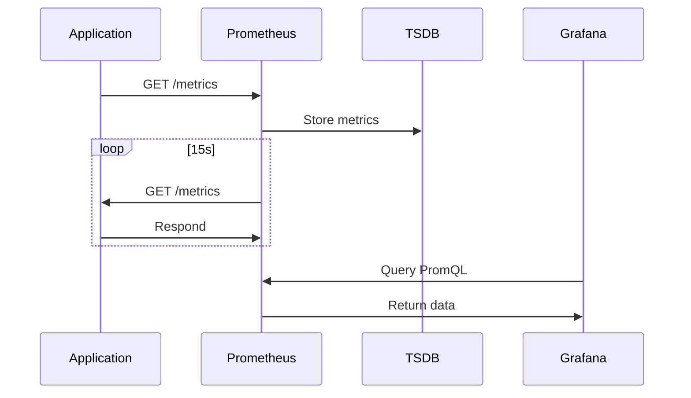

<!-- Generated by Groq via GitHub Actions -->
<!-- Topic ID: T173 -->
<!-- Category: Observability -->
<!-- Generated at UTC: 2026-11-04T20:29:42.843407+00:00 -->

# Prometheus

## 1. What problem does this solve?

**Motivation**  
In a modern backend stack you have many moving parts: HTTP servers, databases, message queues, AI inference services, and more. Each component can fail silently, degrade performance, or become a bottleneck. Without a systematic way to *measure* what’s happening, you’re left guessing when something goes wrong.

**What problem exists**  
- **Visibility**: You can’t see the health or performance of services in real time.  
- **Alerting**: You can’t automatically detect anomalies or thresholds being breached.  
- **Root‑cause analysis**: When an outage occurs, you lack historical metrics to trace the issue.  

**Why the problem matters**  
- **Downtime costs**: Even a few minutes of unobserved failure can cost revenue and damage reputation.  
- **Capacity planning**: Without metrics you can’t predict when to scale.  
- **Compliance**: Some regulations require audit trails of system performance.  

**What happens if this concept is not used**  
- Silent failures lead to user complaints.  
- Over‑provisioning wastes resources.  
- Harder to meet SLAs and SLOs.  

**Where this concept appears in real backend systems**  
- Microservice clusters (Kubernetes, ECS).  
- Monolithic APIs with multiple layers (API gateway, service layer, DB).  
- AI pipelines where inference latency is critical.  
- Data pipelines (Kafka, Redis streams).  

---

## 2. Mental model

**Analogy**  
Think of Prometheus like a *traffic camera system* for your backend.  
- The camera (scraper) takes snapshots (scrapes) of traffic flow (metrics) at regular intervals.  
- The *traffic control center* (Prometheus server) stores all snapshots and lets you query them to see how busy a road is, where congestion occurs, or if a lane is closed.  
- If a road is blocked, the control center can alert traffic police (alertmanager) to dispatch help.

**Engineering model**  
- **Scrape**: Pull metrics from endpoints.  
- **Store**: Time‑series database.  
- **Query**: PromQL to analyze trends.  
- **Alert**: Rules that trigger notifications.  

---

## 3. Deep explanation

### Internals
- **Exporter**: Exposes metrics via HTTP in a plain‑text format.  
- **Scraper**: Prometheus server pulls (`GET /metrics`) from exporters.  
- **TSDB**: Columnar time‑series database optimized for append‑only writes.  
- **PromQL**: Domain‑specific query language.  
- **Alertmanager**: Handles alert routing, deduplication, silencing.

### Important terminology
| Term | Meaning |
|------|---------|
| **Metric** | A named value with optional labels (e.g., `http_requests_total{method="GET"}`) |
| **Label** | Key/value pair that adds dimensionality (e.g., `service="auth"`). |
| **Scrape interval** | How often Prometheus pulls metrics (default 15s). |
| **Retention** | How long data is kept (default 15d). |
| **Target** | A service Prometheus monitors. |
| **Rule** | A PromQL expression that produces alerts or recording rules. |

### Trade‑offs
- **Pull vs Push**: Prometheus prefers pull; push is possible via `pushgateway` but is less reliable for short‑lived jobs.  
- **Scrape interval**: Shorter intervals give finer granularity but increase load on exporters and network.  
- **Retention**: Longer retention needs more storage; older data may be downsampled.  
- **Label cardinality**: Too many unique label values can explode memory usage.

### Failure modes
- **Exporter crash** → metrics stop, Prometheus marks target as down.  
- **Network partition** → Prometheus may miss scrapes; data gaps.  
- **High cardinality** → TSDB memory exhaustion.  
- **Misconfigured scrape interval** → Over‑scraping or under‑scraping.

### Limitations
- **No built‑in tracing** – separate tools (OpenTelemetry).  
- **No push model for long‑running jobs** – use pushgateway sparingly.  
- **Limited to numeric metrics** – no complex objects.  
- **No built‑in log aggregation** – use Loki or ELK.

### Where it fits in a backend architecture
```
┌───────────────────────┐
│  Application (Node.js)│
│  ├─ /metrics (prom-client)
│  └─ business logic
└─────────────┬─────────┘
              │
          (HTTP)
              │
┌───────────────────────┐
│   Prometheus Server   │
│  ├─ Scraper            │
│  ├─ TSDB               │
│  ├─ PromQL             │
│  └─ Alertmanager       │
└─────────────┬─────────┘
              │
          (Grafana)
              │
          (Dashboards)
```

### Interaction with related concepts
- **Tracing**: Prometheus metrics + OpenTelemetry traces give a full picture.  
- **Logging**: Prometheus metrics + Loki logs correlate events.  
- **Service Mesh**: Envoy exposes metrics automatically; Prometheus scrapes them.  
- **CI/CD**: Prometheus can be used to monitor test runs (e.g., test duration metrics).

---

## 4. How it works

1. **Exporter exposes metrics**  
   - HTTP endpoint `/metrics` returns plain text.  
2. **Prometheus config**  
   - `scrape_configs` define targets and intervals.  
3. **Scraper pulls metrics**  
   - `GET /metrics` → parse into time‑series.  
4. **TSDB stores**  
   - Append‑only blocks; compaction over time.  
5. **PromQL queries**  
   - User or Grafana asks for data.  
6. **Alertmanager**  
   - Evaluates rules; sends notifications.  



---

## 5. Practical implementation

### 5.1 Install dependencies

```bash
npm install express prom-client
```

### 5.2 Basic Node.js server with metrics

```ts
// src/server.ts
import express from 'express';
import client, { collectDefaultMetrics, Counter, Histogram } from 'prom-client';

const app = express();
const port = 3000;

// 1️⃣ Collect Node.js & Express defaults
collectDefaultMetrics();

// 2️⃣ Custom metrics
const httpRequestsTotal = new Counter({
  name: 'http_requests_total',
  help: 'Total number of HTTP requests',
  labelNames: ['method', 'route', 'status_code'],
});

const httpRequestDuration = new Histogram({
  name: 'http_request_duration_seconds',
  help: 'Duration of HTTP requests in seconds',
  labelNames: ['method', 'route', 'status_code'],
  buckets: [0.1, 0.3, 0.5, 1, 2, 5],
});

// 3️⃣ Middleware to record metrics
app.use((req, res, next) => {
  const end = httpRequestDuration.startTimer();
  res.on('finish', () => {
    const labels = {
      method: req.method,
      route: req.route?.path ?? req.path,
      status_code: res.statusCode.toString(),
    };
    httpRequestsTotal.inc(labels);
    end(labels);
  });
  next();
});

// 4️⃣ Example route
app.get('/hello', (req, res) => {
  res.send('Hello, Prometheus!');
});

// 5️⃣ Metrics endpoint
app.get('/metrics', async (req, res) => {
  res.set('Content-Type', client.register.contentType);
  res.end(await client.register.metrics());
});

app.listen(port, () => {
  console.log(`🚀 Server listening on http://localhost:${port}`);
});
```

**Run**

```bash
ts-node src/server.ts
```

**Verify**

```bash
curl http://localhost:3000/metrics | grep http_requests_total
```

### 5.3 Prometheus configuration (`prometheus.yml`)

```yaml
global:
  scrape_interval: 15s

scrape_configs:
  - job_name: 'nodejs-app'
    static_configs:
      - targets: ['localhost:3000']
```

### 5.4 Docker Compose (optional)

```yaml
version: '3.8'
services:
  app:
    build: .
    ports:
      - "3000:3000"
  prometheus:
    image: prom/prometheus:v2.52.0
    volumes:
      - ./prometheus.yml:/etc/prometheus/prometheus.yml
    ports:
      - "9090:9090"
```

---

## 6. Production considerations

| Concern | Tips |
|---------|------|
| **Scalability** | Use service discovery (Kubernetes, Consul). Keep scrape interval > 15s for many targets. |
| **Reliability** | Expose `/metrics` on a health‑check endpoint. Use `pushgateway` only for batch jobs. |
| **Security** | Basic auth or mTLS for `/metrics`. Avoid exposing sensitive labels. |
| **Observability** | Combine with Grafana dashboards, Loki logs, OpenTelemetry traces. |
| **Performance** | Keep metric cardinality low. Use `histogram` buckets wisely. |
| **Error handling** | Scrape failures are logged; set `scrape_timeout` to avoid hanging. |
| **Resource usage** | TSDB can grow fast; enable `--storage.tsdb.retention.time`. |
| **Operational concerns** | Backup TSDB, monitor disk usage, rotate logs. |
| **Failure recovery** | Alertmanager routes to Slack/PagerDuty. Use `relabel_configs` to filter noisy targets. |
| **Deployment** | Helm charts for Kubernetes; keep Prometheus and Alertmanager separate for high availability. |

---

## 7. Common mistakes

1. **Exposing too many labels**  
   - *Problem*: Cardinality explosion → memory blowup.  
   - *Fix*: Keep labels to a few high‑level dimensions (service, status).  

2. **Using `pushgateway` for long‑running services**  
   - *Problem*: Pushgateway is meant for batch jobs; metrics can become stale.  
   - *Fix*: Let services expose `/metrics` and let Prometheus scrape.  

3. **Scrape interval too short**  
   - *Problem*: Over‑scraping increases load and network traffic.  
   - *Fix*: 15–30s is usually sufficient; adjust per metric granularity.  

4. **Ignoring retention**  
   - *Problem*: TSDB grows indefinitely → disk exhaustion.  
   - *Fix*: Set `--storage.tsdb.retention.time` and consider downsampling.  

5. **Not securing `/metrics`**  
   - *Problem*: Sensitive data leakage.  
   - *Fix*: Add auth or restrict network access.  

---

## 8. Senior engineer perspective

### Architecture decisions
- **Centralized vs decentralized**: A single Prometheus server vs federation.  
- **Scrape vs push**: Use pushgateway only for CI pipelines.  
- **Retention strategy**: 15d for hot data, 30d for cold, with downsampling.  

### Trade‑offs
- **Granularity vs cost**: More metrics → better insight but higher storage.  
- **Latency vs reliability**: Short scrape intervals give near‑real‑time alerts but risk missing scrapes under load.  

### Bottlenecks
- **TSDB write path**: High cardinality can saturate disk I/O.  
- **Alertmanager**: Too many alerts can overwhelm notification channels.  

### Failure scenarios
- **Prometheus crash** → metrics lost until next scrape.  
- **Exporter crash** → target marked down; alerts fire.  

### Monitoring
- **Self‑monitoring**: Expose Prometheus metrics for Prometheus itself (`prometheus_engine_query_duration_seconds`).  
- **Alerting**: SLO‑based alerts (e.g., latency > 95th percentile).  

### Cost/performance
- **Storage**: Use remote write to object storage (Cortex, Thanos) for long‑term retention.  
- **Compute**: Run Prometheus on dedicated nodes; avoid running on application servers.  

### When NOT to use
- **Very small, short‑lived services**: Overhead may outweigh benefit.  
- **High‑cardinality real‑time analytics**: Use a dedicated analytics platform.  

---

## 9. Interview questions

| Level | Question | Answer Points |
|-------|----------|---------------|
| Beginner | What is the purpose of the `/metrics` endpoint in a Prometheus exporter? | Exposes numeric metrics in a plain‑text format for Prometheus to scrape. |
| Beginner | How does Prometheus decide when to scrape a target? | Based on `scrape_interval` in `prometheus.yml`; default 15s. |
| Senior | Explain the difference between a Counter and a Gauge in Prometheus. | Counter: monotonically increasing, reset on restart; Gauge: can go up/down. |
| Senior | Describe how you would handle high cardinality metrics in a large microservice architecture. | Limit label cardinality, use recording rules, aggregate metrics, consider using histogram buckets. |
| Scenario | Your service exposes a metric `http_requests_total{method="GET", status="200"}`. After a deployment, the metric stops appearing. What steps would you take to debug? | Check exporter health, ensure `/metrics` is reachable, verify Prometheus target status, look at Prometheus logs, confirm scrape interval, inspect network/firewall. |

---

## 10. Hands‑on task

**Task**: Add a *request latency* histogram to the existing Node.js app and create a Grafana dashboard that visualizes the 95th percentile latency per route.  

1. Update `src/server.ts` to expose a `http_request_latency_seconds` histogram.  
2. Configure Prometheus to scrape the app.  
3. Import the Grafana dashboard from the Prometheus community (search “Prometheus HTTP latency”).  
4. Verify that the dashboard updates in real time when you hit different routes.  

---

## 11. Quick revision

- Prometheus is a pull‑based time‑series database.  
- Exporters expose metrics via `/metrics`.  
- PromQL is used for querying and alerting.  
- Labels add dimensionality; keep cardinality low.  
- Scrape interval defaults to 15 s; adjust per need.  
- Alertmanager routes alerts; use silencing and grouping.  
- Use `prom-client` in Node.js to instrument services.  
- Store metrics in TSDB; set retention policies.  
- Secure `/metrics` with auth or network policies.  
- Combine with Grafana, Loki, and OpenTelemetry for full observability.  

---

## 12. References

- https://prometheus.io/docs/introduction/overview/  
- https://prometheus.io/docs/prometheus/latest/getting_started/  
- https://prometheus.io/docs/prometheus/latest/alerting/  
- https://prometheus.io/docs/instrumenting/clientlibs/  
- https://github.com/siimon/prom-client  
- https://grafana.com/docs/grafana/latest/datasources/prometheus/  
- https://prometheus.io/docs/operating/remote_write/  

---
