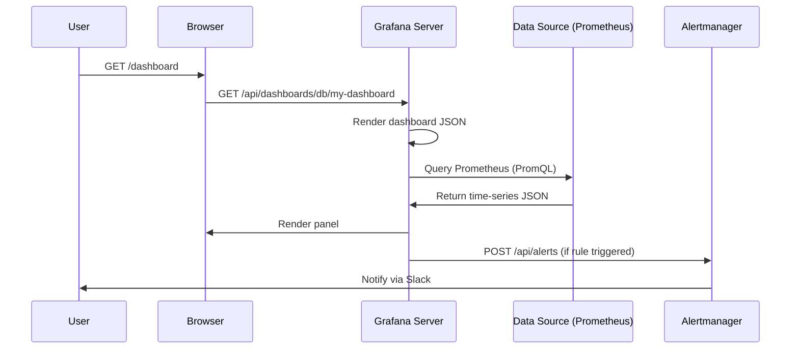

<!-- Generated by Groq via GitHub Actions -->
<!-- Topic ID: T174 -->
<!-- Category: Observability -->
<!-- Generated at UTC: 2026-11-04T20:29:42.843407+00:00 -->

# Grafana

## 1. What problem does this solve?

**Motivation**  
In a modern backend stack you generate a lot of telemetry: logs, metrics, traces, and even custom events.  
Without a unified way to *visualize* and *analyze* that data, you end up:

- Sifting through raw log files or querying a database manually.
- Writing ad‑hoc dashboards in spreadsheets or custom web pages.
- Missing early warning signs of performance regressions or outages.

**What problem exists**  
You need a single, flexible, and extensible UI that can:

- Pull data from many heterogeneous sources (Prometheus, Loki, PostgreSQL, Redis, etc.).
- Render time‑series, histograms, tables, and more.
- Allow teams to create, share, and version dashboards.

**Why the problem matters**  
- **Visibility**: Operators can detect anomalies before users notice.
- **Collaboration**: Teams can agree on metrics and dashboards.
- **Decision‑making**: Data‑driven insights guide capacity planning and feature prioritization.

**What happens if this concept is not used**  
- Latency to discover issues increases.
- Inefficient use of engineering time (manual queries, duplicated dashboards).
- Higher MTTR (Mean Time To Recovery) and potentially higher SLA violations.

**Where this concept appears in real backend systems**  
- Monitoring microservices with Prometheus + Grafana.
- Visualizing Redis cache hit ratios.
- Tracking request latency in a Next.js API route.
- Observing AI inference latency and GPU utilization.

---

## 2. Mental model

**Analogy**  
Think of Grafana as a *smart dashboard* for a factory.  
- The factory produces many different kinds of data (temperature, pressure, speed).  
- Workers need a single control room where they can see all relevant metrics in real time, set alarms, and drill down into details.  
- Grafana is that control room: it pulls data from various machines (data sources) and presents it in a unified, interactive interface.

**Engineering model**  
- **Data Sources**: External systems (Prometheus, Loki, PostgreSQL, etc.) expose data via APIs or query languages.  
- **Panels**: Individual visualizations (graphs, tables, heatmaps).  
- **Dashboards**: Collections of panels arranged on a grid.  
- **Variables**: Dynamic parameters that can be reused across panels (e.g., selecting a service name).  
- **Alerting**: Rules that evaluate panel queries and trigger notifications.

---

## 3. Deep explanation

### Internals
- **Grafana Server**: Node.js/Go (depending on version) that serves the UI, handles authentication, and proxies queries to data sources.
- **Data Source Plugins**: Each plugin implements a *query language* (e.g., PromQL for Prometheus) and translates Grafana queries into the source’s API calls.
- **Rendering Engine**: Uses a lightweight JavaScript library (e.g., Plotly, Chart.js) to draw panels in the browser.
- **Alerting Engine**: Evaluates queries at a configurable interval; can send alerts via Slack, PagerDuty, email, etc.

### Important terminology
- **Query**: The expression that fetches data from a source (e.g., `sum(rate(http_requests_total[5m])) by (service)`).
- **Time Range**: The period over which the query is evaluated (last 5 minutes, last 24 hours, etc.).
- **Variable**: A templated value that can be changed by the user (e.g., `$service`).
- **Dashboard JSON**: The serializable representation of a dashboard, used for versioning and API operations.
- **Alert Rule**: A condition that, when true, triggers an alert.

### Trade‑offs
| Aspect | Pros | Cons |
|--------|------|------|
| **Single UI** | Unified view, less context switching | Requires learning Grafana UI |
| **Plugin ecosystem** | Supports many data sources | Some plugins lag behind source updates |
| **Alerting** | Built‑in, no extra tooling | Limited to query‑based alerts; complex logic may need external systems |
| **Performance** | Client‑side rendering | Large dashboards can be slow in the browser |

### Failure modes
- **Data source unavailability**: Panels show “no data” or errors; alerts may fire if thresholds are not met.
- **Query timeouts**: Long queries can block the UI; Grafana may abort after a timeout.
- **Authentication failures**: If the data source requires auth, Grafana may return 401/403.

### Limitations
- **Real‑time constraints**: Grafana is best suited for near‑real‑time (seconds to minutes). For millisecond latency, consider dedicated dashboards.
- **Complex data transformations**: While Grafana supports some transformations, heavy ETL is better handled upstream.
- **Security**: Exposing data sources directly to Grafana can expose sensitive data if not properly secured.

### Where this concept fits in a backend architecture
```
┌───────────────────────┐
│   Application Layer   │
│  (Node.js, FastAPI)   │
└─────────────┬─────────┘
              │
              ▼
┌───────────────────────┐
│   Telemetry Layer     │
│  (Prometheus, Loki,   │
│   custom metrics)     │
└─────────────┬─────────┘
              │
              ▼
┌───────────────────────┐
│   Grafana Server      │
│  (Dashboard UI)       │
└───────────────────────┘
```
Grafana sits *above* the telemetry layer, pulling data via the data source plugins.

### Interaction with related backend concepts
- **Prometheus**: Grafana queries Prometheus using PromQL.
- **Loki**: For log aggregation; Grafana can display logs in panels.
- **Alertmanager**: Grafana can forward alerts to Alertmanager or use its own alerting.
- **CI/CD**: Dashboards can be versioned in Git and deployed via Grafana API.
- **RBAC**: Grafana supports fine‑grained access control, aligning with your auth system.

---

## 4. How it works

1. **User opens Grafana** → Browser requests `/login` → Authenticated via LDAP/OAuth.
2. **Dashboard request** → Grafana fetches dashboard JSON from its database.
3. **Panel rendering** → For each panel, Grafana builds a query (including variables).
4. **Query execution** → Grafana proxies the query to the appropriate data source plugin.
5. **Data retrieval** → Data source returns JSON → Grafana renders the panel.
6. **Alert evaluation** → At configured intervals, Grafana evaluates alert rules; if triggered, sends notification.



---

## 5. Practical implementation

Below is a minimal Node.js example that:

1. Exposes a Prometheus‑compatible metrics endpoint.
2. Uses the Grafana HTTP API to create a dashboard programmatically.

```ts
// metrics.ts
import express from 'express';
import client from 'prom-client';

const app = express();
const register = new client.Registry();

// Example metric
const httpRequestsTotal = new client.Counter({
  name: 'http_requests_total',
  help: 'Total HTTP requests',
  labelNames: ['method', 'route'],
});
register.registerMetric(httpRequestsTotal);

// Middleware to count requests
app.use((req, res, next) => {
  httpRequestsTotal.inc({ method: req.method, route: req.path });
  next();
});

app.get('/metrics', async (_req, res) => {
  res.set('Content-Type', register.contentType);
  res.end(await register.metrics());
});

app.listen(3000, () => console.log('Metrics server listening on :3000'));
```

```ts
// grafana-dashboard.ts
import fetch from 'node-fetch';

const GRAFANA_URL = 'http://localhost:3000';
const API_KEY = 'YOUR_GRAFANA_API_KEY';

const dashboard = {
  title: 'Node.js App Metrics',
  panels: [
    {
      title: 'HTTP Requests per Second',
      type: 'graph',
      datasource: 'Prometheus',
      targets: [
        {
          expr: 'rate(http_requests_total[1m])',
          legendFormat: '{{method}} {{route}}',
        },
      ],
      gridPos: { x: 0, y: 0, w: 12, h: 8 },
    },
  ],
  schemaVersion: 16,
  version: 1,
};

async function createDashboard() {
  const res = await fetch(`${GRAFANA_URL}/api/dashboards/db`, {
    method: 'POST',
    headers: {
      'Content-Type': 'application/json',
      Authorization: `Bearer ${API_KEY}`,
    },
    body: JSON.stringify({ dashboard, folderId: 0, overwrite: true }),
  });

  if (!res.ok) {
    const err = await res.text();
    throw new Error(`Failed to create dashboard: ${err}`);
  }
  console.log('Dashboard created');
}

createDashboard().catch(console.error);
```

**Explanation**

- `metrics.ts` exposes `/metrics` that Prometheus scrapes.  
- `grafana-dashboard.ts` uses the Grafana HTTP API to push a dashboard JSON.  
- The dashboard queries the `http_requests_total` counter and displays it as a graph.

---

## 6. Production considerations

| Concern | What to watch for | Mitigation |
|---------|-------------------|------------|
| **Scalability** | Many dashboards → many queries | Use templated variables, limit query resolution, cache results in Prometheus |
| **Reliability** | Grafana downtime → no visibility | Deploy Grafana in HA mode (two nodes, shared DB) |
| **Security** | Exposing data sources | Use TLS, restrict data source access, enable Grafana RBAC |
| **Observability** | Grafana itself needs metrics | Expose Grafana metrics (`/metrics`) and monitor them |
| **Performance** | Large panels can slow the browser | Use `maxDataPoints`, enable `timeSeries` rendering, paginate dashboards |
| **Error handling** | API failures when creating dashboards | Retry with exponential backoff, log errors |
| **Resource usage** | Grafana can be memory heavy | Allocate sufficient RAM, monitor GC, use `--max-threads` |
| **Operational concerns** | Backup dashboards | Export JSON via API, store in Git |
| **Failure recovery** | Data source outages | Configure alerting on data source health, fallback dashboards |
| **Deployment** | Docker image updates | Use immutable tags, test in staging, use Helm charts |

---

## 7. Common mistakes

| Mistake | Why it’s problematic |
|---------|----------------------|
| **Hard‑coding queries in dashboards** | Hard to maintain; changes require editing many panels |
| **Ignoring time‑range defaults** | Users may see “no data” if the default range is too narrow |
| **Over‑loading dashboards with panels** | Browser freezes, slow load times |
| **Not securing data sources** | Sensitive metrics exposed to unauthorized users |
| **Using Grafana for real‑time alerts only** | Grafana alerting is query‑based; complex logic may need external systems |
| **Failing to version dashboards** | Hard to roll back changes, no audit trail |
| **Not monitoring Grafana itself** | You may lose visibility into Grafana’s health |

---

## 8. Senior engineer perspective

### What changes at scale
- **Architecture**: Deploy Grafana in a highly available cluster, use a shared PostgreSQL or MySQL backend for dashboards.
- **Data source scaling**: Prometheus may need federation or remote write; Loki may need sharding.
- **Alerting**: Move to a dedicated alerting system (PagerDuty, Opsgenie) and integrate via Grafana’s notification channels.

### Design decisions
- **Data source choice**: Prefer Prometheus for metrics, Loki for logs, but consider Grafana Cloud for managed services.
- **Dashboard ownership**: Assign teams to maintain specific dashboards; use folder permissions.
- **Alerting strategy**: Combine Grafana alerts with external systems; use “alerting rules” in Prometheus for critical thresholds.
- **Cost**: Running Grafana on a dedicated VM vs. managed Grafana Cloud; evaluate storage costs for Loki.
- **Bottlenecks**: Panel query latency, Grafana’s single‑threaded rendering, database I/O for dashboard storage.
- **Failure scenarios**: Data source outage → fallback to cached data; Grafana crash → HA failover.
- **Monitoring**: Expose Grafana metrics (`/metrics`) and set up dashboards for Grafana health.
- **When NOT to use**: If you need sub‑second latency dashboards or heavy custom visualizations beyond Grafana’s capabilities, consider a custom UI.

---

## 9. Interview questions

1. **Beginner**: *What is a Grafana panel and how does it differ from a dashboard?*  
   *Answer*: A panel is a single visualization (graph, table, etc.) within a dashboard. A dashboard is a collection of panels arranged on a grid.

2. **Beginner**: *Explain how Grafana queries a Prometheus data source.*  
   *Answer*: Grafana sends a PromQL expression to the Prometheus HTTP API (`/api/v1/query` or `/api/v1/query_range`) and receives JSON time‑series data.

3. **Senior**: *Describe how you would design a Grafana alerting pipeline for a microservice that must maintain 99.9% uptime.*  
   *Answer*: Use Prometheus alert rules for critical metrics, forward alerts to Grafana, configure Grafana to send notifications to PagerDuty, set up alert suppression, and monitor alert health dashboards.

4. **Senior**: *What are the trade‑offs between using Grafana’s built‑in alerting versus an external system like Alertmanager?*  
   *Answer*: Built‑in alerting is easier to set up but limited to query‑based rules and may not support complex routing. Alertmanager offers richer routing, silencing, and integration with external systems but requires additional configuration.

5. **Scenario/Debugging**: *A dashboard panel shows “no data” even though Prometheus has metrics. What steps would you take to debug this?*  
   *Answer*:  
   - Verify the panel query syntax.  
   - Check the time range and panel resolution.  
   - Inspect Grafana’s data source configuration (URL, auth).  
   - Look at Grafana logs for query errors.  
   - Query Prometheus directly with the same PromQL to confirm data exists.  
   - Ensure the metric name and labels match.  

---

## 10. Hands‑on task

**Task**: Create a Grafana dashboard that visualizes the average response time of a Next.js API route (`/api/hello`) over the last 24 hours.

1. Instrument the route with a Prometheus histogram (`http_request_duration_seconds`).
2. Expose `/metrics` via `prom-client`.
3. Use the Grafana HTTP API to programmatically create a dashboard that:
   - Shows a graph of the histogram’s `avg` over time.
   - Includes a variable to filter by HTTP method.
4. Deploy Grafana in Docker, configure Prometheus as a data source, and verify the dashboard displays data.

---

## 11. Quick revision

- Grafana is a UI for visualizing telemetry from many data sources.  
- **Panels** = individual visualizations; **Dashboards** = collections of panels.  
- Data sources are plugged in via plugins; Grafana proxies queries.  
- Variables enable dynamic filtering across panels.  
- Alert rules evaluate queries and can notify external systems.  
- Grafana’s performance depends on query complexity and panel count.  
- Secure data sources, enable RBAC, and monitor Grafana’s own metrics.  
- Use the Grafana HTTP API to create, update, and version dashboards.  
- At scale, consider HA deployment, shared DB, and external alerting.  
- Common pitfalls: hard‑coded queries, over‑crowded dashboards, unsecured data sources.

---

## 12. References

- https://grafana.com/docs/grafana/latest/  
- https://prometheus.io/docs/prometheus/latest/querying/basics/  
- https://grafana.com/docs/grafana/latest/datasources/prometheus/  
- https://grafana.com/docs/grafana/latest/alerting/  
- https://grafana.com/docs/grafana/latest/http_api/dashboard/  
- https://grafana.com/docs/grafana/latest/installation/docker/  
- https://prometheus.io/docs/operating/remote_write/  

---
