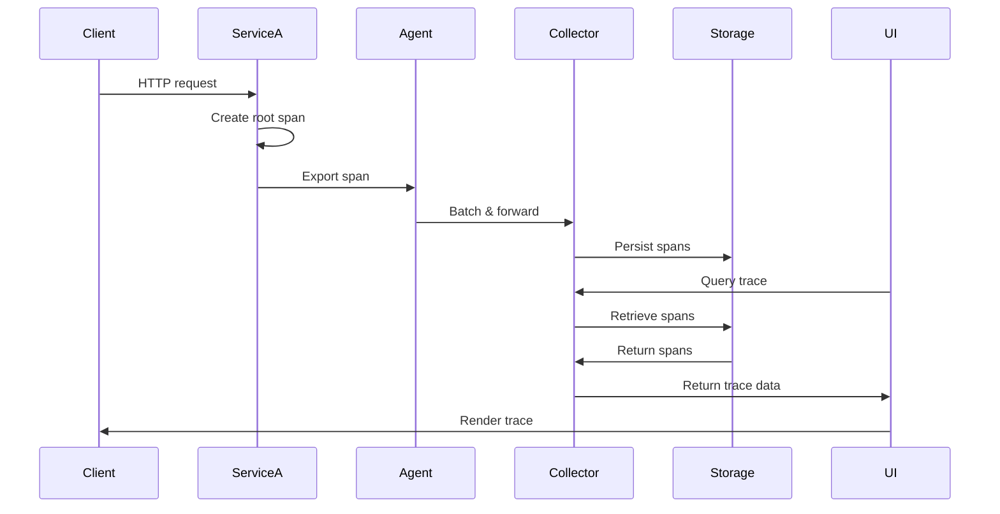

<!-- Generated by Groq via GitHub Actions -->
<!-- Topic ID: T175 -->
<!-- Category: Observability -->
<!-- Generated at UTC: 2026-11-05T08:02:34.232901+00:00 -->

# Jaeger

## 1. What problem does this solve?

### Motivation
Modern back‑end systems are rarely monolithic. A single user request often touches dozens of services, databases, queues, and external APIs. When something goes wrong—slow response, error, or data inconsistency—debugging is hard because the failure can be spread across many components.  
**Distributed tracing** gives a single, end‑to‑end view of a request’s journey, showing latency per hop and where errors occur.

### What problem exists
- **Hard to pinpoint latency sources**: A 2 s request may be 1 s in service A, 0.5 s in service B, 0.3 s in DB, etc.
- **Hard to correlate logs**: Logs are often timestamped but not linked to a single request.
- **Hard to debug failures**: A downstream service may return an error that propagates back to the client, but the root cause is buried.

### Why the problem matters
- **User experience**: Slow or failing requests hurt retention.
- **Operational cost**: Unidentified bottlenecks lead to over‑provisioning.
- **Security**: Mis‑routed requests or unauthorized calls can be hard to detect.

### Consequences of not using tracing
- **Blind spots**: You can’t see where latency accumulates.
- **Longer MTTR**: Debugging takes hours instead of minutes.
- **Inconsistent monitoring**: Metrics alone can’t show causal chains.

### Where it appears in real systems
- **Microservice architectures**: Each service emits spans.
- **Serverless functions**: Tracing across cold starts and invocations.
- **Event‑driven pipelines**: Tracing message flow through Kafka/Redis.
- **Service meshes**: Envoy sidecars automatically emit traces.

---

## 2. Mental model

### Simple analogy
Think of a **delivery truck** that must pass through several **hubs** (services) before reaching the customer. Each hub records the truck’s arrival time, departure time, and any issues. By collecting all hub logs, you can reconstruct the entire delivery timeline and spot where delays happened.

### Precise engineering model
- **Trace**: The entire journey of a request (the truck).
- **Span**: A single hop or operation (a hub). Contains start/end timestamps, operation name, tags, logs, and a unique ID.
- **Trace context**: A lightweight token (trace ID + span ID + sampling flag) that travels with the request, allowing each service to create a child span.
- **Sampling**: Decide which traces to keep to avoid overwhelming storage.
- **Storage**: Persist spans in a backend (Cassandra, Elasticsearch, Kafka, etc.) for later querying.

---

## 3. Deep explanation

### Internals
| Component | Role |
|-----------|------|
| **Agent** | Lightweight daemon on each host that receives spans over UDP/TCP, batches them, and forwards to the Collector. |
| **Collector** | Receives batches, validates, and writes to storage. Can be scaled horizontally. |
| **Storage** | Back‑end (Cassandra, Elasticsearch, Kafka, etc.) that stores spans. |
| **Query** | REST API that serves the Jaeger UI and allows programmatic queries. |
| **UI** | Web interface for visualizing traces. |

### Important terminology
- **Trace ID**: 128‑bit identifier shared across all spans of a request.
- **Span ID**: 64‑bit identifier unique to a span.
- **Parent Span ID**: Links child spans to their parent.
- **Baggage**: Key/value pairs propagated across all downstream spans.
- **Tags**: Metadata (e.g., HTTP status, DB query) attached to a span.
- **Logs**: Structured events inside a span (e.g., error messages).

### Trade‑offs
| Decision | Pros | Cons |
|----------|------|------|
| **Sampling rate** | Reduces storage and network load. | Misses rare but critical traces. |
| **Storage backend** | Cassandra: high write throughput. | Requires cluster management. |
| | Elasticsearch: powerful search. | Higher query latency, more RAM. |
| | Kafka: durable, replayable. | Requires consumer for query. |
| **Agent vs. direct exporter** | Agent reduces network overhead. | Extra component to maintain. |

### Failure modes
- **Context loss**: If a service fails to propagate trace headers, its spans are orphaned.
- **High cardinality tags**: Tags with many unique values (e.g., user IDs) can blow up storage and degrade query performance.
- **Collector overload**: Too many incoming batches can cause backpressure or dropped spans.
- **Storage failure**: Data loss or query unavailability.

### Limitations
- **Sampling bias**: Rare errors may never be captured.
- **Storage cost**: Long‑term retention of all traces is expensive.
- **Complexity**: Requires instrumentation in every service.

### Where it fits in a backend architecture
- **Instrumentation layer**: SDKs (OpenTelemetry, Jaeger client) sit in each service.
- **Transport layer**: Agent/Collector handle network traffic.
- **Observability stack**: Traces complement logs and metrics; often integrated with Prometheus and Loki.

### Interaction with related concepts
- **Logging**: Use trace IDs in logs for correlation.
- **Metrics**: Export trace latency as histograms for Prometheus.
- **Service mesh**: Envoy can auto‑inject tracing headers.
- **CI/CD**: Automated tests can verify trace propagation.

---

## 4. How it works

### Step‑by‑step flow

1. **Instrumentation**: Service code creates a root span for an incoming request.
2. **Context propagation**: The service reads trace headers (e.g., `uber-trace-id`) from the incoming HTTP request and attaches them to the span.
3. **Span creation**: Child spans are created for internal calls, DB queries, etc.
4. **Export**: Spans are sent to the local Jaeger Agent via UDP/TCP.
5. **Batching**: Agent batches spans and forwards to the Collector.
6. **Storage**: Collector writes spans to the configured backend.
7. **Query**: UI or API queries the backend for traces by trace ID, service name, or time range.
8. **Visualization**: UI renders a flame‑graph or timeline of spans.



---

## 5. Practical implementation

Below is a minimal **Node.js / Express** service instrumented with OpenTelemetry and Jaeger.  
Assumes Docker Compose runs Jaeger locally.

```bash
# docker-compose.yml
version: "3"
services:
  jaeger:
    image: jaegertracing/all-in-one:1.48
    ports:
      - "16686:16686"   # UI
      - "14268:14268"   # Collector HTTP
      - "14250:14250"   # gRPC Collector
      - "6831:6831/udp" # Agent UDP
```

```bash
# npm install @opentelemetry/api @opentelemetry/sdk-node @opentelemetry/exporter-jaeger express
```

```ts
// src/server.ts
import express from 'express';
import { NodeSDK } from '@opentelemetry/sdk-node';
import { JaegerExporter } from '@opentelemetry/exporter-jaeger';
import { registerInstrumentations } from '@opentelemetry/instrumentation';
import { HttpInstrumentation } from '@opentelemetry/instrumentation-http';
import { ExpressInstrumentation } from '@opentelemetry/instrumentation-express';
import { Resource } from '@opentelemetry/resources';
import { SemanticResourceAttributes } from '@opentelemetry/semantic-conventions';

// 1️⃣ Set up OpenTelemetry SDK
const sdk = new NodeSDK({
  resource: new Resource({
    [SemanticResourceAttributes.SERVICE_NAME]: 'user-service',
    [SemanticResourceAttributes.SERVICE_VERSION]: '1.0.0',
  }),
  traceExporter: new JaegerExporter({
    // Use the agent (default) or collector endpoint
    serviceName: 'user-service',
    host: 'localhost',
    port: 6831, // UDP port for agent
  }),
  instrumentations: [
    new HttpInstrumentation(),
    new ExpressInstrumentation(),
  ],
});

sdk.start()
  .then(() => console.log('Tracing initialized'))
  .catch((err) => console.error('Error initializing tracing', err));

// 2️⃣ Express app
const app = express();
app.use(express.json());

// 3️⃣ Sample route
app.get('/users/:id', async (req, res) => {
  const { id } = req.params;
  // Simulate DB call
  const user = await fakeDbCall(id);
  res.json(user);
});

async function fakeDbCall(id: string) {
  // Simulate latency
  await new Promise((r) => setTimeout(r, 120));
  return { id, name: 'Alice', email: 'alice@example.com' };
}

app.listen(3000, () => console.log('Server listening on :3000'));
```

**Key lines explained**

- `NodeSDK` sets up the OpenTelemetry runtime.
- `JaegerExporter` points to the local Jaeger Agent (`localhost:6831`).
- `HttpInstrumentation` and `ExpressInstrumentation` automatically create spans for incoming HTTP requests and outgoing HTTP calls.
- The `Resource` identifies the service in Jaeger UI.

**Running**

```bash
docker compose up -d
node src/server.ts
curl http://localhost:3000/users/42
```

Open `http://localhost:16686` to view the trace.

---

## 6. Production considerations

| Concern | What to do |
|---------|------------|
| **Scalability** | Deploy multiple collectors behind a load balancer. Use a durable storage backend (Cassandra, Elasticsearch, or Kafka). |
| **Reliability** | Run agents as sidecars or DaemonSets. Enable retries and backpressure handling. |
| **Security** | Encrypt transport (TLS) between services, agent, and collector. Use mutual TLS for authentication. |
| **Observability** | Export trace latency as Prometheus histograms. Correlate trace IDs in logs (e.g., via Loki). |
| **Performance** | Sample aggressively in production (e.g., 1 % of requests). Use batch size tuning. |
| **Error handling** | Ensure spans are finished even on exceptions. Use `try/finally`. |
| **Resource usage** | Monitor agent memory (UDP buffer). Collector CPU for ingest. Storage disk for retention. |
| **Operational concerns** | Enable health checks (`/healthz`). Use sidecar pattern to avoid service restarts. |
| **Failure recovery** | Persist unsent spans to disk in the agent. Use a durable queue (Kafka) if you need replay. |
| **Deployment** | Prefer containerized deployment (Docker/K8s). Use Helm charts for Jaeger. |

---

## 7. Common mistakes

| Mistake | Why it’s problematic |
|---------|----------------------|
| **Not propagating trace headers** | Spans become orphaned; you lose end‑to‑end visibility. |
| **Using high‑cardinality tags (e.g., user IDs)** | Causes storage bloat and slows queries. |
| **No sampling** | Overwhelms storage and network; traces become unusable. |
| **Instrumenting too many spans** | Adds overhead; can degrade request latency. |
| **Using in‑memory storage in prod** | Data loss on restart; no persistence. |
| **Ignoring baggage** | Useful for cross‑service context (e.g., auth tokens). |
| **Hard‑coding exporter endpoints** | Breaks when services move; use environment variables. |
| **Not handling exporter errors** | Spans may be dropped silently. |
| **Using old Jaeger client** | Missing features and security fixes. |

---

## 8. Senior engineer perspective

### What changes at scale
- **Sampling strategy**: Use adaptive sampling (e.g., based on error rate) instead of static percentages.
- **Storage choice**: For millions of traces/day, Cassandra or Elasticsearch clusters with sharding are required.
- **Collector scaling**: Horizontal scaling with a load balancer; consider using Kafka as a durable ingestion layer.
- **Retention policy**: Decide how long to keep traces; older data can be moved to cheaper cold storage.
- **Observability integration**: Combine traces with logs (Loki) and metrics (Prometheus) for full context.

### Design decisions
- **Agent vs. direct exporter**: Agents reduce network chatter but add a component; direct exporters simplify but may overload collectors.
- **Sidecar vs. in‑process**: Sidecars (e.g., Envoy) automatically inject headers but increase pod size; in‑process SDKs give finer control.
- **Sampling algorithm**: Rate‑based vs. adaptive; consider per‑service or per‑operation sampling.
- **Baggage size**: Limit baggage to essential keys; large baggage can bloat headers.

### Bottlenecks
- **Collector ingestion**: High batch rates can saturate CPU or network.
- **Storage query latency**: Large indexes can slow trace retrieval; consider pre‑aggregated views.
- **Network partitions**: If the agent cannot reach the collector, spans are lost unless buffered.

### Failure scenarios
- **Collector crash**: Spans are lost unless buffered; use Kafka or persistent queues.
- **Storage outage**: Traces become unavailable; implement graceful degradation.
- **TLS misconfiguration**: Agents may fail to connect; monitor connection metrics.

### Monitoring
- **Collector metrics**: `jaeger_collector_ingress_bytes_total`, `jaeger_collector_ingress_span_count`.
- **Agent metrics**: `jaeger_agent_ingress_bytes_total`, `jaeger_agent_ingress_span_count`.
- **Storage health**: Latency, error rates, disk usage.

### Cost/performance
- **Storage cost**: Long retention + high cardinality tags = high disk usage.
- **Compute cost**: Collector and storage clusters add to cloud bill.
- **Trade‑off**: Reduce sampling or prune tags to lower cost, but risk missing insights.

### When NOT to use Jaeger
- **Monolithic apps**: A single service may not need distributed tracing.
- **Very low traffic**: The overhead may outweigh benefits.
- **Real‑time constraints**: If you need sub‑millisecond latency, tracing overhead may be unacceptable.

---

## 9. Interview questions

1. **Beginner**: *What is a span in Jaeger?*  
   **Answer**: A span represents a single unit of work within a trace, containing start/end timestamps, operation name, tags, logs, and a unique ID.

2. **Beginner**: *Why do we need sampling in distributed tracing?*  
   **Answer**: To limit the volume of data sent to Jaeger, reducing storage, network, and processing overhead while still capturing representative traces.

3. **Senior**: *Explain how Jaeger’s storage backend choice affects query performance and cost.*  
   **Answer**:  
   - **Cassandra**: High write throughput, good for ingestion, but queries can be slow and require careful indexing.  
   - **Elasticsearch**: Powerful search and aggregation, but consumes more RAM and has higher query latency.  
   - **Kafka**: Durable ingestion and replay, but requires a separate consumer for querying; cost depends on retention and cluster size.

4. **Senior**: *Describe a strategy to avoid high‑cardinality tags in Jaeger and why it matters.*  
   **Answer**: Use a fixed set of low‑cardinality keys (e.g., `http.status_code`, `db.type`) and avoid user IDs or session tokens. High cardinality inflates index size, slows queries, and increases storage cost.

5. **Scenario/Debugging**: *A user reports a 5 s latency on a request that is 2 s in the UI. In Jaeger, you see a trace with a single span that lasts 5 s, but no child spans. What could be wrong and how would you investigate?*  
   **Answer**:  
   - **Possible cause**: The service failed to propagate trace headers, so the span is orphaned and the UI shows the whole request as one span.  
   - **Investigation steps**:  
     1. Verify that the incoming HTTP request contains `uber-trace-id`.  
     2. Check that the SDK is correctly extracting headers.  
     3. Look for errors in the agent logs (e.g., “failed to parse trace context”).  
     4. Ensure the exporter is configured to send spans to the correct collector.  
     5. Add a child span around the suspected slow operation (e.g., DB query) to see if it appears.  

---

## 10. Hands‑on task

**Goal**: Add distributed tracing to an existing Next.js API route and verify it in Jaeger.

1. **Add OpenTelemetry**  
   ```bash
   npm install @opentelemetry/api @opentelemetry/sdk-node @opentelemetry/exporter-jaeger @opentelemetry/instrumentation-http @opentelemetry/instrumentation-next
   ```

2. **Create `tracing.ts`** (similar to the Node.js example above) and import it in `pages/_app.tsx`.

3. **Instrument a custom API route** (e.g., `/api/hello`) to create a child span around a simulated async operation.

4. **Run Docker Compose** to start Jaeger.

5. **Make a request** to `/api/hello` and open `http://localhost:16686` to view the trace.

6. **Optional**: Add a tag with the request query param and verify it appears in the UI.

---

## 11. Quick revision

- **Trace** = end‑to‑end request journey.  
- **Span** = single operation inside a trace.  
- **Trace context** = `trace-id`, `span-id`, `parent-id`, `sampling`.  
- **Agent** batches spans locally; **Collector** ingests and writes to storage.  
- **Sampling** controls volume; use adaptive strategies in prod.  
- **High‑cardinality tags** = storage bloat; avoid user IDs.  
- **Baggage** = propagated key/value pairs across services.  
- **OpenTelemetry** is the standard SDK; Jaeger exporter sends data.  
- **Security**: TLS, mutual TLS, and authentication for transport.  
- **Monitoring**: Export trace latency to Prometheus; correlate with logs.  
- **Common pitfalls**: Forgetting header propagation, no sampling, in‑memory storage.  
- **When not to use**: Monoliths, low traffic, strict latency constraints.

---

## 12. References

- Jaeger documentation: https://www.jaegertracing.io/docs/  
- OpenTelemetry JS SDK: https://opentelemetry.io/docs/instrumentation/js/  
- Jaeger Docker image: https://hub.docker.com/r/jaegertracing/all-in-one  
- Jaeger exporter for OpenTelemetry: https://github.com/open-telemetry/opentelemetry-js/tree/main/packages/opentelemetry-exporter-jaeger  
- Jaeger architecture overview: https://www.jaegertracing.io/docs/1.48/architecture/  

---
