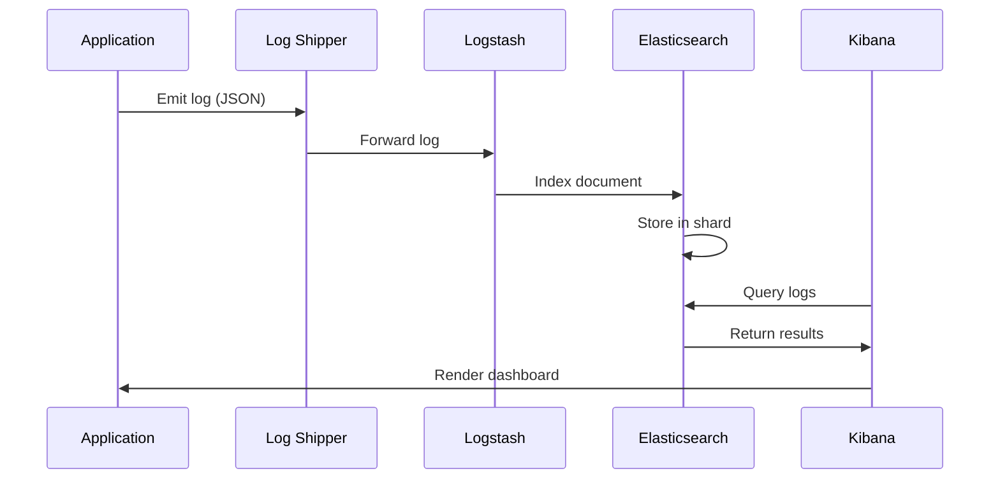

<!-- Generated by Groq via GitHub Actions -->
<!-- Topic ID: T176 -->
<!-- Category: Observability -->
<!-- Generated at UTC: 2026-11-05T08:02:34.232901+00:00 -->

# ELK / OpenSearch

## 1. What problem does this solve?

**Motivation**  
Modern backends generate *massive amounts* of structured and unstructured data: HTTP access logs, application logs, metrics, traces, security events, and more.  
Without a dedicated system to collect, store, and query this data, teams face:

- **Visibility loss** – Hard to spot performance regressions, errors, or security incidents.
- **Debugging pain** – Searching logs across services becomes time‑consuming.
- **Compliance risk** – Regulatory requirements often mandate log retention and auditability.
- **Operational blind spots** – No central view of system health or usage patterns.

**Why it matters**  
Observability is the foundation of reliable, secure, and high‑performing systems. A robust log‑ingestion and search platform lets engineers:

- Detect anomalies early.
- Root‑cause failures faster.
- Meet SLAs and compliance.
- Optimize resources based on real usage data.

**Consequences of not using it**  
- Longer MTTR (Mean Time to Recovery).
- Increased downtime and customer impact.
- Difficulty scaling services safely.
- Potential regulatory penalties.

**Real‑world appearance**  
- A microservice cluster in Kubernetes sends logs to a central OpenSearch cluster.
- A Next.js API gateway forwards HTTP access logs to Logstash, which enriches and indexes them.
- A FastAPI backend streams error logs to Elasticsearch for real‑time alerting.

---

## 2. Mental model

**Analogy**  
Think of ELK/OpenSearch as a *library* for your backend’s “books” (logs).  
- **Elasticsearch** = the *catalog* and *search engine* that lets you find a book by title, author, or content quickly.  
- **Logstash** = the *librarian* that collects books from various shelves, cleans them (parsing, filtering), and places them in the right section.  
- **Kibana** = the *reading room* where you browse, visualize, and analyze the books.

**Engineering model**  
- **Ingestion**: Logstash (or Beats, Fluentd, or direct API) streams data into Elasticsearch.  
- **Storage**: Elasticsearch stores data in *indices* (shards, replicas).  
- **Query**: RESTful JSON API (or Kibana) runs full‑text and structured queries.  
- **Visualization**: Kibana dashboards, OpenSearch Dashboards, or custom UIs.

---

## 3. Deep explanation

### Internals
| Component | Role | Key Concepts |
|-----------|------|--------------|
| **Elasticsearch / OpenSearch** | Distributed search & analytics engine | *Indices*, *shards*, *replicas*, *nodes*, *cluster state*, *Lucene* |
| **Logstash** | Data pipeline | *Inputs*, *filters*, *outputs*, *pipeline workers*, *dead letter queues* |
| **Kibana / OpenSearch Dashboards** | UI & visualization | *Discover*, *Visualize*, *Dashboard*, *Dev Tools* |

### Important terminology
- **Index** – logical namespace for documents; analogous to a table.  
- **Shard** – physical partition of an index; enables horizontal scaling.  
- **Replica** – copy of a shard; provides high availability and read throughput.  
- **Mapping** – schema definition for fields.  
- **Ingest Node** – pre‑processing pipeline inside Elasticsearch (similar to Logstash).  
- **Pipeline** – sequence of processors (e.g., `grok`, `date`, `geoip`).  
- **Index Lifecycle Management (ILM)** – automated rollover, shrink, delete.  
- **Snapshot/Restore** – backup mechanism.

### Trade‑offs
| Aspect | Elastic (ELK) | OpenSearch |
|--------|---------------|------------|
| **License** | Elastic License (OSS + proprietary) | Apache 2.0 |
| **Feature parity** | Slightly ahead (e.g., ML, security) | Close; some features lag |
| **Community support** | Large, commercial backing | Growing, AWS‑centric |
| **Upgrade path** | Requires license changes | Open source, easier upgrades |

### Failure modes
- **Shard imbalance** – uneven data distribution → hot spots.  
- **Node failure** – replicas must be re‑balanced; may cause temporary read latency.  
- **Index corruption** – due to disk failure; mitigated by snapshots.  
- **Ingestion backlog** – Logstash workers saturated → data loss if not configured with DLQ.

### Limitations
- **Write latency** – not a real‑time stream; best effort.  
- **Cost** – storage and compute can be expensive at scale.  
- **Schema evolution** – dynamic mapping can lead to unexpected field types.  
- **Security** – requires careful RBAC, TLS, and audit logging.

### Where it fits
```
┌───────────────────────┐
│  Application Layer    │
│  (Node.js, FastAPI)   │
└───────▲───────────────┘
        │
        │ logs (JSON, syslog)
        ▼
┌───────────────────────┐
│  Log Shipper (Fluentd)│
└───────▲───────────────┘
        │
        │ enriched logs
        ▼
┌───────────────────────┐
│  Logstash / Ingest Node│
└───────▲───────────────┘
        │
        │ processed documents
        ▼
┌───────────────────────┐
│  OpenSearch Cluster   │
└───────▲───────────────┘
        │
        │ search / analytics
        ▼
┌───────────────────────┐
│  Kibana / Dashboards  │
└───────────────────────┘
```

### Interaction with related concepts
- **Metrics**: Prometheus + Grafana vs. OpenSearch Dashboards.  
- **Tracing**: OpenTelemetry → OpenSearch for trace storage.  
- **Security**: X-Pack (Elastic) vs. OpenSearch Security plugin.  
- **CI/CD**: Automated ILM policies via Terraform or Helm.

---

## 4. How it works

1. **Application emits log** (JSON, syslog, etc.).  
2. **Log shipper** (e.g., `filebeat`, `fluentd`) tails the log file or receives HTTP logs.  
3. **Logstash / Ingest Node** parses, enriches (e.g., adds geo‑IP, timestamps), and forwards to Elasticsearch.  
4. **Elasticsearch** receives the document, assigns it to a shard, writes to Lucene index.  
5. **Kibana** queries Elasticsearch via REST API, renders visualizations.  

**Mermaid diagram**



---

## 5. Practical implementation

### 5.1. Node.js logger that sends logs to OpenSearch

```ts
// logger.ts
import { Client } from '@opensearch-project/opensearch';

const client = new Client({
  node: process.env.OPENSEARCH_URL ?? 'http://localhost:9200',
  auth: {
    username: process.env.OPENSEARCH_USER ?? 'admin',
    password: process.env.OPENSEARCH_PASS ?? 'admin',
  },
});

export async function logEvent(
  index: string,
  event: Record<string, unknown>
) {
  try {
    await client.index({
      index,
      body: {
        ...event,
        timestamp: new Date().toISOString(),
      },
    });
  } catch (err) {
    console.error('OpenSearch logging failed', err);
  }
}
```

**Usage in an Express route**

```ts
// server.ts
import express from 'express';
import { logEvent } from './logger';

const app = express();
app.use(express.json());

app.post('/api/submit', async (req, res) => {
  const payload = req.body;
  // Business logic...
  await logEvent('api-requests', {
    method: 'POST',
    path: '/api/submit',
    status: 200,
    payload,
  });
  res.send({ ok: true });
});

app.listen(3000, () => console.log('Server listening on 3000'));
```

**Docker Compose snippet**

```yaml
# docker-compose.yml
services:
  opensearch:
    image: opensearchproject/opensearch:2.7.0
    environment:
      - discovery.type=single-node
      - plugins.security.disabled=true
    ports:
      - "9200:9200"
  app:
    build: .
    environment:
      - OPENSEARCH_URL=http://opensearch:9200
      - OPENSEARCH_USER=admin
      - OPENSEARCH_PASS=admin
    depends_on:
      - opensearch
```

### 5.2. Logstash pipeline (optional)

```conf
# logstash.conf
input {
  beats {
    port => 5044
  }
}

filter {
  json {
    source => "message"
  }
  date {
    match => ["timestamp", "ISO8601"]
  }
}

output {
  elasticsearch {
    hosts => ["http://opensearch:9200"]
    index => "%{[@metadata][beat]}-%{+YYYY.MM.dd}"
  }
}
```

---

## 6. Production considerations

| Concern | Recommendation |
|---------|----------------|
| **Scalability** | Use *sharding* (≥3 shards per index) and *replicas* (≥2). Scale nodes horizontally. |
| **Reliability** | Enable *snapshot* schedules. Use *dead‑letter queues* in Logstash. |
| **Security** | TLS for all traffic. RBAC via OpenSearch Security plugin. Audit logs. |
| **Observability** | Expose cluster health metrics (JVM, GC, FS). Use OpenSearch Dashboards alerts. |
| **Performance** | Tune *refresh interval* (e.g., 30s for logs). Use *bulk API* for high‑volume ingestion. |
| **Error handling** | Retry with exponential backoff. Log failures to a separate index. |
| **Resource usage** | Monitor heap (max 30% of RAM). Avoid large field data. |
| **Operational concerns** | Use Helm/Terraform for cluster provisioning. Automate ILM policies. |
| **Failure recovery** | Plan for node replacement, shard re‑allocation. Keep snapshots in S3. |
| **Deployment** | Prefer managed services (Amazon OpenSearch Service, Elastic Cloud) for ease. |

---

## 7. Common mistakes

| Mistake | Why it hurts |
|---------|--------------|
| **Index per day without ILM** | Rapidly grows disk usage; manual rollover needed. |
| **Dynamic mapping for every field** | Unexpected field types, large mapping, slow queries. |
| **No shard balancing** | Hot shards → performance bottlenecks. |
| **Ignoring refresh interval** | Too frequent → high write latency; too infrequent → stale data. |
| **Hard‑coding credentials** | Security breach; fails in CI/CD. |
| **Not monitoring cluster health** | Unnoticed node failures → data loss. |
| **Using single-node cluster in prod** | No HA; single point of failure. |
| **Over‑indexing** | Indexing every log line verbatim → huge indices, slow search. |
| **Not using bulk API** | 1‑by‑1 writes cause high overhead. |

---

## 8. Senior engineer perspective

### Architecture decisions
- **Cluster size & topology**: Separate master‑eligible, data, and ingest nodes.  
- **ILM policy design**: Rollover after size or age, shrink, delete after retention.  
- **Index template**: Enforce mappings, analyzers, and settings.  
- **Security model**: Fine‑grained roles, TLS, audit logging.  
- **Observability stack**: Combine OpenSearch metrics with Prometheus/Grafana.

### Trade‑offs
- **Cost vs. latency**: More replicas → faster reads but higher storage cost.  
- **Retention vs. compliance**: Longer retention → more storage, but may be required.  
- **Granularity vs. performance**: Index per service vs. shared index.

### Bottlenecks
- **Shard allocation**: Poorly balanced shards cause I/O hotspots.  
- **Refresh & merge**: Frequent merges degrade write throughput.  
- **Network**: Ingest nodes must have low‑latency links to data nodes.

### Failure scenarios
- **Master node loss**: Cluster becomes read‑only; need fast failover.  
- **Shard corruption**: Requires reindexing or snapshot restore.  
- **Disk exhaustion**: Trigger alerts; auto‑scale storage.

### Monitoring
- **Cluster health**: `/_cluster/health`.  
- **Node stats**: `/_nodes/stats`.  
- **Index stats**: `/_cat/indices`.  
- **JVM metrics**: `/_nodes/stats/jvm`.  
- **Alerting**: OpenSearch Alerting plugin or external tools.

### Cost/performance
- Use *warm* nodes for older indices.  
- Compress data (`index.codec: best_compression`).  
- Leverage *dedicated* ingest nodes to offload parsing.

### When NOT to use
- **Real‑time streaming**: Kafka Streams or Pulsar are better.  
- **Low‑volume logs**: Simple file rotation + `grep` may suffice.  
- **Highly regulated data**: If you cannot meet strict audit requirements, consider a managed, compliant service.

---

## 9. Interview questions

| Level | Question | Key answer points |
|-------|----------|-------------------|
| Beginner | What is the purpose of an Elasticsearch index? | Stores documents; logical namespace; can be sharded and replicated. |
| Beginner | How does Logstash enrich logs before indexing? | Uses filters (`grok`, `date`, `geoip`); transforms raw logs into structured JSON. |
| Senior | Explain shard allocation and its impact on performance. | Shards distribute data; imbalance causes hot spots; allocation awareness (zone, rack). |
| Senior | How would you design an index lifecycle policy for logs that must be retained for 90 days? | Rollover after size/age, shrink, delete; use ILM with `hot`, `warm`, `delete` phases. |
| Scenario | A production cluster shows `yellow` status with many unassigned shards. What steps would you take to resolve this? | Check disk space, node availability; run `/_cluster/allocation/explain`; adjust `cluster.routing.allocation.disk.watermark`; add nodes or free space; reallocate. |

---

## 10. Hands‑on task

**Goal**: Build a simple log ingestion pipeline that sends Express request logs to OpenSearch and visualizes them.

1. **Set up Docker Compose** with OpenSearch and Logstash (use the snippets above).  
2. **Create an Express app** that logs each request to a local file (`access.log`).  
3. **Configure Logstash** to read `access.log`, parse JSON, and index into OpenSearch.  
4. **Create a Kibana dashboard** that shows:
   - Total requests per minute.
   - Error rate (status >= 500).
   - Top endpoints.
5. **Validate** that logs appear in OpenSearch and the dashboard updates in real time.

**Deliverables**:  
- `docker-compose.yml`  
- `server.ts` (Express app)  
- `logstash.conf`  
- A screenshot of the Kibana dashboard.

---

## 11. Quick revision

- ELK = Elasticsearch, Logstash, Kibana; OpenSearch is a fork.  
- **Elasticsearch**: distributed search engine; stores documents in indices.  
- **Logstash**: data pipeline; inputs → filters → outputs.  
- **Index lifecycle**: rollover, shrink, delete via ILM.  
- **Shards & replicas**: horizontal scaling & HA.  
- **Bulk API**: efficient ingestion.  
- **Security**: TLS, RBAC, audit logs.  
- **Monitoring**: cluster health, node stats, index stats.  
- **Common pitfalls**: dynamic mapping, unbalanced shards, no snapshots.  
- **Senior concerns**: cost vs. performance, retention policies, failover strategy.  
- **Typical flow**: App → Log shipper → Logstash → Elasticsearch → Kibana.

---

## 12. References

- https://www.elastic.co/guide/en/elasticsearch/reference/current/index.html  
- https://opensearch.org/docs/latest/  
- https://www.elastic.co/guide/en/logstash/current/pipeline.html  
- https://www.elastic.co/guide/en/kibana/current/index.html  
- https://opensearch.org/docs/latest/opensearch/indexing/  
- https://www.elastic.co/guide/en/elasticsearch/reference/current/ilm.html  
- https://www.elastic.co/guide/en/elasticsearch/reference/current/indices-shards.html  
- https://www.elastic.co/guide/en/elasticsearch/reference/current/cluster-health.html  
- https://opensearch.org/docs/latest/opensearch/security-plugin/  
- https://www.elastic.co/guide/en/elasticsearch/reference/current/bulk.html

---
