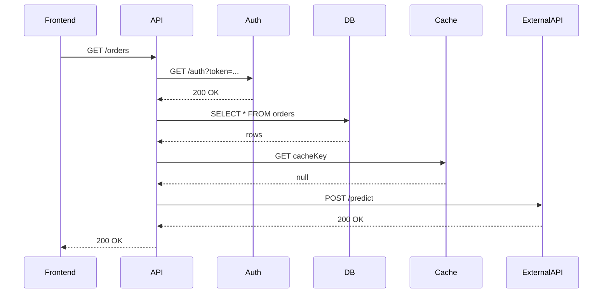

<!-- Generated by Groq via GitHub Actions -->
<!-- Topic ID: T177 -->
<!-- Category: Observability -->
<!-- Generated at UTC: 2026-11-05T20:46:19.949928+00:00 -->

# Tracing one request across multiple services

## 1. What problem does this solve?

When a user hits an API endpoint, the request often travels through many micro‑services, databases, message queues, and external APIs.  
**Problem**: Without a way to follow that single request end‑to‑end, you cannot:

- **Diagnose latency** – you see a 500 ms response but don’t know which hop caused it.
- **Detect failures** – a downstream service may fail silently, causing a cascade.
- **Understand business flow** – you can’t correlate logs or metrics to a specific user action.

**Why it matters**:  
- **Customer experience** – slow or failing requests hurt users.  
- **Operational cost** – blind debugging wastes engineering time.  
- **Compliance** – some regulations require audit trails for data access.

**If not used**:  
- Logs become noisy and unstructured.  
- You may miss subtle performance regressions.  
- Root‑cause analysis turns into a guess‑work exercise.

**Real‑world appearance**:  
- E‑commerce checkout pipelines (frontend → auth → inventory → payment).  
- SaaS SaaS analytics (frontend → ingestion → processing → storage).  
- AI inference pipelines (frontend → feature extraction → model inference → post‑processing).

---

## 2. Mental model

**Analogy**:  
Think of a package delivery. The package starts at a warehouse (frontend), passes through sorting centers (services), maybe a customs office (external API), and finally arrives at the customer’s doorstep. Each location stamps the package with a tracking number and a timestamp. By following the stamps, you know exactly where delays occurred.

**Engineering model**:  
- **Trace** = the journey of a single request.  
- **Spans** = individual operations (HTTP call, DB query, message send).  
- **Context propagation** = passing a unique trace ID through headers or message metadata.  
- **Sampling** = deciding which traces to keep to avoid overload.

---

## 3. Deep explanation

### Internals
1. **Trace ID** – a globally unique identifier (UUID or 128‑bit hex).  
2. **Span ID** – unique per operation; parent‑child relationships form a tree.  
3. **Context propagation** – usually via HTTP headers (`traceparent`, `baggage`) or message attributes.  
4. **Exporters** – send collected spans to a backend (Jaeger, Zipkin, OpenTelemetry Collector).  
5. **Samplers** – decide whether to record a trace (e.g., 1% of requests).

### Important terminology
- **Propagation** – carrying trace context across process boundaries.  
- **Instrumentation** – adding code to generate spans.  
- **Exporter** – transport layer to send spans.  
- **Sampler** – policy to limit data volume.  
- **Baggage** – key/value pairs that travel with the trace (e.g., user ID).

### Trade‑offs
| Aspect | Trade‑off |
|--------|-----------|
| **Granularity** | More spans = richer data but higher overhead. |
| **Sampling rate** | 100% gives full visibility but can overwhelm storage. |
| **Exporter choice** | OpenTelemetry Collector is flexible but adds a deployment layer. |
| **Context format** | `traceparent` (W3C) is standard but may need custom headers for legacy systems. |

### Failure modes
- **Missing context** – spans cannot be linked; you see orphaned logs.  
- **Clock skew** – timestamps out of order; use monotonic clocks or NTP.  
- **Exporter failure** – spans lost; use buffering or retry logic.  
- **Sampler too aggressive** – critical bugs never captured.

### Limitations
- **Stateful services** – tracing a request that spans multiple user sessions is hard.  
- **High‑volume systems** – even sampled traces can be large; need retention policies.  
- **Security** – trace IDs can leak sensitive request data if logged insecurely.

### Where it fits
- **Observability stack** – sits alongside metrics and logs.  
- **Distributed tracing** – part of the “tracing” pillar in the SRE triad.  
- **CI/CD** – can be used to detect performance regressions before release.

### Interaction with related concepts
- **Metrics** – provide aggregated view; traces give causal chains.  
- **Logs** – enriched with trace IDs for correlation.  
- **Service meshes** – often inject tracing automatically (e.g., Istio).  
- **Error handling** – spans can record error status and stack traces.

---

## 4. How it works

1. **Incoming request** – frontend receives HTTP request.  
2. **Extract trace context** – middleware reads `traceparent` header; if absent, generate new trace ID.  
3. **Create root span** – start a span for the request handling.  
4. **Propagate context** – add `traceparent` to outgoing HTTP calls, message headers, or DB queries.  
5. **Record child spans** – each downstream call creates its own span, linked to parent via span ID.  
6. **Finish spans** – close spans when operations complete.  
7. **Export** – exporter batches spans and sends to collector/agent.  
8. **Storage & UI** – backend stores spans; UI (Jaeger, Tempo) visualizes trace tree.



---

## 5. Practical implementation

### 5.1 Install OpenTelemetry for Node.js

```bash
npm install @opentelemetry/api @opentelemetry/sdk-node @opentelemetry/exporter-jaeger
```

### 5.2 Create a tracing bootstrap file (`tracing.ts`)

```ts
// tracing.ts
import { NodeSDK } from '@opentelemetry/sdk-node';
import { getNodeAutoInstrumentations } from '@opentelemetry/auto-instrumentations-node';
import { JaegerExporter } from '@opentelemetry/exporter-jaeger';
import { diag, DiagConsoleLogger, DiagLogLevel } from '@opentelemetry/api';

// Optional: enable debug logs
diag.setLogger(new DiagConsoleLogger(), DiagLogLevel.INFO);

const exporter = new JaegerExporter({
  serviceName: 'orders-service',
  // Jaeger agent defaults to localhost:6831
});

const sdk = new NodeSDK({
  traceExporter: exporter,
  instrumentations: [getNodeAutoInstrumentations()],
});

sdk.start()
  .then(() => console.log('Tracing initialized'))
  .catch((err) => console.error('Error initializing tracing', err));
```

### 5.3 Hook into your app

```ts
// app.ts
import './tracing'; // initialize tracing before anything else
import express from 'express';
import { context, trace } from '@opentelemetry/api';

const app = express();

app.get('/orders', async (req, res) => {
  // The auto‑instrumentation already created a root span for the HTTP request.
  // You can create child spans manually if needed.
  const span = trace.getTracer('orders').startSpan('fetch-orders');
  try {
    // Simulate DB call
    await new Promise((r) => setTimeout(r, 50));
    span.setAttribute('db.system', 'postgresql');
    res.json({ orders: [] });
  } finally {
    span.end();
  }
});

app.listen(3000, () => console.log('Server running on 3000'));
```

### 5.4 Propagate context to downstream HTTP call

```ts
import fetch from 'node-fetch';
import { context, trace, SpanKind } from '@opentelemetry/api';

async function callAuthService(token: string) {
  const tracer = trace.getTracer('orders');
  const span = tracer.startSpan('auth-service-call', {
    kind: SpanKind.CLIENT,
  });

  return context.with(trace.setSpan(context.active(), span), async () => {
    const response = await fetch('http://auth-service/auth', {
      headers: {
        // OpenTelemetry automatically injects traceparent header
        'traceparent': trace.getSpan(context.active())?.spanContext().traceId ?? '',
        'Authorization': `Bearer ${token}`,
      },
    });
    span.setAttribute('http.status_code', response.status);
    span.end();
    return response.json();
  });
}
```

> **Note**: The `@opentelemetry/auto-instrumentations-node` package automatically injects the `traceparent` header for outgoing HTTP requests, so you usually don’t need to set it manually.

### 5.5 Export to Jaeger

Run Jaeger locally (Docker):

```bash
docker run -d --name jaeger \
  -e COLLECTOR_ZIPKIN_HOST_PORT=:9411 \
  -p 5775:5775/udp \
  -p 6831:6831/udp \
  -p 6832:6832/udp \
  -p 5778:5778 \
  -p 16686:16686 \
  -p 14268:14268 \
  -p 14250:14250 \
  -p 9411:9411 \
  jaegertracing/all-in-one:1.48
```

Open `http://localhost:16686` to view traces.

---

## 6. Production considerations

| Concern | Recommendation |
|---------|----------------|
| **Scalability** | Use a **collector** (e.g., OpenTelemetry Collector) to batch and ship spans; avoid sending each span directly from services. |
| **Reliability** | Buffer spans locally (e.g., in memory or disk) and retry on exporter failure. |
| **Security** | Never log trace IDs in public logs; mask sensitive headers. Use TLS for exporter transport. |
| **Observability** | Correlate traces with metrics (e.g., latency histograms) and logs (include trace ID). |
| **Performance** | Keep sampling low (e.g., 1–5%) in high‑traffic environments; enable async span creation. |
| **Error handling** | Record error status and exception details in spans; propagate error codes to downstream services. |
| **Resource usage** | Monitor exporter memory; adjust batch size and flush interval. |
| **Operational** | Expose health endpoints for collector; use sidecar pattern if services cannot be restarted. |
| **Failure recovery** | Implement graceful shutdown to flush pending spans. |
| **Deployment** | Use environment variables for exporter endpoints; keep trace config in CI/CD pipeline. |

---

## 7. Common mistakes

| Mistake | Why it’s problematic |
|---------|----------------------|
| **Not propagating context** | Spans become orphaned; you lose end‑to‑end visibility. |
| **Using 100% sampling in prod** | Overwhelms storage, increases latency, and costs. |
| **Logging raw trace IDs in public logs** | Potentially leaks request identifiers to attackers. |
| **Ignoring span status** | Errors go unnoticed; metrics may still show “healthy.” |
| **Hardcoding trace IDs** | Breaks uniqueness; causes span collisions. |
| **Not handling exporter failures** | Spans are lost; you lose visibility during outages. |
| **Over‑instrumenting** | Adds CPU/memory overhead; can degrade performance. |

---

## 8. Senior engineer perspective

### Architecture decisions
- **Collector vs. direct export**: A sidecar collector reduces network hops and centralizes configuration.  
- **Sampling strategy**: Use adaptive sampling (e.g., based on error rate) instead of static percentages.  
- **Context format**: Adopt W3C `traceparent` for interoperability; avoid proprietary headers.  
- **Storage backend**: Choose a time‑series database (e.g., Tempo, Elastic) that can handle high cardinality.  

### Trade‑offs
- **Latency vs. fidelity**: Lower sampling reduces latency but may miss rare bugs.  
- **Cost vs. observability**: Storing all traces is expensive; balance with business impact.  

### Bottlenecks
- **Exporter bandwidth**: Large payloads can saturate network links.  
- **Collector CPU**: Parsing and batching spans can become CPU‑bound.  

### Failure scenarios
- **Collector crash**: Implement graceful shutdown and local buffering.  
- **Exporter TLS failure**: Use mutual TLS and monitor certificate expiry.  

### Monitoring
- **Exporter health**: Expose `/health` and `/metrics`.  
- **Trace volume**: Track number of traces per second; alert on spikes.  

### Cost/performance
- **Batch size**: Larger batches reduce overhead but increase latency.  
- **Retention policy**: Keep only recent traces; archive older data if needed.  

### When NOT to use
- **Very low‑traffic services**: Simple logging may suffice.  
- **Stateless, single‑service apps**: Tracing overhead may outweigh benefits.  

---

## 9. Interview questions

1. **Beginner**: *What is a trace and a span in distributed tracing?*  
   *Answer*: A trace is the full path of a single request through the system; a span is an individual operation within that trace (e.g., an HTTP call, DB query).

2. **Beginner**: *How do you propagate trace context across services?*  
   *Answer*: By injecting a trace ID (and optionally span ID) into outgoing HTTP headers (`traceparent`) or message metadata, and extracting it on the receiving side.

3. **Senior**: *Explain the trade‑offs between using a 100% sampling rate versus a 1% sampling rate in a high‑traffic microservice.*  
   *Answer*: 100% gives full visibility but can overwhelm storage, increase latency, and cost more. 1% reduces overhead but may miss rare errors; adaptive sampling can mitigate this.

4. **Senior**: *Describe how you would design a tracing system for a service mesh that already injects tracing headers.*  
   *Answer*: Leverage the mesh’s automatic injection, use sidecar collectors to batch spans, configure sampling at the mesh level, and ensure exporters are secured and monitored.

5. **Scenario/Debugging**: *A user reports a 2‑second latency on a specific endpoint. Your traces show a long span in the payment service, but the payment service logs show no errors. What steps would you take to investigate?*  
   *Answer*:  
   - Verify the span’s duration and attributes (e.g., `http.status_code`).  
   - Check if the payment service is waiting on an external API; add child spans for those calls.  
   - Look at the payment service’s metrics (CPU, DB queue).  
   - Correlate with logs that include the trace ID.  
   - If necessary, increase sampling for that endpoint temporarily.  

---

## 10. Hands‑on task

**Task**: Add distributed tracing to the existing `orders-service` (Node.js + Express) so that:

1. Every incoming HTTP request starts a root span.  
2. Calls to the `inventory-service` and `payment-service` create child spans.  
3. The trace ID is logged in the console for each request.  
4. Export spans to a local Jaeger instance.  

**Steps**:
- Install OpenTelemetry packages.  
- Create `tracing.ts` bootstrap.  
- Wrap the Express router with a middleware that logs the trace ID.  
- Use the `@opentelemetry/auto-instrumentations-node` to instrument HTTP client calls.  
- Run Jaeger locally and verify traces appear.  

**Evaluation**: Check that the trace ID propagates through the services and that the UI shows a tree with three spans (orders, inventory, payment).

---

## 11. Quick revision

- A **trace** is a request’s journey; a **span** is an operation within that trace.  
- **Trace ID** is globally unique; **Span ID** is unique per operation.  
- Context is propagated via `traceparent` header (W3C).  
- **Auto‑instrumentation** can automatically create spans for HTTP, DB, etc.  
- **Sampling** limits data volume; use adaptive strategies.  
- **Exporters** send spans to backends (Jaeger, Tempo).  
- Correlate trace IDs across logs, metrics, and traces.  
- Handle exporter failures with buffering and retries.  
- Avoid logging sensitive data in trace headers.  
- Use a collector for scalability and central control.  
- Monitor exporter health and trace volume.  

---

## 12. References

- OpenTelemetry Specification – https://opentelemetry.io/docs/specs/  
- OpenTelemetry Node.js SDK – https://opentelemetry.io/docs/instrumentation/node/  
- Jaeger Documentation – https://www.jaegertracing.io/docs/  
- W3C Trace Context – https://www.w3.org/TR/trace-context/  
- OpenTelemetry Collector – https://opentelemetry.io/docs/collector/  
- Istio Tracing – https://istio.io/latest/docs/tasks/observability/distributed-tracing/  

---
