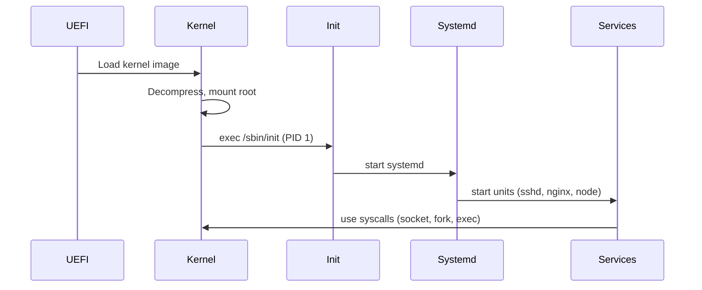
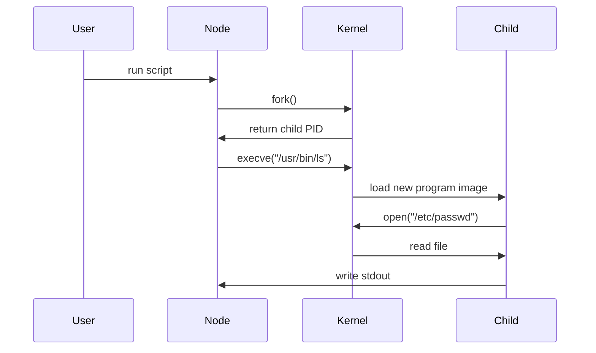

<!-- Generated by Groq via GitHub Actions -->
<!-- Topic ID: T178 -->
<!-- Category: DevOps / Infrastructure -->
<!-- Generated at UTC: 2026-11-05T20:46:19.949928+00:00 -->

# Linux

## 1. What problem does this solve?

Linux is an open‑source operating system kernel that provides the foundational services required to run backend workloads:

| Problem | Why it matters | Consequence if not solved | Real‑world appearance |
|---------|----------------|---------------------------|-----------------------|
| **Resource isolation** | Multiple services must share CPU, memory, disk, and network without interfering. | Services can starve each other or crash the host. | A Node.js API and a PostgreSQL instance on the same VM |
| **Process management** | Need to start, stop, monitor, and restart services reliably. | Manual intervention, downtime, or orphaned processes. | Systemd units for a FastAPI microservice |
| **File system abstraction** | Persistent storage, configuration, and logs must be organized and secure. | Data loss, permission leaks, or inconsistent state. | `/var/log`, `/etc/nginx/nginx.conf` |
| **Networking stack** | Services must communicate over TCP/UDP, expose ports, and handle firewalls. | Inaccessible APIs, security breaches. | A Next.js front‑end talking to a Redis cache |
| **Security boundaries** | Prevent privilege escalation and contain compromised processes. | System compromise, data exfiltration. | User namespaces, SELinux policies |
| **Hardware abstraction** | Hide differences between CPUs, NICs, disks, and GPUs. | Portability issues, vendor lock‑in. | A GPU‑accelerated AI inference service |

Without Linux (or a similar OS), you would need to write your own kernel‑level code to handle all of the above, which is impractical for production backend systems.

---

## 2. Mental model

### Analogy  
Think of Linux as a **city**:

| City component | Linux component |
|----------------|-----------------|
| **Roads & traffic lights** | Kernel’s networking stack and scheduler |
| **Buildings & utilities** | User space programs and services |
| **City council** | `systemd` (or other init system) |
| **Neighborhood watch** | Namespaces, cgroups, SELinux/AppArmor |
| **Public transport** | Docker containers, VMs |

Just as a city’s infrastructure lets people move, work, and communicate safely, Linux’s kernel lets processes run, share resources, and talk to each other.

### Engineering model  
- **Kernel**: Core, runs in privileged mode, handles hardware, memory, scheduling, I/O, networking, security hooks.  
- **System calls**: API from user space to kernel (`open`, `read`, `write`, `socket`, `fork`, etc.).  
- **User space**: All applications, libraries, and utilities.  
- **Init system**: Starts services (`systemd`, `upstart`, `init`).  
- **Namespaces & cgroups**: Isolate processes (PID, network, mount, IPC, UTS) and limit resources.  
- **File system**: Hierarchical, with inodes, permissions, mount points.  
- **Networking stack**: TCP/IP, routing, firewall (`iptables`, `nftables`).  

---

## 3. Deep explanation

### Internals

1. **Bootloader → Kernel → Init**  
   - BIOS/UEFI loads the kernel.  
   - Kernel decompresses, mounts the root filesystem, then starts the init process (`/sbin/init` → `systemd`).

2. **Process lifecycle**  
   - `fork()` creates a child process (copy‑on‑write).  
   - `execve()` replaces the child’s memory image with a new program.  
   - `waitpid()` collects exit status.  
   - Signals (`SIGTERM`, `SIGKILL`) control termination.

3. **Memory management**  
   - Page tables, virtual memory, paging, swapping.  
   - `mmap()` for shared memory, anonymous memory.

4. **File system**  
   - Inodes, block devices, mount points.  
   - `open()`, `read()`, `write()`, `close()`.

5. **Networking**  
   - Socket API (`socket()`, `bind()`, `listen()`, `accept()`).  
   - Kernel routing tables, netfilter chains.

6. **Security**  
   - User IDs, group IDs, capabilities.  
   - SELinux/AppArmor policies.  
   - Mandatory Access Control (MAC).

### Important terminology

| Term | Meaning |
|------|---------|
| **PID** | Process ID |
| **UID/GID** | User / Group ID |
| **cgroup** | Control group (resource limits) |
| **namespace** | Isolated view of system resources |
| **init** | First user‑space process (PID 1) |
| **systemd** | Modern init system, service manager |
| **mount** | Attach a filesystem to a directory |
| **inode** | File metadata structure |
| **netfilter** | Kernel framework for packet filtering |

### Trade‑offs

| Aspect | Monolithic kernel | Microkernel |
|--------|-------------------|-------------|
| **Performance** | Fewer context switches | More context switches |
| **Modularity** | Harder to add/remove modules | Easier to replace subsystems |
| **Stability** | A bug can crash the whole kernel | Isolated services reduce impact |
| **Complexity** | Simpler to develop | More IPC overhead |

Linux uses a **monolithic** kernel with loadable modules, balancing performance and modularity.

### Failure modes

- **Kernel panic**: Unrecoverable error → system halt.  
- **Deadlock**: Two or more processes wait forever.  
- **Resource exhaustion**: Disk full, memory leak, too many open files.  
- **Security breach**: Privilege escalation via kernel module or exploit.

### Limitations

- Single kernel per architecture; porting to new hardware requires kernel changes.  
- Requires careful tuning for high‑performance workloads (e.g., low‑latency networking).  
- Security depends heavily on correct configuration (e.g., SELinux policies).

### Fit in backend architecture

- **Bare metal**: Direct control, minimal overhead.  
- **Virtual machines**: Linux as guest OS, provides isolation.  
- **Containers**: Linux kernel shared across containers; namespaces & cgroups provide isolation.  
- **Orchestration**: Kubernetes relies on Linux features (cgroups, namespaces, iptables) to schedule pods.

### Interaction with related concepts

- **Docker**: Uses Linux namespaces and cgroups to sandbox containers.  
- **Kubernetes**: Schedules pods on Linux nodes, relies on kubelet to manage systemd services.  
- **CI/CD**: Build agents run on Linux; Docker images are built on Linux.  
- **Observability**: `systemd` logs, `journalctl`, Prometheus node_exporter scrape `/proc` and `/sys`.

---

## 4. How it works

### Boot sequence (simplified)



### Process creation flow



---

## 5. Practical implementation

### 5.1 Spawning a child process in Node.js

```ts
// childRunner.ts
import { spawn } from 'child_process';
import { writeFileSync } from 'fs';
import { join } from 'path';

const logFile = join(__dirname, 'child.log');

function runCommand(cmd: string, args: string[] = []) {
  return new Promise<{ stdout: string; stderr: string; code: number }>((resolve, reject) => {
    const child = spawn(cmd, args, { stdio: ['ignore', 'pipe', 'pipe'] });

    let stdout = '';
    let stderr = '';

    child.stdout.on('data', (data) => (stdout += data));
    child.stderr.on('data', (data) => (stderr += data));

    child.on('error', reject);

    child.on('close', (code) => {
      // Log the output
      writeFileSync(logFile, `Command: ${cmd} ${args.join(' ')}\nCode: ${code}\nSTDOUT:\n${stdout}\nSTDERR:\n${stderr}\n\n`, { flag: 'a' });
      resolve({ stdout, stderr, code: code ?? -1 });
    });
  });
}

// Example usage
(async () => {
  const { stdout, stderr, code } = await runCommand('ls', ['-la', '/']);
  console.log(`Exit code: ${code}`);
  console.log(`STDOUT:\n${stdout}`);
  console.error(`STDERR:\n${stderr}`);
})();
```

**Key points**

- `spawn()` uses the kernel’s `fork()` + `execve()` under the hood.  
- `stdio: ['ignore', 'pipe', 'pipe']` gives us access to stdout/stderr.  
- We write logs to a file to persist output across restarts.  

### 5.2 Dockerfile using a minimal Linux base

```dockerfile
# Dockerfile
FROM ubuntu:22.04

# Install Node.js
RUN apt-get update && \
    apt-get install -y curl && \
    curl -fsSL https://deb.nodesource.com/setup_20.x | bash - && \
    apt-get install -y nodejs && \
    rm -rf /var/lib/apt/lists/*

# Copy source
WORKDIR /app
COPY . .

# Build TypeScript
RUN npm install && npm run build

# Run the compiled script
CMD ["node", "dist/childRunner.js"]
```

This Dockerfile demonstrates:

- Using a **Linux** base image (`ubuntu`).  
- Installing Node.js via the package manager (uses `apt`, which relies on the Linux file system).  
- Running a Node.js script that interacts with the kernel via `spawn()`.

---

## 6. Production considerations

| Concern | Linux‑specific tips |
|---------|---------------------|
| **Scalability** | Use cgroups v2 + systemd for fine‑grained resource limits; run services in containers to scale horizontally. |
| **Reliability** | `systemd` service files with `Restart=on-failure`; use health checks; enable automatic kernel updates (`unattended-upgrades`). |
| **Security** | Run services as non‑root users; enable SELinux/AppArmor; use `systemd` `PrivateTmp=true`; restrict capabilities (`CAP_NET_BIND_SERVICE`). |
| **Observability** | Collect `/proc` metrics with node_exporter; ship logs via `journald` or `rsyslog`; use `systemd` `StandardOutput=journal`. |
| **Performance** | Tune scheduler (`schedutil`), use `io_scheduler` (`deadline`, `noop`), enable hugepages for AI workloads. |
| **Error handling** | Capture exit codes, handle signals (`SIGTERM`, `SIGINT`) in Node.js (`process.on('SIGTERM', ...)`). |
| **Resource usage** | Set cgroup limits (`MemoryMax`, `CPUQuota`) in systemd unit files. |
| **Operational concerns** | Automate patching, use immutable infrastructure (Docker images), keep `/var/log` rotated. |
| **Failure recovery** | Use `systemd` `OnFailure=` to trigger alerts; maintain snapshots (LVM, Btrfs). |
| **Deployment** | Prefer container images; use Kubernetes or Docker Swarm; keep images small to reduce attack surface. |

---

## 7. Common mistakes

| Mistake | Why it’s problematic |
|---------|----------------------|
| Running services as **root** | Privilege escalation risk; accidental system changes. |
| Ignoring **file permissions** | Unintended access to config files or logs. |
| Forgetting to **handle signals** | Services may not shut down cleanly, leaving orphaned processes. |
| Over‑provisioning **cgroups** | Waste of resources; may mask real bottlenecks. |
| Using **systemd** incorrectly (e.g., `RemainAfterExit=yes` for long‑running services) | Service may appear active when it’s not. |
| Relying on **busybox** for complex scripts | Busybox may lack needed utilities; portability issues. |
| Not setting **mount options** (`noexec`, `nosuid`) | Security holes in shared volumes. |
| Ignoring **kernel updates** | Missed security patches; potential exploits. |

---

## 8. Senior engineer perspective

### When Linux is used at scale

- **Architecture decisions**  
  - Choose between bare metal, VMs, or containers based on isolation vs performance.  
  - Decide on init system (`systemd` vs `runit`) for microservices.  
  - Use namespaces + cgroups for fine‑grained isolation in Kubernetes.

- **Trade‑offs**  
  - **Monolithic kernel** gives better performance for I/O‑heavy AI workloads but is harder to patch.  
  - **Containerization** adds overhead but simplifies deployment and scaling.

- **Bottlenecks**  
  - Disk I/O: use SSDs, NVMe, or in‑memory filesystems.  
  - Network: enable SR-IOV or RDMA for low‑latency.  
  - CPU: tune scheduler, use `nice`/`cpuset`.

- **Failure scenarios**  
  - Kernel panic → use `kexec` to reboot into a rescue kernel.  
  - Disk full → monitor `/var/log` size, use `tmpfs` for temp data.  
  - Memory leak → enable `systemd` `MemoryMax` and `OOMPolicy=kill`.

- **Monitoring**  
  - `node_exporter` + Prometheus for metrics.  
  - `journald` + Loki for logs.  
  - `systemd-analyze` for boot performance.

- **Cost/performance**  
  - Spot instances for batch AI jobs; reserve instances for steady traffic.  
  - Use lightweight base images (`alpine`, `distroless`) to reduce attack surface.

- **When NOT to use**  
  - Bare‑metal for workloads requiring custom kernel modules (e.g., GPU drivers).  
  - Avoid `systemd` on minimal IoT devices where a lighter init is preferable.

---

## 9. Interview questions

| Level | Question | Answer points |
|-------|----------|---------------|
| Beginner | What is a PID? | Process ID, unique per running process, assigned by kernel. |
| Beginner | What is the difference between `fork()` and `exec()`? | `fork()` creates a copy of the process; `exec()` replaces the process image with a new program. |
| Intermediate | Explain how Linux handles process scheduling. | Scheduler policies (`CFS`, `FIFO`, `RR`), time slices, priority, `nice` values, `cgroups` influence. |
| Senior | Discuss trade‑offs between monolithic and microkernel architectures in Linux. | Performance vs modularity, IPC overhead, stability, maintainability. |
| Senior | How would you design a highly available Linux‑based backend service? | Use `systemd` units with `Restart=on-failure`, health checks, load balancer, redundant nodes, automated failover. |
| Scenario | A Node.js service on Linux is crashing with “Segmentation fault”. How would you debug? | Check core dumps (`/proc/sys/kernel/core_pattern`), use `gdb` or `lldb`, inspect stack trace, check native addons, verify memory usage, review recent changes. |

---

## 10. Hands‑on task

**Goal**: Build a small Node.js service that runs a shell command, logs output, and restarts on failure.

1. Create a new Node.js project (`npm init -y`).  
2. Add the `childRunner.ts` code from section 5.1.  
3. Add a `systemd` unit file (`/etc/systemd/system/child-runner.service`):

```ini
[Unit]
Description=Child Runner Service
After=network.target

[Service]
ExecStart=/usr/bin/node /app/dist/childRunner.js
Restart=on-failure
RestartSec=5
User=appuser
Group=appgroup
Environment=NODE_ENV=production
StandardOutput=journal
StandardError=journal

[Install]
WantedBy=multi-user.target
```

4. Build the TypeScript (`npm run build`).  
5. Reload systemd (`systemctl daemon-reload`) and start the service (`systemctl start child-runner`).  
6. Verify logs with `journalctl -u child-runner`.  
7. Simulate a failure by modifying the script to exit with code 1, observe automatic restart.

---

## 11. Quick revision

- Linux kernel + user space = operating system.  
- **Process**: fork → exec → run; managed by scheduler.  
- **File system**: inodes, permissions, mount points.  
- **Networking**: sockets, netfilter, routing tables.  
- **Security**: UID/GID, capabilities, SELinux/AppArmor.  
- **Isolation**: namespaces, cgroups, systemd.  
- **Init**: `systemd` starts services, manages dependencies.  
- **Containers**: share kernel, use namespaces + cgroups.  
- **Observability**: `journalctl`, Prometheus node_exporter, Grafana.  
- **Deployment**: Docker images, Kubernetes pods, CI/CD pipelines.  
- **Common pitfalls**: root services, missing signal handling, improper permissions.  
- **Senior focus**: scalability, reliability, cost, monitoring, architecture trade‑offs.

---

## 12. References

- Linux kernel source: https://www.kernel.org/  
- Linux man pages: https://man7.org/linux/man-pages/  
- systemd documentation: https://www.freedesktop.org/software/systemd/man/  
- Docker documentation: https://docs.docker.com/  
- Prometheus node_exporter: https://github.com/prometheus/node_exporter  
- SELinux Project: https://selinuxproject.org/  
- AppArmor: https://gitlab.com/apparmor/apparmor/-/wikis/home  
- Linux Foundation: https://www.linuxfoundation.org/  

---
