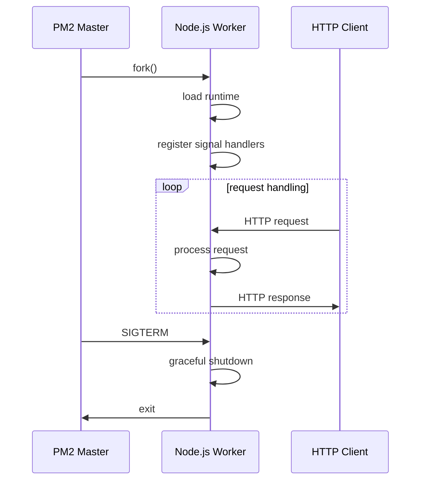

<!-- Generated by Groq via GitHub Actions -->
<!-- Topic ID: T179 -->
<!-- Category: DevOps / Infrastructure -->
<!-- Generated at UTC: 2026-11-06T08:06:52.425029+00:00 -->

# Processes

## 1. What problem does this solve?

| Problem | Why it matters | Consequence of ignoring it | Real‑world appearance |
|---------|----------------|---------------------------|-----------------------|
| **Resource isolation** | Prevents one service from exhausting CPU, memory, or file descriptors and affecting others. | A memory‑leaking process can bring down the entire host or other services. | Microservice backends, background workers, cron jobs. |
| **Fault isolation** | A crash in one process should not kill the whole application stack. | A single buggy module can bring down the entire system. | Web servers, API gateways, worker queues. |
| **Scalability & concurrency** | Processes can run on separate cores or hosts, enabling parallelism. | Single‑threaded or single‑process apps become bottlenecks. | High‑traffic APIs, data pipelines, AI inference services. |
| **Lifecycle management** | Start, stop, restart, and monitor processes reliably. | Manual restarts lead to downtime, inconsistent state. | CI/CD pipelines, production deployments, autoscaling. |
| **Security boundaries** | Processes run with least privilege, limiting the blast radius of a compromise. | A compromised process can read/write any data on the host. | Containerized services, multi‑tenant SaaS. |

In a typical backend stack you’ll see processes everywhere: the Node.js HTTP server, a Python FastAPI worker, a PostgreSQL instance, a Redis cache, a Kafka broker, and a set of background jobs. Each of those is an OS process (or a container that encapsulates one) that must be managed, monitored, and scaled.

---

## 2. Mental model

### Analogy: The Factory Floor

Imagine a factory where each **process** is a separate production line. Each line has its own machines (CPU, memory), its own workers (threads), and its own safety protocols (signals, exit codes). If one line breaks down, the factory can isolate the problem, repair it, and keep the rest of the lines running. The factory manager (process supervisor) schedules the lines, ensures they have enough resources, and restarts them if they fail.

### Engineering model

* **Process** = an instance of a program running in its own address space, with its own PID, memory, file descriptors, and scheduling priority.
* **Process table** = the OS’s registry of all active processes.
* **Scheduler** = the kernel component that decides which process runs next.
* **Signals** = asynchronous notifications (e.g., `SIGTERM`, `SIGINT`) that tell a process to shut down or take action.
* **Process manager** = a tool (systemd, PM2, Docker‑compose, Kubernetes) that starts, stops, restarts, and monitors processes.

---

## 3. Deep explanation

### Internals

| Concept | What it is | How it works |
|---------|------------|--------------|
| **PID / PPID** | Process ID and Parent Process ID | Unique identifiers; the kernel uses them for ownership and signal routing. |
| **Fork / Exec** | Process creation primitives | `fork()` duplicates the current process; `exec()` replaces the image with a new program. |
| **Zombie / Orphan** | Terminated but not reaped / no parent | Zombies occupy a PID slot until `wait()`; orphans are adopted by `init` (PID 1). |
| **Signal handling** | Asynchronous events | Handlers can be installed; default actions include terminate, ignore, core dump. |
| **Context switch** | Switching CPU from one process to another | Kernel saves registers, updates page tables, loads new context. |
| **Memory mapping** | Shared libraries, stack, heap | The kernel maps files and anonymous memory into the process’s address space. |

### Important terminology

* **Process group / session** – collections of processes that share job control.
* **Daemon** – a background process that detaches from the terminal and runs continuously.
* **Child process** – a process created by another process.
* **Process supervisor** – a tool that manages the lifecycle of processes (e.g., systemd, PM2, Docker‑compose).
* **Container** – a lightweight process isolation mechanism that bundles an application and its dependencies.

### Trade‑offs

| Approach | Pros | Cons |
|----------|------|------|
| **Single process** | Simpler code, no IPC overhead | Limited concurrency, single point of failure |
| **Multiple processes** | True isolation, can use all cores | Higher memory usage, IPC complexity |
| **Threads** | Lower overhead than processes | Shared memory can lead to race conditions |
| **Containers** | Portable, consistent environment | Extra layer of abstraction, potential performance hit |
| **Serverless functions** | Automatic scaling, no server management | Cold start latency, limited runtime |

### Failure modes

* **Zombie accumulation** – if a parent never calls `wait()`, PIDs leak.
* **Orphan processes** – can become runaway processes if the parent dies unexpectedly.
* **Signal mishandling** – ignoring `SIGTERM` can prevent graceful shutdown.
* **Resource exhaustion** – too many processes can exhaust file descriptors or memory.
* **IPC bottlenecks** – heavy inter‑process communication can become a performance choke.

### Limitations

* Processes are heavyweight compared to threads; each has its own memory space.
* Context switching is expensive for fine‑grained tasks.
* IPC (pipes, sockets, shared memory) adds latency and complexity.
* Debugging across multiple processes can be harder than single‑process debugging.

### Where it fits in a backend architecture

* **Web servers** – each worker process handles a subset of requests.
* **Background workers** – e.g., a Node.js worker pool that processes queue messages.
* **Database servers** – PostgreSQL runs as a single process with multiple threads.
* **Cache servers** – Redis runs as a single process.
* **Message brokers** – Kafka runs as a set of Java processes.
* **Container orchestration** – Kubernetes treats each container as a process group.

### Interaction with related concepts

| Concept | Interaction |
|---------|-------------|
| **Containers** | A container is essentially a process with its own namespace. |
| **Kubernetes** | Pods are groups of one or more containers (processes) that share a network namespace. |
| **PM2 / systemd** | These are process supervisors that provide restart policies, clustering, and monitoring. |
| **Load balancers** | Distribute traffic across multiple process instances. |
| **Health checks** | Probe process liveness and readiness. |
| **Tracing** | Attach to process boundaries to correlate spans across services. |

---

## 4. How it works

### Step‑by‑step flow of a typical Node.js worker process

1. **Parent process** (e.g., a PM2 cluster master) starts the worker.
2. The kernel creates a new **PID** and allocates memory.
3. The worker loads the Node.js runtime and the application bundle.
4. The worker registers **signal handlers** (`SIGTERM`, `SIGINT`) for graceful shutdown.
5. The worker enters the **event loop**, listening for incoming requests or messages.
6. On **request** or **message**, the worker processes the task.
7. If the worker **crashes** or exits, the supervisor receives a `SIGCHLD` and restarts it according to policy.
8. On **shutdown**, the supervisor sends `SIGTERM`; the worker cleans up, closes sockets, and exits.



---

## 5. Practical implementation

### 5.1 Spawning a child process in Node.js

```ts
// worker.ts
import { spawn } from 'child_process';

const child = spawn('node', ['child.js'], {
  stdio: 'inherit', // forward stdout/stderr
  env: { ...process.env, WORKER_ID: '1' },
});

child.on('exit', (code, signal) => {
  console.log(`Child exited with code ${code} signal ${signal}`);
  // Optionally restart or exit parent
});

process.on('SIGTERM', () => {
  console.log('Parent received SIGTERM, shutting down child...');
  child.kill('SIGTERM');
  process.exit(0);
});
```

```ts
// child.js
console.log(`Child process ${process.pid} started`);
setInterval(() => {
  console.log('Child doing work...');
}, 1000);
```

### 5.2 Using PM2 to manage multiple workers

```json
// pm2.config.js
module.exports = {
  apps: [
    {
      name: 'api',
      script: 'dist/server.js',
      instances: 'max',          // spawn one per CPU core
      exec_mode: 'cluster',      // Node.js cluster mode
      watch: false,
      env: { NODE_ENV: 'production' },
      env_production: { NODE_ENV: 'production' },
    },
  ],
};
```

Run:

```bash
pm2 start pm2.config.js
pm2 monit
```

### 5.3 Docker‑based process isolation

```dockerfile
# Dockerfile
FROM node:20-alpine
WORKDIR /app
COPY package*.json ./
RUN npm ci --omit=dev
COPY . .
EXPOSE 3000
CMD ["node", "dist/server.js"]
```

```bash
docker build -t my-api .
docker run -d -p 3000:3000 --name api my-api
```

---

## 6. Production considerations

| Concern | What to do |
|---------|------------|
| **Scalability** | Use cluster mode or multiple containers; scale horizontally via Kubernetes. |
| **Reliability** | Configure restart policies (`restart: always`), health checks, graceful shutdown. |
| **Security** | Run processes as non‑root users, use seccomp profiles, limit capabilities. |
| **Observability** | Emit logs to a central log aggregator, expose metrics (`/metrics`), trace spans. |
| **Performance** | Profile CPU/memory, avoid unnecessary child processes, use `worker_threads` for CPU‑bound tasks. |
| **Error handling** | Catch uncaught exceptions, use `process.on('unhandledRejection')`. |
| **Resource usage** | Set CPU/memory limits in Docker/K8s, monitor file descriptor usage. |
| **Operational concerns** | Automate deployment with CI/CD, use blue/green or canary releases. |
| **Failure recovery** | Implement graceful shutdown, graceful restart, and circuit breakers. |
| **Deployment** | Use immutable container images, pin dependencies, keep secrets out of images. |

---

## 7. Common mistakes

| Mistake | Why it’s problematic |
|---------|----------------------|
| **Not handling `SIGTERM`** | The process may exit abruptly, leaving resources (DB connections, sockets) open. |
| **Using `child_process.exec` for long‑running tasks** | `exec` buffers output in memory; can cause OOM for large streams. |
| **Spawning too many child processes** | Exhausts file descriptors and memory, leading to `EMFILE` or `ENOMEM`. |
| **Ignoring zombie processes** | PID table fills up, new processes cannot start. |
| **Running as root inside containers** | Increases blast radius if the container is compromised. |
| **Using `process.exit()` in async callbacks** | Skips cleanup, can leave dangling timers or sockets. |
| **Not setting `env` for child processes** | Child inherits all env vars, potentially leaking secrets. |
| **Assuming Node.js cluster shares memory** | Each worker has its own memory; shared state must be via IPC or external store. |

---

## 8. Senior engineer perspective

### What changes at scale?

* **Process per core** – On a 16‑core server, you might run 16 Node.js workers, each in its own process, to fully utilize CPU.
* **Container orchestration** – Deploy each process as a container in Kubernetes; use `Deployment` objects with replica counts.
* **Service mesh** – Use Envoy or Istio to manage inter‑process traffic, retries, and circuit breaking.
* **Observability stack** – Collect process metrics (CPU, memory, file descriptors) with Prometheus, log with Loki, trace with Jaeger.
* **Security hardening** – Apply least‑privilege user namespaces, read‑only file systems, and SELinux/AppArmor profiles.

### Design decisions

| Decision | Trade‑off |
|----------|-----------|
| **Process vs. thread** | Processes give isolation but cost more memory; threads share memory but risk data races. |
| **Container vs. VM** | Containers are lightweight but share kernel; VMs provide stronger isolation at higher cost. |
| **Restart policy** | Aggressive restarts reduce downtime but may mask underlying bugs. |
| **Health check frequency** | Frequent checks catch failures early but add load. |
| **Resource limits** | Tight limits prevent runaway processes but may cause legitimate spikes to fail. |

### Bottlenecks

* **Context switching** – Too many processes can saturate the scheduler.
* **IPC overhead** – Heavy message passing between processes can become a bottleneck.
* **Memory fragmentation** – Many short‑lived processes can fragment heap.

### Failure scenarios

* **Zombie storm** – A bug that never reaps children leads to PID exhaustion.
* **Orphaned processes** – Parent crashes leaving orphan processes that consume resources.
* **Signal storms** – Rapid `SIGTERM` bursts during rolling updates can cause race conditions.

### Monitoring

* **Process metrics** – `node_exporter` for Node.js, `postgres_exporter` for PostgreSQL.
* **Log aggregation** – Structured logs with process ID, container ID.
* **Alerting** – Trigger on high CPU, memory, or process count.

### Cost/performance

* **Container per process** – Adds overhead but simplifies deployment.
* **Serverless vs. process** – Serverless eliminates process management but incurs cold‑start latency.

### When NOT to use processes

* **Micro‑tasks** that are I/O bound and can be handled in a single event loop.
* **Serverless workloads** where the platform manages scaling and isolation.
* **Highly dynamic workloads** where launching a new process per request is too expensive.

---

## 9. Interview questions

1. **Beginner** – *What is a PID and why is it important?*  
   *Answer:* PID is the unique identifier for a process. It’s used by the OS to manage ownership, send signals, and track process state.

2. **Beginner** – *How do you gracefully shut down a Node.js server?*  
   *Answer:* Listen for `SIGTERM`/`SIGINT`, close the HTTP server, finish pending requests, then exit.

3. **Senior** – *Explain the trade‑offs between using Node.js cluster mode and Docker containers for scaling a web service.*  
   *Answer:* Cluster mode shares the same binary and memory space, reducing image size but limiting isolation. Docker provides stronger isolation and easier deployment but adds container overhead.

4. **Senior** – *Describe how you would design a process supervisor for a microservice that must restart automatically on crash, but also support graceful shutdown during rolling updates.*  
   *Answer:* Use a supervisor like systemd or PM2 with `restart: always` and `stop_timeout`. On `SIGTERM`, the supervisor waits for graceful shutdown, then restarts. Use health checks to ensure the process is ready before routing traffic.

5. **Scenario/Debugging** – *Your application runs fine locally but in production a child process exits with code 1 and never restarts. What steps would you take to diagnose and fix the issue?*  
   *Answer:*  
   - Enable verbose logging for the child process.  
   - Check environment variables and file paths.  
   - Inspect the exit code and signal.  
   - Verify that the supervisor is configured to restart on non‑zero exit codes.  
   - Look for resource limits (memory, file descriptors).  
   - Add a `process.on('uncaughtException')` handler to capture stack traces.

---

## 10. Hands‑on task

**Build a simple worker pool that processes CPU‑intensive tasks using child processes.**

1. Create a Node.js project with a `worker.js` that performs a heavy calculation (e.g., Fibonacci).
2. In `index.ts`, spawn 4 child processes using `child_process.fork`.
3. Distribute a list of numbers to the workers via IPC.
4. Collect results and log them.
5. Implement graceful shutdown: on `SIGTERM`, send a shutdown message to each worker and wait for them to finish.
6. Add a PM2 configuration to run the pool in cluster mode.

*Deliverable:* A GitHub repo with the code, a `README.md` explaining how to run and test, and a short script that demonstrates the pool handling a batch of 100 numbers.

---

## 11. Quick revision

- A **process** is an isolated instance of a program with its own PID, memory, and scheduling priority.
- **Fork/exec** create new processes; `exec` replaces the image.
- **Signals** (`SIGTERM`, `SIGINT`, `SIGKILL`) control process lifecycle.
- **Zombie** processes remain after exit; **orphan** processes are adopted by `init`.
- **Process supervisors** (systemd, PM2, Docker‑compose, Kubernetes) manage restarts, health checks, and scaling.
- **Cluster mode** in Node.js spawns workers that share the same codebase but run in separate processes.
- **Graceful shutdown** involves closing sockets, finishing requests, and exiting cleanly.
- **Resource limits** (CPU, memory, file descriptors) prevent a single process from exhausting the host.
- **Observability**: logs, metrics, and traces should include process identifiers.
- **Security**: run processes as non‑root, use namespace isolation, and limit capabilities.
- **Common pitfalls**: ignoring signals, spawning too many children, leaking zombies, running as root.

---

## 12. References

- [Node.js child_process documentation](https://nodejs.org/api/child_process.html)
- [PM2 process manager](https://pm2.keymetrics.io/)
- [systemd process management](https://www.freedesktop.org/software/systemd/man/systemd.service.html)
- [Docker process isolation](https://docs.docker.com/engine/security/containers/)
- [Kubernetes Pods and containers](https://kubernetes.io/docs/concepts/workloads/pods/pod/)
- [Node.js cluster module](https://nodejs.org/api/cluster.html)
- [Linux Signals](https://man7.org/linux/man-pages/man7/signal.7.html)
- [Prometheus Node exporter](https://github.com/prometheus/node_exporter)
- [OpenTelemetry for Node.js](https://opentelemetry.io/docs/instrumentation/node/)
