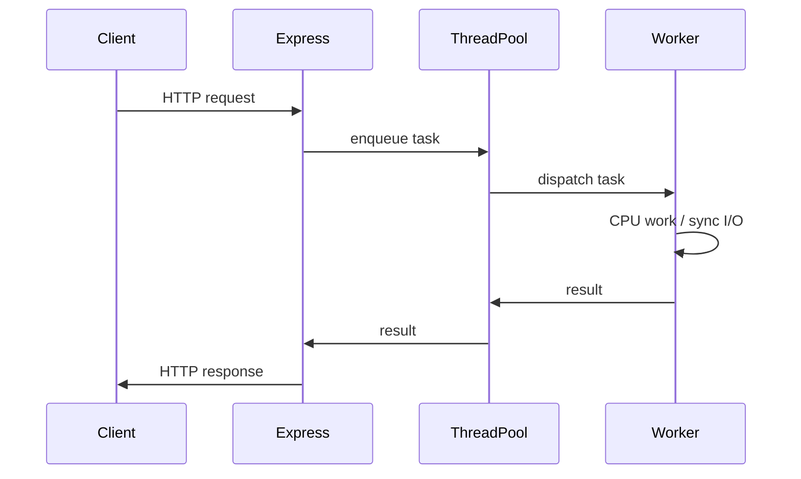

<!-- Generated by Groq via GitHub Actions -->
<!-- Topic ID: T180 -->
<!-- Category: DevOps / Infrastructure -->
<!-- Generated at UTC: 2026-11-06T08:06:52.425029+00:00 -->

# Threads

## 1. What problem does this solve?

**Motivation**  
Modern backends must handle many concurrent requests while performing CPU‑bound work (image processing, AI inference, data aggregation) and I/O‑bound work (DB queries, external API calls). A single thread can only do one thing at a time, so either the server becomes a bottleneck or we rely on asynchronous callbacks that are hard to reason about for CPU‑heavy tasks.

**Problem exists**  
- **Blocking operations**: A CPU‑intensive calculation or a synchronous DB call can stall the entire request pipeline.
- **Limited parallelism**: Node’s event loop is single‑threaded; Python’s GIL prevents true parallel execution of bytecode in CPython.
- **Resource contention**: Without threads, you must spawn many processes or rely on external services, increasing overhead.

**Why it matters**  
- **Latency**: Users experience slower responses when a single thread is busy.
- **Throughput**: The number of requests handled per second drops.
- **Cost**: More hardware or cloud resources are needed to compensate for lack of parallelism.

**What happens if threads are not used**  
- You’ll either serialize work (slow) or duplicate services (expensive).
- You’ll struggle to keep CPU‑bound workloads from blocking I/O‑bound ones.

**Real‑world appearance**  
- Web servers (e.g., Nginx, Apache) use thread pools to serve HTTP requests.
- Node.js uses worker threads for CPU‑bound tasks.
- Python web frameworks (FastAPI, Django) often run behind a thread‑pooling WSGI server (Gunicorn workers).
- AI inference servers spawn threads to parallelize model inference.

---

## 2. Mental model

**Simple analogy**  
Imagine a kitchen with one chef. The chef can only cook one dish at a time. If a customer orders a steak, a salad, and a dessert, the chef must finish the steak before starting the salad, causing delays. A *thread* is like an additional chef: each chef can work on a different dish simultaneously, speeding up service.

**Engineering model**  
- **Thread**: A lightweight process that shares the same memory space as its parent.
- **Thread pool**: A fixed number of worker threads that can be reused to execute tasks.
- **Task queue**: Work items waiting to be processed by a thread.
- **Synchronization primitives**: Locks, semaphores, condition variables that coordinate access to shared data.

---

## 3. Deep explanation

### Internals
- **OS threads**: Managed by the kernel; each has its own stack and register set.
- **User‑level threads**: Managed by a runtime (e.g., Node’s `worker_threads`, Python’s `threading` module).
- **Context switching**: The OS saves the state of one thread and restores another; expensive compared to lightweight task switching in async I/O.

### Important terminology
- **GIL (Global Interpreter Lock)**: CPython’s lock that allows only one thread to execute bytecode at a time.
- **Thread pool**: A collection of pre‑created threads that can execute tasks.
- **Race condition**: Two threads accessing shared data concurrently leading to inconsistent state.
- **Deadlock**: Two or more threads waiting indefinitely for each other’s resources.
- **Starvation**: A thread never gets CPU time because others dominate the scheduler.

### Trade‑offs
| Aspect | Threads | Async I/O (single thread) |
|--------|---------|---------------------------|
| Parallel CPU work | ✔️ | ❌ |
| Memory overhead | Higher (stack per thread) | Low |
| Complexity | Higher (synchronization) | Lower |
| Latency for I/O | ✔️ (can overlap) | ✔️ |
| Debugging | Harder | Easier |

### Failure modes
- **Deadlocks**: Misordered lock acquisition.
- **Race conditions**: Unsynchronized shared state.
- **Resource exhaustion**: Too many threads → high memory, context‑switch overhead.
- **GIL starvation**: In CPython, CPU‑bound threads block each other.

### Limitations
- **Context switch cost**: Switching between many threads can degrade performance.
- **Memory footprint**: Each thread needs a stack (often 1 MB on Linux).
- **Thread safety**: All shared data must be protected; otherwise, bugs are subtle.

### Where it fits in backend architecture
- **Request handling**: Each incoming HTTP request can be dispatched to a thread pool.
- **Background jobs**: CPU‑heavy tasks (image resizing, AI inference) run in worker threads.
- **Microservices**: A service may spawn threads to parallelize calls to other services.

### Interaction with related concepts
- **Event loop**: Threads can offload blocking work so the event loop stays responsive.
- **Process isolation**: Threads share memory; processes isolate memory but are heavier.
- **Containerization**: Threads share the same container resources; careful resource limits needed.
- **Load balancers**: Distribute requests across multiple service instances; each instance may use its own thread pool.

---

## 4. How it works

1. **Request arrives** → HTTP server (e.g., Express) receives it.
2. **Task queued** → The request handler pushes a task onto a thread‑pool queue.
3. **Worker thread picks task** → A thread from the pool dequeues the task.
4. **Execute** → The thread performs CPU‑bound work or synchronous I/O.
5. **Return result** → The thread sends the result back to the main thread.
6. **Respond** → The main thread sends the HTTP response to the client.



---

## 5. Practical implementation

### Node.js worker threads (CPU‑bound image resizing)

```ts
// worker.ts
import { parentPort } from 'worker_threads';
import sharp from 'sharp';

parentPort?.on('message', async (data: { imageBuffer: Buffer }) => {
  try {
    const resized = await sharp(data.imageBuffer)
      .resize(200, 200)
      .toBuffer();
    parentPort?.postMessage({ resized });
  } catch (err) {
    parentPort?.postMessage({ error: err.message });
  }
});
```

```ts
// server.ts
import express from 'express';
import { Worker } from 'worker_threads';
import fs from 'fs';

const app = express();
app.use(express.raw({ type: 'image/*', limit: '10mb' }));

// Simple thread pool
const workers: Worker[] = [];
const queue: Array<{ data: Buffer; resolve: (v: any) => void; reject: (e: any) => void }> = [];

function getWorker(): Worker {
  if (workers.length === 0) {
    const w = new Worker('./worker.js');
    w.on('message', (msg) => {
      const { resolve, reject } = queue.shift()!;
      if (msg.error) reject(new Error(msg.error));
      else resolve(msg.resized);
    });
    workers.push(w);
  }
  return workers[0];
}

app.post('/resize', async (req, res) => {
  const imageBuffer = req.body as Buffer;
  const worker = getWorker();
  const result = await new Promise<Buffer>((resolve, reject) => {
    queue.push({ data: imageBuffer, resolve, reject });
    worker.postMessage({ imageBuffer });
  });
  res.set('Content-Type', 'image/png');
  res.send(result);
});

app.listen(3000, () => console.log('Server listening on 3000'));
```

**Key lines explained**

- `Worker` from `worker_threads` creates a new OS thread.
- `parentPort.postMessage` communicates results back.
- The simple pool reuses a single worker; in production you’d use a proper pool library.

### Python example (threading + GIL)

```python
# cpu_task.py
import time
from concurrent.futures import ThreadPoolExecutor

def heavy_calc(n: int) -> int:
    # CPU‑bound, but CPython will serialize execution due to GIL
    return sum(i * i for i in range(n))

def main():
    with ThreadPoolExecutor(max_workers=4) as pool:
        futures = [pool.submit(heavy_calc, 10_000_000) for _ in range(8)]
        results = [f.result() for f in futures]
        print(results)

if __name__ == "__main__":
    main()
```

**Why this matters**  
In CPython the GIL means only one thread runs Python bytecode at a time, so the above is effectively single‑threaded. For true parallelism, use `multiprocessing` or a C extension.

---

## 6. Production considerations

| Concern | Threading notes |
|---------|-----------------|
| **Scalability** | Thread pool size should match CPU cores; oversubscription hurts performance. |
| **Reliability** | A misbehaving thread can crash the whole process; isolate critical work. |
| **Security** | Threads share memory; ensure no privilege escalation via shared data. |
| **Observability** | Expose thread pool metrics (active, idle, queue length) via Prometheus. |
| **Performance** | Measure context‑switch overhead; use async I/O for I/O‑bound parts. |
| **Error handling** | Catch exceptions inside workers; propagate errors to main thread. |
| **Resource usage** | Limit stack size (`worker_threads` option `stackSize`) to avoid OOM. |
| **Operational concerns** | Monitor thread health; restart process if a thread dies. |
| **Failure recovery** | Retry failed tasks; avoid infinite loops in worker code. |
| **Deployment** | Container resource limits (`--cpus`, `--memory`) should align with thread count. |

---

## 7. Common mistakes

| Mistake | Why it’s problematic |
|---------|----------------------|
| **Using threads for I/O in Node** | Node’s async I/O is already non‑blocking; threads add overhead. |
| **Ignoring the GIL in Python** | Threads don’t give parallel CPU speed; use processes instead. |
| **Sharing mutable state without locks** | Race conditions lead to subtle bugs and data corruption. |
| **Creating too many threads** | Exceeds system limits, causes thrashing. |
| **Not handling worker crashes** | A single crash can bring down the whole service. |
| **Blocking the main thread** | Prevents event loop from processing other requests. |
| **Assuming thread safety of third‑party libs** | Many libs are not thread‑safe; double‑check. |

---

## 8. Senior engineer perspective

### What changes at scale?
- **Thread pool sizing**: Must be tuned per workload; use metrics to adjust.
- **Task granularity**: Too fine‑grained tasks increase scheduling overhead; too coarse can starve other work.
- **Isolation**: Consider using separate processes or containers for critical CPU‑heavy services.
- **Monitoring**: Track per‑thread CPU, memory, lock contention; alert on high contention.
- **Cost**: More threads can mean higher CPU usage; balance against request latency.

### Design decisions
- **Use worker threads vs child processes**: Threads share memory (fast IPC) but risk corruption; processes isolate memory but incur higher overhead.
- **Thread‑safe data structures**: Prefer lock‑free queues (e.g., `worker_threads` `MessageChannel`) over shared mutable objects.
- **Backpressure**: If the queue grows too large, apply backpressure to upstream services.
- **Fail‑fast**: Detect and kill runaway threads; use timeouts per task.

### When NOT to use threads
- Pure async I/O workloads (e.g., high‑throughput HTTP proxies).
- Environments with strict memory constraints (e.g., serverless functions).
- When a language runtime already provides efficient async primitives (e.g., Go goroutines, Rust async).

---

## 9. Interview questions

1. **Beginner**: *What is a thread and how does it differ from a process?*  
   *Answer*: A thread shares the same memory space and resources of its parent process, has its own stack and register set, and is lighter weight than a process.

2. **Beginner**: *Why does CPython’s GIL prevent true parallelism with threads?*  
   *Answer*: The GIL allows only one thread to execute Python bytecode at a time, so CPU‑bound threads run serially.

3. **Senior**: *How would you design a thread pool for a Node.js service that handles both CPU‑bound image processing and I/O‑bound database queries?*  
   *Answer*: Use a fixed pool of worker threads for image processing; keep the main event loop for async DB queries; monitor queue length; adjust pool size based on CPU core count.

4. **Senior**: *Explain a scenario where using threads could lead to a deadlock and how you would detect and mitigate it.*  
   *Answer*: Two threads each hold a lock that the other needs; detect via lock‑contention metrics or deadlock detection algorithms; mitigate by enforcing lock acquisition order or using try‑lock with backoff.

5. **Scenario/Debugging**: *Your Node.js service’s response times have spiked after adding a new CPU‑heavy endpoint. What steps would you take to diagnose and fix the issue?*  
   *Answer*:  
   - Profile CPU usage per thread.  
   - Check thread pool size vs CPU cores.  
   - Inspect for blocking operations in the main thread.  
   - Add timeouts to worker tasks.  
   - Consider moving the heavy work to a separate microservice or using a job queue.

---

## 10. Hands‑on task

**Task**: Implement a simple image thumbnail generator that uses a thread pool to process uploads concurrently.

1. Create an Express endpoint `/upload` that accepts multipart/form‑data with an image file.
2. Offload the resizing to a worker thread pool (max 4 workers).
3. Return the resized image to the client.
4. Add Prometheus metrics for:
   - Number of active workers
   - Queue length
   - Average processing time

**Goal**: Observe how thread pool size affects throughput and latency.

---

## 11. Quick revision

- Threads allow parallel execution of CPU‑bound or blocking tasks.
- Node’s `worker_threads` share memory; Python’s `threading` is limited by the GIL.
- Thread pools reuse threads to avoid expensive creation overhead.
- Synchronization primitives (locks, semaphores) prevent race conditions.
- Over‑creating threads leads to context‑switch thrashing.
- Monitor thread metrics; use backpressure to avoid queue buildup.
- For pure async I/O, prefer event loop; for CPU work, use threads or processes.
- Deadlocks arise from circular lock dependencies; avoid by ordering locks.
- In production, size the pool to match CPU cores and workload characteristics.
- Use Prometheus or similar to expose thread‑pool health.

---

## 12. References

- [Node.js worker_threads](https://nodejs.org/api/worker_threads.html)
- [Python threading module](https://docs.python.org/3/library/threading.html)
- [Python GIL](https://docs.python.org/3/faq/programming.html#what-is-the-global-interpreter-lock-gil)
- [Linux thread basics](https://man7.org/linux/man-pages/man7/threads.7.html)
- [Prometheus thread metrics](https://prometheus.io/docs/instrumenting/writing_exporters/#exporter-architecture)
- [Go goroutine vs thread comparison](https://blog.golang.org/goroutines)
