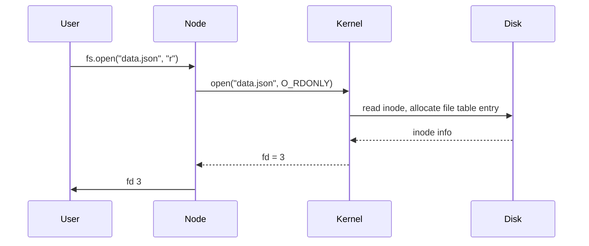
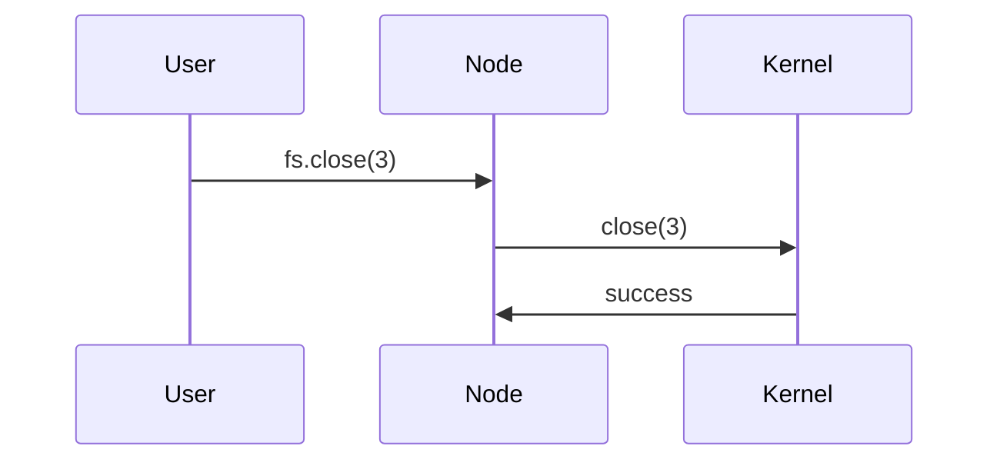
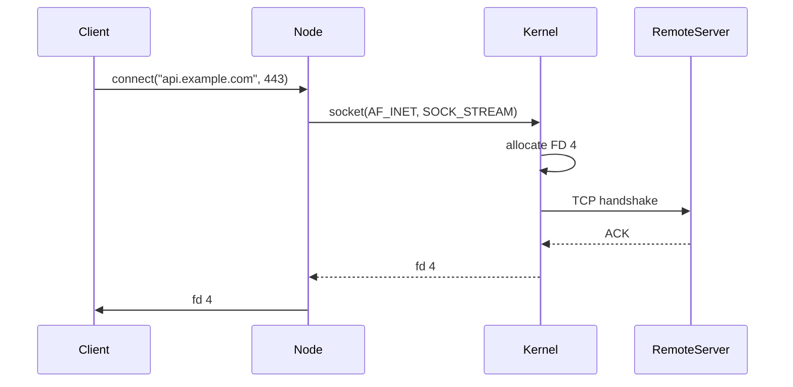

<!-- Generated by Groq via GitHub Actions -->
<!-- Topic ID: T182 -->
<!-- Category: DevOps / Infrastructure -->
<!-- Generated at UTC: 2026-11-06T20:01:41.815384+00:00 -->

# File descriptors

## 1. What problem does this solve?

| What problem exists | Why it matters | Consequences of ignoring it | Real‑world appearance |
|---------------------|----------------|-----------------------------|-----------------------|
| **Limited OS resources** – every open file, socket, pipe, etc. consumes a *file descriptor* (FD). | The kernel can only keep a finite number of descriptors per process (default ~1024 on many Linux distros). | Running out of FDs causes `EMFILE`/`ENFILE` errors, crashes, or silent failures. | Web servers, database connection pools, message brokers, long‑running ETL jobs, microservices that open many sockets. |
| **Resource leaks** – forgetting to close descriptors leads to exhaustion over time. | Leaks degrade performance, increase memory usage, and can bring a service down. | Gradual slowdown, eventual denial of service. | A Node.js API that never closes a DB connection or a Python script that keeps file handles open. |
| **Concurrency limits** – each FD is a slot in the kernel’s I/O scheduler. | High concurrency workloads (e.g., 10k simultaneous HTTP connections) need efficient FD handling. | Bottlenecks, increased latency, or inability to accept new connections. | Nginx, HAProxy, or a custom TCP server. |
| **Security boundaries** – descriptors can be inherited by child processes. | Unintended sharing can leak secrets or open attack vectors. | Privilege escalation, data leakage. | Forked worker processes that inherit DB sockets. |

In short, file descriptors are the *gatekeepers* of OS‑level I/O. Managing them correctly is essential for any backend that does I/O.

---

## 2. Mental model

### Analogy: Library checkout system

- **Books** = *files/sockets*  
- **Library card** = *process*  
- **Checkout desk** = *kernel*  
- **Checkout counter** = *file descriptor table*  

When you check out a book, the library records which card holds which book. You can only hold a limited number of books at once. If you forget to return a book, the library eventually runs out of books to lend.

### Engineering model

- **File descriptor**: an integer index into the process’s *open file table*.
- **Open file table**: kernel data structure mapping FD numbers to *open file descriptions* (inode, offset, flags).
- **Reference counting**: multiple FDs can point to the same open file description (e.g., `dup()` or `fork()`).
- **Descriptor lifecycle**: `open()` → use → `close()` (or `dup()`/`fork()` semantics).

---

## 3. Deep explanation

### Internals

| Term | Meaning | Example |
|------|---------|---------|
| **FD (file descriptor)** | Small integer (0, 1, 2, …) used by system calls to refer to an open resource. | `int fd = open("log.txt", O_WRONLY);` |
| **Open file description** | Kernel object containing inode, file offset, flags, and reference count. | Two FDs (`fd1`, `fd2`) can share the same open file description after `dup(fd1)`. |
| **File table** | Per‑process array of pointers to open file descriptions. | `proc->files->fd[fd] = &open_file_desc;` |
| **Inode** | File metadata on disk (size, permissions, block pointers). | `stat()` returns inode number. |
| **File descriptor limit** | `RLIMIT_NOFILE` (ulimit -n). | `ulimit -n 65536` |

### Trade‑offs

| Approach | Pros | Cons |
|----------|------|------|
| **Blocking I/O** (e.g., `fs.readFileSync`) | Simple code, deterministic. | Blocks event loop, poor scalability. |
| **Non‑blocking I/O** (`fs.read` with callbacks) | Keeps event loop free. | Callback hell, harder to reason about. |
| **Streams** (`fs.createReadStream`) | Handles backpressure, efficient for large files. | Requires understanding of flow control. |
| **File descriptor pooling** (e.g., DB connection pool) | Reuses descriptors, reduces overhead. | Adds complexity, must handle stale connections. |

### Failure modes

- **EMFILE**: Too many open files in a process.  
- **ENFILE**: System‑wide file table full.  
- **EBADF**: Using an invalid FD (e.g., after close).  
- **Resource leaks**: FDs never closed → exhaustion.  
- **Race conditions**: Two threads close the same FD simultaneously.  

### Limitations

- **Single‑process scope**: FD limits apply per process; containers or VMs can circumvent by sharing the host’s limits.  
- **Non‑portable semantics**: Some OSes expose additional FD types (e.g., sockets, pipes) with different behaviors.  
- **No built‑in garbage collection**: Must be managed manually or via high‑level abstractions.

### Where it fits in backend architecture

- **HTTP servers**: Each incoming connection gets an FD.  
- **Database clients**: Each connection uses an FD (TCP socket).  
- **Message brokers**: Sockets, pipes, or shared memory segments.  
- **File uploads/downloads**: Streams use FDs to read/write data.  
- **Logging**: File handles for log rotation.  

### Interaction with related concepts

- **Event loop**: Node.js uses libuv’s epoll/kqueue to multiplex many FDs.  
- **Connection pooling**: Reuses FDs to avoid repeated `open()`/`close()`.  
- **Process forking**: Child inherits FDs; careful duplication needed.  
- **Container limits**: Docker’s `--ulimit nofile=...` sets per‑container FD caps.  

---

## 4. How it works

### Step‑by‑step flow for opening a file in Node.js



### Closing a file



### Using a descriptor with a socket



---

## 5. Practical implementation

### 5.1 Node.js: Streaming a large file with proper FD handling

```ts
import { createReadStream, closeSync, openSync } from "fs";
import { pipeline } from "stream";
import { promisify } from "util";

const pipelineAsync = promisify(pipeline);

async function streamLargeFile(req, res) {
  // 1️⃣ Open the file and get an FD
  const fd = openSync("/var/log/huge.log", "r");

  try {
    // 2️⃣ Create a read stream from the FD
    const readStream = createReadStream(null, { fd, start: 0, end: 10_000_000 });

    // 3️⃣ Pipe to the HTTP response
    await pipelineAsync(readStream, res);
  } catch (err) {
    console.error("Streaming error:", err);
    res.statusCode = 500;
    res.end("Internal Server Error");
  } finally {
    // 4️⃣ Close the FD explicitly
    closeSync(fd);
  }
}
```

**Key points**

- `openSync` gives you a raw FD; you can pass it to `createReadStream`.
- `createReadStream` **does not** close the FD automatically when you pass it explicitly.
- Always close the FD in a `finally` block to avoid leaks.

### 5.2 Node.js: Using a socket FD with `net` module

```ts
import { createConnection } from "net";

const socket = createConnection({ host: "api.example.com", port: 443 });

socket.on("connect", () => {
  console.log("Socket FD:", socket._handle.fd); // internal, but shows the FD number
});

socket.on("data", (chunk) => {
  // process data
});

socket.on("close", () => {
  console.log("Socket closed");
});
```

> **Caution**: Accessing `_handle.fd` is internal and may change across Node.js versions. Use it only for debugging.

### 5.3 Python: Context manager ensures FD closure

```python
import os

with open("/tmp/large.txt", "rb") as f:
    data = f.read(1024)  # FD automatically closed at end of block
```

---

## 6. Production considerations

| Concern | What to watch for | Mitigation |
|---------|-------------------|------------|
| **Scalability** | High concurrent connections → FD exhaustion | Raise `ulimit -n`, use connection pooling, use async I/O (libuv, epoll) |
| **Reliability** | Leaked descriptors cause slow degradation | Instrument FD count (`/proc/self/fd`), use `resource.getrlimit` in Python, `process.getActiveHandles()` in Node |
| **Security** | Inherited FDs in child processes | Explicitly close FDs before `exec`, use `FD_CLOEXEC` flag |
| **Observability** | Hard to see leaks | Log FD count on startup and at intervals; expose `/proc/self/fd` via a health endpoint |
| **Performance** | Blocking I/O stalls event loop | Prefer streams, async APIs, or worker threads for CPU‑bound work |
| **Error handling** | `EMFILE` errors can crash services | Catch `EMFILE`, back off, or use a queue to retry |
| **Resource usage** | Each FD consumes kernel memory | Monitor `/proc/sys/fs/file-nr`, adjust limits |
| **Operational concerns** | Containers may have low defaults | Set `--ulimit nofile=65536` in Docker Compose or Kubernetes `securityContext` |
| **Failure recovery** | FD exhaustion leads to 503s | Implement graceful shutdown, drain connections, restart workers |
| **Deployment** | Different OS limits | Test on target OS, document required limits |

---

## 7. Common mistakes

| Mistake | Why it’s problematic |
|---------|----------------------|
| **Never closing FDs** | Gradual exhaustion → `EMFILE` → service crash |
| **Using blocking I/O in event‑driven code** | Blocks the event loop → latency spikes |
| **Ignoring `FD_CLOEXEC`** | Child processes inherit FDs → potential leaks or privilege escalation |
| **Relying on high‑level abstractions that hide leaks** | Example: using `fs.readFile` in a tight loop without checking for leaks |
| **Setting FD limits too low** | Even a small number of sockets can hit the limit in microservices |
| **Not handling `EMFILE`** | Unhandled exception → crash instead of graceful degradation |
| **Using `fs.createReadStream` without a `close` listener** | If the stream errors, the FD may stay open |
| **Forking processes without closing unused FDs** | Child inherits all parent FDs → wasteful resource usage |

---

## 8. Senior engineer perspective

### What changes at scale?

- **FD limits** become a hard bottleneck; you must tune `ulimit` and possibly use `systemd` to set per‑service limits.
- **Connection pooling** is essential for database and message broker clients; each pool entry holds an FD.
- **Ephemeral ports**: With many outbound connections, you may exhaust the local port range; configure `net.ipv4.ip_local_port_range`.
- **Monitoring**: Expose metrics like `node_fd_open` (Prometheus) and alert on thresholds.
- **Security hardening**: Use `seccomp` or `apparmor` to restrict which FDs a process can open.
- **Container limits**: Kubernetes `resources.limits` for `nofile` must match the application’s needs.
- **Failure scenarios**: Design for graceful degradation when hitting FD limits (e.g., queue requests, back‑pressure).
- **Cost/performance**: Opening a new socket incurs kernel overhead; reusing FDs via pooling reduces CPU and memory usage.
- **When NOT to use**: If you only need a handful of connections, the overhead of a pool may outweigh benefits; or if you’re writing a short‑lived script that exits quickly.

---

## 9. Interview questions

1. **Beginner**: *What is a file descriptor and why is it important in a Node.js application?*  
   **Answer**: An integer that uniquely identifies an open file, socket, or pipe in the kernel. It’s the handle used by system calls to perform I/O. In Node.js, each open resource consumes one FD; exceeding the limit causes errors.

2. **Beginner**: *How do you prevent file descriptor leaks in a long‑running Node.js service?*  
   **Answer**: Always close FDs in a `finally` block or use streams that emit `close` events. Use `process.getActiveHandles()` for debugging. Set `ulimit -n` high enough and monitor `/proc/self/fd`.

3. **Senior**: *Explain how you would design a database connection pool that respects the OS file descriptor limits while maximizing throughput.*  
   **Answer**: Use a bounded pool size (e.g., 50 connections). Each connection holds a socket FD. On `acquire`, block or queue if pool is empty. Use `async`/`await` to avoid blocking the event loop. Monitor pool usage and adjust size based on load. Handle `EMFILE` by backing off and retrying.

4. **Senior**: *Describe the trade‑offs between using `fs.readFileSync` vs. `fs.createReadStream` for serving large static assets in a production web server.*  
   **Answer**: `readFileSync` blocks the event loop, causing latency spikes and poor scalability. `createReadStream` streams data asynchronously, respects backpressure, and keeps the event loop free. However, it requires careful handling of errors and closing the stream.

5. **Scenario/Debugging**: *Your Node.js service starts throwing `EMFILE` after a few hours of steady traffic. What steps would you take to diagnose and fix the issue?*  
   **Answer**:  
   - Check current FD count (`lsof -p $$ | wc -l` or `process.getActiveHandles().length`).  
   - Identify leaked handles (`process.getActiveHandles()` or `node --inspect`).  
   - Review code paths that open sockets or files; ensure `close()` is called.  
   - Increase `ulimit -n` if necessary.  
   - Add metrics to monitor FD usage.  
   - If using a pool, verify it releases connections properly.  

---

## 10. Hands‑on task

**Goal**: Build a small HTTP server that streams a 100 MB file to clients while logging the number of open file descriptors before and after each request.

**Steps**

1. Create a 100 MB dummy file (`dd if=/dev/urandom of=huge.bin bs=1M count=100`).
2. Implement an Express or plain HTTP server that:
   - On `/download`, opens the file with `openSync`, streams it with `createReadStream`, and closes the FD in a `finally` block.
   - Logs `process.getActiveHandles().length` before and after handling the request.
3. Run the server, make multiple concurrent requests (e.g., with `ab` or `wrk`).
4. Observe that the FD count does not grow over time.
5. Intentionally comment out the `closeSync(fd)` line and repeat; verify that the FD count increases until hitting `EMFILE`.

**Deliverables**

- `server.ts` (or `server.js`) with the implementation.
- A short README explaining how to run the test and what to observe.

---

## 11. Quick revision

- FD = integer index into process’s open file table.  
- Kernel limits: `RLIMIT_NOFILE` (ulimit -n).  
- `open()` → FD; `close()` → release.  
- `dup()`, `fork()` share open file descriptions.  
- Node.js: `fs.openSync`, `fs.createReadStream`, `socket._handle.fd`.  
- Leaks → `EMFILE` → service crash.  
- Use streams for large files; avoid blocking I/O.  
- Monitor FD usage (`/proc/self/fd`, `process.getActiveHandles()`).  
- Set container FD limits (`--ulimit nofile=...`).  
- Connection pools reuse FDs, reduce overhead.  
- Always close FDs in `finally` or use `using`/`with` patterns.  

---

## 12. References

- Node.js fs module: <https://nodejs.org/api/fs.html>  
- Node.js net module: <https://nodejs.org/api/net.html>  
- POSIX open(2) man page: <https://man7.org/linux/man-pages/man2/open.2.html>  
- Linux `ulimit` documentation: <https://man7.org/linux/man-pages/man1/ulimit.1.html>  
- Systemd resource limits: <https://www.freedesktop.org/software/systemd/man/systemd.exec.html#RuntimeDirectoryMode>  
- Prometheus Node.js client: <https://github.com/siimon/prom-client>  
- Docker `--ulimit` flag: <https://docs.docker.com/engine/reference/run/#ulimit-configuration>  
- Kubernetes `securityContext` `runAsUser`: <https://kubernetes.io/docs/tasks/configure-pod-container/security-context/>  

---
