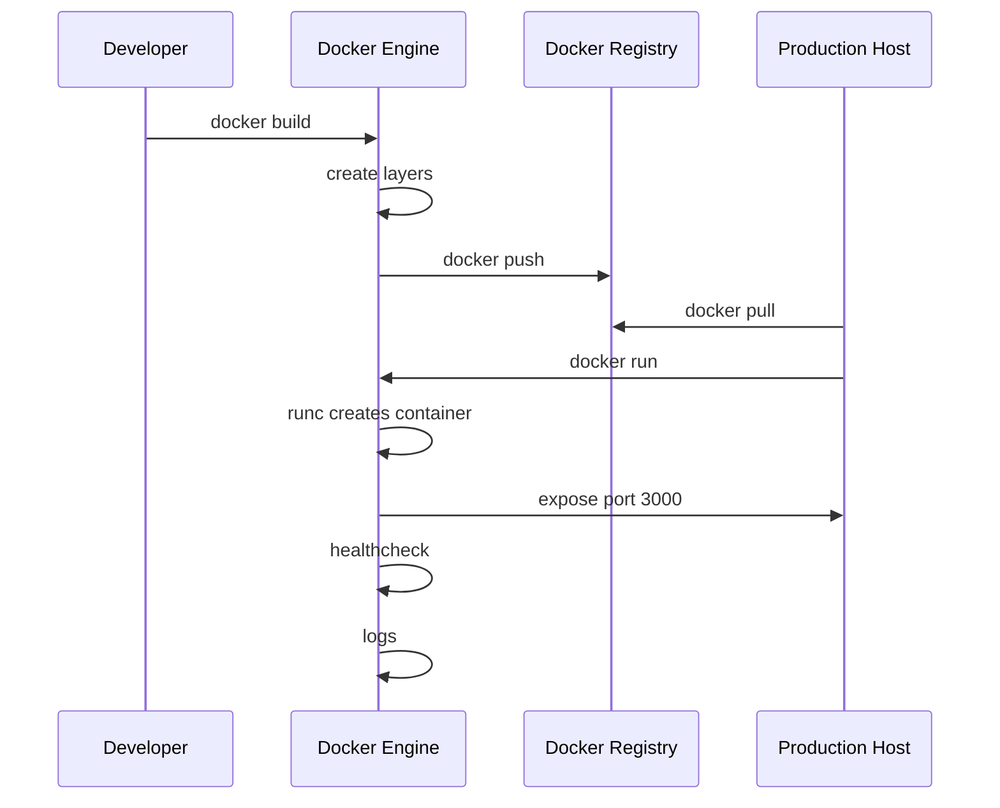

<!-- Generated by Groq via GitHub Actions -->
<!-- Topic ID: T184 -->
<!-- Category: DevOps / Infrastructure -->
<!-- Generated at UTC: 2026-11-07T07:26:39.232118+00:00 -->

# Docker

## 1. What problem does this solve?

**Motivation**  
When a backend team builds a service, the code runs on a developer’s laptop, a CI runner, and a production server. Each of those environments can have different Node.js versions, OS packages, environment variables, and network settings. If the code works locally but fails in production, the root cause is often *environment drift*.

**The problem**  
- **Dependency hell** – mismatched library versions, missing system packages.  
- **Reproducibility** – “It works on my machine” becomes a real pain.  
- **Deployment friction** – shipping binaries, Dockerfiles, or manual scripts for each environment.  
- **Scaling** – spinning up many identical instances requires a consistent runtime.

**Why it matters**  
- **Reliability** – A consistent runtime eliminates “works locally” bugs.  
- **Speed** – Developers can ship code faster because they don’t need to configure each target environment.  
- **Security** – Isolated runtimes reduce attack surface.  
- **Observability** – Containers expose a uniform interface for logging and metrics.

**What happens if we don’t use it**  
- Manual configuration errors propagate to production.  
- Longer debugging cycles.  
- Harder to scale horizontally; each instance may need custom setup.  
- Increased operational cost and risk.

**Real‑world appearance**  
- Microservice stacks (Node.js + FastAPI + PostgreSQL) are often containerized.  
- CI/CD pipelines build Docker images and push them to registries.  
- Production clusters (Kubernetes, ECS, GKE) run containers at scale.

---

## 2. Mental model

### Analogy  
Think of Docker as a **shipping container**.  
- **Container** = a standardized, lightweight box that can be shipped anywhere.  
- **Image** = the contents of the box (the code, libraries, OS files).  
- **Dockerfile** = the packing list that tells you how to fill the box.  
- **Runtime** = the ship that carries the container across the ocean (the host OS).  

Just as a shipping container can be loaded onto a truck, train, or ship without re‑packing, a Docker image can be run on any host that supports the Docker runtime without modification.

### Precise engineering model  
- **Image**: A read‑only set of layers built from a Dockerfile.  
- **Container**: A writable layer on top of an image, plus a process namespace.  
- **Runtime**: `runc` (or a higher‑level orchestrator) that creates namespaces, cgroups, and mounts the container filesystem.  
- **Union filesystem**: Combines layers into a single view.  
- **Networking**: Docker creates a virtual bridge (`docker0`) and assigns IPs to containers.  
- **Volumes**: Separate persistent storage that can be shared across containers.

---

## 3. Deep explanation

### Internals
| Component | Role |
|-----------|------|
| **Dockerfile** | Declarative build script. |
| **Build context** | Files sent to the Docker daemon during `docker build`. |
| **Image layers** | Immutable snapshots; each instruction creates a new layer. |
| **Union FS** | OverlayFS (Linux) or similar; merges layers. |
| **runc** | Low‑level runtime that creates namespaces, mounts, and starts the container process. |
| **Docker Engine** | Daemon that orchestrates builds, runs, and manages containers. |
| **Docker Registry** | Stores images; can be public (Docker Hub) or private. |

### Important terminology
- **Image** – Immutable, versioned artifact.  
- **Container** – Runtime instance of an image.  
- **Layer** – Diff between two image states.  
- **Registry** – Repository of images.  
- **Tag** – Human‑readable label (e.g., `v1.2.3`).  
- **Compose** – YAML file to orchestrate multi‑container setups.  
- **Healthcheck** – Command that Docker runs to determine container health.  
- **Build cache** – Re‑uses unchanged layers to speed up builds.

### Trade‑offs
| Aspect | Docker | Alternatives |
|--------|--------|--------------|
| **Isolation** | OS‑level namespaces; less isolation than VMs. | Virtual Machines (VMs) – full isolation, heavier. |
| **Startup time** | < 1 s | VMs – minutes. |
| **Resource overhead** | Low | VMs – high. |
| **Security** | Requires kernel hardening; shared kernel. | VMs – isolated kernel. |
| **Portability** | Runs on any Docker‑compatible host. | Native binaries – platform specific. |

### Failure modes
- **Image corruption** – corrupted layers lead to runtime errors.  
- **Network isolation** – misconfigured bridge can expose services.  
- **Resource exhaustion** – no limits → host OOM.  
- **Privilege escalation** – running as root inside container.  

### Limitations
- **Kernel dependency** – Docker uses host kernel; cannot run a different kernel.  
- **Security** – Shared kernel means a vulnerability in the host can affect containers.  
- **Performance** – Some workloads (e.g., high‑frequency I/O) may suffer from the union FS overhead.  

### Where it fits in backend architecture
- **Microservices** – Each service runs in its own container.  
- **CI/CD** – Build images, run tests, push to registry.  
- **Orchestration** – Kubernetes, ECS, or Docker Swarm manage container lifecycle.  
- **Observability** – Containers expose logs, metrics, and health endpoints.

### Interaction with related concepts
- **Kubernetes** – Uses Docker images as the unit of deployment.  
- **CI pipelines** – `docker build`, `docker push`, `docker run` steps.  
- **Secrets management** – Docker secrets, environment variables, or external vaults.  
- **Service mesh** – Injects sidecar containers for traffic control.

---

## 4. How it works

1. **Write a Dockerfile** – define base image, copy source, install deps, expose ports.  
2. **Build the image** – `docker build -t myapp:latest .`  
   - Docker daemon reads the Dockerfile, sends the build context, creates layers.  
3. **Push to a registry** – `docker push myregistry.com/myapp:latest`  
4. **Pull on target host** – `docker pull myregistry.com/myapp:latest`  
5. **Run the container** – `docker run -d --name myapp -p 3000:3000 myregistry.com/myapp:latest`  
6. **Container runtime** – `runc` creates namespaces, mounts the image, starts the process.  
7. **Networking** – Docker assigns an IP, sets up NAT to host ports.  
8. **Healthcheck** – Docker periodically runs the healthcheck command.  
9. **Logs** – `docker logs myapp` streams stdout/stderr.  
10. **Shutdown** – `docker stop myapp` sends SIGTERM, then SIGKILL after timeout.



---

## 5. Practical implementation

### 5.1 Dockerfile for a Next.js + Express API

```dockerfile
# Stage 1 – build
FROM node:20-alpine AS builder
WORKDIR /app

# Install dependencies
COPY package*.json ./
RUN npm ci --omit=dev

# Copy source
COPY . .
RUN npm run build

# Stage 2 – runtime
FROM node:20-alpine
WORKDIR /app

# Copy built assets
COPY --from=builder /app/.next ./.next
COPY --from=builder /app/public ./public
COPY --from=builder /app/package*.json ./
RUN npm ci --omit=dev

# Expose port
EXPOSE 3000

# Start the server
CMD ["npm", "start"]
```

**Key points**  
- **Multi‑stage** – keeps runtime image small.  
- **`--omit=dev`** – removes dev dependencies.  
- **`EXPOSE`** – documents the port.  

### 5.2 docker‑compose.yml for a full stack

```yaml
version: "3.9"
services:
  web:
    build: .
    ports:
      - "3000:3000"
    environment:
      - DATABASE_URL=postgres://postgres:postgres@db:5432/app
      - REDIS_URL=redis://redis:6379
    depends_on:
      - db
      - redis
    restart: unless-stopped

  db:
    image: postgres:16-alpine
    environment:
      POSTGRES_USER: postgres
      POSTGRES_PASSWORD: postgres
      POSTGRES_DB: app
    volumes:
      - db-data:/var/lib/postgresql/data
    restart: unless-stopped

  redis:
    image: redis:7-alpine
    volumes:
      - redis-data:/data
    restart: unless-stopped

volumes:
  db-data:
  redis-data:
```

Run the stack:

```bash
docker compose up -d
```

### 5.3 Node.js entry point (`src/server.ts`)

```ts
import express from 'express';
import { Pool } from 'pg';
import redis from 'redis';

const app = express();
const pool = new Pool({ connectionString: process.env.DATABASE_URL });
const redisClient = redis.createClient({ url: process.env.REDIS_URL });

app.get('/health', async (req, res) => {
  // Simple DB ping
  await pool.query('SELECT 1');
  // Redis ping
  await redisClient.ping();
  res.json({ status: 'ok' });
});

app.listen(3000, () => {
  console.log('Server listening on port 3000');
});
```

---

## 6. Production considerations

| Concern | How Docker helps | Practical steps |
|---------|------------------|-----------------|
| **Scalability** | Stateless containers can be replicated. | Use orchestrator (K8s) with horizontal pod autoscaler. |
| **Reliability** | Healthchecks + restart policies. | `HEALTHCHECK CMD curl -f http://localhost:3000/health || exit 1` |
| **Security** | Least‑privilege images, user namespaces, image scanning. | `USER node` in Dockerfile; use `docker scan`. |
| **Observability** | Unified logging, metrics, tracing. | Forward stdout to Loki/Prometheus; expose `/metrics`. |
| **Performance** | Layer caching, minimal base images. | Use `node:20-alpine`, multi‑stage builds. |
| **Error handling** | Exit codes propagate to orchestrator. | `CMD ["npm", "start"]` ensures process stays alive. |
| **Resource usage** | CPU/memory limits via cgroups. | `docker run -m 512m --cpus=1 ...` or K8s resource requests/limits. |
| **Operational concerns** | CI/CD pipelines, image versioning, registry management. | Tag images with git SHA; use GitHub Actions to push. |
| **Failure recovery** | Rolling updates, canary releases. | K8s `Deployment` with `maxSurge`/`maxUnavailable`. |
| **Deployment** | Immutable deployments, blue‑green. | Use image tags, immutable deployments in K8s. |

---

## 7. Common mistakes

| Mistake | Why it’s problematic |
|---------|----------------------|
| Running as root inside container | Increases attack surface; can escape container. |
| Not using `.dockerignore` | Copies unnecessary files → larger images, slower builds. |
| Large base images (e.g., `node:20`) | Bloat image size, longer download times. |
| Hard‑coding secrets in Dockerfile | Secrets get baked into image layers. |
| No healthchecks | Orchestrator may think container is healthy when it isn’t. |
| Using bind mounts in production | Leaks host filesystem; inconsistent data. |
| Not pinning image tags | `latest` can change unexpectedly. |
| Ignoring resource limits | Containers can consume all host resources. |
| Not scanning images | Vulnerabilities remain in production. |
| Over‑privileged network mode | Containers can reach services they shouldn’t. |

---

## 8. Senior engineer perspective

### What changes at scale?
- **Orchestration** – Docker alone is insufficient; use Kubernetes or ECS.  
- **Service mesh** – Inject sidecars for traffic control, observability.  
- **CI/CD** – Build once, deploy many; use immutable tags.  
- **Image registry** – Private registry with access control, vulnerability scanning.  

### Design decisions
- **Base image** – `node:20-alpine` vs. `distroless` vs. custom minimal image.  
- **Layer strategy** – Cache npm install layer; rebuild only when `package.json` changes.  
- **Secrets** – Use Docker secrets or external vault; never bake into image.  
- **Networking** – Use overlay networks; isolate namespaces.  
- **Data persistence** – Separate volumes; use StatefulSets for DBs.  

### Trade‑offs
- **Build time vs. runtime size** – Multi‑stage builds reduce runtime size but add build steps.  
- **Image size vs. startup speed** – Smaller images start faster but may need more layers.  
- **Security vs. convenience** – Running as non‑root adds complexity but improves security.  

### Bottlenecks
- **Image pull bandwidth** – Use local registry mirrors.  
- **Disk I/O** – Union FS can be slow on certain storage backends.  
- **CPU** – Heavy CPU workloads may need dedicated nodes.  

### Failure scenarios
- **Image vulnerability** – Patch and rebuild; use automated scanning.  
- **Resource exhaustion** – Set limits; monitor with Prometheus.  
- **Mis‑configured healthchecks** – Orchestrator may keep unhealthy pods running.  

### Monitoring
- **Container metrics** – CPU, memory, network.  
- **Application logs** – Structured logs to Loki/EFK stack.  
- **Tracing** – OpenTelemetry sidecar.  

### Cost/performance
- **Smaller images** → less storage, faster pulls.  
- **Parallel builds** – Use BuildKit, cache across CI runners.  
- **Immutable deployments** – Avoid rollbacks, reduce downtime.  

### When NOT to use Docker
- **Legacy monoliths** that cannot be split into containers.  
- **High‑performance native code** that requires direct kernel access.  
- **GPU workloads** – Docker can be used, but requires NVIDIA runtime.  
- **Very small services** where the overhead outweighs benefits.

---

## 9. Interview questions

1. **Beginner** – *What is a Docker image?*  
   *Answer:* A read‑only, versioned artifact composed of layers that contains all files, libraries, and metadata needed to run an application.

2. **Beginner** – *What is a Docker container?*  
   *Answer:* A runtime instance of an image, with its own filesystem overlay, process namespace, and network stack.

3. **Intermediate** – *Explain the difference between `COPY` and `ADD` in a Dockerfile.*  
   *Answer:*  
   - `COPY` only copies files from the build context to the image.  
   - `ADD` can also fetch remote URLs and unpack local tar archives.  
   Use `COPY` unless you need the extra features of `ADD`.

4. **Senior** – *How does Docker achieve process isolation without full virtualization?*  
   *Answer:* Docker uses Linux kernel namespaces (PID, network, mount, UTS, IPC, cgroup) and a copy‑on‑write union filesystem. This isolates processes, filesystems, and networking while sharing the host kernel, giving lightweight isolation.

5. **Senior** – *Describe how you would design a CI/CD pipeline that builds, tests, and deploys a Dockerized Node.js application to Kubernetes.*  
   *Answer:*  
   - **Build stage**: `docker build` with BuildKit, cache layers, tag with git SHA.  
   - **Test stage**: `docker run` the image, run unit/integration tests.  
   - **Push stage**: `docker push` to a private registry.  
   - **Deploy stage**: Use Helm or Kustomize to update the Deployment with the new image tag, trigger a rolling update.  
   - **Rollback**: Keep previous image tags; use `kubectl rollout undo`.  
   - **Observability**: Push logs to ELK, metrics to Prometheus.  

6. **Scenario/Debugging** – *A container starts but immediately exits with code 1. What steps would you take to debug?*  
   *Answer:*  
   1. `docker logs <container>` – inspect error output.  
   2. `docker inspect <container>` – check exit code, environment variables.  
   3. Run interactively: `docker run -it --entrypoint /bin/sh <image>` and manually start the process.  
   4. Verify that required env vars (e.g., DB URL) are set.  
   5. Check healthcheck and entrypoint scripts for errors.  
   6. Look for missing files or permissions issues.

---

## 10. Hands‑on task

**Goal:** Build a Dockerized Next.js + Express API with PostgreSQL, run it locally with `docker compose`, run tests, push the image to Docker Hub, and deploy to a local Kubernetes cluster (Minikube or Kind).

**Steps**

1. **Clone the starter repo** (provided in this repository).  
2. **Add a `.dockerignore`** to exclude `node_modules`, `.git`, etc.  
3. **Create the Dockerfile** as shown in section 5.1.  
4. **Write a simple test** (`src/__tests__/health.test.ts`) that starts the container and hits `/health`.  
5. **Build and run**:  
   ```bash
   docker compose up --build -d
   curl http://localhost:3000/health
   ```  
6. **Run tests**: `npm test`.  
7. **Tag and push**:  
   ```bash
   docker tag myapp:latest myregistry.com/username/myapp:$(git rev-parse --short HEAD)
   docker push myregistry.com/username/myapp:$(git rev-parse --short HEAD)
   ```  
8. **Deploy to Minikube**:  
   - Create a `deployment.yaml` that pulls the image from your registry.  
   - Apply: `kubectl apply -f deployment.yaml`.  
   - Verify: `kubectl get pods`, `kubectl port-forward`.  
9. **Cleanup**: `docker compose down`, `kubectl delete -f deployment.yaml`.

---

## 11. Quick revision

- Docker images are immutable, layered artifacts.  
- Containers are runtime instances with isolated namespaces.  
- `docker build` creates layers; `docker run` starts a container.  
- Multi‑stage builds keep runtime images small.  
- Use `.dockerignore` to keep images lean.  
- Healthchecks and restart policies improve reliability.  
- Run containers as non‑root; pin image tags.  
- Use Docker Compose for local multi‑service stacks.  
- Push images to a registry; tag with git SHA.  
- Orchestrate with Kubernetes for scaling and rolling updates.  
- Scan images for vulnerabilities; set resource limits.  
- Monitor logs, metrics, and traces; use sidecars for observability.

---

## 12. References

- [Docker Engine Documentation](https://docs.docker.com/engine/)  
- [Dockerfile Reference](https://docs.docker.com/engine/reference/builder/)  
- [Docker Compose Documentation](https://docs.docker.com/compose/)  
- [Docker Security Best Practices](https://docs.docker.com/engine/security/security/)  
- [Docker BuildKit](https://docs.docker.com/build/buildkit/)  
- [Kubernetes Container Basics](https://kubernetes.io/docs/concepts/containers/)  
- [Docker Hub](https://hub.docker.com/)  
- [Docker Scan](https://docs.docker.com/engine/security/scanning/)  
- [OpenTelemetry for Docker](https://opentelemetry.io/docs/instrumentation/docker/)
