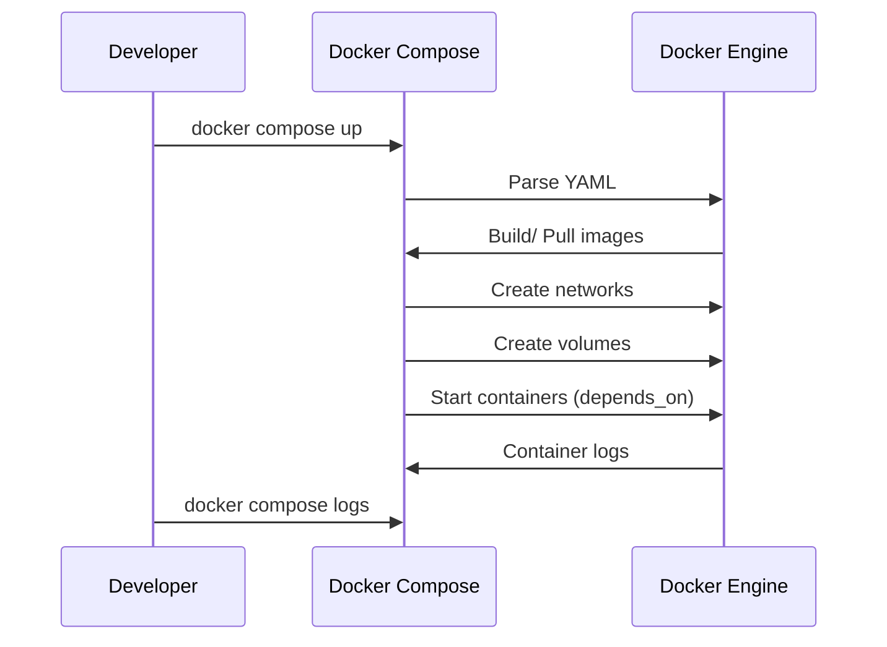

<!-- Generated by Groq via GitHub Actions -->
<!-- Topic ID: T185 -->
<!-- Category: DevOps / Infrastructure -->
<!-- Generated at UTC: 2026-11-07T18:10:14.693557+00:00 -->

# Docker Compose

## 1. What problem does this solve?

- **Problem**  
  Modern backends rarely run as a single process. A typical stack might include a Node.js API, a Next.js frontend, a FastAPI micro‑service, PostgreSQL, MongoDB, Redis, and an AI inference container. Each of these components needs its own runtime, network, storage, and configuration. Managing them manually with `docker run` commands is error‑prone, hard to reproduce, and difficult to share with teammates.

- **Why it matters**  
  Developers need a *single, declarative* file that describes the entire stack. Without it, onboarding new team members, running tests, or spinning up a staging environment becomes a manual, fragile process.

- **Consequences of not using it**  
  • Inconsistent environments between dev, CI, and prod.  
  • Hard to track dependencies and version mismatches.  
  • Increased risk of “works on my machine” bugs.  
  • More time spent on shell scripts and environment variables.

- **Real‑world appearance**  
  • Local development of a SaaS product that uses a Next.js frontend, a Node.js API, and a PostgreSQL database.  
  • CI pipelines that spin up a test environment with Docker Compose before running integration tests.  
  • Staging environments that mirror production by running the same `docker-compose.yml` with different environment variables.

---

## 2. Mental model

**Analogy – Kitchen with a Recipe**  
Think of Docker Compose as a *recipe* for a multi‑course meal.  
- Each *service* is a dish (e.g., “API”, “frontend”, “database”).  
- The *compose file* lists the ingredients (images, ports, volumes).  
- Docker Compose reads the recipe and prepares each dish in the right order, ensuring they can talk to each other over a shared kitchen (network).

**Engineering model**  
- **Services** – isolated containers defined by image, command, environment, volumes, etc.  
- **Networks** – Docker creates an isolated network per Compose project; services can resolve each other by name.  
- **Volumes** – persistent storage shared across containers or bound to the host.  
- **Dependencies** – `depends_on` ensures startup order but does not wait for readiness; readiness probes are still needed.

---

## 3. Deep explanation

### Internals
- Docker Compose is a CLI tool that parses a `docker-compose.yml` file, builds or pulls images, creates containers, networks, and volumes, then starts them.
- It uses the Docker Engine API under the hood; each service becomes a container with its own lifecycle.
- Compose can run in *local* mode (single host) or *Swarm* mode (`docker stack deploy`) for cluster orchestration.

### Important terminology
| Term | Meaning |
|------|---------|
| `service` | A logical grouping of a container and its configuration. |
| `image` | Docker image to run. |
| `build` | Build context and Dockerfile for a custom image. |
| `depends_on` | Startup order dependency. |
| `networks` | User‑defined networks for inter‑service communication. |
| `volumes` | Persistent or shared storage. |
| `environment` / `env_file` | Runtime configuration. |
| `profiles` | Conditional inclusion of services (e.g., dev vs prod). |

### Trade‑offs
| Aspect | Compose | Swarm / Kubernetes |
|--------|---------|--------------------|
| Simplicity | Very simple, single file | More complex, manifests |
| Scalability | Single host only | Multi‑node scaling |
| Production readiness | Not intended for high‑availability | Designed for HA |
| Observability | Basic logs via `docker compose logs` | Integrated with monitoring stack |

### Failure modes
- **Missing readiness**: `depends_on` only waits for container start, not for service readiness. Use healthchecks or `wait-for-it.sh`.  
- **Port conflicts**: Exposing the same host port from multiple services fails. Use unique ports or internal networking only.  
- **Volume permission issues**: Host volumes may have wrong ownership; use `user` or `chown` in Dockerfile.  
- **Image pull failures**: Private registries require authentication; use `.docker/config.json` or `docker login`.

### Limitations
- No built‑in load balancing or rolling updates.  
- Limited to a single Docker host (unless using Swarm).  
- No declarative scaling; you must manually change `scale` or `replicas`.  
- No built‑in secrets management (use Docker secrets in Swarm or external tools).

### Where it fits
- **Local dev**: Spin up the full stack with one command.  
- **CI**: Use Compose to create a reproducible test environment.  
- **Staging**: Deploy the same Compose file with environment overrides.  
- **Production**: Rarely used directly; usually migrated to Swarm/K8s.

### Interaction with related concepts
- **Dockerfile**: Compose builds images from Dockerfiles.  
- **Docker Swarm**: Compose can deploy stacks to Swarm (`docker stack deploy`).  
- **Kubernetes**: Compose files can be converted to K8s manifests with tools like Kompose.  
- **CI/CD**: Compose is often invoked in pipelines (`docker compose up --build`).  
- **Secrets**: Use `.env` files or Docker secrets in Swarm.

---

## 4. How it works

1. **Compose file parsed** – YAML is read; services, networks, volumes are extracted.  
2. **Images resolved** – Docker pulls images or builds them from Dockerfiles.  
3. **Networks created** – A default network per project is created; custom networks are added.  
4. **Volumes created** – Named volumes are created; bind mounts are set up.  
5. **Containers instantiated** – For each service, a container is created with the specified config.  
6. **Dependencies started** – `depends_on` ensures containers start in order.  
7. **Containers run** – Each container starts; healthchecks can be monitored.  
8. **Logs collected** – `docker compose logs` aggregates logs; `docker compose exec` allows interactive debugging.  



---

## 5. Practical implementation

Below is a realistic `docker-compose.yml` that ties together a Next.js frontend, a Node.js API, a FastAPI AI service, PostgreSQL, MongoDB, and Redis. The services are isolated but can talk to each other via service names.

```yaml
# docker-compose.yml
version: "3.9"

services:
  # Frontend
  frontend:
    build:
      context: ./frontend
      dockerfile: Dockerfile
    ports:
      - "3000:3000"
    environment:
      - NEXT_PUBLIC_API_URL=http://api:4000
    depends_on:
      - api

  # Node.js API
  api:
    build:
      context: ./api
      dockerfile: Dockerfile
    ports:
      - "4000:4000"
    environment:
      - DATABASE_URL=postgres://postgres:postgres@db:5432/app
      - MONGO_URL=mongodb://mongo:27017/app
      - REDIS_URL=redis://redis:6379
      - AI_URL=http://ai:8000
    depends_on:
      - db
      - mongo
      - redis
      - ai

  # FastAPI AI service
  ai:
    build:
      context: ./ai
      dockerfile: Dockerfile
    ports:
      - "8000:8000"
    environment:
      - MODEL_PATH=/models/model.pt
    volumes:
      - ./ai/models:/models

  # PostgreSQL
  db:
    image: postgres:15
    restart: always
    environment:
      POSTGRES_USER: postgres
      POSTGRES_PASSWORD: postgres
      POSTGRES_DB: app
    volumes:
      - pgdata:/var/lib/postgresql/data

  # MongoDB
  mongo:
    image: mongo:6
    restart: always
    volumes:
      - mongodata:/data/db

  # Redis
  redis:
    image: redis:7
    restart: always

volumes:
  pgdata:
  mongodata:
```

### Directory layout

```
project-root/
├─ docker-compose.yml
├─ frontend/
│   ├─ Dockerfile
│   └─ src/...
├─ api/
│   ├─ Dockerfile
│   └─ src/...
├─ ai/
│   ├─ Dockerfile
│   └─ app.py
└─ ai/models/
    └─ model.pt
```

#### Example Dockerfile for the Node.js API

```dockerfile
# api/Dockerfile
FROM node:20-alpine

WORKDIR /app
COPY package*.json ./
RUN npm ci --only=production
COPY . .
EXPOSE 4000
CMD ["node", "dist/index.js"]
```

#### Example FastAPI AI service

```python
# ai/app.py
from fastapi import FastAPI
import torch

app = FastAPI()
model = torch.load("/models/model.pt")

@app.post("/predict")
async def predict(input: dict):
    # Dummy inference
    return {"prediction": model(input["data"])}
```

```dockerfile
# ai/Dockerfile
FROM python:3.12-slim

WORKDIR /app
COPY requirements.txt .
RUN pip install -r requirements.txt
COPY . .
EXPOSE 8000
CMD ["uvicorn", "app:app", "--host", "0.0.0.0", "--port", "8000"]
```

#### Running

```bash
# Build and start all services
docker compose up --build

# Open the frontend
open http://localhost:3000
```

---

## 6. Production considerations

| Concern | How Compose addresses it | What to add for production |
|---------|--------------------------|----------------------------|
| **Scalability** | Single host only | Migrate to Swarm/K8s; use `docker stack deploy` or `kompose` |
| **Reliability** | No built‑in HA | Add healthchecks, restart policies, and external load balancer |
| **Security** | Images pulled from registry; environment vars in plain text | Use Docker secrets, restrict network access, scan images |
| **Observability** | `docker compose logs` | Integrate Prometheus/Grafana, ELK stack, or Loki |
| **Performance** | Containers share host kernel; no VM overhead | Tune resource limits (`mem_limit`, `cpus`) |
| **Error handling** | Restart policies | Use `restart: on-failure` and graceful shutdown hooks |
| **Resource usage** | Volumes for persistence | Use dedicated storage (e.g., EBS, GCS) |
| **Operational concerns** | Manual `docker compose down` | Automate with CI/CD, use orchestration tools |
| **Failure recovery** | `docker compose up` restarts containers | Implement rolling updates, blue/green deployments |
| **Deployment** | Single command | Use environment overrides (`docker compose -f docker-compose.prod.yml up`) |

---

## 7. Common mistakes

| Mistake | Why it’s problematic |
|---------|----------------------|
| Using `depends_on` as the only readiness check | Containers may start before their dependencies are ready, causing connection errors. |
| Exposing all services to the host network | Increases attack surface; better to expose only the frontend. |
| Hard‑coding secrets in `docker-compose.yml` | Secrets get stored in image history and Git. |
| Forgetting to set `restart: always` for critical services | Containers may exit and never restart, breaking the stack. |
| Using the same host port for multiple services | Port conflicts prevent the stack from starting. |
| Not using named volumes for databases | Data disappears when containers are removed. |
| Relying on `docker compose up` in production | No rolling updates or zero‑downtime deployments. |

---

## 8. Senior engineer perspective

### At scale
- **Architecture decisions**  
  • Move from Compose to Swarm/K8s for multi‑node scaling.  
  • Separate concerns: use separate Compose files for dev, staging, prod.  
  • Adopt service meshes (Istio, Linkerd) for traffic control.

- **Trade‑offs**  
  • Compose is great for dev but not for HA; Swarm adds complexity but offers rolling updates.  
  • K8s provides richer features (autoscaling, self‑healing) at the cost of steeper learning curve.

- **Bottlenecks**  
  • Single host CPU/memory limits.  
  • Network bandwidth between containers on the same host is usually fine, but cross‑host traffic can be a bottleneck.

- **Failure scenarios**  
  • Database container crashes → API fails. Mitigate with `restart` policies and external managed DBs.  
  • AI service latency spikes → API timeouts. Use circuit breakers or separate queue.

- **Monitoring**  
  • Export container metrics to Prometheus (`cadvisor`).  
  • Centralize logs with Loki or ELK.  
  • Set up alerts on container restarts or high latency.

- **Cost/performance**  
  • Running all services in a single VM is cheaper but less resilient.  
  • Splitting services across managed services (e.g., RDS, Elasticache) reduces operational overhead.

- **When NOT to use Compose**  
  • Production workloads requiring high availability, autoscaling, or multi‑region deployment.  
  • Micro‑service architectures with dozens of services; better suited for K8s.  
  • Environments where you need fine‑grained RBAC and secrets management.

---

## 9. Interview questions

1. **Beginner** – *What is Docker Compose and why would you use it?*  
   *Answer:* Docker Compose is a tool for defining and running multi‑container Docker applications. It lets you specify services, networks, and volumes in a single YAML file, simplifying local development and CI setups.

2. **Beginner** – *Explain the difference between `build` and `image` in a Compose file.*  
   *Answer:* `image` pulls a pre‑built image from a registry. `build` builds an image from a Dockerfile in the specified context. Use `build` for custom images, `image` for public or private registry images.

3. **Senior** – *How would you migrate a Compose‑based stack to Kubernetes? What challenges might you face?*  
   *Answer:* Use tools like Kompose or write manifests manually. Challenges include translating Compose networking to K8s Services, handling volumes (PVCs), managing secrets, and configuring health checks and autoscaling.

4. **Senior** – *Describe how you would implement zero‑downtime deployments for a Compose‑based API service.*  
   *Answer:* Use a reverse proxy (NGINX or Traefik) in front of the API. Deploy a new container version, perform health checks, then switch the proxy to route traffic to the new container while keeping the old one alive until all requests finish. Alternatively, use Docker Swarm’s rolling update feature.

5. **Scenario/Debugging** – *Your `docker compose up` starts all services, but the API fails to connect to PostgreSQL with “connection refused”. What steps would you take to debug?*  
   *Answer:*  
   - Check `docker compose ps` to ensure the `db` container is running.  
   - Inspect logs: `docker compose logs db`.  
   - Verify the `DATABASE_URL` environment variable points to `db:5432`.  
   - Confirm the PostgreSQL container exposed port 5432 internally.  
   - Test connectivity from the API container: `docker compose exec api sh -c "nc -zv db 5432"`.  
   - Look for network misconfigurations or missing `depends_on`.  
   - Ensure the database has finished initializing before the API starts (use healthchecks or a wait script).

---

## 10. Hands‑on task

**Task:** Add a Redis cache layer to the existing Compose stack and modify the Node.js API to use it for caching user session data.

**Steps:**

1. **Add Redis service** (already present in the example).  
2. **Update the API Dockerfile** to install `ioredis`.  
3. **Modify `src/index.ts`** to connect to Redis and cache a simple key (`session:<userId>`).  
4. **Create a new endpoint** `/session/:id` that returns cached data or sets a new value if missing.  
5. **Run `docker compose up --build`** and test the endpoint with `curl`.  
6. **Verify Redis persistence** by inspecting the `redis` container logs and the `redis` volume.

---

## 11. Quick revision

- Docker Compose orchestrates multi‑container Docker apps via a single YAML file.  
- Services, networks, and volumes are declaratively defined.  
- `depends_on` controls start order but not readiness; use healthchecks.  
- Compose is ideal for local dev and CI, not for production HA.  
- Use `restart` policies, environment variables, and named volumes for reliability.  
- For production, migrate to Swarm or Kubernetes; add secrets, monitoring, and load balancing.  
- Common pitfalls: hard‑coded secrets, port conflicts, missing healthchecks.  
- Senior engineers focus on scalability, observability, and cost‑efficiency when scaling Compose‑based stacks.

---

## 12. References

- Docker Compose documentation: https://docs.docker.com/compose/  
- Docker Compose file reference: https://docs.docker.com/compose/compose-file/  
- Docker Swarm overview: https://docs.docker.com/engine/swarm/  
- Kompose conversion tool: https://github.com/kubernetes/kompose  
- Docker healthcheck docs: https://docs.docker.com/engine/reference/builder/#healthcheck  
- Docker secrets (Swarm): https://docs.docker.com/engine/swarm/secrets/  
- Prometheus Docker exporter: https://github.com/moncho/cadvisor  
- Docker Compose best practices: https://docs.docker.com/develop/develop-images/dockerfile_best-practices/#compose

---
