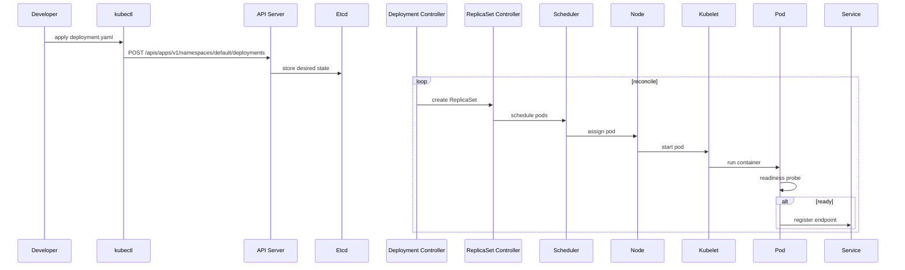

<!-- Generated by Groq via GitHub Actions -->
<!-- Topic ID: T186 -->
<!-- Category: DevOps / Infrastructure -->
<!-- Generated at UTC: 2026-11-07T18:10:14.693557+00:00 -->

# Kubernetes basics

## 1. What problem does this solve?

| Problem | Why it matters | Consequence of not using it | Real‑world appearance |
|---------|----------------|-----------------------------|-----------------------|
| **Manual scaling & deployment** | Developers must spin up VMs, copy binaries, configure networking, and monitor each instance. | Slow rollouts, inconsistent environments, human error, and hard-to‑reproduce bugs. | A monolithic Node.js service that must be manually restarted after every code change. |
| **Resource fragmentation** | VMs are over‑provisioned to handle peak traffic, wasting CPU & memory. | Higher cloud bill, underutilized hardware, poor performance under load. | A single EC2 instance running a Next.js app and a Redis cache. |
| **Fault isolation** | If one service crashes, it can bring down the whole stack. | Downtime, cascading failures, hard debugging. | A Python FastAPI microservice that crashes and kills the entire pod. |
| **Infrastructure drift** | Environments diverge over time (dev ≠ prod). | Bugs that only appear in production, hard to debug. | A Docker image built locally that behaves differently when deployed to a remote cluster. |
| **Observability & self‑healing** | No built‑in health checks or automatic restarts. | Manual intervention, lost uptime. | A service that never restarts after a crash. |

**Kubernetes** is a container orchestration platform that abstracts away the underlying nodes (VMs or bare metal) and provides declarative APIs for deploying, scaling, and managing containerized workloads. It solves the above problems by:

- **Declarative configuration**: You describe *what* you want (e.g., a deployment with 3 replicas), and Kubernetes figures out *how* to achieve it.
- **Automated scaling**: Horizontal Pod Autoscaler (HPA) adjusts replica counts based on CPU/memory or custom metrics.
- **Self‑healing**: Pods are automatically restarted or recreated if they fail.
- **Service discovery & load balancing**: Internal DNS and load balancers expose services without manual IPs.
- **Unified observability**: Liveness/readiness probes, logs, metrics, and events are collected centrally.

---

## 2. Mental model

### Analogy: A city’s traffic system

| Kubernetes component | City counterpart | What it does |
|-----------------------|------------------|--------------|
| **Node** | City block | Physical machine (VM or host) that runs containers. |
| **Pod** | Apartment unit | One or more tightly coupled containers that share a network namespace. |
| **Deployment** | Building plan | Declarative spec that tells the city how many apartments (pods) to build and how to update them. |
| **Service** | Street name | A stable address that routes traffic to the right apartments, even if they move. |
| **ReplicaSet** | Apartment occupancy list | Ensures a certain number of apartments are occupied at all times. |
| **Horizontal Pod Autoscaler** | Traffic lights | Adjusts the number of occupied apartments based on traffic flow. |
| **Namespace** | District | Logical grouping of resources, like a city district. |

### Engineering model

- **Control plane**: The brain (API server, scheduler, controller manager) that reads the desired state and reconciles it with the actual state.
- **Worker nodes**: The body (kubelet, container runtime) that runs the containers.
- **Pods**: The smallest deployable unit, always co‑located on the same node.
- **Controllers**: Reconcile loops that keep the cluster in sync (e.g., Deployment controller ensures the right number of pods).

---

## 3. Deep explanation

### Internals

1. **API Server** (`kube-apiserver`) – REST endpoint for all cluster operations.
2. **Scheduler** – Assigns pods to nodes based on resource requests and constraints.
3. **Controller Manager** – Runs controllers (Deployment, ReplicaSet, HPA, etc.) that watch the API server and act to reach desired state.
4. **etcd** – Distributed key‑value store holding cluster state.
5. **kubelet** – Runs on each node, ensures containers match the pod spec.
6. **Container Runtime** – Docker, containerd, CRI‑O, etc.

### Important terminology

- **Pod**: One or more containers sharing network namespace.
- **Deployment**: Declarative spec for a set of replicas; handles rolling updates.
- **ReplicaSet**: Guarantees a fixed number of pod replicas.
- **Service**: Stable virtual IP and DNS name; can be ClusterIP, NodePort, LoadBalancer, or ExternalName.
- **Ingress**: HTTP/HTTPS routing into the cluster.
- **Namespace**: Logical partition of cluster resources.
- **Label & Selector**: Key/value pairs for grouping and selecting resources.
- **Affinity/Anti‑Affinity**: Scheduling constraints.
- **Taints/Tolerations**: Node-level restrictions.

### Trade‑offs

| Feature | Pros | Cons |
|---------|------|------|
| **Pods can contain multiple containers** | Enables sidecar patterns (e.g., Envoy, Prometheus exporter). | More complex networking; harder to reason about failures. |
| **Declarative API** | Predictable, versioned, GitOps friendly. | Requires understanding of desired vs. actual state; misconfigurations can be hard to debug. |
| **Self‑healing** | High availability. | Over‑restarts can mask underlying bugs; need proper liveness probes. |
| **Service Mesh** | Fine‑grained traffic control. | Adds latency, complexity, and operational overhead. |

### Failure modes

- **Node failure**: Pods are rescheduled; if node is drained, pods may be evicted.
- **API server outage**: Controllers stop reconciling; cluster state diverges.
- **etcd corruption**: Cluster loses state; requires backup restore.
- **Resource starvation**: Pods can be evicted if node runs out of CPU/memory.
- **Misconfigured probes**: Pods restart unnecessarily, causing churn.

### Limitations

- **Stateful workloads**: Requires StatefulSets, persistent volumes; not as straightforward as stateless services.
- **Complex networking**: CNI plugins add overhead; not all features are supported by all providers.
- **Learning curve**: Requires understanding of many concepts (pods, controllers, CRDs).
- **Cost**: Running a control plane and worker nodes can be expensive; managed services (EKS, GKE, AKS) mitigate this.

### Where it fits

- **Microservices**: Each service runs in its own deployment; shared services (Redis, PostgreSQL) run in StatefulSets.
- **CI/CD pipelines**: Deployments triggered by GitOps tools (ArgoCD, Flux).
- **Observability stack**: Prometheus, Grafana, Loki, Jaeger deployed as separate pods.
- **AI backends**: GPU nodes, custom runtime, and autoscaling based on inference latency.

### Interaction with related concepts

- **Docker**: Container runtime; images built locally and pushed to registry.
- **PostgreSQL / MongoDB**: Run as StatefulSets with persistent volumes; use `StatefulSet` + `Headless Service`.
- **Redis**: Often deployed as a `Deployment` with `StatefulSet` for persistence or as a `DaemonSet` for local caching.
- **HTTP**: Services expose ports; Ingress controllers route external traffic.
- **Kafka**: Runs as a StatefulSet; each broker is a pod; uses persistent volumes.

---

## 4. How it works

### Step‑by‑step flow for a Deployment

1. **Developer writes a Deployment YAML** specifying image, replicas, and probes.
2. **kubectl apply** sends the YAML to the API server.
3. **API server** stores the desired state in etcd.
4. **Deployment controller** watches the Deployment, creates a ReplicaSet.
5. **ReplicaSet controller** ensures the desired number of pods exist.
6. **Scheduler** assigns each pod to a node based on resource requests.
7. **kubelet** on the node pulls the image and starts the container.
8. **Readiness probe** checks if the pod is ready; once ready, Service endpoints update.
9. **Traffic** from Ingress or Service reaches the pod.
10. **Health checks** continue; if a pod fails, the ReplicaSet recreates it.



---

## 5. Practical implementation

### 5.1. Deploy a simple Next.js API with a PostgreSQL backend

```bash
# 1. Create a Dockerfile for the Next.js API
cat <<'EOF' > Dockerfile
FROM node:20-alpine
WORKDIR /app
COPY package*.json ./
RUN npm ci
COPY . .
RUN npm run build
EXPOSE 3000
CMD ["npm", "start"]
EOF
```

```bash
# 2. Build and push the image
docker build -t myorg/next-api:latest .
docker push myorg/next-api:latest
```

```yaml
# 3. Deployment YAML (next-api-deployment.yaml)
apiVersion: apps/v1
kind: Deployment
metadata:
  name: next-api
spec:
  replicas: 3
  selector:
    matchLabels:
      app: next-api
  template:
    metadata:
      labels:
        app: next-api
    spec:
      containers:
      - name: next
        image: myorg/next-api:latest
        ports:
        - containerPort: 3000
        env:
        - name: DATABASE_URL
          valueFrom:
            secretKeyRef:
              name: postgres-secret
              key: url
        readinessProbe:
          httpGet:
            path: /health
            port: 3000
          initialDelaySeconds: 5
          periodSeconds: 10
```

```yaml
# 4. Service YAML (next-api-service.yaml)
apiVersion: v1
kind: Service
metadata:
  name: next-api
spec:
  selector:
    app: next-api
  ports:
  - protocol: TCP
    port: 80
    targetPort: 3000
  type: ClusterIP
```

```yaml
# 5. PostgreSQL StatefulSet (postgres.yaml)
apiVersion: apps/v1
kind: StatefulSet
metadata:
  name: postgres
spec:
  serviceName: "postgres"
  replicas: 1
  selector:
    matchLabels:
      app: postgres
  template:
    metadata:
      labels:
        app: postgres
    spec:
      containers:
      - name: postgres
        image: postgres:15
        env:
        - name: POSTGRES_PASSWORD
          valueFrom:
            secretKeyRef:
              name: postgres-secret
              key: password
        ports:
        - containerPort: 5432
        volumeMounts:
        - name: data
          mountPath: /var/lib/postgresql/data
  volumeClaimTemplates:
  - metadata:
      name: data
    spec:
      accessModes: [ "ReadWriteOnce" ]
      resources:
        requests:
          storage: 10Gi
```

```yaml
# 6. Headless Service for PostgreSQL (postgres-headless.yaml)
apiVersion: v1
kind: Service
metadata:
  name: postgres
spec:
  clusterIP: None
  selector:
    app: postgres
  ports:
  - port: 5432
    targetPort: 5432
```

```bash
# 7. Apply resources
kubectl apply -f postgres.yaml
kubectl apply -f postgres-headless.yaml
kubectl apply -f next-api-deployment.yaml
kubectl apply -f next-api-service.yaml
```

**Key lines explained**

- `readinessProbe`: ensures traffic only goes to healthy pods.
- `statefulset` + `volumeClaimTemplates`: persistent storage for PostgreSQL.
- `clusterIP: None`: headless service for stable DNS names for stateful pods.

---

## 6. Production considerations

| Concern | How Kubernetes addresses it | Practical tips |
|---------|------------------------------|----------------|
| **Scalability** | HPA, Cluster Autoscaler | Use custom metrics (e.g., request latency) for HPA; set min/max replicas. |
| **Reliability** | Self‑healing, pod disruption budgets | Define `maxUnavailable` in Deployment; use `PodDisruptionBudget`. |
| **Security** | RBAC, NetworkPolicies, Secrets | Least‑privilege service accounts; encrypt secrets; restrict egress. |
| **Observability** | Liveness/readiness probes, Prometheus, Loki | Expose metrics endpoints; use sidecar exporters. |
| **Performance** | Resource requests/limits, node affinity | Pin GPU nodes; set `cpu`/`memory` requests to avoid scheduling issues. |
| **Error handling** | Graceful shutdown, graceful termination signals | Handle SIGTERM in Node.js (`process.on('SIGTERM', ...)`). |
| **Resource usage** | Quotas, limits, autoscaling | Set namespace quotas; monitor CPU/memory usage. |
| **Operational concerns** | CI/CD, GitOps, backup | Use ArgoCD; backup etcd; use Velero for volume snapshots. |
| **Failure recovery** | Persistent volumes, StatefulSets | Use `volumeSnapshotClass` for PostgreSQL; enable `pgBackRest`. |
| **Deployment considerations** | Blue/Green, Canary, Rolling updates | Set `strategy: RollingUpdate` with `maxSurge`/`maxUnavailable`. |

---

## 7. Common mistakes

| Mistake | Why it’s problematic |
|---------|----------------------|
| **Running stateful services in Deployments** | No stable identity; data loss on pod reschedule. |
| **Ignoring resource requests/limits** | Pods may be evicted or starved; cluster becomes unstable. |
| **Using `hostNetwork: true` indiscriminately** | Breaks isolation; security risk. |
| **Not setting liveness probes** | Pods can stay in a crashed state without restart. |
| **Hard‑coding IPs or ports** | Fails when pods move; defeats service discovery. |
| **Over‑provisioning replicas** | Wastes resources; increases cost. |
| **Not using namespaces** | Hard to isolate dev/test/prod; risk of accidental cross‑environment changes. |
| **Skipping RBAC** | Exposes cluster to privilege escalation. |
| **Deploying without health checks** | Traffic can hit unhealthy pods, causing user errors. |
| **Using `kubectl apply` without versioning** | Drift between local and cluster manifests; hard to audit. |

---

## 8. Senior engineer perspective

### At scale

- **Architecture decisions**: Choose managed Kubernetes (EKS/GKE/AKS) vs. self‑managed; decide on multi‑cluster or single‑cluster with namespaces.
- **Trade‑offs**: Managed services reduce ops overhead but lock you into provider APIs; self‑managed gives more control but requires more expertise.
- **Bottlenecks**: API server latency, etcd performance, node capacity, network bandwidth.
- **Failure scenarios**: Cluster‑wide outage, node pool failure, storage loss; plan for disaster recovery.
- **Monitoring**: Use cluster‑level dashboards (Prometheus + Grafana), log aggregation (Loki), and tracing (Jaeger).
- **Cost/performance**: Use spot instances for stateless workloads; reserve instances for stateful services; enable autoscaling to match demand.
- **When NOT to use**: For very small, single‑service projects where Docker Compose suffices; for legacy monoliths that cannot be containerized easily.

---

## 9. Interview questions

| Level | Question | Answer points |
|-------|----------|---------------|
| **Beginner** | What is a Pod in Kubernetes? | Smallest deployable unit; one or more containers sharing network namespace; scheduled together. |
| | How does a Service expose a Pod? | Creates a stable virtual IP; DNS name; load balances across pod endpoints. |
| **Intermediate** | Explain the difference between Deployment and StatefulSet. | Deployment is stateless, uses ReplicaSet; StatefulSet provides stable network ID, persistent storage, ordered scaling. |
| | What is a Horizontal Pod Autoscaler and how does it work? | Monitors metrics (CPU, memory, custom); scales replica count up/down based on thresholds. |
| **Senior** | Describe how you would design a highly available PostgreSQL cluster on Kubernetes. | Use StatefulSet + PersistentVolumeClaim; use Patroni or Vitess; enable replication; use headless service; backup strategy. |
| | Scenario: A pod is stuck in `CrashLoopBackOff`. What steps would you take to debug? | Check logs (`kubectl logs`), describe pod (`kubectl describe pod`), inspect events, verify liveness/readiness probes, check resource limits, examine init containers, look at image pull errors. |

---

## 10. Hands‑on task

**Task**: Deploy a simple “Hello, World” FastAPI service that reads from Redis and expose metrics for Prometheus.

1. **Create a Dockerfile** for the FastAPI app.
2. **Write a Deployment** with 2 replicas, a readiness probe, and a `readinessProbe` that checks `/health`.
3. **Create a Service** exposing port 80.
4. **Add a ConfigMap** for Redis connection string.
5. **Deploy Prometheus** (via Helm) and configure it to scrape the FastAPI metrics endpoint.
6. **Verify** that the metrics appear in Grafana.

*Hints*: Use `uvicorn` with `--reload` disabled; expose `/metrics` via `prometheus_fastapi_instrumentator`.

---

## 11. Quick revision

- Kubernetes is a declarative, container orchestration platform.
- **Pods** are the smallest deployable unit; **Deployments** manage replicas.
- **Services** provide stable networking; **Ingress** routes external traffic.
- **StatefulSets** are for stateful workloads with persistent storage.
- **Horizontal Pod Autoscaler** scales based on metrics.
- **Readiness/Liveness probes** control traffic flow and self‑healing.
- **RBAC** secures cluster resources.
- **Namespaces** isolate environments.
- **Helm** simplifies package management.
- **Prometheus + Grafana** for observability.
- **Backup**: Velero for volumes; etcd snapshots.
- **Common pitfalls**: missing probes, over‑provisioning, no resource limits, hard‑coded IPs.

---

## 12. References

- https://kubernetes.io/docs/concepts/overview/what-is-kubernetes/
- https://kubernetes.io/docs/concepts/workloads/controllers/deployment/
- https://kubernetes.io/docs/concepts/workloads/controllers/statefulset/
- https://kubernetes.io/docs/tasks/configure-pod-container/configure-liveness-readiness-probes/
- https://kubernetes.io/docs/tasks/run-application/horizontal-pod-autoscale/
- https://kubernetes.io/docs/concepts/security/authorization/rbac/
- https://kubernetes.io/docs/concepts/cluster-administration/monitoring/
- https://kubernetes.io/docs/tasks/run-application/monitoring/
- https://kubernetes.io/docs/tasks/configure-pod-container/configure-pod-resources/
- https://kubernetes.io/docs/tasks/administer-cluster/cluster-logging/
- https://kubernetes.io/docs/tasks/administer-cluster/cluster-backup/
- https://helm.sh/docs/intro/quickstart/
- https://prometheus.io/docs/introduction/overview/
- https://grafana.com/docs/grafana/latest/installation/
